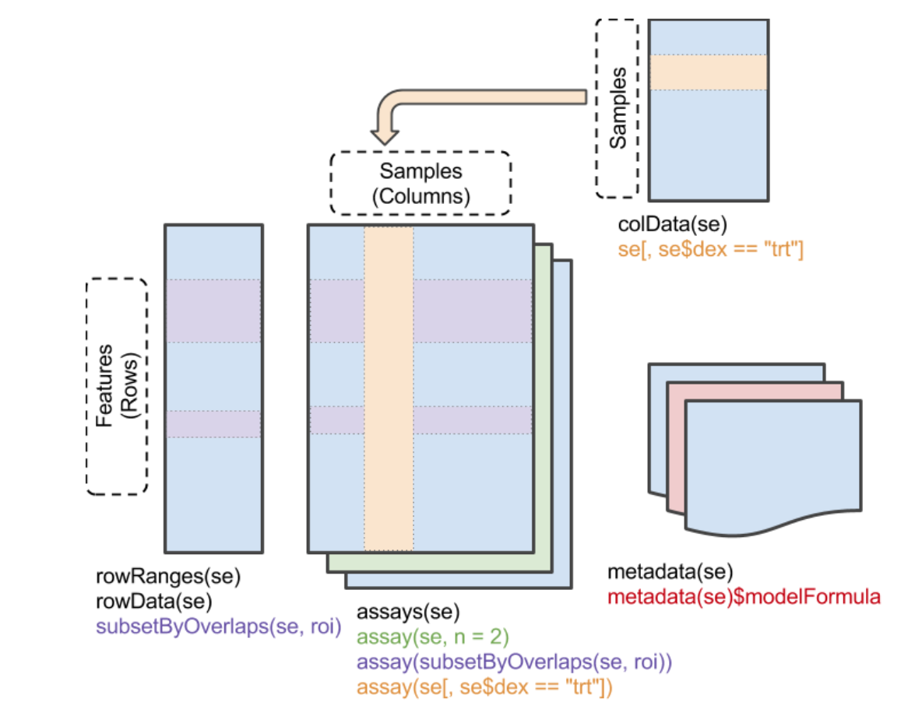
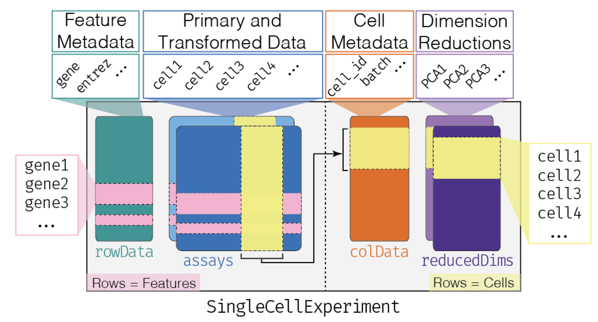
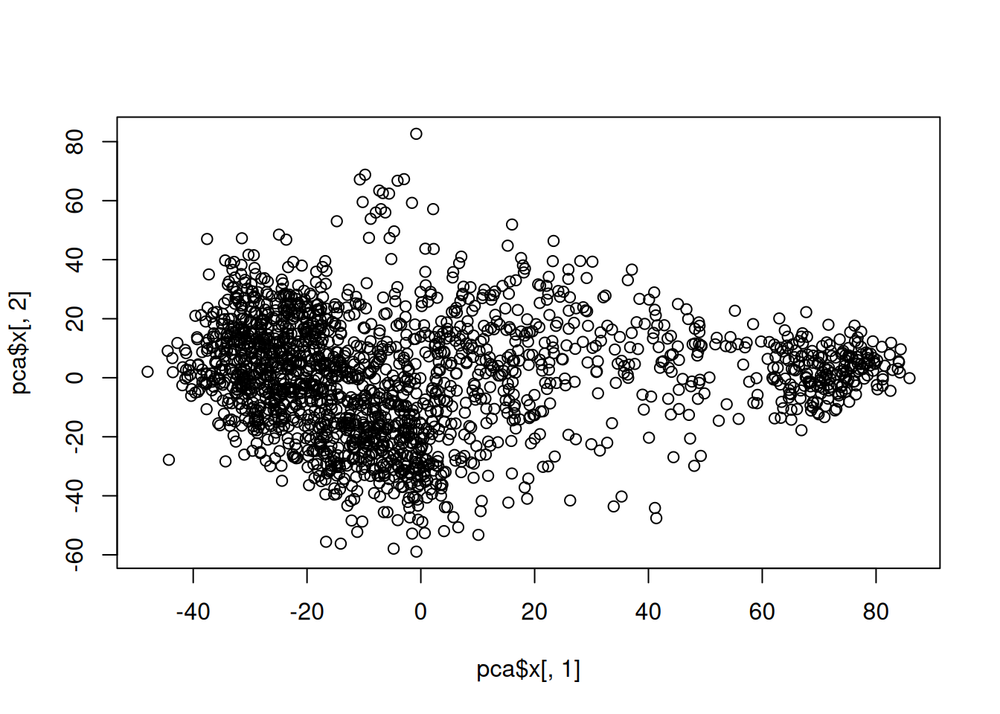
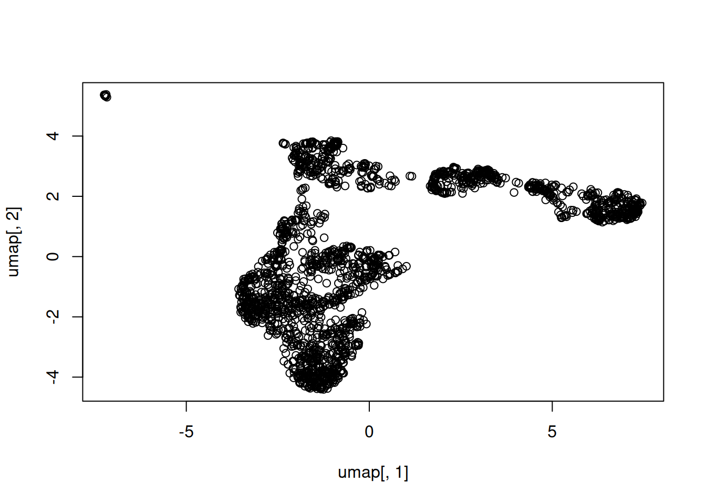

# 6  Lab 3: Introduction to R/Bioconductor

> **NOTE:**
>
> The estimated time for this lab is around 1h20.

> **TIP:**
>
> - Install and load `R` packages from different sources.
> - Understand the basic classes used in `R` and `Bioconductor`.
> - Load and manipulate single-cell RNA-seq data in `R` and `Bioconductor`.
> - Compare `Bioconductor` and `Seurat` approaches to scRNAseq data analysis.
> - Read scRNAseq data from local files.

## 6.1 Installing packages in `R`

> “Hey, I’ve heard so many good things about this piece of software, it’s called ‘slingshot’? Heard of it? I really want to try it out on my dataset!!”

Or, in other words: “how do I install this or that brand new cutting-edge fancy `package`?”

`R` works with `packages`, available from different sources:

- `CRAN`, the `R` developer team and official package provider: [CRAN](https://cran.r-project.org/).
- `Bioconductor`, another package provider, with a primary focus on genomic-related packages: [Bioconductor](https://www.bioconductor.org/).
- Other unofficial sources, such as `GitHub`.

Let’s start by going over package installation.

> **NOTE:**
>
> Install `mgcv`, `HCAData` and `revelio` packages. Each of these three packages is available from a different source:
>
> - `mgcv` is a `CRAN` package
> - `HCAData` is a `Bioconductor` package
> - `revelio` is a `GitHub` package
>
> > **NOTE:**
> >
> > [`BiocManager::install()`](https://bioconductor.github.io/BiocManager/reference/install.html) is the recommended way to install packages for a given version of `Bioconductor`: it installs packages from `Bioconductor`, from `CRAN`, and from `GitHub` (given a `"<user>/<repo>"` name), while making sure that all of them are compatible with each other.
> >
> > ``` r
> > install.packages('mgcv')
> > BiocManager::install('HCAData')
> > BiocManager::install('danielschw188/Revelio')
> > ```
> >
> > You can check which version of `Bioconductor` you are using, and whether any installed package is out-of-date or too recent for it:
> >
> > ``` r
> > BiocManager::version()
> > BiocManager::valid()
> > ```

> **TIP:**
>
> All the packages used in this workshop are already installed in your workshop session (and in the Docker image it is started from).

Package help pages are available at different places, depending on their source. That being said, there is a place I like to go to easily find information related to most packages:

<https://rdrr.io/>

For instance, check out `Revelio` package help pages.

- What is this package designed for?
- What are its main functions? What type of input does it require?

## 6.2 Basic `R` and `Bioconductor` classes

While `CRAN` is a repository of general-purpose packages, `Bioconductor` is the greatest source of analytical tools, data and workflows dedicated to genomic projects in `R`. [Read more about `Bioconductor`](https://www.bioconductor.org/about/) to fully understand how it builds up on top of `R` general features, especially with the specific classes it introduces.

The two main concepts behind `Bioconductor`’s success are the **non-redundant** classes of objects it provides and their **inter-operability**. [Huber et al., Nat. Methods 2015](https://www.nature.com/articles/nmeth.3252) summarizes it well.

### 6.2.1 Important R concepts:

#### 6.2.1.1 `tibble` tables:

`tibbles` are built on the fundamental `data.frame` objects. They follow “tidy” concepts, all gathered in a common [`tidyverse`](https://www.tidyverse.org/). This set of key concepts help general data investigation and data visualization through a set of associated packages such as `ggplot2`.

``` r
library(tidyverse)
##  ── Attaching core tidyverse packages ───────────────────── tidyverse 2.0.0 ──
##  ✔ dplyr     1.2.1     ✔ readr     2.2.0
##  ✔ forcats   1.0.1     ✔ stringr   1.6.0
##  ✔ ggplot2   4.0.3     ✔ tibble    3.3.1
##  ✔ lubridate 1.9.5     ✔ tidyr     1.3.2
##  ✔ purrr     1.2.2     
##  ── Conflicts ─────────────────────────────────────── tidyverse_conflicts() ──
##  ✖ dplyr::filter() masks stats::filter()
##  ✖ dplyr::lag()    masks stats::lag()
##  ℹ Use the conflicted package (<http://conflicted.r-lib.org/>) to force all conflicts to become errors
dat <- tibble(
    x = 1:5,
    y = 1,
    z = x ^ 2 + y,
    class = c('a', 'a', 'b', 'b', 'c')
)
dat
##  # A tibble: 5 × 4
##        x     y     z class
##    <int> <dbl> <dbl> <chr>
##  1     1     1     2 a    
##  2     2     1     5 a    
##  3     3     1    10 b    
##  4     4     1    17 b    
##  5     5     1    26 c
```

- **Import a text file into `tibbles`**

`tibbles` can be created from text files (or Excel files) using the `readr` package (part of `tidyverse`). We will read the list of genes quantified by `cellranger` in the `AXH009` sample from `Leir et al.` (see [Lab 1](../../pages/day1/Lab1_Intro.md)).

Rather than downloading the file by hand, we use `BiocFileCache`: it downloads a file the first time it is requested, stores it in a local cache, and simply returns the path to the cached copy afterwards.

``` r
library(BiocFileCache)
##  Loading required package: dbplyr
##  
##  Attaching package: 'dbplyr'
##  The following objects are masked from 'package:dplyr':
##  
##      ident, sql, sql_escape_ident, sql_escape_string
##  OpenTelemetry error: there is no package called 'otelsdk'
##  OpenTelemetry error: there is no package called 'otelsdk'
bfc <- BiocFileCache(ask = FALSE)
genes_file <- bfcrpath(bfc, "https://ftp.ncbi.nlm.nih.gov/geo/samples/GSM4486nnn/GSM4486714/suppl/GSM4486714_AXH009_genes.tsv.gz")
##  adding rname 'https://ftp.ncbi.nlm.nih.gov/geo/samples/GSM4486nnn/GSM4486714/suppl/GSM4486714_AXH009_genes.tsv.gz'
genes_file
##                                                                      BFC1 
##  "/opt/R-cache/R/BiocFileCache/1c57afcb9a_GSM4486714_AXH009_genes.tsv.gz"
genes <- read_tsv(genes_file, col_names = c('ID', 'Symbol'))
##  Rows: 32738 Columns: 2
##  ── Column specification ─────────────────────────────────────────────────────
##  Delimiter: "\t"
##  chr (2): ID, Symbol
##  
##  ℹ Use `spec()` to retrieve the full column specification for this data.
##  ℹ Specify the column types or set `show_col_types = FALSE` to quiet this message.
genes
##  # A tibble: 32,738 × 2
##    ID              Symbol      
##    <chr>           <chr>       
##  1 ENSG00000243485 MIR1302-10  
##  2 ENSG00000237613 FAM138A     
##  3 ENSG00000186092 OR4F5       
##  4 ENSG00000238009 RP11-34P13.7
##  5 ENSG00000239945 RP11-34P13.8
##  6 ENSG00000237683 AL627309.1  
##  # ℹ 32,732 more rows
```

#### 6.2.1.2 Handling of `tibbles`:

`tibbles` can be readily “sliced” (i.e. selecting rows by number/name), “filtered” (i.e. selecting rows by condition) and columns can be “selected”. All these operations are performed using *verbs* (most of them provided by the `dplyr` package, part of `tidyverse`).

``` r
slice(genes, 1:4)
##  # A tibble: 4 × 2
##    ID              Symbol      
##    <chr>           <chr>       
##  1 ENSG00000243485 MIR1302-10  
##  2 ENSG00000237613 FAM138A     
##  3 ENSG00000186092 OR4F5       
##  4 ENSG00000238009 RP11-34P13.7
filter(genes, Symbol == 'CFTR')
##  # A tibble: 1 × 2
##    ID              Symbol
##    <chr>           <chr> 
##  1 ENSG00000001626 CFTR
filter(genes, grepl('^CCDC.*', Symbol))
##  # A tibble: 159 × 2
##    ID              Symbol  
##    <chr>           <chr>   
##  1 ENSG00000162592 CCDC27  
##  2 ENSG00000160050 CCDC28B 
##  3 ENSG00000186409 CCDC30  
##  4 ENSG00000177868 CCDC23  
##  5 ENSG00000159214 CCDC24  
##  6 ENSG00000236624 CCDC163P
##  # ℹ 153 more rows
filter(genes, grepl('^CCDC.*', Symbol), grepl('.*5$', Symbol))
##  # A tibble: 9 × 2
##    ID              Symbol 
##    <chr>           <chr>  
##  1 ENSG00000136710 CCDC115
##  2 ENSG00000183323 CCDC125
##  3 ENSG00000147419 CCDC25 
##  4 ENSG00000149548 CCDC15 
##  5 ENSG00000139537 CCDC65 
##  6 ENSG00000151838 CCDC175
##  # ℹ 3 more rows
select(genes, 1)
##  # A tibble: 32,738 × 1
##    ID             
##    <chr>          
##  1 ENSG00000243485
##  2 ENSG00000237613
##  3 ENSG00000186092
##  4 ENSG00000238009
##  5 ENSG00000239945
##  6 ENSG00000237683
##  # ℹ 32,732 more rows
select(genes, ID)
##  # A tibble: 32,738 × 1
##    ID             
##    <chr>          
##  1 ENSG00000243485
##  2 ENSG00000237613
##  3 ENSG00000186092
##  4 ENSG00000238009
##  5 ENSG00000239945
##  6 ENSG00000237683
##  # ℹ 32,732 more rows
select(genes, matches('Sym.*'))
##  # A tibble: 32,738 × 1
##    Symbol      
##    <chr>       
##  1 MIR1302-10  
##  2 FAM138A     
##  3 OR4F5       
##  4 RP11-34P13.7
##  5 RP11-34P13.8
##  6 AL627309.1  
##  # ℹ 32,732 more rows
```

Columns can also be quickly added/modified using the `mutate` verb.

``` r
mutate(genes, chr = sample(1:22, n(), replace = TRUE))
##  # A tibble: 32,738 × 3
##    ID              Symbol         chr
##    <chr>           <chr>        <int>
##  1 ENSG00000243485 MIR1302-10      21
##  2 ENSG00000237613 FAM138A          7
##  3 ENSG00000186092 OR4F5           16
##  4 ENSG00000238009 RP11-34P13.7     5
##  5 ENSG00000239945 RP11-34P13.8     1
##  6 ENSG00000237683 AL627309.1      11
##  # ℹ 32,732 more rows
```

#### 6.2.1.3 `|>` pipe:

Actions on `tibbles` can be piped as a chain with `|>`, just like `|` pipes `stdout` as the `stdin` of the next command in `bash`. In this case, the first argument is always the output of the previous function and is ommited. Because `tidyverse` functions generally return a modified version of the input, pipping works remarkably well in such context.

``` r
read_tsv(genes_file, col_names = c('ID', 'Symbol')) |>
    mutate(chr = sample(1:22, n(), replace = TRUE)) |>
    filter(chr == 2, grepl('^CCDC.*', Symbol)) |>
    select(ID) |>
    slice_head(n = 3)
##  Rows: 32738 Columns: 2
##  ── Column specification ─────────────────────────────────────────────────────
##  Delimiter: "\t"
##  chr (2): ID, Symbol
##  
##  ℹ Use `spec()` to retrieve the full column specification for this data.
##  ℹ Specify the column types or set `show_col_types = FALSE` to quiet this message.
##  # A tibble: 3 × 1
##    ID             
##    <chr>          
##  1 ENSG00000213085
##  2 ENSG00000173013
##  3 ENSG00000203952
```

### 6.2.2 Important Bioconductor concepts:

#### 6.2.2.1 `SummarizedExperiment` class:

The most fundamental class used to hold the content of large-scale quantitative analyses, such as counts of RNA-seq experiments, or high-throughput cytometry experiments or proteomics experiments.



Make sure you understand the structure of objects from this class. A dedicated workshop that I would recommend quickly going over is available [here](https://www.bioconductor.org/help/course-materials/2019/BSS2019/04_Practical_CoreApproachesInBioconductor.html). Generally speaking, a `SummarizedExperiment` object contains matrix-like objects (the `assays`), with rows representing features (e.g. genes, transcripts, …) and each column representing a sample. Information specific to genes and samples are stored in “parallel” data frames, for example to store gene locations, tissue of expression, biotypes (for genes) or batch, generation date, or machine ID (for samples). On top of that, metadata are also stored in the object (to store description of a project, …).

An important difference with S3 `list`-like objects usually used in `R` is that most of the underlying data (organized in precisely structured `"slots"`) is accessed using `getter` functions, rather than the familiar `$` or `[`. Here are some important `getters`:

- [`assay()`](https://rdrr.io/pkg/SummarizedExperiment/man/SummarizedExperiment-class.html), [`assays()`](https://rdrr.io/pkg/SummarizedExperiment/man/SummarizedExperiment-class.html): Extract matrix-like or list of matrix-like objects of identical dimensions. Since the objects are `matrix`-like, [`dim()`](https://rdrr.io/r/base/dim.html), [`dimnames()`](https://rdrr.io/r/base/dimnames.html), and 2-dimensional `[`, `[<-` methods are available.
- [`colData()`](https://rdrr.io/pkg/SummarizedExperiment/man/SummarizedExperiment-class.html): Annotations on each column (as a DataFrame): usually, description of each sample
- [`rowData()`](https://rdrr.io/pkg/SummarizedExperiment/man/SummarizedExperiment-class.html): Annotations on each row (as a DataFrame): usually, description of each gene
- [`metadata()`](https://rdrr.io/pkg/S4Vectors/man/Annotated-class.html): List of unstructured metadata describing the overall content of the object.

Let’s dig into an example, with the `airway` dataset (provided by the `airway` package from `Bioconductor`).

``` r
library(SummarizedExperiment)
##  Loading required package: MatrixGenerics
##  Loading required package: matrixStats
##  
##  Attaching package: 'matrixStats'
##  The following object is masked from 'package:dplyr':
##  
##      count
##  
##  Attaching package: 'MatrixGenerics'
##  The following objects are masked from 'package:matrixStats':
##  
##      colAlls, colAnyNAs, colAnys, colAvgsPerRowSet, colCollapse,
##      colCounts, colCummaxs, colCummins, colCumprods, colCumsums,
##      colDiffs, colIQRDiffs, colIQRs, colLogSumExps, colMadDiffs,
##      colMads, colMaxs, colMeans2, colMedians, colMins, colOrderStats,
##      colProds, colQuantiles, colRanges, colRanks, colSdDiffs, colSds,
##      colSums2, colTabulates, colVarDiffs, colVars, colWeightedMads,
##      colWeightedMeans, colWeightedMedians, colWeightedSds,
##      colWeightedVars, rowAlls, rowAnyNAs, rowAnys, rowAvgsPerColSet,
##      rowCollapse, rowCounts, rowCummaxs, rowCummins, rowCumprods,
##      rowCumsums, rowDiffs, rowIQRDiffs, rowIQRs, rowLogSumExps,
##      rowMadDiffs, rowMads, rowMaxs, rowMeans2, rowMedians, rowMins,
##      rowOrderStats, rowProds, rowQuantiles, rowRanges, rowRanks,
##      rowSdDiffs, rowSds, rowSums2, rowTabulates, rowVarDiffs,
##      rowVars, rowWeightedMads, rowWeightedMeans, rowWeightedMedians,
##      rowWeightedSds, rowWeightedVars
##  Loading required package: GenomicRanges
##  Loading required package: stats4
##  Loading required package: BiocGenerics
##  Loading required package: generics
##  
##  Attaching package: 'generics'
##  The following object is masked from 'package:lubridate':
##  
##      as.difftime
##  The following object is masked from 'package:dplyr':
##  
##      explain
##  The following objects are masked from 'package:base':
##  
##      as.difftime, as.factor, as.ordered, intersect, is.element,
##      setdiff, setequal, union
##  
##  Attaching package: 'BiocGenerics'
##  The following object is masked from 'package:dplyr':
##  
##      combine
##  The following objects are masked from 'package:stats':
##  
##      IQR, mad, sd, var, xtabs
##  The following object is masked from 'package:utils':
##  
##      data
##  The following objects are masked from 'package:base':
##  
##      Filter, Find, Map, Position, Reduce, anyDuplicated, aperm,
##      append, as.data.frame, basename, cbind, colnames, dirname,
##      do.call, duplicated, eval, evalq, get, grep, grepl, is.unsorted,
##      lapply, mapply, match, mget, order, paste, pmax, pmax.int, pmin,
##      pmin.int, rank, rbind, rownames, sapply, saveRDS, scale,
##      sequence, table, tapply, transform, unique, unsplit, which.max,
##      which.min
##  Loading required package: S4Vectors
##  
##  Attaching package: 'S4Vectors'
##  The following objects are masked from 'package:lubridate':
##  
##      second, second<-
##  The following objects are masked from 'package:dplyr':
##  
##      first, rename
##  The following object is masked from 'package:tidyr':
##  
##      expand
##  The following object is masked from 'package:utils':
##  
##      findMatches
##  The following objects are masked from 'package:base':
##  
##      I, expand.grid, unname
##  Loading required package: IRanges
##  
##  Attaching package: 'IRanges'
##  The following object is masked from 'package:lubridate':
##  
##      %within%
##  The following objects are masked from 'package:dplyr':
##  
##      collapse, desc, slice
##  The following object is masked from 'package:purrr':
##  
##      reduce
##  Loading required package: Seqinfo
##  Loading required package: Biobase
##  Welcome to Bioconductor
##  
##      Vignettes contain introductory material; view with
##      'browseVignettes()'. To cite Bioconductor, see
##      'citation("Biobase")', and for packages 'citation("pkgname")'.
##  
##  Attaching package: 'Biobase'
##  The following object is masked from 'package:MatrixGenerics':
##  
##      rowMedians
##  The following objects are masked from 'package:matrixStats':
##  
##      anyMissing, rowMedians
library(airway)
data(airway)
airway
##  class: RangedSummarizedExperiment 
##  dim: 63677 8 
##  metadata(1): ''
##  assays(1): counts
##  rownames(63677): ENSG00000000003 ENSG00000000005 ... ENSG00000273492
##    ENSG00000273493
##  rowData names(10): gene_id gene_name ... seq_coord_system symbol
##  colnames(8): SRR1039508 SRR1039509 ... SRR1039520 SRR1039521
##  colData names(9): SampleName cell ... Sample BioSample
```

> **NOTE:**
>
> What are the dimensions of the dataset? What type of quantitative data is stored? Which features are assessed?
>
> > **NOTE:**
> >
> > ``` r
> > dim(airway)
> > ##  [1] 63677     8
> > rowData(airway)
> > ##  DataFrame with 63677 rows and 10 columns
> > ##                          gene_id     gene_name  entrezid   gene_biotype
> > ##                      <character>   <character> <integer>    <character>
> > ##  ENSG00000000003 ENSG00000000003        TSPAN6        NA protein_coding
> > ##  ENSG00000000005 ENSG00000000005          TNMD        NA protein_coding
> > ##  ENSG00000000419 ENSG00000000419          DPM1        NA protein_coding
> > ##  ENSG00000000457 ENSG00000000457         SCYL3        NA protein_coding
> > ##  ENSG00000000460 ENSG00000000460      C1orf112        NA protein_coding
> > ##  ...                         ...           ...       ...            ...
> > ##  ENSG00000273489 ENSG00000273489 RP11-180C16.1        NA      antisense
> > ##  ENSG00000273490 ENSG00000273490        TSEN34        NA protein_coding
> > ##  ENSG00000273491 ENSG00000273491  RP11-138A9.2        NA        lincRNA
> > ##  ENSG00000273492 ENSG00000273492    AP000230.1        NA        lincRNA
> > ##  ENSG00000273493 ENSG00000273493  RP11-80H18.4        NA        lincRNA
> > ##                  gene_seq_start gene_seq_end              seq_name seq_strand
> > ##                       <integer>    <integer>           <character>  <integer>
> > ##  ENSG00000000003       99883667     99894988                     X         -1
> > ##  ENSG00000000005       99839799     99854882                     X          1
> > ##  ENSG00000000419       49551404     49575092                    20         -1
> > ##  ENSG00000000457      169818772    169863408                     1         -1
> > ##  ENSG00000000460      169631245    169823221                     1          1
> > ##  ...                        ...          ...                   ...        ...
> > ##  ENSG00000273489      131178723    131182453                     7         -1
> > ##  ENSG00000273490       54693789     54697585 HSCHR19LRC_LRC_J_CTG1          1
> > ##  ENSG00000273491      130600118    130603315          HG1308_PATCH          1
> > ##  ENSG00000273492       27543189     27589700                    21          1
> > ##  ENSG00000273493       58315692     58315845                     3          1
> > ##                  seq_coord_system        symbol
> > ##                         <integer>   <character>
> > ##  ENSG00000000003               NA        TSPAN6
> > ##  ENSG00000000005               NA          TNMD
> > ##  ENSG00000000419               NA          DPM1
> > ##  ENSG00000000457               NA         SCYL3
> > ##  ENSG00000000460               NA      C1orf112
> > ##  ...                          ...           ...
> > ##  ENSG00000273489               NA RP11-180C16.1
> > ##  ENSG00000273490               NA        TSEN34
> > ##  ENSG00000273491               NA  RP11-138A9.2
> > ##  ENSG00000273492               NA    AP000230.1
> > ##  ENSG00000273493               NA  RP11-80H18.4
> > colData(airway)
> > ##  DataFrame with 8 rows and 9 columns
> > ##             SampleName     cell      dex    albut        Run avgLength
> > ##               <factor> <factor> <factor> <factor>   <factor> <integer>
> > ##  SRR1039508 GSM1275862  N61311     untrt    untrt SRR1039508       126
> > ##  SRR1039509 GSM1275863  N61311     trt      untrt SRR1039509       126
> > ##  SRR1039512 GSM1275866  N052611    untrt    untrt SRR1039512       126
> > ##  SRR1039513 GSM1275867  N052611    trt      untrt SRR1039513        87
> > ##  SRR1039516 GSM1275870  N080611    untrt    untrt SRR1039516       120
> > ##  SRR1039517 GSM1275871  N080611    trt      untrt SRR1039517       126
> > ##  SRR1039520 GSM1275874  N061011    untrt    untrt SRR1039520       101
> > ##  SRR1039521 GSM1275875  N061011    trt      untrt SRR1039521        98
> > ##             Experiment    Sample    BioSample
> > ##               <factor>  <factor>     <factor>
> > ##  SRR1039508  SRX384345 SRS508568 SAMN02422669
> > ##  SRR1039509  SRX384346 SRS508567 SAMN02422675
> > ##  SRR1039512  SRX384349 SRS508571 SAMN02422678
> > ##  SRR1039513  SRX384350 SRS508572 SAMN02422670
> > ##  SRR1039516  SRX384353 SRS508575 SAMN02422682
> > ##  SRR1039517  SRX384354 SRS508576 SAMN02422673
> > ##  SRR1039520  SRX384357 SRS508579 SAMN02422683
> > ##  SRR1039521  SRX384358 SRS508580 SAMN02422677
> > ```

> **NOTE:**
>
> Can you create a subset of the data corresponding to `LRG` genes in untreated samples?
>
> > **NOTE:**
> >
> > ``` r
> > untreated_LRG <- airway[grepl('^LRG_', rownames(airway)), airway$dex == 'untrt']
> > untreated_LRG
> > ##  class: RangedSummarizedExperiment 
> > ##  dim: 0 4 
> > ##  metadata(1): ''
> > ##  assays(1): counts
> > ##  rownames(0):
> > ##  rowData names(10): gene_id gene_name ... seq_coord_system symbol
> > ##  colnames(4): SRR1039508 SRR1039512 SRR1039516 SRR1039520
> > ##  colData names(9): SampleName cell ... Sample BioSample
> > ```

#### 6.2.2.2 `GenomicRanges` class (a.k.a. `GRanges`):

`GenomicRanges` are a type of `IntervalRanges`, they are useful to describe genomic intervals. Each entry in a `GRanges` object has a [`seqnames()`](https://rdrr.io/pkg/Seqinfo/man/seqinfo.html), a [`start()`](https://rdrr.io/r/stats/start.html) and an [`end()`](https://rdrr.io/r/stats/start.html) coordinates, a [`strand()`](https://rdrr.io/pkg/BiocGenerics/man/strand.html), as well as associated metadata ([`mcols()`](https://rdrr.io/pkg/S4Vectors/man/Vector-class.html)). They can be built from scratch using `tibbles` converted with [`makeGRangesFromDataFrame()`](https://rdrr.io/pkg/GenomicRanges/man/makeGRangesFromDataFrame.html).

``` r
library(GenomicRanges)
gr <- read_tsv(genes_file, col_names = c('ID', 'Symbol')) |>
    mutate(
        chr = sample(1:22, n(), replace = TRUE),
        start = sample(1:1000, n(), replace = TRUE),
        end = sample(10000:20000, n(), replace = TRUE),
        strand = sample(c('-', '+'), n(), replace = TRUE)
    ) |>
    makeGRangesFromDataFrame(keep.extra.columns = TRUE)
##  Rows: 32738 Columns: 2
##  ── Column specification ─────────────────────────────────────────────────────
##  Delimiter: "\t"
##  chr (2): ID, Symbol
##  
##  ℹ Use `spec()` to retrieve the full column specification for this data.
##  ℹ Specify the column types or set `show_col_types = FALSE` to quiet this message.
gr
##  GRanges object with 32738 ranges and 2 metadata columns:
##            seqnames    ranges strand |              ID       Symbol
##               <Rle> <IRanges>  <Rle> |     <character>  <character>
##        [1]       15 168-17232      - | ENSG00000243485   MIR1302-10
##        [2]        9  49-18896      - | ENSG00000237613      FAM138A
##        [3]       16 912-17497      + | ENSG00000186092        OR4F5
##        [4]        6 694-14108      - | ENSG00000238009 RP11-34P13.7
##        [5]       12  16-18555      - | ENSG00000239945 RP11-34P13.8
##        ...      ...       ...    ... .             ...          ...
##    [32734]        2 860-16653      - | ENSG00000215635   AC145205.1
##    [32735]        4 719-12086      - | ENSG00000268590        BAGE5
##    [32736]        3 463-14349      + | ENSG00000251180   CU459201.1
##    [32737]       11 877-11338      - | ENSG00000215616   AC002321.2
##    [32738]       21 311-18800      + | ENSG00000215611   AC002321.1
##    -------
##    seqinfo: 22 sequences from an unspecified genome; no seqlengths
mcols(gr)
##  DataFrame with 32738 rows and 2 columns
##                     ID       Symbol
##            <character>  <character>
##  1     ENSG00000243485   MIR1302-10
##  2     ENSG00000237613      FAM138A
##  3     ENSG00000186092        OR4F5
##  4     ENSG00000238009 RP11-34P13.7
##  5     ENSG00000239945 RP11-34P13.8
##  ...               ...          ...
##  32734 ENSG00000215635   AC145205.1
##  32735 ENSG00000268590        BAGE5
##  32736 ENSG00000251180   CU459201.1
##  32737 ENSG00000215616   AC002321.2
##  32738 ENSG00000215611   AC002321.1
```

Just like `tidyverse` in R, `tidy` functions are provided for `GRanges` by the `plyranges` package.

``` r
library(plyranges)
##  
##  Attaching package: 'plyranges'
##  The following objects are masked from 'package:dplyr':
##  
##      between, n, n_distinct
gr |>
    filter(start < 400, end > 12000, end < 15000) |>
    seqnames() |>
    table()
##    1   2   3   4   5   6   7   8   9  10  11  12  13  14  15  16  17  18  19 
##  165 188 193 158 153 177 169 152 170 179 161 157 172 185 170 173 200 195 164 
##   20  21  22 
##  211 148 184
```

> **NOTE:**
>
> Can you find a way to easily read common input files such as `bed` files into `GRanges`? Try it on the list of accessible chromatin regions (*peaks*) identified by 10x Genomics in a single-cell ATAC-seq experiment of human PBMCs (which we will analyse in [Lab 7](../../pages/day4/Lab7_atac-seq.md)): `https://cf.10xgenomics.com/samples/cell-atac/1.0.1/atac_v1_pbmc_10k/atac_v1_pbmc_10k_peaks.bed`.
>
> > **NOTE:**
> >
> > ``` r
> > library(rtracklayer)
> > peaks_file <- file.path(tempdir(), "atac_v1_pbmc_10k_peaks.bed")
> > download.file(
> >     "https://cf.10xgenomics.com/samples/cell-atac/1.0.1/atac_v1_pbmc_10k/atac_v1_pbmc_10k_peaks.bed",
> >     destfile = peaks_file
> > )
> > peaks <- import(peaks_file)
> > peaks
> > ##  GRanges object with 89796 ranges and 0 metadata columns:
> > ##            seqnames            ranges strand
> > ##               <Rle>         <IRanges>  <Rle>
> > ##        [1]     chr1     565108-565550      *
> > ##        [2]     chr1     569175-569639      *
> > ##        [3]     chr1     713461-714823      *
> > ##        [4]     chr1     752423-753038      *
> > ##        [5]     chr1     762107-763359      *
> > ##        ...      ...               ...    ...
> > ##    [89792]     chrY 58993393-58993760      *
> > ##    [89793]     chrY 58994572-58994823      *
> > ##    [89794]     chrY 58996353-58997331      *
> > ##    [89795]     chrY 59001783-59002175      *
> > ##    [89796]     chrY 59017144-59017246      *
> > ##    -------
> > ##    seqinfo: 24 sequences from an unspecified genome; no seqlengths
> > ```

> **NOTE:**
>
> How would you have proceeded without `rtracklayer`? Check the `start` coordinates: what do you see? Comment on the interest of using `Bioconductor`.
>
> > **NOTE:**
> >
> > ``` r
> > peaks_manual <- read_tsv(peaks_file, col_names = c('chr', 'start', 'end')) |>
> >     makeGRangesFromDataFrame()
> > ##  Rows: 89796 Columns: 3
> > ##  ── Column specification ─────────────────────────────────────────────────────
> > ##  Delimiter: "\t"
> > ##  chr (1): chr
> > ##  dbl (2): start, end
> > ##  
> > ##  ℹ Use `spec()` to retrieve the full column specification for this data.
> > ##  ℹ Specify the column types or set `show_col_types = FALSE` to quiet this message.
> > peaks_manual
> > ##  GRanges object with 89796 ranges and 0 metadata columns:
> > ##            seqnames            ranges strand
> > ##               <Rle>         <IRanges>  <Rle>
> > ##        [1]     chr1     565107-565550      *
> > ##        [2]     chr1     569174-569639      *
> > ##        [3]     chr1     713460-714823      *
> > ##        [4]     chr1     752422-753038      *
> > ##        [5]     chr1     762106-763359      *
> > ##        ...      ...               ...    ...
> > ##    [89792]     chrY 58993392-58993760      *
> > ##    [89793]     chrY 58994571-58994823      *
> > ##    [89794]     chrY 58996352-58997331      *
> > ##    [89795]     chrY 59001782-59002175      *
> > ##    [89796]     chrY 59017143-59017246      *
> > ##    -------
> > ##    seqinfo: 24 sequences from an unspecified genome; no seqlengths
> > head(start(peaks))
> > ##  [1] 565108 569175 713461 752423 762107 779590
> > head(start(peaks_manual))
> > ##  [1] 565107 569174 713460 752422 762106 779589
> > ```
> >
> > `bed` files use 0-based, half-open coordinates, whereas `GRanges` (like most of `Bioconductor`) use 1-based, closed coordinates: `rtracklayer::import()` takes care of the conversion for us.

## 6.3 CRAN & Bioconductor approaches to scRNAseq

### 6.3.1 scRNAseq in Bioconductor

For single-cell RNA-seq projects, `Bioconductor` has been introducting new classes and standards very rapidly in the past few years. Notably, several packages are increasingly becoming central for single-cell analysis:

- **`SingleCellExperiment`**
- `scrapper`
- `scater`
- `scran`
- `scuttle`
- `bluster`
- `batchelor`
- `SingleR`
- `DropletUtils`
- `slingshot`
- `tradeSeq`
- …

**`SingleCellExperiment`** is the fundamental class designed to contain single-cell (RNA-seq) data in `Bioconductor` ecosystem. It is a modified version of the `SummarizedExperiment` object, so most of the getters/setters are shared with this class.



Let’s load a dataset of mouse haematopoietic stem and progenitor cells (`Nestorowa et al., Blood 2016`, doi: 10.1182/blood-2016-05-716480), distributed by the `scRNAseq` package, and normalize its counts.

``` r
library(SingleCellExperiment)
sce <- scRNAseq::fetchDataset("nestorowa-hsc-2016", "2024-04-18")

## Load the counts in memory, as a sparse matrix
counts(sce) <- as(counts(sce), "dgCMatrix")

## Compute normalized counts (more on this in the next labs!),
## and store them as a sparse matrix too
sce <- scrapper::normalizeRnaCounts.se(sce, more.norm.args = list(delayed = FALSE))
sce$label <- sce$broad
sce
##  class: SingleCellExperiment 
##  dim: 46078 1920 
##  metadata(0):
##  assays(2): counts logcounts
##  rownames(46078): ENSMUSG00000000001 ENSMUSG00000000003 ...
##    ENSMUSG00000107391 ENSMUSG00000107392
##  rowData names(0):
##  colnames(1920): HSPC_007 HSPC_013 ... Prog_852 Prog_810
##  colData names(11): gate broad ... sizeFactor label
##  reducedDimNames(1): diffusion
##  mainExpName: endogenous
##  altExpNames(2): ERCC FACS
class(sce)
##  [1] "SingleCellExperiment"
##  attr(,"package")
##  [1] "SingleCellExperiment"
```

Several slots can be accessed in a **`SingleCellExperiment`** object, just like the `SummarizedExperiment` object it’s been adapted from:

``` r
colData(sce)
##  DataFrame with 1920 rows and 11 columns
##                  gate       broad   broad.mpp        fine    fine.mpp
##           <character> <character> <character> <character> <character>
##  HSPC_007        HSPC          NA          NA          NA          NA
##  HSPC_013        HSPC        LMPP          NA        LMPP          NA
##  HSPC_019        HSPC        LMPP          NA          NA          NA
##  HSPC_025        HSPC         MPP        MPP1          NA          NA
##  HSPC_031        HSPC         MPP       STHSC          NA          NA
##  ...              ...         ...         ...         ...         ...
##  Prog_834        Prog         CMP          NA          NA          NA
##  Prog_840        Prog         GMP          NA         GMP          NA
##  Prog_846        Prog         GMP          NA          NA          NA
##  Prog_852        Prog         MEP          NA         MEP          NA
##  Prog_810        Prog         CMP          NA         CMP          NA
##               ESLAM      HSC1 projected             metrics sizeFactor
##           <logical> <logical> <logical>         <DataFrame>  <numeric>
##  HSPC_007     FALSE     FALSE     FALSE 194829:  5022:0:...  0.0274355
##  HSPC_013     FALSE     FALSE     FALSE 110530: 15271:0:...  0.0902610
##  HSPC_019     FALSE     FALSE     FALSE  86825:  2708:0:...  0.0199822
##  HSPC_025     FALSE     FALSE     FALSE 212206:107278:0:...  0.5199231
##  HSPC_031     FALSE     FALSE     FALSE 690411:227480:0:...  1.1041905
##  ...            ...       ...       ...                 ...        ...
##  Prog_834     FALSE     FALSE     FALSE 471273:296060:0:...   1.662472
##  Prog_840     FALSE     FALSE     FALSE 421195:317394:0:...   1.722307
##  Prog_846     FALSE     FALSE     FALSE 337564:253387:0:...   1.278245
##  Prog_852     FALSE     FALSE     FALSE 200193:136478:0:...   0.640825
##  Prog_810     FALSE     FALSE     FALSE 857257:396247:0:...   2.605001
##                 label
##           <character>
##  HSPC_007          NA
##  HSPC_013        LMPP
##  HSPC_019        LMPP
##  HSPC_025         MPP
##  HSPC_031         MPP
##  ...              ...
##  Prog_834         CMP
##  Prog_840         GMP
##  Prog_846         GMP
##  Prog_852         MEP
##  Prog_810         CMP
rowData(sce)
##  DataFrame with 46078 rows and 0 columns
metadata(sce)
##  list()
dim(sce)
##  [1] 46078  1920
assays(sce)
##  List of length 2
##  names(2): counts logcounts
```

Quantitative metrics for scRNAseq studies can also be stored in `assays`:

``` r
assays(sce)
##  List of length 2
##  names(2): counts logcounts
assay(sce, 'counts')[1:10, 1:10]
##  10 x 10 sparse Matrix of class "dgCMatrix"
##    [[ suppressing 10 column names 'HSPC_007', 'HSPC_013', 'HSPC_019' ... ]]
##                                                      
##  ENSMUSG00000000001 .  7 1 185  2   2 136 232 354 181
##  ENSMUSG00000000003 .  . .   .  .   .   .   .   .   .
##  ENSMUSG00000000028 4  1 2   4  3   1   1   2   2   .
##  ENSMUSG00000000031 .  . .   .  .   .   .   .   .   .
##  ENSMUSG00000000037 .  . .   .  .   .   .   .   1  20
##  ENSMUSG00000000049 .  . .   .  .   .   .   .   .   .
##  ENSMUSG00000000056 1  1 2   1  2   3   .   .   .   .
##  ENSMUSG00000000058 1  . .   .  .   .   .   . 242   1
##  ENSMUSG00000000078 . 18 3   9 51   3  46  56   1 364
##  ENSMUSG00000000085 2  1 2   .  . 153   .   .   .  59
assay(sce, 'logcounts')[1:10, 1:10]
##  10 x 10 sparse Matrix of class "dgCMatrix"
##    [[ suppressing 10 column names 'HSPC_007', 'HSPC_013', 'HSPC_019' ... ]]
##                                                                          
##  ENSMUSG00000000001 .        6.295593 5.673688 8.479060 1.491228 2.293997
##  ENSMUSG00000000003 .        .        .        .        .        .       
##  ENSMUSG00000000028 7.197673 3.594427 6.659487 3.119928 1.894109 1.561724
##  ENSMUSG00000000031 .        .        .        .        .        .       
##  ENSMUSG00000000037 .        .        .        .        .        .       
##  ENSMUSG00000000049 .        .        .        .        .        .       
##  ENSMUSG00000000056 5.226859 3.594427 6.659487 1.547628 1.491228 2.777408
##  ENSMUSG00000000058 5.226859 .        .        .        .        .       
##  ENSMUSG00000000078 .        7.646895 7.239684 4.194580 5.560338 2.777408
##  ENSMUSG00000000085 6.207467 3.594427 6.659487 .        .        8.227211
##                                                         
##  ENSMUSG00000000001 9.742067 6.744344 9.426313  9.100361
##  ENSMUSG00000000003 .        .        .         .       
##  ENSMUSG00000000028 2.865797 0.937822 2.287321  .       
##  ENSMUSG00000000031 .        .        .         .       
##  ENSMUSG00000000037 .        .        1.556181  5.943448
##  ENSMUSG00000000049 .        .        .         .       
##  ENSMUSG00000000056 .        .        .         .       
##  ENSMUSG00000000058 .        .        8.878541  2.009702
##  ENSMUSG00000000078 8.181458 4.735401 1.556181 10.106987
##  ENSMUSG00000000085 .        .        .         7.488583
counts(sce)[1:10, 1:10]
##  10 x 10 sparse Matrix of class "dgCMatrix"
##    [[ suppressing 10 column names 'HSPC_007', 'HSPC_013', 'HSPC_019' ... ]]
##                                                      
##  ENSMUSG00000000001 .  7 1 185  2   2 136 232 354 181
##  ENSMUSG00000000003 .  . .   .  .   .   .   .   .   .
##  ENSMUSG00000000028 4  1 2   4  3   1   1   2   2   .
##  ENSMUSG00000000031 .  . .   .  .   .   .   .   .   .
##  ENSMUSG00000000037 .  . .   .  .   .   .   .   1  20
##  ENSMUSG00000000049 .  . .   .  .   .   .   .   .   .
##  ENSMUSG00000000056 1  1 2   1  2   3   .   .   .   .
##  ENSMUSG00000000058 1  . .   .  .   .   .   . 242   1
##  ENSMUSG00000000078 . 18 3   9 51   3  46  56   1 364
##  ENSMUSG00000000085 2  1 2   .  . 153   .   .   .  59
logcounts(sce)[1:10, 1:10]
##  10 x 10 sparse Matrix of class "dgCMatrix"
##    [[ suppressing 10 column names 'HSPC_007', 'HSPC_013', 'HSPC_019' ... ]]
##                                                                          
##  ENSMUSG00000000001 .        6.295593 5.673688 8.479060 1.491228 2.293997
##  ENSMUSG00000000003 .        .        .        .        .        .       
##  ENSMUSG00000000028 7.197673 3.594427 6.659487 3.119928 1.894109 1.561724
##  ENSMUSG00000000031 .        .        .        .        .        .       
##  ENSMUSG00000000037 .        .        .        .        .        .       
##  ENSMUSG00000000049 .        .        .        .        .        .       
##  ENSMUSG00000000056 5.226859 3.594427 6.659487 1.547628 1.491228 2.777408
##  ENSMUSG00000000058 5.226859 .        .        .        .        .       
##  ENSMUSG00000000078 .        7.646895 7.239684 4.194580 5.560338 2.777408
##  ENSMUSG00000000085 6.207467 3.594427 6.659487 .        .        8.227211
##                                                         
##  ENSMUSG00000000001 9.742067 6.744344 9.426313  9.100361
##  ENSMUSG00000000003 .        .        .         .       
##  ENSMUSG00000000028 2.865797 0.937822 2.287321  .       
##  ENSMUSG00000000031 .        .        .         .       
##  ENSMUSG00000000037 .        .        1.556181  5.943448
##  ENSMUSG00000000049 .        .        .         .       
##  ENSMUSG00000000056 .        .        .         .       
##  ENSMUSG00000000058 .        .        8.878541  2.009702
##  ENSMUSG00000000078 8.181458 4.735401 1.556181 10.106987
##  ENSMUSG00000000085 .        .        .         7.488583
```

> **NOTE:**
>
> Check the [`colData()`](https://rdrr.io/pkg/SummarizedExperiment/man/SummarizedExperiment-class.html) output of the `sce` object. What information is stored there? How can you access the different objects stored in `colData`?
>
> > **NOTE:**
> >
> > ``` r
> > colData(sce)
> > ##  DataFrame with 1920 rows and 11 columns
> > ##                  gate       broad   broad.mpp        fine    fine.mpp
> > ##           <character> <character> <character> <character> <character>
> > ##  HSPC_007        HSPC          NA          NA          NA          NA
> > ##  HSPC_013        HSPC        LMPP          NA        LMPP          NA
> > ##  HSPC_019        HSPC        LMPP          NA          NA          NA
> > ##  HSPC_025        HSPC         MPP        MPP1          NA          NA
> > ##  HSPC_031        HSPC         MPP       STHSC          NA          NA
> > ##  ...              ...         ...         ...         ...         ...
> > ##  Prog_834        Prog         CMP          NA          NA          NA
> > ##  Prog_840        Prog         GMP          NA         GMP          NA
> > ##  Prog_846        Prog         GMP          NA          NA          NA
> > ##  Prog_852        Prog         MEP          NA         MEP          NA
> > ##  Prog_810        Prog         CMP          NA         CMP          NA
> > ##               ESLAM      HSC1 projected             metrics sizeFactor
> > ##           <logical> <logical> <logical>         <DataFrame>  <numeric>
> > ##  HSPC_007     FALSE     FALSE     FALSE 194829:  5022:0:...  0.0274355
> > ##  HSPC_013     FALSE     FALSE     FALSE 110530: 15271:0:...  0.0902610
> > ##  HSPC_019     FALSE     FALSE     FALSE  86825:  2708:0:...  0.0199822
> > ##  HSPC_025     FALSE     FALSE     FALSE 212206:107278:0:...  0.5199231
> > ##  HSPC_031     FALSE     FALSE     FALSE 690411:227480:0:...  1.1041905
> > ##  ...            ...       ...       ...                 ...        ...
> > ##  Prog_834     FALSE     FALSE     FALSE 471273:296060:0:...   1.662472
> > ##  Prog_840     FALSE     FALSE     FALSE 421195:317394:0:...   1.722307
> > ##  Prog_846     FALSE     FALSE     FALSE 337564:253387:0:...   1.278245
> > ##  Prog_852     FALSE     FALSE     FALSE 200193:136478:0:...   0.640825
> > ##  Prog_810     FALSE     FALSE     FALSE 857257:396247:0:...   2.605001
> > ##                 label
> > ##           <character>
> > ##  HSPC_007          NA
> > ##  HSPC_013        LMPP
> > ##  HSPC_019        LMPP
> > ##  HSPC_025         MPP
> > ##  HSPC_031         MPP
> > ##  ...              ...
> > ##  Prog_834         CMP
> > ##  Prog_840         GMP
> > ##  Prog_846         GMP
> > ##  Prog_852         MEP
> > ##  Prog_810         CMP
> > lapply(colData(sce), class)
> > ##  $gate
> > ##  [1] "character"
> > ##  
> > ##  $broad
> > ##  [1] "character"
> > ##  
> > ##  $broad.mpp
> > ##  [1] "character"
> > ##  
> > ##  $fine
> > ##  [1] "character"
> > ##  
> > ##  $fine.mpp
> > ##  [1] "character"
> > ##  
> > ##  $ESLAM
> > ##  [1] "logical"
> > ##  
> > ##  $HSC1
> > ##  [1] "logical"
> > ##  
> > ##  $projected
> > ##  [1] "logical"
> > ##  
> > ##  $metrics
> > ##  [1] "DFrame"
> > ##  attr(,"package")
> > ##  [1] "S4Vectors"
> > ##  
> > ##  $sizeFactor
> > ##  [1] "numeric"
> > ##  
> > ##  $label
> > ##  [1] "character"
> > head(colData(sce)[[1]])
> > ##  [1] "HSPC" "HSPC" "HSPC" "HSPC" "HSPC" "HSPC"
> > head(colData(sce)[['broad']])
> > ##  [1] NA     "LMPP" "LMPP" "MPP"  "MPP"  "MPP"
> > table(sce$broad, useNA = 'ifany')
> > ##  
> > ##    CMP   GMP  LMPP LTHSC   MEP   MPP  <NA> 
> > ##    328   123   280   323   362   368   136
> > head(sce$sizeFactor)
> > ##  [1] 0.02743552 0.09026097 0.01998215 0.51992308 1.10419049 0.51227802
> > ```
> >
> > Some information is stored as nested tables, e.g. the `metrics` column:
> >
> > ``` r
> > head(colData(sce)[['metrics']])
> > ##  DataFrame with 6 rows and 5 columns
> > ##           X__no_feature X__ambiguous X__too_low_aQual X__not_aligned
> > ##               <numeric>    <numeric>        <numeric>      <numeric>
> > ##  HSPC_007        194829         5022                0        5820455
> > ##  HSPC_013        110530        15271                0        1562724
> > ##  HSPC_019         86825         2708                0        1407254
> > ##  HSPC_025        212206       107278                0        1810368
> > ##  HSPC_031        690411       227480                0        6097116
> > ##  HSPC_037        242472       126874                0        2267894
> > ##           X__alignment_not_unique
> > ##                         <numeric>
> > ##  HSPC_007                       0
> > ##  HSPC_013                       0
> > ##  HSPC_019                       0
> > ##  HSPC_025                       0
> > ##  HSPC_031                       0
> > ##  HSPC_037                       0
> > ```

A `SingleCellExperiment` can also hold *alternative experiments*, measured on the same cells but for different features: here, the counts of spike-in transcripts (`ERCC`) and the cell surface marker intensities measured by flow cytometry when sorting the cells (`FACS`).

> **NOTE:**
>
> Retrieve the FACS measurements of the first cells.
>
> > **NOTE:**
> >
> > ``` r
> > altExpNames(sce)
> > ##  [1] "ERCC" "FACS"
> > altExp(sce, 'FACS')
> > ##  class: SingleCellExperiment 
> > ##  dim: 10 1920 
> > ##  metadata(0):
> > ##  assays(1): intensities
> > ##  rownames(10): FSC.H CD34 ... Lin Sca1
> > ##  rowData names(0):
> > ##  colnames(1920): HSPC_007 HSPC_013 ... Prog_852 Prog_810
> > ##  colData names(0):
> > ##  reducedDimNames(0):
> > ##  mainExpName: NULL
> > ##  altExpNames(0):
> > assay(altExp(sce, 'FACS'))[, 1:5]
> > ##  <10 x 5> DelayedMatrix object of type "double":
> > ##            HSPC_007     HSPC_013     HSPC_019     HSPC_025     HSPC_031
> > ##  FSC.H           NA           NA           NA 2.767519e+04 3.904752e+04
> > ##  CD34            NA           NA           NA 1.179906e+00 1.035124e+00
> > ##  CD16            NA           NA           NA 1.129986e+00 1.377646e+00
> > ##  c.Kit           NA           NA           NA 1.508063e+00 1.477311e+00
> > ##  EPCR            NA           NA           NA 1.351540e+00 1.642698e+00
> > ##  Flk2            NA           NA           NA 2.291032e-01 2.540589e-01
> > ##  CD150           NA           NA           NA 5.002410e-01 3.296843e-01
> > ##  CD48            NA           NA           NA 6.045971e-01 6.684350e-01
> > ##  Lin             NA           NA           NA 2.942638e-01 3.419017e-01
> > ##  Sca1            NA           NA           NA 1.743715e+00 1.030498e+00
> > ```

> **NOTE:**
>
> Are there any reduced dimensionality representation of the data stored in the `sce` object? How can we run a `PCA` using normalized counts of the 1,000 most variable genes?
>
> > **NOTE:**
> >
> > ``` r
> > reducedDims(sce)
> > ##  List of length 1
> > ##  names(1): diffusion
> > vars <- MatrixGenerics::rowVars(logcounts(sce))
> > top_genes <- order(vars, decreasing = TRUE)[1:1000]
> > pca <- prcomp(t(as.matrix(logcounts(sce)[top_genes, ])), rank. = 50)
> > names(pca)
> > ##  [1] "sdev"     "rotation" "center"   "scale"    "x"
> > dim(pca$x)
> > ##  [1] 1920   50
> > head(pca$x[, 1:10])
> > ##                  PC1        PC2        PC3        PC4        PC5        PC6
> > ##  HSPC_007  14.907066  -7.593049 -10.334586  8.7499017  5.1586819  8.9897222
> > ##  HSPC_013 -10.334074 -13.365665  -4.253436 13.6295583 -1.2041570 -0.7977678
> > ##  HSPC_019  -2.980249   6.828359  -5.965514  0.7932646  0.7082373 -2.7505610
> > ##  HSPC_025 -25.967614  -3.638078 -12.013803 11.9481600 -1.7353565 -5.1019669
> > ##  HSPC_031 -23.756524  17.325639   1.296087  8.5516833  1.4945298 -5.6223206
> > ##  HSPC_037 -27.969431   2.832235   3.300004 18.4563416 11.3312596  1.3427835
> > ##                 PC7        PC8       PC9      PC10
> > ##  HSPC_007 13.101831  0.7113269 17.869108 -7.802902
> > ##  HSPC_013 -4.845274 -1.3151442 10.337638 -1.315440
> > ##  HSPC_019  3.268548  3.4668216  6.131350 -9.108714
> > ##  HSPC_025 -4.223475 -3.8640182  9.067266  1.627898
> > ##  HSPC_031 -1.706465 10.4310956  6.098249 -1.530326
> > ##  HSPC_037 -5.870450 12.0803532  1.133259 -2.062560
> > ```

> **NOTE:**
>
> Now, let’s compute a `UMAP` embedding from this `PCA` and compare it to the `PCA` embedding.
>
> > **NOTE:**
> >
> > ``` r
> > umap <- uwot::umap(pca$x)
> > colnames(umap) <- c('UMAP1', 'UMAP2')
> > plot(pca$x[,1], pca$x[,2])
> > ```
> >
> > 
> >
> > ``` r
> > plot(umap[,1], umap[,2])
> > ```
> >
> > 

We will see more advanced ways of reducing scRNAseq data dimensionality in the coming lectures and labs.

### 6.3.2 scRNAseq in R

[`Seurat`](https://satijalab.org/seurat/articles/get_started.html) is another very popular ecosystem to investigate scRNAseq data. It is primarily developed and maintained by [the Satija Lab](https://satijalab.org/seurat). It originally begun as a single package aiming at encompassing “all” (most) aspects of scRNAseq analysis. However, it rapidly evolved in a much larger project, and now operates along with other [“wrappers” and extensions](https://satijalab.org/seurat/articles/extensions.html). It also has a [very extended support](https://github.com/satijalab/seurat/discussions) from the lab group. All in all, is provides a (somewhat) simple workflow to start investigating scRNAseq data.

It is important to chose one standard that you feel comfortable with yourself. Which standard provides the most intuitive approach for you? Do you prefer an “all-in-one, plug-n-play” workflow (`Seurat`-style), or a modular approach (`Bioconductor`-style)? Which documentation is easier to read for you, a central full-featured website with extensive examples (`Seurat`-style), or “programmatic”-style vignettes (`Bioconductor`-style)?

This course will mostly rely on `Bioconductor`-based methods, but sometimes use `Seurat`-based methods. In the absence of coordination of data structures, the next best solution is to write functions to coerce an object from a certain class to another class (i.e. `Seurat` to `SingleCellExperiment`, or vice-versa). Luckily, this is quite straightforward in `R` for these 2 data classes:

``` r
sce_seurat <- Seurat::as.Seurat(removeAltExps(sce))
sce
##  class: SingleCellExperiment 
##  dim: 46078 1920 
##  metadata(0):
##  assays(2): counts logcounts
##  rownames(46078): ENSMUSG00000000001 ENSMUSG00000000003 ...
##    ENSMUSG00000107391 ENSMUSG00000107392
##  rowData names(0):
##  colnames(1920): HSPC_007 HSPC_013 ... Prog_852 Prog_810
##  colData names(11): gate broad ... sizeFactor label
##  reducedDimNames(1): diffusion
##  mainExpName: endogenous
##  altExpNames(2): ERCC FACS
sce_seurat
##  An object of class Seurat 
##  46078 features across 1920 samples within 1 assay 
##  Active assay: endogenous (46078 features, 0 variable features)
##   2 layers present: counts, data
##   1 dimensional reduction calculated: diffusion
sce2 <- Seurat::as.SingleCellExperiment(sce_seurat)
```

Note that we had to remove the alternative experiments (`altExps`) before converting the object: `Seurat` stores each of them as an additional `Assay`, and cannot convert the `FACS` intensities, which are not counts.

> **NOTE:**
>
> Do you see any change between `sce` and the corresponding, “back-converted”, `sce2` objects? Explain these differences.
>
> > **NOTE:**
> >
> > ``` r
> > sce
> > ##  class: SingleCellExperiment 
> > ##  dim: 46078 1920 
> > ##  metadata(0):
> > ##  assays(2): counts logcounts
> > ##  rownames(46078): ENSMUSG00000000001 ENSMUSG00000000003 ...
> > ##    ENSMUSG00000107391 ENSMUSG00000107392
> > ##  rowData names(0):
> > ##  colnames(1920): HSPC_007 HSPC_013 ... Prog_852 Prog_810
> > ##  colData names(11): gate broad ... sizeFactor label
> > ##  reducedDimNames(1): diffusion
> > ##  mainExpName: endogenous
> > ##  altExpNames(2): ERCC FACS
> > sce2
> > ##  class: SingleCellExperiment 
> > ##  dim: 46078 1920 
> > ##  metadata(0):
> > ##  assays(2): counts logcounts
> > ##  rownames(46078): ENSMUSG00000000001 ENSMUSG00000000003 ...
> > ##    ENSMUSG00000107391 ENSMUSG00000107392
> > ##  rowData names(0):
> > ##  colnames(1920): HSPC_007 HSPC_013 ... Prog_852 Prog_810
> > ##  colData names(19): orig.ident nCount_endogenous ... label ident
> > ##  reducedDimNames(1): DIFFUSION
> > ##  mainExpName: endogenous
> > ##  altExpNames(0):
> > #
> > colData(sce)
> > ##  DataFrame with 1920 rows and 11 columns
> > ##                  gate       broad   broad.mpp        fine    fine.mpp
> > ##           <character> <character> <character> <character> <character>
> > ##  HSPC_007        HSPC          NA          NA          NA          NA
> > ##  HSPC_013        HSPC        LMPP          NA        LMPP          NA
> > ##  HSPC_019        HSPC        LMPP          NA          NA          NA
> > ##  HSPC_025        HSPC         MPP        MPP1          NA          NA
> > ##  HSPC_031        HSPC         MPP       STHSC          NA          NA
> > ##  ...              ...         ...         ...         ...         ...
> > ##  Prog_834        Prog         CMP          NA          NA          NA
> > ##  Prog_840        Prog         GMP          NA         GMP          NA
> > ##  Prog_846        Prog         GMP          NA          NA          NA
> > ##  Prog_852        Prog         MEP          NA         MEP          NA
> > ##  Prog_810        Prog         CMP          NA         CMP          NA
> > ##               ESLAM      HSC1 projected             metrics sizeFactor
> > ##           <logical> <logical> <logical>         <DataFrame>  <numeric>
> > ##  HSPC_007     FALSE     FALSE     FALSE 194829:  5022:0:...  0.0274355
> > ##  HSPC_013     FALSE     FALSE     FALSE 110530: 15271:0:...  0.0902610
> > ##  HSPC_019     FALSE     FALSE     FALSE  86825:  2708:0:...  0.0199822
> > ##  HSPC_025     FALSE     FALSE     FALSE 212206:107278:0:...  0.5199231
> > ##  HSPC_031     FALSE     FALSE     FALSE 690411:227480:0:...  1.1041905
> > ##  ...            ...       ...       ...                 ...        ...
> > ##  Prog_834     FALSE     FALSE     FALSE 471273:296060:0:...   1.662472
> > ##  Prog_840     FALSE     FALSE     FALSE 421195:317394:0:...   1.722307
> > ##  Prog_846     FALSE     FALSE     FALSE 337564:253387:0:...   1.278245
> > ##  Prog_852     FALSE     FALSE     FALSE 200193:136478:0:...   0.640825
> > ##  Prog_810     FALSE     FALSE     FALSE 857257:396247:0:...   2.605001
> > ##                 label
> > ##           <character>
> > ##  HSPC_007          NA
> > ##  HSPC_013        LMPP
> > ##  HSPC_019        LMPP
> > ##  HSPC_025         MPP
> > ##  HSPC_031         MPP
> > ##  ...              ...
> > ##  Prog_834         CMP
> > ##  Prog_840         GMP
> > ##  Prog_846         GMP
> > ##  Prog_852         MEP
> > ##  Prog_810         CMP
> > colData(sce2)
> > ##  DataFrame with 1920 rows and 19 columns
> > ##           orig.ident nCount_endogenous nFeature_endogenous        gate
> > ##             <factor>         <numeric>           <integer> <character>
> > ##  HSPC_007       HSPC             43369                9932        HSPC
> > ##  HSPC_013       HSPC            142681                9752        HSPC
> > ##  HSPC_019       HSPC             31587                7884        HSPC
> > ##  HSPC_025       HSPC            821874               10613        HSPC
> > ##  HSPC_031       HSPC           1745461               12110        HSPC
> > ##  ...             ...               ...                 ...         ...
> > ##  Prog_834       Prog           2627971               14167        Prog
> > ##  Prog_840       Prog           2722556               14579        Prog
> > ##  Prog_846       Prog           2020599               13644        Prog
> > ##  Prog_852       Prog           1012991               12349        Prog
> > ##  Prog_810       Prog           4117883               14917        Prog
> > ##                 broad   broad.mpp        fine    fine.mpp     ESLAM      HSC1
> > ##           <character> <character> <character> <character> <logical> <logical>
> > ##  HSPC_007          NA          NA          NA          NA     FALSE     FALSE
> > ##  HSPC_013        LMPP          NA        LMPP          NA     FALSE     FALSE
> > ##  HSPC_019        LMPP          NA          NA          NA     FALSE     FALSE
> > ##  HSPC_025         MPP        MPP1          NA          NA     FALSE     FALSE
> > ##  HSPC_031         MPP       STHSC          NA          NA     FALSE     FALSE
> > ##  ...              ...         ...         ...         ...       ...       ...
> > ##  Prog_834         CMP          NA          NA          NA     FALSE     FALSE
> > ##  Prog_840         GMP          NA         GMP          NA     FALSE     FALSE
> > ##  Prog_846         GMP          NA          NA          NA     FALSE     FALSE
> > ##  Prog_852         MEP          NA         MEP          NA     FALSE     FALSE
> > ##  Prog_810         CMP          NA         CMP          NA     FALSE     FALSE
> > ##           projected metrics.X__no_feature metrics.X__ambiguous
> > ##           <logical>             <numeric>            <numeric>
> > ##  HSPC_007     FALSE                194829                 5022
> > ##  HSPC_013     FALSE                110530                15271
> > ##  HSPC_019     FALSE                 86825                 2708
> > ##  HSPC_025     FALSE                212206               107278
> > ##  HSPC_031     FALSE                690411               227480
> > ##  ...            ...                   ...                  ...
> > ##  Prog_834     FALSE                471273               296060
> > ##  Prog_840     FALSE                421195               317394
> > ##  Prog_846     FALSE                337564               253387
> > ##  Prog_852     FALSE                200193               136478
> > ##  Prog_810     FALSE                857257               396247
> > ##           metrics.X__too_low_aQual metrics.X__not_aligned
> > ##                          <numeric>              <numeric>
> > ##  HSPC_007                        0                5820455
> > ##  HSPC_013                        0                1562724
> > ##  HSPC_019                        0                1407254
> > ##  HSPC_025                        0                1810368
> > ##  HSPC_031                        0                6097116
> > ##  ...                           ...                    ...
> > ##  Prog_834                        0                4312094
> > ##  Prog_840                        0                3770447
> > ##  Prog_846                        0                2549458
> > ##  Prog_852                        0                1442745
> > ##  Prog_810                        0                4518455
> > ##           metrics.X__alignment_not_unique sizeFactor       label
> > ##                                 <numeric>  <numeric> <character>
> > ##  HSPC_007                               0  0.0274355          NA
> > ##  HSPC_013                               0  0.0902610        LMPP
> > ##  HSPC_019                               0  0.0199822        LMPP
> > ##  HSPC_025                               0  0.5199231         MPP
> > ##  HSPC_031                               0  1.1041905         MPP
> > ##  ...                                  ...        ...         ...
> > ##  Prog_834                               0   1.662472         CMP
> > ##  Prog_840                               0   1.722307         GMP
> > ##  Prog_846                               0   1.278245         GMP
> > ##  Prog_852                               0   0.640825         MEP
> > ##  Prog_810                               0   2.605001         CMP
> > ##                          ident
> > ##                       <factor>
> > ##  HSPC_007 SingleCellExperiment
> > ##  HSPC_013 SingleCellExperiment
> > ##  HSPC_019 SingleCellExperiment
> > ##  HSPC_025 SingleCellExperiment
> > ##  HSPC_031 SingleCellExperiment
> > ##  ...                       ...
> > ##  Prog_834 SingleCellExperiment
> > ##  Prog_840 SingleCellExperiment
> > ##  Prog_846 SingleCellExperiment
> > ##  Prog_852 SingleCellExperiment
> > ##  Prog_810 SingleCellExperiment
> > ```

> **NOTE:**
>
> Try and access the underlying raw or normalized data from the `sce_seurat` object. How does it compare to data access from an `SingleCellExperiment` object?
>
> > **NOTE:**
> >
> > ``` r
> > colnames(sce_seurat)
> > ##     [1] "HSPC_007"   "HSPC_013"   "HSPC_019"   "HSPC_025"   "HSPC_031"  
> > ##     [6] "HSPC_037"   "LT-HSC_001" "HSPC_001"   "HSPC_008"   "HSPC_014"  
> > ##    [11] "HSPC_020"   "HSPC_026"   "HSPC_032"   "HSPC_038"   "LT-HSC_002"
> > ##    [16] "HSPC_002"   "HSPC_009"   "HSPC_015"   "HSPC_021"   "HSPC_027"  
> > ##    [21] "HSPC_033"   "HSPC_039"   "LT-HSC_003" "HSPC_003"   "HSPC_010"  
> > ##    [26] "HSPC_016"   "HSPC_022"   "HSPC_028"   "HSPC_034"   "HSPC_040"  
> > ##    [31] "LT-HSC_004" "HSPC_004"   "HSPC_011"   "HSPC_017"   "HSPC_023"  
> > ##    [36] "HSPC_029"   "HSPC_035"   "HSPC_041"   "LT-HSC_005" "HSPC_005"  
> > ##    [41] "HSPC_012"   "HSPC_018"   "HSPC_024"   "HSPC_030"   "HSPC_036"  
> > ##    [46] "HSPC_042"   "LT-HSC_006" "HSPC_006"   "Prog_007"   "Prog_013"  
> > ##    [51] "Prog_019"   "Prog_025"   "Prog_031"   "Prog_037"   "LT-HSC_007"
> > ##    [56] "Prog_001"   "Prog_008"   "Prog_014"   "Prog_020"   "Prog_026"  
> > ##    [61] "Prog_032"   "Prog_038"   "LT-HSC_008" "Prog_002"   "Prog_009"  
> > ##    [66] "Prog_015"   "Prog_021"   "Prog_027"   "Prog_033"   "Prog_039"  
> > ##    [71] "LT-HSC_009" "Prog_003"   "Prog_010"   "Prog_016"   "Prog_022"  
> > ##    [76] "Prog_028"   "Prog_034"   "Prog_040"   "LT-HSC_010" "Prog_004"  
> > ##    [81] "Prog_011"   "Prog_017"   "Prog_023"   "Prog_029"   "Prog_035"  
> > ##    [86] "Prog_041"   "LT-HSC_011" "Prog_005"   "Prog_012"   "Prog_018"  
> > ##    [91] "Prog_024"   "Prog_030"   "Prog_036"   "Prog_042"   "LT-HSC_012"
> > ##    [96] "Prog_006"   "HSPC_049"   "HSPC_055"   "HSPC_061"   "HSPC_067"  
> > ##   [101] "HSPC_073"   "HSPC_079"   "LT-HSC_013" "HSPC_043"   "HSPC_050"  
> > ##   [106] "HSPC_056"   "HSPC_062"   "HSPC_068"   "HSPC_074"   "HSPC_080"  
> > ##   [111] "LT-HSC_014" "HSPC_044"   "HSPC_051"   "HSPC_057"   "HSPC_063"  
> > ##   [116] "HSPC_069"   "HSPC_075"   "HSPC_081"   "LT-HSC_015" "HSPC_045"  
> > ##   [121] "HSPC_052"   "HSPC_058"   "HSPC_064"   "HSPC_070"   "HSPC_076"  
> > ##   [126] "HSPC_082"   "LT-HSC_016" "HSPC_046"   "HSPC_053"   "HSPC_059"  
> > ##   [131] "HSPC_065"   "HSPC_071"   "HSPC_077"   "HSPC_083"   "LT-HSC_017"
> > ##   [136] "HSPC_047"   "HSPC_054"   "HSPC_060"   "HSPC_066"   "HSPC_072"  
> > ##   [141] "HSPC_078"   "HSPC_084"   "LT-HSC_018" "HSPC_048"   "Prog_049"  
> > ##   [146] "Prog_055"   "Prog_061"   "Prog_067"   "Prog_073"   "Prog_079"  
> > ##   [151] "LT-HSC_019" "Prog_043"   "Prog_050"   "Prog_056"   "Prog_062"  
> > ##   [156] "Prog_068"   "Prog_074"   "Prog_080"   "LT-HSC_020" "Prog_044"  
> > ##   [161] "Prog_051"   "Prog_057"   "Prog_063"   "Prog_069"   "Prog_075"  
> > ##   [166] "Prog_081"   "LT-HSC_021" "Prog_045"   "Prog_052"   "Prog_058"  
> > ##   [171] "Prog_064"   "Prog_070"   "Prog_076"   "Prog_082"   "LT-HSC_022"
> > ##   [176] "Prog_046"   "Prog_053"   "Prog_059"   "Prog_065"   "Prog_071"  
> > ##   [181] "Prog_077"   "Prog_083"   "LT-HSC_023" "Prog_047"   "Prog_054"  
> > ##   [186] "Prog_060"   "Prog_066"   "Prog_072"   "Prog_078"   "Prog_084"  
> > ##   [191] "LT-HSC_024" "Prog_048"   "HSPC_091"   "HSPC_097"   "HSPC_103"  
> > ##   [196] "HSPC_109"   "HSPC_115"   "HSPC_121"   "LT-HSC_025" "HSPC_085"  
> > ##   [201] "HSPC_092"   "HSPC_098"   "HSPC_104"   "HSPC_110"   "HSPC_116"  
> > ##   [206] "HSPC_122"   "LT-HSC_026" "HSPC_086"   "HSPC_093"   "HSPC_099"  
> > ##   [211] "HSPC_105"   "HSPC_111"   "HSPC_117"   "HSPC_123"   "LT-HSC_027"
> > ##   [216] "HSPC_087"   "HSPC_094"   "HSPC_100"   "HSPC_106"   "HSPC_112"  
> > ##   [221] "HSPC_118"   "HSPC_124"   "LT-HSC_028" "HSPC_088"   "HSPC_095"  
> > ##   [226] "HSPC_101"   "HSPC_107"   "HSPC_113"   "HSPC_119"   "HSPC_125"  
> > ##   [231] "LT-HSC_029" "HSPC_089"   "HSPC_096"   "HSPC_102"   "HSPC_108"  
> > ##   [236] "HSPC_114"   "HSPC_120"   "HSPC_126"   "LT-HSC_030" "HSPC_090"  
> > ##   [241] "Prog_091"   "Prog_097"   "Prog_103"   "Prog_109"   "Prog_115"  
> > ##   [246] "Prog_121"   "LT-HSC_031" "Prog_085"   "Prog_092"   "Prog_098"  
> > ##   [251] "Prog_104"   "Prog_110"   "Prog_116"   "Prog_122"   "LT-HSC_032"
> > ##   [256] "Prog_086"   "Prog_093"   "Prog_099"   "Prog_105"   "Prog_111"  
> > ##   [261] "Prog_117"   "Prog_123"   "LT-HSC_033" "Prog_087"   "Prog_094"  
> > ##   [266] "Prog_100"   "Prog_106"   "Prog_112"   "Prog_118"   "Prog_124"  
> > ##   [271] "LT-HSC_034" "Prog_088"   "Prog_095"   "Prog_101"   "Prog_107"  
> > ##   [276] "Prog_113"   "Prog_119"   "Prog_125"   "LT-HSC_035" "Prog_089"  
> > ##   [281] "Prog_096"   "Prog_102"   "Prog_108"   "Prog_114"   "Prog_120"  
> > ##   [286] "Prog_126"   "LT-HSC_036" "Prog_090"   "HSPC_133"   "HSPC_139"  
> > ##   [291] "HSPC_145"   "HSPC_151"   "HSPC_157"   "HSPC_163"   "LT-HSC_037"
> > ##   [296] "HSPC_127"   "HSPC_134"   "HSPC_140"   "HSPC_146"   "HSPC_152"  
> > ##   [301] "HSPC_158"   "HSPC_164"   "LT-HSC_038" "HSPC_128"   "HSPC_135"  
> > ##   [306] "HSPC_141"   "HSPC_147"   "HSPC_153"   "HSPC_159"   "HSPC_165"  
> > ##   [311] "LT-HSC_039" "HSPC_129"   "HSPC_136"   "HSPC_142"   "HSPC_148"  
> > ##   [316] "HSPC_154"   "HSPC_160"   "HSPC_166"   "LT-HSC_040" "HSPC_130"  
> > ##   [321] "HSPC_137"   "HSPC_143"   "HSPC_149"   "HSPC_155"   "HSPC_161"  
> > ##   [326] "HSPC_167"   "LT-HSC_041" "HSPC_131"   "HSPC_138"   "HSPC_144"  
> > ##   [331] "HSPC_150"   "HSPC_156"   "HSPC_162"   "HSPC_168"   "LT-HSC_042"
> > ##   [336] "HSPC_132"   "Prog_133"   "Prog_139"   "Prog_145"   "Prog_151"  
> > ##   [341] "Prog_157"   "Prog_163"   "LT-HSC_043" "Prog_127"   "Prog_134"  
> > ##   [346] "Prog_140"   "Prog_146"   "Prog_152"   "Prog_158"   "Prog_164"  
> > ##   [351] "LT-HSC_044" "Prog_128"   "Prog_135"   "Prog_141"   "Prog_147"  
> > ##   [356] "Prog_153"   "Prog_159"   "Prog_165"   "LT-HSC_045" "Prog_129"  
> > ##   [361] "Prog_136"   "Prog_142"   "Prog_148"   "Prog_154"   "Prog_160"  
> > ##   [366] "Prog_166"   "LT-HSC_046" "Prog_130"   "Prog_137"   "Prog_143"  
> > ##   [371] "Prog_149"   "Prog_155"   "Prog_161"   "Prog_167"   "LT-HSC_047"
> > ##   [376] "Prog_131"   "Prog_138"   "Prog_144"   "Prog_150"   "Prog_156"  
> > ##   [381] "Prog_162"   "Prog_168"   "LT-HSC_048" "Prog_132"   "HSPC_175"  
> > ##   [386] "HSPC_181"   "HSPC_187"   "HSPC_193"   "HSPC_199"   "HSPC_205"  
> > ##   [391] "LT-HSC_049" "HSPC_169"   "HSPC_176"   "HSPC_182"   "HSPC_188"  
> > ##   [396] "HSPC_194"   "HSPC_200"   "HSPC_206"   "LT-HSC_050" "HSPC_170"  
> > ##   [401] "HSPC_177"   "HSPC_183"   "HSPC_189"   "HSPC_195"   "HSPC_201"  
> > ##   [406] "HSPC_207"   "LT-HSC_051" "HSPC_171"   "HSPC_178"   "HSPC_184"  
> > ##   [411] "HSPC_190"   "HSPC_196"   "HSPC_202"   "HSPC_208"   "LT-HSC_052"
> > ##   [416] "HSPC_172"   "HSPC_179"   "HSPC_185"   "HSPC_191"   "HSPC_197"  
> > ##   [421] "HSPC_203"   "HSPC_209"   "LT-HSC_053" "HSPC_173"   "HSPC_180"  
> > ##   [426] "HSPC_186"   "HSPC_192"   "HSPC_198"   "HSPC_204"   "HSPC_210"  
> > ##   [431] "LT-HSC_054" "HSPC_174"   "Prog_175"   "Prog_181"   "Prog_187"  
> > ##   [436] "Prog_193"   "Prog_199"   "Prog_205"   "LT-HSC_055" "Prog_169"  
> > ##   [441] "Prog_176"   "Prog_182"   "Prog_188"   "Prog_194"   "Prog_200"  
> > ##   [446] "Prog_206"   "LT-HSC_056" "Prog_170"   "Prog_177"   "Prog_183"  
> > ##   [451] "Prog_189"   "Prog_195"   "Prog_201"   "Prog_207"   "LT-HSC_057"
> > ##   [456] "Prog_171"   "Prog_178"   "Prog_184"   "Prog_190"   "Prog_196"  
> > ##   [461] "Prog_202"   "Prog_208"   "LT-HSC_058" "Prog_172"   "Prog_179"  
> > ##   [466] "Prog_185"   "Prog_191"   "Prog_197"   "Prog_203"   "Prog_209"  
> > ##   [471] "LT-HSC_059" "Prog_173"   "Prog_180"   "Prog_186"   "Prog_192"  
> > ##   [476] "Prog_198"   "Prog_204"   "Prog_210"   "LT-HSC_060" "Prog_174"  
> > ##   [481] "HSPC_217"   "HSPC_223"   "HSPC_229"   "HSPC_235"   "HSPC_241"  
> > ##   [486] "HSPC_247"   "LT-HSC_061" "HSPC_211"   "HSPC_218"   "HSPC_224"  
> > ##   [491] "HSPC_230"   "HSPC_236"   "HSPC_242"   "HSPC_248"   "LT-HSC_062"
> > ##   [496] "HSPC_212"   "HSPC_219"   "HSPC_225"   "HSPC_231"   "HSPC_237"  
> > ##   [501] "HSPC_243"   "HSPC_249"   "LT-HSC_063" "HSPC_213"   "HSPC_220"  
> > ##   [506] "HSPC_226"   "HSPC_232"   "HSPC_238"   "HSPC_244"   "HSPC_250"  
> > ##   [511] "LT-HSC_064" "HSPC_214"   "HSPC_221"   "HSPC_227"   "HSPC_233"  
> > ##   [516] "HSPC_239"   "HSPC_245"   "HSPC_251"   "LT-HSC_065" "HSPC_215"  
> > ##   [521] "HSPC_222"   "HSPC_228"   "HSPC_234"   "HSPC_240"   "HSPC_246"  
> > ##   [526] "HSPC_252"   "LT-HSC_066" "HSPC_216"   "Prog_217"   "Prog_223"  
> > ##   [531] "Prog_229"   "Prog_235"   "Prog_241"   "Prog_247"   "LT-HSC_067"
> > ##   [536] "Prog_211"   "Prog_218"   "Prog_224"   "Prog_230"   "Prog_236"  
> > ##   [541] "Prog_242"   "Prog_248"   "LT-HSC_068" "Prog_212"   "Prog_219"  
> > ##   [546] "Prog_225"   "Prog_231"   "Prog_237"   "Prog_243"   "Prog_249"  
> > ##   [551] "LT-HSC_069" "Prog_213"   "Prog_220"   "Prog_226"   "Prog_232"  
> > ##   [556] "Prog_238"   "Prog_244"   "Prog_250"   "LT-HSC_070" "Prog_214"  
> > ##   [561] "Prog_221"   "Prog_227"   "Prog_233"   "Prog_239"   "Prog_245"  
> > ##   [566] "Prog_251"   "LT-HSC_071" "Prog_215"   "Prog_222"   "Prog_228"  
> > ##   [571] "Prog_234"   "Prog_240"   "Prog_246"   "Prog_252"   "LT-HSC_072"
> > ##   [576] "Prog_216"   "HSPC_259"   "HSPC_265"   "HSPC_271"   "HSPC_277"  
> > ##   [581] "HSPC_283"   "HSPC_289"   "LT-HSC_073" "HSPC_253"   "HSPC_260"  
> > ##   [586] "HSPC_266"   "HSPC_272"   "HSPC_278"   "HSPC_284"   "HSPC_290"  
> > ##   [591] "LT-HSC_074" "HSPC_254"   "HSPC_261"   "HSPC_267"   "HSPC_273"  
> > ##   [596] "HSPC_279"   "HSPC_285"   "HSPC_291"   "LT-HSC_075" "HSPC_255"  
> > ##   [601] "HSPC_262"   "HSPC_268"   "HSPC_274"   "HSPC_280"   "HSPC_286"  
> > ##   [606] "HSPC_292"   "LT-HSC_076" "HSPC_256"   "HSPC_263"   "HSPC_269"  
> > ##   [611] "HSPC_275"   "HSPC_281"   "HSPC_287"   "HSPC_293"   "LT-HSC_077"
> > ##   [616] "HSPC_257"   "HSPC_264"   "HSPC_270"   "HSPC_276"   "HSPC_282"  
> > ##   [621] "HSPC_288"   "HSPC_294"   "LT-HSC_078" "HSPC_258"   "Prog_259"  
> > ##   [626] "Prog_265"   "Prog_271"   "Prog_277"   "Prog_283"   "Prog_289"  
> > ##   [631] "LT-HSC_079" "Prog_253"   "Prog_260"   "Prog_266"   "Prog_272"  
> > ##   [636] "Prog_278"   "Prog_284"   "Prog_290"   "LT-HSC_080" "Prog_254"  
> > ##   [641] "Prog_261"   "Prog_267"   "Prog_273"   "Prog_279"   "Prog_285"  
> > ##   [646] "Prog_291"   "LT-HSC_081" "Prog_255"   "Prog_262"   "Prog_268"  
> > ##   [651] "Prog_274"   "Prog_280"   "Prog_286"   "Prog_292"   "LT-HSC_082"
> > ##   [656] "Prog_256"   "Prog_263"   "Prog_269"   "Prog_275"   "Prog_281"  
> > ##   [661] "Prog_287"   "Prog_293"   "LT-HSC_083" "Prog_257"   "Prog_264"  
> > ##   [666] "Prog_270"   "Prog_276"   "Prog_282"   "Prog_288"   "Prog_294"  
> > ##   [671] "LT-HSC_084" "Prog_258"   "HSPC_301"   "HSPC_307"   "HSPC_313"  
> > ##   [676] "HSPC_319"   "HSPC_325"   "HSPC_331"   "LT-HSC_085" "HSPC_295"  
> > ##   [681] "HSPC_302"   "HSPC_308"   "HSPC_314"   "HSPC_320"   "HSPC_326"  
> > ##   [686] "HSPC_332"   "LT-HSC_086" "HSPC_296"   "HSPC_303"   "HSPC_309"  
> > ##   [691] "HSPC_315"   "HSPC_321"   "HSPC_327"   "HSPC_333"   "LT-HSC_087"
> > ##   [696] "HSPC_297"   "HSPC_304"   "HSPC_310"   "HSPC_316"   "HSPC_322"  
> > ##   [701] "HSPC_328"   "HSPC_334"   "LT-HSC_088" "HSPC_298"   "HSPC_305"  
> > ##   [706] "HSPC_311"   "HSPC_317"   "HSPC_323"   "HSPC_329"   "HSPC_335"  
> > ##   [711] "LT-HSC_089" "HSPC_299"   "HSPC_306"   "HSPC_312"   "HSPC_318"  
> > ##   [716] "HSPC_324"   "HSPC_330"   "HSPC_336"   "LT-HSC_090" "HSPC_300"  
> > ##   [721] "Prog_301"   "Prog_307"   "Prog_313"   "Prog_319"   "Prog_325"  
> > ##   [726] "Prog_331"   "LT-HSC_091" "Prog_295"   "Prog_302"   "Prog_308"  
> > ##   [731] "Prog_314"   "Prog_320"   "Prog_326"   "Prog_332"   "LT-HSC_092"
> > ##   [736] "Prog_296"   "Prog_303"   "Prog_309"   "Prog_315"   "Prog_321"  
> > ##   [741] "Prog_327"   "Prog_333"   "LT-HSC_093" "Prog_297"   "Prog_304"  
> > ##   [746] "Prog_310"   "Prog_316"   "Prog_322"   "Prog_328"   "Prog_334"  
> > ##   [751] "LT-HSC_094" "Prog_298"   "Prog_305"   "Prog_311"   "Prog_317"  
> > ##   [756] "Prog_323"   "Prog_329"   "Prog_335"   "LT-HSC_095" "Prog_299"  
> > ##   [761] "Prog_306"   "Prog_312"   "Prog_318"   "Prog_324"   "Prog_330"  
> > ##   [766] "Prog_336"   "LT-HSC_096" "Prog_300"   "HSPC_343"   "HSPC_349"  
> > ##   [771] "HSPC_355"   "HSPC_361"   "HSPC_367"   "HSPC_373"   "LT-HSC_097"
> > ##   [776] "HSPC_337"   "HSPC_344"   "HSPC_350"   "HSPC_356"   "HSPC_362"  
> > ##   [781] "HSPC_368"   "HSPC_374"   "LT-HSC_098" "HSPC_338"   "HSPC_345"  
> > ##   [786] "HSPC_351"   "HSPC_357"   "HSPC_363"   "HSPC_369"   "HSPC_375"  
> > ##   [791] "LT-HSC_099" "HSPC_339"   "HSPC_346"   "HSPC_352"   "HSPC_358"  
> > ##   [796] "HSPC_364"   "HSPC_370"   "HSPC_376"   "LT-HSC_100" "HSPC_340"  
> > ##   [801] "HSPC_347"   "HSPC_353"   "HSPC_359"   "HSPC_365"   "HSPC_371"  
> > ##   [806] "HSPC_377"   "LT-HSC_101" "HSPC_341"   "HSPC_348"   "HSPC_354"  
> > ##   [811] "HSPC_360"   "HSPC_366"   "HSPC_372"   "HSPC_378"   "LT-HSC_102"
> > ##   [816] "HSPC_342"   "Prog_343"   "Prog_349"   "Prog_355"   "Prog_361"  
> > ##   [821] "Prog_367"   "Prog_373"   "LT-HSC_103" "Prog_337"   "Prog_344"  
> > ##   [826] "Prog_350"   "Prog_356"   "Prog_362"   "Prog_368"   "Prog_374"  
> > ##   [831] "LT-HSC_104" "Prog_338"   "Prog_345"   "Prog_351"   "Prog_357"  
> > ##   [836] "Prog_363"   "Prog_369"   "Prog_375"   "LT-HSC_105" "Prog_339"  
> > ##   [841] "Prog_346"   "Prog_352"   "Prog_358"   "Prog_364"   "Prog_370"  
> > ##   [846] "Prog_376"   "LT-HSC_106" "Prog_340"   "Prog_347"   "Prog_353"  
> > ##   [851] "Prog_359"   "Prog_365"   "Prog_371"   "Prog_377"   "LT-HSC_107"
> > ##   [856] "Prog_341"   "Prog_348"   "Prog_354"   "Prog_360"   "Prog_366"  
> > ##   [861] "Prog_372"   "Prog_378"   "LT-HSC_108" "Prog_342"   "HSPC_385"  
> > ##   [866] "HSPC_391"   "HSPC_397"   "HSPC_403"   "HSPC_409"   "HSPC_415"  
> > ##   [871] "HSPC_421"   "HSPC_379"   "HSPC_386"   "HSPC_392"   "HSPC_398"  
> > ##   [876] "HSPC_404"   "HSPC_410"   "HSPC_416"   "HSPC_422"   "HSPC_380"  
> > ##   [881] "HSPC_387"   "HSPC_393"   "HSPC_399"   "HSPC_405"   "HSPC_411"  
> > ##   [886] "HSPC_417"   "HSPC_423"   "HSPC_381"   "HSPC_388"   "HSPC_394"  
> > ##   [891] "HSPC_400"   "HSPC_406"   "HSPC_412"   "HSPC_418"   "HSPC_424"  
> > ##   [896] "HSPC_382"   "HSPC_389"   "HSPC_395"   "HSPC_401"   "HSPC_407"  
> > ##   [901] "HSPC_413"   "HSPC_419"   "HSPC_425"   "HSPC_383"   "HSPC_390"  
> > ##   [906] "HSPC_396"   "HSPC_402"   "HSPC_408"   "HSPC_414"   "HSPC_420"  
> > ##   [911] "HSPC_426"   "HSPC_384"   "Prog_385"   "Prog_391"   "Prog_397"  
> > ##   [916] "Prog_403"   "Prog_409"   "Prog_415"   "Prog_421"   "Prog_379"  
> > ##   [921] "Prog_386"   "Prog_392"   "Prog_398"   "Prog_404"   "Prog_410"  
> > ##   [926] "Prog_416"   "Prog_422"   "Prog_380"   "Prog_387"   "Prog_393"  
> > ##   [931] "Prog_399"   "Prog_405"   "Prog_411"   "Prog_417"   "Prog_423"  
> > ##   [936] "Prog_381"   "Prog_388"   "Prog_394"   "Prog_400"   "Prog_406"  
> > ##   [941] "Prog_412"   "Prog_418"   "Prog_424"   "Prog_382"   "Prog_389"  
> > ##   [946] "Prog_395"   "Prog_401"   "Prog_407"   "Prog_413"   "Prog_419"  
> > ##   [951] "Prog_425"   "Prog_383"   "Prog_390"   "Prog_396"   "Prog_402"  
> > ##   [956] "Prog_408"   "Prog_414"   "Prog_420"   "Prog_426"   "Prog_384"  
> > ##   [961] "HSPC_433"   "HSPC_439"   "HSPC_445"   "HSPC_451"   "HSPC_457"  
> > ##   [966] "HSPC_463"   "LT-HSC_109" "HSPC_427"   "HSPC_434"   "HSPC_440"  
> > ##   [971] "HSPC_446"   "HSPC_452"   "HSPC_458"   "HSPC_464"   "LT-HSC_110"
> > ##   [976] "HSPC_428"   "HSPC_435"   "HSPC_441"   "HSPC_447"   "HSPC_453"  
> > ##   [981] "HSPC_459"   "HSPC_465"   "LT-HSC_111" "HSPC_429"   "HSPC_436"  
> > ##   [986] "HSPC_442"   "HSPC_448"   "HSPC_454"   "HSPC_460"   "HSPC_466"  
> > ##   [991] "LT-HSC_112" "HSPC_430"   "HSPC_437"   "HSPC_443"   "HSPC_449"  
> > ##   [996] "HSPC_455"   "HSPC_461"   "HSPC_467"   "LT-HSC_113" "HSPC_431"  
> > ##  [1001] "HSPC_438"   "HSPC_444"   "HSPC_450"   "HSPC_456"   "HSPC_462"  
> > ##  [1006] "HSPC_468"   "LT-HSC_114" "HSPC_432"   "Prog_433"   "Prog_439"  
> > ##  [1011] "Prog_445"   "Prog_451"   "Prog_457"   "Prog_463"   "LT-HSC_115"
> > ##  [1016] "Prog_427"   "Prog_434"   "Prog_440"   "Prog_446"   "Prog_452"  
> > ##  [1021] "Prog_458"   "Prog_464"   "LT-HSC_116" "Prog_428"   "Prog_435"  
> > ##  [1026] "Prog_441"   "Prog_447"   "Prog_453"   "Prog_459"   "Prog_465"  
> > ##  [1031] "LT-HSC_117" "Prog_429"   "Prog_436"   "Prog_442"   "Prog_448"  
> > ##  [1036] "Prog_454"   "Prog_460"   "Prog_466"   "LT-HSC_118" "Prog_430"  
> > ##  [1041] "Prog_437"   "Prog_443"   "Prog_449"   "Prog_455"   "Prog_461"  
> > ##  [1046] "Prog_467"   "LT-HSC_119" "Prog_431"   "Prog_438"   "Prog_444"  
> > ##  [1051] "Prog_450"   "Prog_456"   "Prog_462"   "Prog_468"   "LT-HSC_120"
> > ##  [1056] "Prog_432"   "HSPC_475"   "HSPC_481"   "HSPC_487"   "HSPC_493"  
> > ##  [1061] "HSPC_499"   "HSPC_505"   "LT-HSC_121" "HSPC_469"   "HSPC_476"  
> > ##  [1066] "HSPC_482"   "HSPC_488"   "HSPC_494"   "HSPC_500"   "HSPC_506"  
> > ##  [1071] "LT-HSC_122" "HSPC_470"   "HSPC_477"   "HSPC_483"   "HSPC_489"  
> > ##  [1076] "HSPC_495"   "HSPC_501"   "HSPC_507"   "LT-HSC_123" "HSPC_471"  
> > ##  [1081] "HSPC_478"   "HSPC_484"   "HSPC_490"   "HSPC_496"   "HSPC_502"  
> > ##  [1086] "HSPC_508"   "LT-HSC_124" "HSPC_472"   "HSPC_479"   "HSPC_485"  
> > ##  [1091] "HSPC_491"   "HSPC_497"   "HSPC_503"   "HSPC_509"   "LT-HSC_125"
> > ##  [1096] "HSPC_473"   "HSPC_480"   "HSPC_486"   "HSPC_492"   "HSPC_498"  
> > ##  [1101] "HSPC_504"   "HSPC_510"   "LT-HSC_126" "HSPC_474"   "Prog_475"  
> > ##  [1106] "Prog_481"   "Prog_487"   "Prog_493"   "Prog_499"   "Prog_505"  
> > ##  [1111] "LT-HSC_127" "Prog_469"   "Prog_476"   "Prog_482"   "Prog_488"  
> > ##  [1116] "Prog_494"   "Prog_500"   "Prog_506"   "LT-HSC_128" "Prog_470"  
> > ##  [1121] "Prog_477"   "Prog_483"   "Prog_489"   "Prog_495"   "Prog_501"  
> > ##  [1126] "Prog_507"   "LT-HSC_129" "Prog_471"   "Prog_478"   "Prog_484"  
> > ##  [1131] "Prog_490"   "Prog_496"   "Prog_502"   "Prog_508"   "LT-HSC_130"
> > ##  [1136] "Prog_472"   "Prog_479"   "Prog_485"   "Prog_491"   "Prog_497"  
> > ##  [1141] "Prog_503"   "Prog_509"   "LT-HSC_131" "Prog_473"   "Prog_480"  
> > ##  [1146] "Prog_486"   "Prog_492"   "Prog_498"   "Prog_504"   "Prog_510"  
> > ##  [1151] "LT-HSC_132" "Prog_474"   "HSPC_517"   "HSPC_523"   "HSPC_529"  
> > ##  [1156] "HSPC_535"   "HSPC_541"   "HSPC_547"   "LT-HSC_133" "HSPC_511"  
> > ##  [1161] "HSPC_518"   "HSPC_524"   "HSPC_530"   "HSPC_536"   "HSPC_542"  
> > ##  [1166] "HSPC_548"   "LT-HSC_134" "HSPC_512"   "HSPC_519"   "HSPC_525"  
> > ##  [1171] "HSPC_531"   "HSPC_537"   "HSPC_543"   "HSPC_549"   "LT-HSC_135"
> > ##  [1176] "HSPC_513"   "HSPC_520"   "HSPC_526"   "HSPC_532"   "HSPC_538"  
> > ##  [1181] "HSPC_544"   "HSPC_550"   "LT-HSC_136" "HSPC_514"   "HSPC_521"  
> > ##  [1186] "HSPC_527"   "HSPC_533"   "HSPC_539"   "HSPC_545"   "HSPC_551"  
> > ##  [1191] "LT-HSC_137" "HSPC_515"   "HSPC_522"   "HSPC_528"   "HSPC_534"  
> > ##  [1196] "HSPC_540"   "HSPC_546"   "HSPC_552"   "LT-HSC_138" "HSPC_516"  
> > ##  [1201] "Prog_517"   "Prog_523"   "Prog_529"   "Prog_535"   "Prog_541"  
> > ##  [1206] "Prog_547"   "LT-HSC_139" "Prog_511"   "Prog_518"   "Prog_524"  
> > ##  [1211] "Prog_530"   "Prog_536"   "Prog_542"   "Prog_548"   "LT-HSC_140"
> > ##  [1216] "Prog_512"   "Prog_519"   "Prog_525"   "Prog_531"   "Prog_537"  
> > ##  [1221] "Prog_543"   "Prog_549"   "LT-HSC_141" "Prog_513"   "Prog_520"  
> > ##  [1226] "Prog_526"   "Prog_532"   "Prog_538"   "Prog_544"   "Prog_550"  
> > ##  [1231] "LT-HSC_142" "Prog_514"   "Prog_521"   "Prog_527"   "Prog_533"  
> > ##  [1236] "Prog_539"   "Prog_545"   "Prog_551"   "LT-HSC_143" "Prog_515"  
> > ##  [1241] "Prog_522"   "Prog_528"   "Prog_534"   "Prog_540"   "Prog_546"  
> > ##  [1246] "Prog_552"   "LT-HSC_144" "Prog_516"   "HSPC_559"   "HSPC_565"  
> > ##  [1251] "HSPC_571"   "HSPC_577"   "HSPC_583"   "HSPC_589"   "LT-HSC_145"
> > ##  [1256] "HSPC_553"   "HSPC_560"   "HSPC_566"   "HSPC_572"   "HSPC_578"  
> > ##  [1261] "HSPC_584"   "HSPC_590"   "LT-HSC_146" "HSPC_554"   "HSPC_561"  
> > ##  [1266] "HSPC_567"   "HSPC_573"   "HSPC_579"   "HSPC_585"   "HSPC_591"  
> > ##  [1271] "LT-HSC_147" "HSPC_555"   "HSPC_562"   "HSPC_568"   "HSPC_574"  
> > ##  [1276] "HSPC_580"   "HSPC_586"   "HSPC_592"   "LT-HSC_148" "HSPC_556"  
> > ##  [1281] "HSPC_563"   "HSPC_569"   "HSPC_575"   "HSPC_581"   "HSPC_587"  
> > ##  [1286] "HSPC_593"   "LT-HSC_149" "HSPC_557"   "HSPC_564"   "HSPC_570"  
> > ##  [1291] "HSPC_576"   "HSPC_582"   "HSPC_588"   "HSPC_594"   "LT-HSC_150"
> > ##  [1296] "HSPC_558"   "Prog_559"   "Prog_565"   "Prog_571"   "Prog_577"  
> > ##  [1301] "Prog_583"   "Prog_589"   "LT-HSC_151" "Prog_553"   "Prog_560"  
> > ##  [1306] "Prog_566"   "Prog_572"   "Prog_578"   "Prog_584"   "Prog_590"  
> > ##  [1311] "LT-HSC_152" "Prog_554"   "Prog_561"   "Prog_567"   "Prog_573"  
> > ##  [1316] "Prog_579"   "Prog_585"   "Prog_591"   "LT-HSC_153" "Prog_555"  
> > ##  [1321] "Prog_562"   "Prog_568"   "Prog_574"   "Prog_580"   "Prog_586"  
> > ##  [1326] "Prog_592"   "LT-HSC_154" "Prog_556"   "Prog_563"   "Prog_569"  
> > ##  [1331] "Prog_575"   "Prog_581"   "Prog_587"   "Prog_593"   "LT-HSC_155"
> > ##  [1336] "Prog_557"   "Prog_564"   "Prog_570"   "Prog_576"   "Prog_582"  
> > ##  [1341] "Prog_588"   "Prog_594"   "LT-HSC_156" "Prog_558"   "HSPC_601"  
> > ##  [1346] "HSPC_607"   "HSPC_613"   "HSPC_619"   "HSPC_625"   "HSPC_631"  
> > ##  [1351] "LT-HSC_157" "HSPC_595"   "HSPC_602"   "HSPC_608"   "HSPC_614"  
> > ##  [1356] "HSPC_620"   "HSPC_626"   "HSPC_632"   "LT-HSC_158" "HSPC_596"  
> > ##  [1361] "HSPC_603"   "HSPC_609"   "HSPC_615"   "HSPC_621"   "HSPC_627"  
> > ##  [1366] "HSPC_633"   "LT-HSC_159" "HSPC_597"   "HSPC_604"   "HSPC_610"  
> > ##  [1371] "HSPC_616"   "HSPC_622"   "HSPC_628"   "HSPC_634"   "LT-HSC_160"
> > ##  [1376] "HSPC_598"   "HSPC_605"   "HSPC_611"   "HSPC_617"   "HSPC_623"  
> > ##  [1381] "HSPC_629"   "HSPC_635"   "LT-HSC_161" "HSPC_599"   "HSPC_606"  
> > ##  [1386] "HSPC_612"   "HSPC_618"   "HSPC_624"   "HSPC_630"   "HSPC_636"  
> > ##  [1391] "LT-HSC_162" "HSPC_600"   "Prog_601"   "Prog_607"   "Prog_613"  
> > ##  [1396] "Prog_619"   "Prog_625"   "Prog_631"   "LT-HSC_163" "Prog_595"  
> > ##  [1401] "Prog_602"   "Prog_608"   "Prog_614"   "Prog_620"   "Prog_626"  
> > ##  [1406] "Prog_632"   "LT-HSC_164" "Prog_596"   "Prog_603"   "Prog_609"  
> > ##  [1411] "Prog_615"   "Prog_621"   "Prog_627"   "Prog_633"   "LT-HSC_165"
> > ##  [1416] "Prog_597"   "Prog_604"   "Prog_610"   "Prog_616"   "Prog_622"  
> > ##  [1421] "Prog_628"   "Prog_634"   "LT-HSC_166" "Prog_598"   "Prog_605"  
> > ##  [1426] "Prog_611"   "Prog_617"   "Prog_623"   "Prog_629"   "Prog_635"  
> > ##  [1431] "LT-HSC_167" "Prog_599"   "Prog_606"   "Prog_612"   "Prog_618"  
> > ##  [1436] "Prog_624"   "Prog_630"   "Prog_636"   "LT-HSC_168" "Prog_600"  
> > ##  [1441] "HSPC_643"   "HSPC_649"   "HSPC_655"   "HSPC_661"   "HSPC_667"  
> > ##  [1446] "HSPC_673"   "LT-HSC_169" "HSPC_637"   "HSPC_644"   "HSPC_650"  
> > ##  [1451] "HSPC_656"   "HSPC_662"   "HSPC_668"   "HSPC_674"   "LT-HSC_170"
> > ##  [1456] "HSPC_638"   "HSPC_645"   "HSPC_651"   "HSPC_657"   "HSPC_663"  
> > ##  [1461] "HSPC_669"   "HSPC_675"   "LT-HSC_171" "HSPC_639"   "HSPC_646"  
> > ##  [1466] "HSPC_652"   "HSPC_658"   "HSPC_664"   "HSPC_670"   "HSPC_676"  
> > ##  [1471] "LT-HSC_172" "HSPC_640"   "HSPC_647"   "HSPC_653"   "HSPC_659"  
> > ##  [1476] "HSPC_665"   "HSPC_671"   "HSPC_677"   "LT-HSC_173" "HSPC_641"  
> > ##  [1481] "HSPC_648"   "HSPC_654"   "HSPC_660"   "HSPC_666"   "HSPC_672"  
> > ##  [1486] "HSPC_678"   "LT-HSC_174" "HSPC_642"   "Prog_643"   "Prog_649"  
> > ##  [1491] "Prog_655"   "Prog_661"   "Prog_667"   "Prog_673"   "LT-HSC_175"
> > ##  [1496] "Prog_637"   "Prog_644"   "Prog_650"   "Prog_656"   "Prog_662"  
> > ##  [1501] "Prog_668"   "Prog_674"   "LT-HSC_176" "Prog_638"   "Prog_645"  
> > ##  [1506] "Prog_651"   "Prog_657"   "Prog_663"   "Prog_669"   "Prog_675"  
> > ##  [1511] "LT-HSC_177" "Prog_639"   "Prog_646"   "Prog_652"   "Prog_658"  
> > ##  [1516] "Prog_664"   "Prog_670"   "Prog_676"   "LT-HSC_178" "Prog_640"  
> > ##  [1521] "Prog_647"   "Prog_653"   "Prog_659"   "Prog_665"   "Prog_671"  
> > ##  [1526] "Prog_677"   "LT-HSC_179" "Prog_641"   "Prog_648"   "Prog_654"  
> > ##  [1531] "Prog_660"   "Prog_666"   "Prog_672"   "Prog_678"   "LT-HSC_180"
> > ##  [1536] "Prog_642"   "HSPC_685"   "HSPC_691"   "HSPC_697"   "HSPC_703"  
> > ##  [1541] "HSPC_709"   "HSPC_715"   "LT-HSC_181" "HSPC_679"   "HSPC_686"  
> > ##  [1546] "HSPC_692"   "HSPC_698"   "HSPC_704"   "HSPC_710"   "HSPC_716"  
> > ##  [1551] "LT-HSC_182" "HSPC_680"   "HSPC_687"   "HSPC_693"   "HSPC_699"  
> > ##  [1556] "HSPC_705"   "HSPC_711"   "HSPC_717"   "LT-HSC_183" "HSPC_681"  
> > ##  [1561] "HSPC_688"   "HSPC_694"   "HSPC_700"   "HSPC_706"   "HSPC_712"  
> > ##  [1566] "HSPC_718"   "LT-HSC_184" "HSPC_682"   "HSPC_689"   "HSPC_695"  
> > ##  [1571] "HSPC_701"   "HSPC_707"   "HSPC_713"   "HSPC_719"   "LT-HSC_185"
> > ##  [1576] "HSPC_683"   "HSPC_690"   "HSPC_696"   "HSPC_702"   "HSPC_708"  
> > ##  [1581] "HSPC_714"   "HSPC_720"   "LT-HSC_186" "HSPC_684"   "Prog_685"  
> > ##  [1586] "Prog_691"   "Prog_697"   "Prog_703"   "Prog_709"   "Prog_715"  
> > ##  [1591] "LT-HSC_187" "Prog_679"   "Prog_686"   "Prog_692"   "Prog_698"  
> > ##  [1596] "Prog_704"   "Prog_710"   "Prog_716"   "LT-HSC_188" "Prog_680"  
> > ##  [1601] "Prog_687"   "Prog_693"   "Prog_699"   "Prog_705"   "Prog_711"  
> > ##  [1606] "Prog_717"   "LT-HSC_189" "Prog_681"   "Prog_688"   "Prog_694"  
> > ##  [1611] "Prog_700"   "Prog_706"   "Prog_712"   "Prog_718"   "LT-HSC_190"
> > ##  [1616] "Prog_682"   "Prog_689"   "Prog_695"   "Prog_701"   "Prog_707"  
> > ##  [1621] "Prog_713"   "Prog_719"   "LT-HSC_191" "Prog_683"   "Prog_690"  
> > ##  [1626] "Prog_696"   "Prog_702"   "Prog_708"   "Prog_714"   "Prog_720"  
> > ##  [1631] "LT-HSC_192" "Prog_684"   "HSPC_727"   "HSPC_733"   "HSPC_739"  
> > ##  [1636] "HSPC_745"   "HSPC_751"   "HSPC_757"   "LT-HSC_193" "HSPC_721"  
> > ##  [1641] "HSPC_728"   "HSPC_734"   "HSPC_740"   "HSPC_746"   "HSPC_752"  
> > ##  [1646] "HSPC_758"   "LT-HSC_194" "HSPC_722"   "HSPC_729"   "HSPC_735"  
> > ##  [1651] "HSPC_741"   "HSPC_747"   "HSPC_753"   "HSPC_759"   "LT-HSC_195"
> > ##  [1656] "HSPC_723"   "HSPC_730"   "HSPC_736"   "HSPC_742"   "HSPC_748"  
> > ##  [1661] "HSPC_754"   "HSPC_760"   "LT-HSC_196" "HSPC_724"   "HSPC_731"  
> > ##  [1666] "HSPC_737"   "HSPC_743"   "HSPC_749"   "HSPC_755"   "HSPC_761"  
> > ##  [1671] "LT-HSC_197" "HSPC_725"   "HSPC_732"   "HSPC_738"   "HSPC_744"  
> > ##  [1676] "HSPC_750"   "HSPC_756"   "HSPC_762"   "LT-HSC_198" "HSPC_726"  
> > ##  [1681] "Prog_727"   "Prog_733"   "Prog_739"   "Prog_745"   "Prog_751"  
> > ##  [1686] "Prog_757"   "LT-HSC_199" "Prog_721"   "Prog_728"   "Prog_734"  
> > ##  [1691] "Prog_740"   "Prog_746"   "Prog_752"   "Prog_758"   "LT-HSC_200"
> > ##  [1696] "Prog_722"   "Prog_729"   "Prog_735"   "Prog_741"   "Prog_747"  
> > ##  [1701] "Prog_753"   "Prog_759"   "LT-HSC_201" "Prog_723"   "Prog_730"  
> > ##  [1706] "Prog_736"   "Prog_742"   "Prog_748"   "Prog_754"   "Prog_760"  
> > ##  [1711] "LT-HSC_202" "Prog_724"   "Prog_731"   "Prog_737"   "Prog_743"  
> > ##  [1716] "Prog_749"   "Prog_755"   "Prog_761"   "LT-HSC_203" "Prog_725"  
> > ##  [1721] "Prog_732"   "Prog_738"   "Prog_744"   "Prog_750"   "Prog_756"  
> > ##  [1726] "Prog_762"   "LT-HSC_204" "Prog_726"   "HSPC_769"   "HSPC_775"  
> > ##  [1731] "HSPC_781"   "HSPC_787"   "HSPC_793"   "HSPC_799"   "LT-HSC_205"
> > ##  [1736] "HSPC_763"   "HSPC_770"   "HSPC_776"   "HSPC_782"   "HSPC_788"  
> > ##  [1741] "HSPC_794"   "HSPC_800"   "LT-HSC_206" "HSPC_764"   "HSPC_771"  
> > ##  [1746] "HSPC_777"   "HSPC_783"   "HSPC_789"   "HSPC_795"   "HSPC_801"  
> > ##  [1751] "LT-HSC_207" "HSPC_765"   "HSPC_772"   "HSPC_778"   "HSPC_784"  
> > ##  [1756] "HSPC_790"   "HSPC_796"   "HSPC_802"   "LT-HSC_208" "HSPC_766"  
> > ##  [1761] "HSPC_773"   "HSPC_779"   "HSPC_785"   "HSPC_791"   "HSPC_797"  
> > ##  [1766] "HSPC_803"   "LT-HSC_209" "HSPC_767"   "HSPC_774"   "HSPC_780"  
> > ##  [1771] "HSPC_786"   "HSPC_792"   "HSPC_798"   "HSPC_804"   "LT-HSC_210"
> > ##  [1776] "HSPC_768"   "Prog_769"   "Prog_775"   "Prog_781"   "Prog_787"  
> > ##  [1781] "Prog_793"   "Prog_799"   "LT-HSC_211" "Prog_763"   "Prog_770"  
> > ##  [1786] "Prog_776"   "Prog_782"   "Prog_788"   "Prog_794"   "Prog_800"  
> > ##  [1791] "LT-HSC_212" "Prog_764"   "Prog_771"   "Prog_777"   "Prog_783"  
> > ##  [1796] "Prog_789"   "Prog_795"   "Prog_801"   "LT-HSC_213" "Prog_765"  
> > ##  [1801] "Prog_772"   "Prog_778"   "Prog_784"   "Prog_790"   "Prog_796"  
> > ##  [1806] "Prog_802"   "LT-HSC_214" "Prog_766"   "Prog_773"   "Prog_779"  
> > ##  [1811] "Prog_785"   "Prog_791"   "Prog_797"   "Prog_803"   "LT-HSC_215"
> > ##  [1816] "Prog_767"   "Prog_774"   "Prog_780"   "Prog_786"   "Prog_792"  
> > ##  [1821] "Prog_798"   "Prog_804"   "LT-HSC_216" "Prog_768"   "HSPC_811"  
> > ##  [1826] "HSPC_817"   "HSPC_823"   "HSPC_829"   "HSPC_835"   "HSPC_841"  
> > ##  [1831] "HSPC_847"   "HSPC_805"   "HSPC_812"   "HSPC_818"   "HSPC_824"  
> > ##  [1836] "HSPC_830"   "HSPC_836"   "HSPC_842"   "HSPC_848"   "HSPC_806"  
> > ##  [1841] "HSPC_813"   "HSPC_819"   "HSPC_825"   "HSPC_831"   "HSPC_837"  
> > ##  [1846] "HSPC_843"   "HSPC_849"   "HSPC_807"   "HSPC_814"   "HSPC_820"  
> > ##  [1851] "HSPC_826"   "HSPC_832"   "HSPC_838"   "HSPC_844"   "HSPC_850"  
> > ##  [1856] "HSPC_808"   "HSPC_815"   "HSPC_821"   "HSPC_827"   "HSPC_833"  
> > ##  [1861] "HSPC_839"   "HSPC_845"   "HSPC_851"   "HSPC_809"   "HSPC_816"  
> > ##  [1866] "HSPC_822"   "HSPC_828"   "HSPC_834"   "HSPC_840"   "HSPC_846"  
> > ##  [1871] "HSPC_852"   "HSPC_810"   "Prog_811"   "Prog_817"   "Prog_823"  
> > ##  [1876] "Prog_829"   "Prog_835"   "Prog_841"   "Prog_847"   "Prog_805"  
> > ##  [1881] "Prog_812"   "Prog_818"   "Prog_824"   "Prog_830"   "Prog_836"  
> > ##  [1886] "Prog_842"   "Prog_848"   "Prog_806"   "Prog_813"   "Prog_819"  
> > ##  [1891] "Prog_825"   "Prog_831"   "Prog_837"   "Prog_843"   "Prog_849"  
> > ##  [1896] "Prog_807"   "Prog_814"   "Prog_820"   "Prog_826"   "Prog_832"  
> > ##  [1901] "Prog_838"   "Prog_844"   "Prog_850"   "Prog_808"   "Prog_815"  
> > ##  [1906] "Prog_821"   "Prog_827"   "Prog_833"   "Prog_839"   "Prog_845"  
> > ##  [1911] "Prog_851"   "Prog_809"   "Prog_816"   "Prog_822"   "Prog_828"  
> > ##  [1916] "Prog_834"   "Prog_840"   "Prog_846"   "Prog_852"   "Prog_810"
> > ncol(sce_seurat)
> > ##  [1] 1920
> > nrow(sce_seurat)
> > ##  [1] 46078
> > # cells and features access
> > head(Seurat::Cells(sce_seurat))
> > ##  [1] "HSPC_007" "HSPC_013" "HSPC_019" "HSPC_025" "HSPC_031" "HSPC_037"
> > head(rownames(sce_seurat))
> > ##  [1] "ENSMUSG00000000001" "ENSMUSG00000000003" "ENSMUSG00000000028"
> > ##  [4] "ENSMUSG00000000031" "ENSMUSG00000000037" "ENSMUSG00000000049"
> > # cell data access
> > head(sce_seurat[[]])
> > ##           orig.ident nCount_endogenous nFeature_endogenous gate broad
> > ##  HSPC_007       HSPC             43369                9932 HSPC  <NA>
> > ##  HSPC_013       HSPC            142681                9752 HSPC  LMPP
> > ##  HSPC_019       HSPC             31587                7884 HSPC  LMPP
> > ##  HSPC_025       HSPC            821874               10613 HSPC   MPP
> > ##  HSPC_031       HSPC           1745461               12110 HSPC   MPP
> > ##  HSPC_037       HSPC            809789               10673 HSPC   MPP
> > ##           broad.mpp fine fine.mpp ESLAM  HSC1 projected metrics.X__no_feature
> > ##  HSPC_007      <NA> <NA>     <NA> FALSE FALSE     FALSE                194829
> > ##  HSPC_013      <NA> LMPP     <NA> FALSE FALSE     FALSE                110530
> > ##  HSPC_019      <NA> <NA>     <NA> FALSE FALSE     FALSE                 86825
> > ##  HSPC_025      MPP1 <NA>     <NA> FALSE FALSE     FALSE                212206
> > ##  HSPC_031     STHSC <NA>     <NA> FALSE FALSE     FALSE                690411
> > ##  HSPC_037     STHSC <NA>     <NA> FALSE FALSE     FALSE                242472
> > ##           metrics.X__ambiguous metrics.X__too_low_aQual
> > ##  HSPC_007                 5022                        0
> > ##  HSPC_013                15271                        0
> > ##  HSPC_019                 2708                        0
> > ##  HSPC_025               107278                        0
> > ##  HSPC_031               227480                        0
> > ##  HSPC_037               126874                        0
> > ##           metrics.X__not_aligned metrics.X__alignment_not_unique sizeFactor
> > ##  HSPC_007                5820455                               0 0.02743552
> > ##  HSPC_013                1562724                               0 0.09026097
> > ##  HSPC_019                1407254                               0 0.01998215
> > ##  HSPC_025                1810368                               0 0.51992308
> > ##  HSPC_031                6097116                               0 1.10419049
> > ##  HSPC_037                2267894                               0 0.51227802
> > ##           label
> > ##  HSPC_007  <NA>
> > ##  HSPC_013  LMPP
> > ##  HSPC_019  LMPP
> > ##  HSPC_025   MPP
> > ##  HSPC_031   MPP
> > ##  HSPC_037   MPP
> > head(sce_seurat$label)
> > ##  HSPC_007 HSPC_013 HSPC_019 HSPC_025 HSPC_031 HSPC_037 
> > ##        NA   "LMPP"   "LMPP"    "MPP"    "MPP"    "MPP"
> > # Counts access
> > Seurat::GetAssayData(object = sce_seurat, layer = "counts")[1:10, 1:10]
> > ##  10 x 10 sparse Matrix of class "dgCMatrix"
> > ##                                                      
> > ##  ENSMUSG00000000001 .  7 1 185  2   2 136 232 354 181
> > ##  ENSMUSG00000000003 .  . .   .  .   .   .   .   .   .
> > ##  ENSMUSG00000000028 4  1 2   4  3   1   1   2   2   .
> > ##  ENSMUSG00000000031 .  . .   .  .   .   .   .   .   .
> > ##  ENSMUSG00000000037 .  . .   .  .   .   .   .   1  20
> > ##  ENSMUSG00000000049 .  . .   .  .   .   .   .   .   .
> > ##  ENSMUSG00000000056 1  1 2   1  2   3   .   .   .   .
> > ##  ENSMUSG00000000058 1  . .   .  .   .   .   . 242   1
> > ##  ENSMUSG00000000078 . 18 3   9 51   3  46  56   1 364
> > ##  ENSMUSG00000000085 2  1 2   .  . 153   .   .   .  59
> > Seurat::GetAssayData(object = sce_seurat, layer = "data")[1:10, 1:10]
> > ##  10 x 10 sparse Matrix of class "dgCMatrix"
> > ##                                                                          
> > ##  ENSMUSG00000000001 .        6.295593 5.673688 8.479060 1.491228 2.293997
> > ##  ENSMUSG00000000003 .        .        .        .        .        .       
> > ##  ENSMUSG00000000028 7.197673 3.594427 6.659487 3.119928 1.894109 1.561724
> > ##  ENSMUSG00000000031 .        .        .        .        .        .       
> > ##  ENSMUSG00000000037 .        .        .        .        .        .       
> > ##  ENSMUSG00000000049 .        .        .        .        .        .       
> > ##  ENSMUSG00000000056 5.226859 3.594427 6.659487 1.547628 1.491228 2.777408
> > ##  ENSMUSG00000000058 5.226859 .        .        .        .        .       
> > ##  ENSMUSG00000000078 .        7.646895 7.239684 4.194580 5.560338 2.777408
> > ##  ENSMUSG00000000085 6.207467 3.594427 6.659487 .        .        8.227211
> > ##                                                         
> > ##  ENSMUSG00000000001 9.742067 6.744344 9.426313  9.100361
> > ##  ENSMUSG00000000003 .        .        .         .       
> > ##  ENSMUSG00000000028 2.865797 0.937822 2.287321  .       
> > ##  ENSMUSG00000000031 .        .        .         .       
> > ##  ENSMUSG00000000037 .        .        1.556181  5.943448
> > ##  ENSMUSG00000000049 .        .        .         .       
> > ##  ENSMUSG00000000056 .        .        .         .       
> > ##  ENSMUSG00000000058 .        .        8.878541  2.009702
> > ##  ENSMUSG00000000078 8.181458 4.735401 1.556181 10.106987
> > ##  ENSMUSG00000000085 .        .        .         7.488583
> > # Embeddings
> > head(Seurat::Embeddings(object = sce_seurat, reduction = "diffusion"))
> > ##                  DC_1         DC_2       DC_3
> > ##  HSPC_007          NA           NA         NA
> > ##  HSPC_013          NA           NA         NA
> > ##  HSPC_019          NA           NA         NA
> > ##  HSPC_025 -0.01101623 -0.001401563 0.01644595
> > ##  HSPC_031 -0.01378359 -0.011040897 0.01367213
> > ##  HSPC_037 -0.01377982 -0.003303141 0.03332661
> > ```

## 6.4 Reading scRNAseq data

> **NOTE:**
>
> Try to load the processed `10X` single-cell RNA-seq data of the `AXH009` sample from `Leir et al.` (see [Lab 1](../../pages/day1/Lab1_Intro.md)) into a `SingleCellExperiment` object using the `DropletUtils` package.
>
> > **TIP:**
> >
> > [`DropletUtils::read10xCounts()`](https://rdrr.io/pkg/DropletUtils/man/read10xCounts.html) expects a folder containing three files named `matrix.mtx.gz`, `barcodes.tsv.gz` and `features.tsv.gz` (the names used by `cellranger`), or a `.h5` file.
>
> > **NOTE:**
> >
> > ``` r
> > ## Download the three files and put them in a folder, with cellranger names
> > url <- "https://ftp.ncbi.nlm.nih.gov/geo/samples/GSM4486nnn/GSM4486714/suppl/GSM4486714_AXH009_"
> > AXH009_dir <- file.path(tempdir(), "AXH009")
> > dir.create(AXH009_dir, showWarnings = FALSE)
> > file.copy(bfcrpath(bfc, paste0(url, "matrix.mtx.gz")), file.path(AXH009_dir, "matrix.mtx.gz"))
> > ##  adding rname 'https://ftp.ncbi.nlm.nih.gov/geo/samples/GSM4486nnn/GSM4486714/suppl/GSM4486714_AXH009_matrix.mtx.gz'
> > ##  [1] TRUE
> > file.copy(bfcrpath(bfc, paste0(url, "barcodes.tsv.gz")), file.path(AXH009_dir, "barcodes.tsv.gz"))
> > ##  adding rname 'https://ftp.ncbi.nlm.nih.gov/geo/samples/GSM4486nnn/GSM4486714/suppl/GSM4486714_AXH009_barcodes.tsv.gz'
> > ##  [1] TRUE
> > file.copy(bfcrpath(bfc, paste0(url, "genes.tsv.gz")), file.path(AXH009_dir, "features.tsv.gz"))
> > ##  [1] TRUE
> > list.files(AXH009_dir)
> > ##  [1] "barcodes.tsv.gz" "features.tsv.gz" "matrix.mtx.gz"
> >
> > ## Import them as a SingleCellExperiment
> > sce <- DropletUtils::read10xCounts(AXH009_dir, col.names = TRUE)
> > sce
> > ##  class: SingleCellExperiment 
> > ##  dim: 32738 1876 
> > ##  metadata(1): Samples
> > ##  assays(1): counts
> > ##  rownames(32738): ENSG00000243485 ENSG00000237613 ... ENSG00000215616
> > ##    ENSG00000215611
> > ##  rowData names(2): ID Symbol
> > ##  colnames(1876): AAACGGGAGATGGGTC-1 AAACGGGAGCTAGTTC-1 ...
> > ##    TTTGTCAGTAGGGACT-1 TTTGTCATCCTGCAGG-1
> > ##  colData names(2): Sample Barcode
> > ##  Found more than one class "package_version" in cache; using the first, from namespace 'alabaster.base'
> > ##  Also defined by 'SeuratObject'
> > ##  reducedDimNames(0):
> > ##  mainExpName: NULL
> > ##  Found more than one class "package_version" in cache; using the first, from namespace 'alabaster.base'
> > ##  Also defined by 'SeuratObject'
> > ##  altExpNames(0):
> > colData(sce)
> > ##  DataFrame with 1876 rows and 2 columns
> > ##                                     Sample            Barcode
> > ##                                <character>        <character>
> > ##  AAACGGGAGATGGGTC-1 /tmp/RtmpAnWfXh/AXH009 AAACGGGAGATGGGTC-1
> > ##  AAACGGGAGCTAGTTC-1 /tmp/RtmpAnWfXh/AXH009 AAACGGGAGCTAGTTC-1
> > ##  AAACGGGGTTACCAGT-1 /tmp/RtmpAnWfXh/AXH009 AAACGGGGTTACCAGT-1
> > ##  AAACGGGGTTGGGACA-1 /tmp/RtmpAnWfXh/AXH009 AAACGGGGTTGGGACA-1
> > ##  AAACGGGTCCTAGTGA-1 /tmp/RtmpAnWfXh/AXH009 AAACGGGTCCTAGTGA-1
> > ##  ...                                   ...                ...
> > ##  TTTGTCACACCGTTGG-1 /tmp/RtmpAnWfXh/AXH009 TTTGTCACACCGTTGG-1
> > ##  TTTGTCACACGAGAGT-1 /tmp/RtmpAnWfXh/AXH009 TTTGTCACACGAGAGT-1
> > ##  TTTGTCACAGGTCTCG-1 /tmp/RtmpAnWfXh/AXH009 TTTGTCACAGGTCTCG-1
> > ##  TTTGTCAGTAGGGACT-1 /tmp/RtmpAnWfXh/AXH009 TTTGTCAGTAGGGACT-1
> > ##  TTTGTCATCCTGCAGG-1 /tmp/RtmpAnWfXh/AXH009 TTTGTCATCCTGCAGG-1
> > rowData(sce)
> > ##  DataFrame with 32738 rows and 2 columns
> > ##                               ID       Symbol
> > ##                      <character>  <character>
> > ##  ENSG00000243485 ENSG00000243485   MIR1302-10
> > ##  ENSG00000237613 ENSG00000237613      FAM138A
> > ##  ENSG00000186092 ENSG00000186092        OR4F5
> > ##  ENSG00000238009 ENSG00000238009 RP11-34P13.7
> > ##  ENSG00000239945 ENSG00000239945 RP11-34P13.8
> > ##  ...                         ...          ...
> > ##  ENSG00000215635 ENSG00000215635   AC145205.1
> > ##  ENSG00000268590 ENSG00000268590        BAGE5
> > ##  ENSG00000251180 ENSG00000251180   CU459201.1
> > ##  ENSG00000215616 ENSG00000215616   AC002321.2
> > ##  ENSG00000215611 ENSG00000215611   AC002321.1
> > ```

Public single-cell RNA-seq data can be retrieved from within R directly, thanks to several data packages, for instance `scRNAseq` or `HCAData`.

> **NOTE:**
>
> Check out the `He et al., Genome Biol. 2020` paper. Can you find a way to load the scRNAseq data from this paper without having to leave the `R` console?
>
> > **NOTE:**
> >
> > [`scRNAseq::surveyDatasets()`](https://rdrr.io/pkg/scRNAseq/man/surveyDatasets.html) lists all the datasets available from the `scRNAseq` package, and [`scRNAseq::searchDatasets()`](https://rdrr.io/pkg/scRNAseq/man/searchDatasets.html) finds datasets matching some keywords. Each dataset can then be fetched with [`fetchDataset()`](https://rdrr.io/pkg/scRNAseq/man/fetchDataset.html).
> >
> > ``` r
> > library(scRNAseq)
> > all_ds <- surveyDatasets()
> > all_ds
> > ##  DataFrame with 83 rows and 15 columns
> > ##                        name     version        path                 object
> > ##                 <character> <character> <character>            <character>
> > ##  1        aztekin-tail-2019  2023-12-14          NA single_cell_experiment
> > ##  2   splicing-demonstrati..  2023-12-20          NA single_cell_experiment
> > ##  3       marques-brain-2016  2023-12-19          NA single_cell_experiment
> > ##  4    grun-bone_marrow-2016  2023-12-14          NA single_cell_experiment
> > ##  5          giladi-hsc-2018  2023-12-21      crispr single_cell_experiment
> > ##  ...                    ...         ...         ...                    ...
> > ##  79          he-organs-2020  2023-12-21     trachea single_cell_experiment
> > ##  80   bhaduri-organoid-2020  2023-12-21          NA single_cell_experiment
> > ##  81      grun-pancreas-2016  2023-12-14          NA                     NA
> > ##  82  fletcher-olfactory-2..  2023-12-21          NA single_cell_experiment
> > ##  83    lawlor-pancreas-2017  2023-12-17          NA single_cell_experiment
> > ##                       title            description taxonomy_id   genome
> > ##                 <character>            <character>      <List>   <List>
> > ##  1   Identification of a .. Identification of a ..        8355 Xenla9.1
> > ##  2   [reprocessed, subset.. [reprocessed, subset..       10090   GRCm38
> > ##  3   Oligodendrocyte hete.. Oligodendrocyte hete..       10090   GRCm38
> > ##  4   De Novo Prediction o.. De Novo Prediction o..       10090   GRCm38
> > ##  5   Single-cell characte.. Single-cell characte..       10090  MGSCv37
> > ##  ...                    ...                    ...         ...      ...
> > ##  79  Single-cell transcri.. Single-cell transcri..        9606   GRCh38
> > ##  80  Cell stress in corti.. Cell stress in corti..        9606   GRCh38
> > ##  81  De Novo Prediction o.. De Novo Prediction o..       10090   GRCm38
> > ##  82  Deconstructing Olfac.. Deconstructing Olfac..       10090   GRCm38
> > ##  83  Single-cell transcri.. Single-cell transcri..        9606   GRCh37
> > ##           rows   columns            assays
> > ##      <integer> <integer>            <List>
> > ##  1       31535     13199            counts
> > ##  2       54448      2325 spliced,unspliced
> > ##  3       23556      5069            counts
> > ##  4       23536      1915            counts
> > ##  5          30     24070            counts
> > ##  ...       ...       ...               ...
> > ##  79      18505      7522            counts
> > ##  80      16774    242349        normalized
> > ##  81         NA        NA                  
> > ##  82      47083       849            counts
> > ##  83      26616       638            counts
> > ##                                           column_annotations
> > ##                                                       <List>
> > ##  1          sample,DevelopmentalStage,DaysPostAmputation,...
> > ##  2                                                  celltype
> > ##  3                    source_name,age,inferred cell type,...
> > ##  4                                           sample,protocol
> > ##  5                                       amplification.batch
> > ##  ...                                                     ...
> > ##  79                       Tissue,nCount_RNA,nFeature_RNA,...
> > ##  80                            title,age (weeks),cloneid,...
> > ##  81                                                         
> > ##  82  MD_expt_condition,MD_sequencing_run_id,MD_c1_run_id,...
> > ##  83                                    age,bmi,cell type,...
> > ##      reduced_dimensions alternative_experiments
> > ##                  <List>                  <List>
> > ##  1                 UMAP                        
> > ##  2                                             
> > ##  3                                             
> > ##  4                                             
> > ##  5                                             
> > ##  ...                ...                     ...
> > ##  79                TSNE                        
> > ##  80                                            
> > ##  81                                            
> > ##  82                                            
> > ##  83                                            
> > ##                                                                                     sources
> > ##                                                                        <SplitDataFrameList>
> > ##  1                                           ArrayExpress:E-MTAB-7716:NA,PubMed:31097661:NA
> > ##  2                                     GEO:GSE109033:NA,GEO:GSM2928341:NA,SRA:SRR6459157:NA
> > ##  3                                                       GEO:GSE75330:NA,PubMed:27284195:NA
> > ##  4                                                       GEO:GSE76983:NA,PubMed:27345837:NA
> > ##  5                                                       PubMed:29915358:NA,GEO:GSE11349:NA
> > ##  ...                                                                                    ...
> > ##  79    GEO:GSE159929:NA,PubMed:33287869:NA,GitHub:bei-lab/scRNA-AHCA:45c4b104e66f82729b00..
> > ##  80                                                     GEO:GSE132672:NA,PubMed:31996853:NA
> > ##  81                                                                         GEO:GSE81076:NA
> > ##  82  GEO:GSE95601:NA,PubMed:28506465:NA,GitHub:rufletch/p63-HBC-diff:86dea4ea81826481e675..
> > ##  83                                                      GEO:GSE86469:NA,PubMed:27864352:NA
> > searchDatasets("organs")
> > ##  DataFrame with 15 rows and 15 columns
> > ##                name     version             path                 object
> > ##         <character> <character>      <character>            <character>
> > ##  1   he-organs-2020  2023-12-21          bladder single_cell_experiment
> > ##  2   he-organs-2020  2023-12-21            blood single_cell_experiment
> > ##  3   he-organs-2020  2023-12-21 common_bile_duct single_cell_experiment
> > ##  4   he-organs-2020  2023-12-21        esophagus single_cell_experiment
> > ##  5   he-organs-2020  2023-12-21            heart single_cell_experiment
> > ##  ...            ...         ...              ...                    ...
> > ##  11  he-organs-2020  2023-12-21             skin single_cell_experiment
> > ##  12  he-organs-2020  2023-12-21  small_intestine single_cell_experiment
> > ##  13  he-organs-2020  2023-12-21           spleen single_cell_experiment
> > ##  14  he-organs-2020  2023-12-21          stomach single_cell_experiment
> > ##  15  he-organs-2020  2023-12-21          trachea single_cell_experiment
> > ##                       title            description taxonomy_id genome
> > ##                 <character>            <character>      <List> <List>
> > ##  1   Single-cell transcri.. Single-cell transcri..        9606 GRCh38
> > ##  2   Single-cell transcri.. Single-cell transcri..        9606 GRCh38
> > ##  3   Single-cell transcri.. Single-cell transcri..        9606 GRCh38
> > ##  4   Single-cell transcri.. Single-cell transcri..        9606 GRCh38
> > ##  5   Single-cell transcri.. Single-cell transcri..        9606 GRCh38
> > ##  ...                    ...                    ...         ...    ...
> > ##  11  Single-cell transcri.. Single-cell transcri..        9606 GRCh38
> > ##  12  Single-cell transcri.. Single-cell transcri..        9606 GRCh38
> > ##  13  Single-cell transcri.. Single-cell transcri..        9606 GRCh38
> > ##  14  Single-cell transcri.. Single-cell transcri..        9606 GRCh38
> > ##  15  Single-cell transcri.. Single-cell transcri..        9606 GRCh38
> > ##           rows   columns assays                 column_annotations
> > ##      <integer> <integer> <List>                             <List>
> > ##  1       17059      7572 counts Tissue,nCount_RNA,nFeature_RNA,...
> > ##  2       14552      1407 counts Tissue,nCount_RNA,nFeature_RNA,...
> > ##  3       19042      3160 counts Tissue,nCount_RNA,nFeature_RNA,...
> > ##  4       17539      9117 counts Tissue,nCount_RNA,nFeature_RNA,...
> > ##  5       16473      7881 counts Tissue,nCount_RNA,nFeature_RNA,...
> > ##  ...       ...       ...    ...                                ...
> > ##  11      17773      7710 counts Tissue,nCount_RNA,nFeature_RNA,...
> > ##  12      16412      4312 counts Tissue,nCount_RNA,nFeature_RNA,...
> > ##  13      15321      4512 counts Tissue,nCount_RNA,nFeature_RNA,...
> > ##  14      16566      5318 counts Tissue,nCount_RNA,nFeature_RNA,...
> > ##  15      18505      7522 counts Tissue,nCount_RNA,nFeature_RNA,...
> > ##      reduced_dimensions alternative_experiments
> > ##                  <List>                  <List>
> > ##  1                 TSNE                        
> > ##  2                 TSNE                        
> > ##  3                 TSNE                        
> > ##  4                 TSNE                        
> > ##  5                 TSNE                        
> > ##  ...                ...                     ...
> > ##  11                TSNE                        
> > ##  12                TSNE                        
> > ##  13                TSNE                        
> > ##  14                TSNE                        
> > ##  15                TSNE                        
> > ##                                                                                   sources
> > ##                                                                      <SplitDataFrameList>
> > ##  1   GEO:GSE159929:NA,PubMed:33287869:NA,GitHub:bei-lab/scRNA-AHCA:45c4b104e66f82729b00..
> > ##  2   GEO:GSE159929:NA,PubMed:33287869:NA,GitHub:bei-lab/scRNA-AHCA:45c4b104e66f82729b00..
> > ##  3   GEO:GSE159929:NA,PubMed:33287869:NA,GitHub:bei-lab/scRNA-AHCA:45c4b104e66f82729b00..
> > ##  4   GEO:GSE159929:NA,PubMed:33287869:NA,GitHub:bei-lab/scRNA-AHCA:45c4b104e66f82729b00..
> > ##  5   GEO:GSE159929:NA,PubMed:33287869:NA,GitHub:bei-lab/scRNA-AHCA:45c4b104e66f82729b00..
> > ##  ...                                                                                  ...
> > ##  11  GEO:GSE159929:NA,PubMed:33287869:NA,GitHub:bei-lab/scRNA-AHCA:45c4b104e66f82729b00..
> > ##  12  GEO:GSE159929:NA,PubMed:33287869:NA,GitHub:bei-lab/scRNA-AHCA:45c4b104e66f82729b00..
> > ##  13  GEO:GSE159929:NA,PubMed:33287869:NA,GitHub:bei-lab/scRNA-AHCA:45c4b104e66f82729b00..
> > ##  14  GEO:GSE159929:NA,PubMed:33287869:NA,GitHub:bei-lab/scRNA-AHCA:45c4b104e66f82729b00..
> > ##  15  GEO:GSE159929:NA,PubMed:33287869:NA,GitHub:bei-lab/scRNA-AHCA:45c4b104e66f82729b00..
> > ```
> >
> > The atlas from `He et al.` is split in one dataset per organ (the `path` column). Let’s fetch three of them and combine them in a single object, keeping the genes measured in all three organs:
> >
> > ``` r
> > organs <- lapply(c("blood", "liver", "spleen"), function(organ) {
> >     fetchDataset("he-organs-2020", "2023-12-21", path = organ)
> > })
> > ##  Found more than one class "package_version" in cache; using the first, from namespace 'alabaster.base'
> > ##  Also defined by 'SeuratObject'
> > ##  Found more than one class "package_version" in cache; using the first, from namespace 'alabaster.base'
> > ##  Also defined by 'SeuratObject'
> > ##  Found more than one class "package_version" in cache; using the first, from namespace 'alabaster.base'
> > ##  Also defined by 'SeuratObject'
> > ##  Found more than one class "package_version" in cache; using the first, from namespace 'alabaster.base'
> > ##  Also defined by 'SeuratObject'
> > ##  Found more than one class "package_version" in cache; using the first, from namespace 'alabaster.base'
> > ##  Also defined by 'SeuratObject'
> > ##  Found more than one class "package_version" in cache; using the first, from namespace 'alabaster.base'
> > ##  Also defined by 'SeuratObject'
> > ##  Found more than one class "package_version" in cache; using the first, from namespace 'alabaster.base'
> > ##  Also defined by 'SeuratObject'
> > ##  Found more than one class "package_version" in cache; using the first, from namespace 'alabaster.base'
> > ##  Also defined by 'SeuratObject'
> > ##  Found more than one class "package_version" in cache; using the first, from namespace 'alabaster.base'
> > ##  Also defined by 'SeuratObject'
> > ##  Found more than one class "package_version" in cache; using the first, from namespace 'alabaster.base'
> > ##  Also defined by 'SeuratObject'
> > ##  Found more than one class "package_version" in cache; using the first, from namespace 'alabaster.base'
> > ##  Also defined by 'SeuratObject'
> > ##  Found more than one class "package_version" in cache; using the first, from namespace 'alabaster.base'
> > ##  Also defined by 'SeuratObject'
> > common_genes <- Reduce(intersect, lapply(organs, rownames))
> > organs <- lapply(organs, function(x) x[common_genes, ])
> > ##  Found more than one class "package_version" in cache; using the first, from namespace 'alabaster.base'
> > ##  Also defined by 'SeuratObject'
> > ##  Found more than one class "package_version" in cache; using the first, from namespace 'alabaster.base'
> > ##  Also defined by 'SeuratObject'
> > ##  Found more than one class "package_version" in cache; using the first, from namespace 'alabaster.base'
> > ##  Also defined by 'SeuratObject'
> > organs <- do.call(cbind, organs)
> > organs
> > ##  class: SingleCellExperiment 
> > ##  dim: 13740 8758 
> > ##  metadata(0):
> > ##  assays(1): counts
> > ##  rownames(13740): FO538757.2 AP006222.2 ... AL592183.1 AC240274.1
> > ##  rowData names(0):
> > ##  colnames(8758): AAACCTGAGCTAACAA-1 AAACCTGAGTGGCACA-1 ...
> > ##    TTTGTCACAGGGATTG-1 TTTGTCATCGTTGCCT-1
> > ##  colData names(10): Tissue nCount_RNA ... reclustered.broad
> > ##    reclustered.fine
> > ##  Found more than one class "package_version" in cache; using the first, from namespace 'alabaster.base'
> > ##  Also defined by 'SeuratObject'
> > ##  reducedDimNames(1): TSNE
> > ##  mainExpName: NULL
> > ##  Found more than one class "package_version" in cache; using the first, from namespace 'alabaster.base'
> > ##  Also defined by 'SeuratObject'
> > ##  altExpNames(0):
> > ```

The interest of this approach is that one can recover a full-fledged **SingleCellExperiment** (often) provided by the authors of the corresponding study. This means that lots of information, such as batch ID, clustering, cell annotation, etc., may be readily available.

> **NOTE:**
>
> Check the data available for cells/features in the dataset from `He et al.`.
>
> > **NOTE:**
> >
> > ``` r
> > colData(organs)
> > ##  DataFrame with 8758 rows and 10 columns
> > ##                          Tissue nCount_RNA nFeature_RNA percent.mito
> > ##                     <character>  <integer>    <integer>    <numeric>
> > ##  AAACCTGAGCTAACAA-1       Blood       2719         1281    0.0518573
> > ##  AAACCTGAGTGGCACA-1       Blood       2168          967    0.0590406
> > ##  AAACCTGCAGTTCATG-1       Blood       2990         1096    0.0505017
> > ##  AAACCTGCATCTCGCT-1       Blood       3025         1008    0.0257851
> > ##  AAACCTGGTTGTGGAG-1       Blood       4552         2007    0.0610721
> > ##  ...                        ...        ...          ...          ...
> > ##  TTTGGTTTCGTCCAGG-1      Spleen       2552         1212    0.0368339
> > ##  TTTGTCAAGGAGTTTA-1      Spleen       2728         1076    0.0436217
> > ##  TTTGTCACAAGCGATG-1      Spleen       2287         1081    0.0581548
> > ##  TTTGTCACAGGGATTG-1      Spleen       1918         1001    0.0552659
> > ##  TTTGTCATCGTTGCCT-1      Spleen       2450          919    0.0334694
> > ##                     RNA_snn_res.orig seurat_clusters Cell_type_in_each_tissue
> > ##                            <integer>       <integer>              <character>
> > ##  AAACCTGAGCTAACAA-1                4              20          NK/T Cell Blood
> > ##  AAACCTGAGTGGCACA-1                4               5          NK/T Cell Blood
> > ##  AAACCTGCAGTTCATG-1                2               1   CD8 T Cell RP11-291B..
> > ##  AAACCTGCATCTCGCT-1                1               1   CD4 T Cell LTB_high ..
> > ##  AAACCTGGTTGTGGAG-1                4              20          NK/T Cell Blood
> > ##  ...                             ...             ...                      ...
> > ##  TTTGGTTTCGTCCAGG-1                9               5   CD8 T Cell TRBV4-2_h..
> > ##  TTTGTCAAGGAGTTTA-1                3               0   B Cell TCL1A_high Sp..
> > ##  TTTGTCACAAGCGATG-1                4              20         NK/T Cell Spleen
> > ##  TTTGTCACAGGGATTG-1                4              20         NK/T Cell Spleen
> > ##  TTTGTCATCGTTGCCT-1                0               1        CD4 T Cell Spleen
> > ##                     Cell_type_in_merged_data reclustered.broad
> > ##                                  <character>       <character>
> > ##  AAACCTGAGCTAACAA-1           NK/T Cell GNLY                NA
> > ##  AAACCTGAGTGGCACA-1              T Cell GZMK               CD8
> > ##  AAACCTGCAGTTCATG-1              T Cell IL7R               CD8
> > ##  AAACCTGCATCTCGCT-1              T Cell IL7R               CD8
> > ##  AAACCTGGTTGTGGAG-1           NK/T Cell GNLY                NA
> > ##  ...                                     ...               ...
> > ##  TTTGGTTTCGTCCAGG-1              T Cell GZMK               CD8
> > ##  TTTGTCAAGGAGTTTA-1             B Cell CD79A      B_and_plasma
> > ##  TTTGTCACAAGCGATG-1           NK/T Cell GNLY                NA
> > ##  TTTGTCACAGGGATTG-1           NK/T Cell GNLY                NA
> > ##  TTTGTCATCGTTGCCT-1              T Cell IL7R               CD4
> > ##                     reclustered.fine
> > ##                          <character>
> > ##  AAACCTGAGCTAACAA-1               NA
> > ##  AAACCTGAGTGGCACA-1        TEFF_GNLY
> > ##  AAACCTGCAGTTCATG-1          TN_SELL
> > ##  AAACCTGCATCTCGCT-1          TN_SELL
> > ##  AAACCTGGTTGTGGAG-1               NA
> > ##  ...                             ...
> > ##  TTTGGTTTCGTCCAGG-1     TEFF_TRBV4-2
> > ##  TTTGTCAAGGAGTTTA-1    Naive_B_TCL1A
> > ##  TTTGTCACAAGCGATG-1               NA
> > ##  TTTGTCACAGGGATTG-1               NA
> > ##  TTTGTCATCGTTGCCT-1         TCM_KLF2
> > table(organs$Tissue)
> > ##  
> > ##   Blood  Liver Spleen 
> > ##    1407   2839   4512
> > table(organs$reclustered.fine, organs$Tissue)
> > ##                             
> > ##                              Blood Liver Spleen
> > ##    BEC_ACKR1                     0     2      0
> > ##    BEC_APOC1                     0     2      0
> > ##    BEC_CA4                       0     9      0
> > ##    BEC_CTSC                      0     1      0
> > ##    BEC_IGFBP3                    0    27      0
> > ##    BEC_PHLDA1                    0     1      0
> > ##    BEC_PRSS23                    0     3      0
> > ##    BEC_RTEL1-TNFRSF6B            0     3      0
> > ##    BEC_TIMP1                     0   157      0
> > ##    BEC_TNFRSF4                   0     3      0
> > ##    Cholangiocyte FXYD2_high      0     6      0
> > ##    Classical_Mon_AQP9            0   277     91
> > ##    Classical_Mon_HCAR3           0    23      0
> > ##    Classical_Mon_S100A12         1   130     81
> > ##    Classical_Mon_S100A8         69    86      9
> > ##    Fib_PTN_high                  0     1      0
> > ##    Hepatic Oval Cell             0    48      0
> > ##    Intermediate_Mon_FN1          0     7      1
> > ##    LEC_CCL21                     0    13      0
> > ##    LEC_FCN3                      0   129      0
> > ##    MAIT_SLC4A10                  0    53    126
> > ##    Mac_APOE                      0     3      0
> > ##    Mac_FTL                       2     5      4
> > ##    Mac_RNASE1                    0     4      0
> > ##    Mac_SDC3                      0   385     99
> > ##    Mac_SPARCL1                   0     2      0
> > ##    Mac_SPP1                      0    12      0
> > ##    Memory_B_AC079767.4           3     1    292
> > ##    Memory_B_CRIP1                5     1    134
> > ##    Memory_B_HSPA8                1    25     86
> > ##    Memory_B_LTB                173     5    127
> > ##    Memory_B_TNF                  0     1     15
> > ##    Naive_B_TCL1A                12     0    343
> > ##    Naive_B_ly_TCL1A              3    14    162
> > ##    Non_Classicial_Mon_FCGR3A    11   152     20
> > ##    Plasma_HIST1H4C              17     0    155
> > ##    Plasma_IGHG1                  7     2    122
> > ##    Plasma_IGKV1-39               0     0      6
> > ##    Plasma_IGKV3-15               1     0      4
> > ##    Plasma_IGKV3-20               4     9     64
> > ##    Plasma_IGLC2                  1     1      6
> > ##    Plasma_IGLV3-1                0     2      6
> > ##    Smo_CCL21_high                0     1      0
> > ##    Smo_CREM_high                 0    22      0
> > ##    Smo_MYH11_high                0     7      0
> > ##    TCM_KLF2                      6     3    705
> > ##    TCM_STMN1                     0    14     42
> > ##    TEFF_GNLY                    20    12      6
> > ##    TEFF_MT1E                     0    38     21
> > ##    TEFF_TRBV4-2                  3    48    167
> > ##    TEM_GIMAP4                   43    59     26
> > ##    TEM_GZMK                     69    50    495
> > ##    TEM_INFG                      0   329     35
> > ##    TN/CM_GADD45B                 0    11      2
> > ##    TN/CM_ITGB1                 283    11     40
> > ##    TN/CM_KLF2                    0     1    260
> > ##    TN/CM_LEF1                    0    12     15
> > ##    TN_LINC00861                346    11     40
> > ##    TN_SELL                     210     3     15
> > ##    TRM_GZMB                      0     3      6
> > ##    TRM_H2AFZ                     2    16      9
> > ##    TRM_HSPA1A                    0    18      0
> > ##    TRM_LMNA                      0     4     15
> > ##    TRM_MT1E                      1    20      2
> > ##    TRM_MT1X                      0     1      5
> > ##    TRM_PRR4                      0     3      2
> > ##    TRM_RGS1                      0     1      8
> > ##    TRM_TNF                       8    89     46
> > ##    TRM_TYMS                      0    46      9
> > ##    Th1_NKG7                      8    29     38
> > ##    Treg_CTLA4                    1     3     27
> > ##    cDC1                          0     0      1
> > ##    cDC2                          0     3      3
> > ```

## 6.5 Bonus

To compare the two different approaches, try preparing both a `SingleCellExperiment` or a `Seurat` object from scratch, using the matrix files downloaded in Lab 1. Read the documentation of the two related packages to understand how to do this. This will be extensively covered in the next lab for everybody.

## 6.6 Session info

> **NOTE:**
>
>     ##  ─ Session info ────────────────────────────────────────────────────────────
>     ##   setting  value
>     ##   version  R version 4.6.1 (2026-06-24)
>     ##   os       Ubuntu 24.04.5 LTS
>     ##   system   x86_64, linux-gnu
>     ##   ui       X11
>     ##   language (EN)
>     ##   collate  C
>     ##   ctype    en_US.UTF-8
>     ##   tz       Etc/UTC
>     ##   date     2026-11-06
>     ##   pandoc   3.13 @ /usr/bin/ (via rmarkdown)
>     ##   quarto   1.11.5 @ /usr/local/bin/quarto
>     ##  
>     ##  ─ Packages ────────────────────────────────────────────────────────────────
>     ##   package              * version   date (UTC) lib source
>     ##   abind                  1.4-8     2024-09-12 [2] RSPM (R 4.6.0)
>     ##   airway               * 1.33.2    2026-07-21 [2] Bioconductor 3.24 (R 4.6.1)
>     ##   alabaster.base         1.13.5    2026-11-04 [2] Bioconductor 3.24 (R 4.6.1)
>     ##   alabaster.matrix       1.13.4    2026-09-23 [2] Bioconductor 3.24 (R 4.6.1)
>     ##   alabaster.ranges       1.13.1    2026-09-06 [2] Bioconductor 3.24 (R 4.6.1)
>     ##   alabaster.sce          1.13.1    2026-09-06 [2] Bioconductor 3.24 (R 4.6.1)
>     ##   alabaster.schemas      1.13.0    2026-04-28 [2] Bioconductor 3.24 (R 4.6.1)
>     ##   alabaster.se           1.13.1    2026-09-06 [2] Bioconductor 3.24 (R 4.6.1)
>     ##   AnnotationDbi          1.75.2    2026-07-21 [2] Bioconductor 3.24 (R 4.6.1)
>     ##   AnnotationFilter       1.37.0    2026-04-28 [2] Bioconductor 3.24 (R 4.6.1)
>     ##   AnnotationHub          4.3.3     2026-10-23 [2] Bioconductor 3.24 (R 4.6.1)
>     ##   beachmat               2.29.3    2026-09-23 [2] Bioconductor 3.24 (R 4.6.1)
>     ##   Biobase              * 2.73.2    2026-07-29 [2] Bioconductor 3.24 (R 4.6.1)
>     ##   BiocBaseUtils          1.15.1    2026-05-10 [2] Bioconductor 3.24 (R 4.6.1)
>     ##   BiocFileCache        * 3.3.2     2026-11-06 [2] xgit (https://git.bioconductor.org/packages/BiocFileCache@709e8bb)
>     ##   BiocGenerics         * 0.59.12   2026-08-11 [2] Bioconductor 3.24 (R 4.6.1)
>     ##   BiocIO                 1.23.3    2026-04-29 [2] Bioconductor 3.24 (R 4.6.1)
>     ##   BiocManager            1.30.27   2025-11-14 [2] CRAN (R 4.6.1)
>     ##   BiocNeighbors          2.7.3     2026-08-21 [2] Bioconductor 3.24 (R 4.6.1)
>     ##   BiocParallel           1.47.0    2026-04-28 [2] Bioconductor 3.24 (R 4.6.1)
>     ##   BiocVersion            3.24.0    2026-04-28 [2] Bioconductor 3.24 (R 4.6.1)
>     ##   Biostrings             2.81.9    2026-09-06 [2] Bioconductor 3.24 (R 4.6.1)
>     ##   bit                    4.6.0     2025-03-06 [2] RSPM (R 4.6.0)
>     ##   bit64                  4.8.6     2026-09-01 [2] RSPM (R 4.6.0)
>     ##   bitops                 1.1-0     2026-07-30 [2] RSPM (R 4.6.0)
>     ##   blob                   1.3.0     2026-01-14 [2] RSPM (R 4.6.0)
>     ##   cachem                 1.1.0     2024-05-16 [2] RSPM (R 4.6.0)
>     ##   cigarillo              1.3.1     2026-07-13 [2] Bioconductor 3.24 (R 4.6.1)
>     ##   cli                    3.6.6     2026-04-09 [2] RSPM (R 4.6.0)
>     ##   cluster                2.1.8.3   2026-07-30 [2] RSPM (R 4.6.1)
>     ##   codetools              0.2-20    2024-03-31 [3] CRAN (R 4.6.1)
>     ##   cowplot                1.2.0     2025-07-07 [2] RSPM (R 4.6.0)
>     ##   crayon                 1.5.3     2024-06-20 [2] RSPM (R 4.6.0)
>     ##   curl                   8.1.0     2026-10-14 [2] RSPM (R 4.6.0)
>     ##   data.table             1.18.6.1  2026-08-24 [2] RSPM (R 4.6.0)
>     ##   DBI                    1.3.0     2026-02-25 [2] RSPM (R 4.6.0)
>     ##   dbplyr               * 2.6.0     2026-06-17 [2] RSPM (R 4.6.0)
>     ##   DelayedArray           0.39.8    2026-09-30 [2] Bioconductor 3.24 (R 4.6.1)
>     ##   DelayedMatrixStats     1.35.0    2026-04-28 [2] Bioconductor 3.24 (R 4.6.1)
>     ##   deldir                 2.0-4     2024-02-28 [2] RSPM (R 4.6.0)
>     ##   dichromat              2.0-1     2026-07-22 [2] RSPM (R 4.6.0)
>     ##   digest                 0.6.39    2025-11-19 [2] RSPM (R 4.6.0)
>     ##   dotCall64              1.2       2024-10-04 [2] RSPM (R 4.6.0)
>     ##   dplyr                * 1.2.1     2026-04-03 [2] RSPM (R 4.6.0)
>     ##   dqrng                  0.4.1     2024-05-28 [2] RSPM (R 4.6.0)
>     ##   DropletUtils           1.33.2    2026-09-24 [2] Bioconductor 3.24 (R 4.6.1)
>     ##   edgeR                  4.99.12   2026-11-04 [2] Bioconductor 3.24 (R 4.6.1)
>     ##   ensembldb              2.37.3    2026-06-07 [2] Bioconductor 3.24 (R 4.6.1)
>     ##   evaluate               1.0.5     2025-08-27 [2] RSPM (R 4.6.0)
>     ##   ExperimentHub          3.3.2     2026-08-12 [2] Bioconductor 3.24 (R 4.6.1)
>     ##   farver                 2.1.2     2024-05-13 [2] RSPM (R 4.6.0)
>     ##   fastDummies            1.7.6     2026-04-22 [2] RSPM (R 4.6.0)
>     ##   fastmap                1.2.0     2024-05-15 [2] RSPM (R 4.6.0)
>     ##   filelock               1.0.3     2023-12-11 [2] RSPM (R 4.6.0)
>     ##   fitdistrplus           1.2-6     2026-01-24 [2] RSPM (R 4.6.0)
>     ##   FNN                    1.1.4.1   2024-09-22 [2] RSPM (R 4.6.0)
>     ##   forcats              * 1.0.1     2025-09-25 [2] RSPM (R 4.6.0)
>     ##   future                 1.80.0    2026-10-16 [2] RSPM (R 4.6.0)
>     ##   future.apply           1.21.0    2026-10-16 [2] RSPM (R 4.6.0)
>     ##   generics             * 0.1.4     2025-05-09 [2] RSPM (R 4.6.0)
>     ##   GenomeInfoDb           1.49.1    2026-05-24 [2] Bioconductor 3.24 (R 4.6.1)
>     ##   GenomicAlignments      1.49.2    2026-09-02 [2] Bioconductor 3.24 (R 4.6.1)
>     ##   GenomicFeatures        1.65.0    2026-04-28 [2] Bioconductor 3.24 (R 4.6.1)
>     ##   GenomicRanges        * 1.65.4    2026-09-02 [2] Bioconductor 3.24 (R 4.6.1)
>     ##   ggplot2              * 4.0.3     2026-04-22 [2] RSPM (R 4.6.0)
>     ##   ggrepel                0.9.8     2026-03-17 [2] RSPM (R 4.6.0)
>     ##   ggridges               0.5.7     2025-08-27 [2] RSPM (R 4.6.0)
>     ##   globals                0.20.0    2026-10-11 [2] RSPM (R 4.6.0)
>     ##   glue                   1.8.1     2026-04-17 [2] RSPM (R 4.6.0)
>     ##   goftest                1.2-3     2021-10-07 [2] RSPM (R 4.6.0)
>     ##   gridExtra              2.3.1     2026-06-25 [2] RSPM (R 4.6.0)
>     ##   gtable                 0.3.6     2024-10-25 [2] RSPM (R 4.6.0)
>     ##   gypsum                 1.9.0     2026-04-28 [2] Bioconductor 3.24 (R 4.6.1)
>     ##   h5mread                1.5.3     2026-09-02 [2] Bioconductor 3.24 (R 4.6.1)
>     ##   HDF5Array              1.41.3    2026-08-21 [2] Bioconductor 3.24 (R 4.6.1)
>     ##   hms                    1.1.4     2025-10-17 [2] RSPM (R 4.6.0)
>     ##   htmltools              0.5.9     2025-12-04 [2] RSPM (R 4.6.0)
>     ##   htmlwidgets            1.6.4     2023-12-06 [2] RSPM (R 4.6.0)
>     ##   httpuv                 1.6.17    2026-03-18 [2] RSPM (R 4.6.0)
>     ##   httr                   1.4.9     2026-09-01 [2] RSPM (R 4.6.0)
>     ##   httr2                  1.3.0     2026-07-13 [2] RSPM (R 4.6.0)
>     ##   ica                    1.0-3     2022-07-08 [2] RSPM (R 4.6.0)
>     ##   igraph                 2.3.4     2026-09-30 [2] RSPM (R 4.6.0)
>     ##   IRanges              * 2.47.5    2026-08-27 [2] Bioconductor 3.24 (R 4.6.1)
>     ##   irlba                  2.4.1     2026-10-05 [2] RSPM (R 4.6.0)
>     ##   jsonlite               2.0.0     2025-03-27 [2] RSPM (R 4.6.0)
>     ##   KEGGREST               1.53.6    2026-07-23 [2] Bioconductor 3.24 (R 4.6.1)
>     ##   KernSmooth             2.23-27   2026-08-12 [2] RSPM (R 4.6.1)
>     ##   knitr                  1.52      2026-09-06 [2] RSPM (R 4.6.0)
>     ##   later                  1.4.8     2026-03-05 [2] RSPM (R 4.6.0)
>     ##   lattice                0.23-1    2026-08-12 [2] RSPM (R 4.6.1)
>     ##   lazyeval               0.2.3     2026-04-04 [2] RSPM (R 4.6.0)
>     ##   lifecycle              1.0.5     2026-01-08 [2] RSPM (R 4.6.0)
>     ##   limma                  3.99.4    2026-11-04 [2] Bioconductor 3.24 (R 4.6.1)
>     ##   listenv                1.1.0     2026-10-04 [2] RSPM (R 4.6.0)
>     ##   lmtest                 0.9-40    2022-03-21 [2] RSPM (R 4.6.0)
>     ##   lubridate            * 1.9.5     2026-02-04 [2] RSPM (R 4.6.0)
>     ##   magrittr               2.0.5     2026-04-04 [2] RSPM (R 4.6.0)
>     ##   MASS                   7.3-66    2026-07-15 [2] RSPM (R 4.6.1)
>     ##   Matrix                 1.7-6     2026-07-25 [2] RSPM (R 4.6.1)
>     ##   MatrixGenerics       * 1.25.0    2026-04-28 [2] Bioconductor 3.24 (R 4.6.1)
>     ##   matrixStats          * 1.5.0     2025-01-07 [2] RSPM (R 4.6.0)
>     ##   memoise                2.0.1     2021-11-26 [2] RSPM (R 4.6.0)
>     ##   mime                   0.13      2025-03-17 [2] RSPM (R 4.6.0)
>     ##   miniUI                 0.1.2     2025-04-17 [2] RSPM (R 4.6.0)
>     ##   nlme                   3.1-171   2026-09-01 [2] RSPM (R 4.6.1)
>     ##   otel                   0.2.0     2025-08-29 [2] RSPM (R 4.6.0)
>     ##   parallelly             1.48.0    2026-06-29 [2] RSPM (R 4.6.0)
>     ##   patchwork              1.3.2     2025-08-25 [2] RSPM (R 4.6.0)
>     ##   pbapply                1.7-5     2026-09-01 [2] RSPM (R 4.6.0)
>     ##   pillar                 1.11.1    2025-09-17 [2] RSPM (R 4.6.0)
>     ##   pkgconfig              2.0.3     2019-09-22 [2] RSPM (R 4.6.0)
>     ##   plotly                 4.12.1    2026-07-22 [2] RSPM (R 4.6.0)
>     ##   plyr                   1.8.9     2023-10-02 [2] RSPM (R 4.6.0)
>     ##   plyranges            * 1.33.2    2026-07-30 [2] Bioconductor 3.24 (R 4.6.1)
>     ##   png                    0.1-9     2026-03-15 [2] RSPM (R 4.6.0)
>     ##   polyclip               1.10-7    2024-07-23 [2] RSPM (R 4.6.0)
>     ##   progressr              1.1.0     2026-10-18 [2] RSPM (R 4.6.0)
>     ##   promises               1.5.0     2025-11-01 [2] RSPM (R 4.6.0)
>     ##   ProtGenerics           1.45.0    2026-04-28 [2] Bioconductor 3.24 (R 4.6.1)
>     ##   purrr                * 1.2.2     2026-04-10 [2] RSPM (R 4.6.0)
>     ##   R.methodsS3            1.8.2     2022-06-13 [2] RSPM (R 4.6.0)
>     ##   R.oo                   1.27.1    2025-05-02 [2] RSPM (R 4.6.0)
>     ##   R.utils                2.13.0    2025-02-24 [2] RSPM (R 4.6.0)
>     ##   R6                     2.6.1     2025-02-15 [2] RSPM (R 4.6.0)
>     ##   RANN                   2.6.3     2026-08-24 [2] RSPM (R 4.6.0)
>     ##   rappdirs               0.3.4     2026-01-17 [2] RSPM (R 4.6.0)
>     ##   RColorBrewer           1.1-3     2022-04-03 [2] RSPM (R 4.6.0)
>     ##   Rcpp                   1.1.2     2026-07-05 [2] RSPM (R 4.6.0)
>     ##   RcppAnnoy              0.0.23    2026-01-12 [2] RSPM (R 4.6.0)
>     ##   RcppHNSW               0.7.0     2026-05-26 [2] RSPM (R 4.6.0)
>     ##   RCurl                  1.98-1.20 2026-08-21 [2] RSPM (R 4.6.0)
>     ##   readr                * 2.2.0     2026-02-19 [2] RSPM (R 4.6.0)
>     ##   reshape2               1.4.5     2025-11-12 [2] RSPM (R 4.6.0)
>     ##   restfulr               0.0.17    2026-06-11 [2] RSPM (R 4.6.0)
>     ##   reticulate             1.47.0    2026-09-03 [2] RSPM (R 4.6.0)
>     ##   rhdf5                  2.57.20   2026-10-06 [2] Bioconductor 3.24 (R 4.6.1)
>     ##   rhdf5filters           1.25.5    2026-10-28 [2] Bioconductor 3.24 (R 4.6.1)
>     ##   Rhdf5lib               2.1.0     2026-04-28 [2] Bioconductor 3.24 (R 4.6.1)
>     ##   rjson                  0.2.23    2024-09-16 [2] RSPM (R 4.6.0)
>     ##   rlang                  1.3.0     2026-07-05 [2] RSPM (R 4.6.0)
>     ##   rmarkdown              2.32      2026-09-01 [2] RSPM (R 4.6.0)
>     ##   ROCR                   1.0-12    2026-01-23 [2] RSPM (R 4.6.0)
>     ##   Rsamtools              2.29.0    2026-04-28 [2] Bioconductor 3.24 (R 4.6.1)
>     ##   RSpectra               0.16-2    2024-07-18 [2] RSPM (R 4.6.0)
>     ##   RSQLite                3.53.3    2026-06-30 [2] RSPM (R 4.6.0)
>     ##   rtracklayer          * 1.73.0    2026-04-28 [2] Bioconductor 3.24 (R 4.6.1)
>     ##   Rtsne                  0.17      2023-12-07 [2] RSPM (R 4.6.0)
>     ##   S4Arrays               1.13.2    2026-09-30 [2] Bioconductor 3.24 (R 4.6.1)
>     ##   S4Vectors            * 0.51.10   2026-09-16 [2] Bioconductor 3.24 (R 4.6.1)
>     ##   S7                     0.2.2     2026-04-22 [2] RSPM (R 4.6.0)
>     ##   scales                 1.4.0     2025-04-24 [2] RSPM (R 4.6.0)
>     ##   scattermore            1.2       2023-06-12 [2] RSPM (R 4.6.0)
>     ##   scrapper               1.7.11    2026-11-04 [2] Bioconductor 3.24 (R 4.6.1)
>     ##   scRNAseq             * 2.27.0    2026-04-30 [2] Bioconductor 3.24 (R 4.6.1)
>     ##   sctransform            0.4.3     2026-01-10 [2] RSPM (R 4.6.0)
>     ##   scuttle                1.23.2    2026-08-27 [2] Bioconductor 3.24 (R 4.6.1)
>     ##   Seqinfo              * 1.3.2     2026-08-27 [2] Bioconductor 3.24 (R 4.6.1)
>     ##   sessioninfo            1.2.4     2026-06-04 [2] RSPM (R 4.6.0)
>     ##   Seurat                 5.6.0     2026-10-03 [2] RSPM (R 4.6.0)
>     ##   SeuratObject           5.4.0     2026-04-11 [2] RSPM (R 4.6.0)
>     ##   shiny                  1.14.0    2026-06-21 [2] RSPM (R 4.6.0)
>     ##   SingleCellExperiment * 1.35.2    2026-07-16 [2] Bioconductor 3.24 (R 4.6.1)
>     ##   sp                     2.2-4     2026-10-11 [2] RSPM (R 4.6.0)
>     ##   spam                   2.11-4    2026-05-29 [2] RSPM (R 4.6.0)
>     ##   SparseArray            1.13.4    2026-09-30 [2] Bioconductor 3.24 (R 4.6.1)
>     ##   sparseMatrixStats      1.25.0    2026-04-28 [2] Bioconductor 3.24 (R 4.6.1)
>     ##   spatstat.data          3.1-9     2025-10-18 [2] RSPM (R 4.6.0)
>     ##   spatstat.explore       3.8-3     2026-09-23 [2] RSPM (R 4.6.0)
>     ##   spatstat.geom          3.8-3     2026-09-18 [2] RSPM (R 4.6.0)
>     ##   spatstat.random        3.5-2     2026-09-22 [2] RSPM (R 4.6.0)
>     ##   spatstat.sparse        3.2-0     2026-05-21 [2] RSPM (R 4.6.0)
>     ##   spatstat.univar        3.2-0     2026-05-18 [2] RSPM (R 4.6.0)
>     ##   spatstat.utils         3.2-5     2026-09-11 [2] RSPM (R 4.6.0)
>     ##   statmod                1.5.2     2026-05-17 [2] RSPM (R 4.6.0)
>     ##   stringi                1.8.9     2026-08-04 [2] RSPM (R 4.6.0)
>     ##   stringr              * 1.6.0     2025-11-04 [2] RSPM (R 4.6.0)
>     ##   SummarizedExperiment * 1.43.0    2026-04-28 [2] Bioconductor 3.24 (R 4.6.1)
>     ##   survival               3.8-12    2026-09-09 [2] RSPM (R 4.6.1)
>     ##   tensor                 1.5.1     2025-06-17 [2] RSPM (R 4.6.0)
>     ##   tibble               * 3.3.1     2026-01-11 [2] RSPM (R 4.6.0)
>     ##   tidyr                * 1.3.2     2025-12-19 [2] RSPM (R 4.6.0)
>     ##   tidyselect             1.2.1     2024-03-11 [2] RSPM (R 4.6.0)
>     ##   tidyverse            * 2.0.0     2023-02-22 [2] RSPM (R 4.6.0)
>     ##   timechange             0.4.0     2026-01-29 [2] RSPM (R 4.6.0)
>     ##   tzdb                   0.5.0     2025-03-15 [2] RSPM (R 4.6.0)
>     ##   UCSC.utils             1.9.0     2026-04-28 [2] Bioconductor 3.24 (R 4.6.1)
>     ##   utf8                   1.2.6     2025-06-08 [2] RSPM (R 4.6.0)
>     ##   uwot                   0.2.5     2026-08-29 [2] RSPM (R 4.6.0)
>     ##   vctrs                  0.7.3     2026-04-11 [2] RSPM (R 4.6.0)
>     ##   viridisLite            0.4.3     2026-02-04 [2] RSPM (R 4.6.0)
>     ##   vroom                  1.7.1     2026-03-31 [2] RSPM (R 4.6.0)
>     ##   withr                  3.0.3     2026-06-19 [2] RSPM (R 4.6.0)
>     ##   xfun                   0.62      2026-10-16 [2] RSPM (R 4.6.0)
>     ##   XML                    3.99-0.25 2026-09-27 [2] RSPM (R 4.6.0)
>     ##   xtable                 1.8-8     2026-02-22 [2] RSPM (R 4.6.0)
>     ##   XVector                0.53.0    2026-04-28 [2] Bioconductor 3.24 (R 4.6.1)
>     ##   yaml                   2.3.12    2025-12-10 [2] RSPM (R 4.6.0)
>     ##   zoo                    1.9-1     2026-09-25 [2] RSPM (R 4.6.0)
>     ##  
>     ##   [1] /tmp/RtmpsJU3Cv/Rinstb4c23f413
>     ##   [2] /usr/local/lib/R/site-library
>     ##   [3] /usr/local/lib/R/library
>     ##   * ── Packages attached to the search path.
>     ##  
>     ##  ───────────────────────────────────────────────────────────────────────────
