# 7  Lab 4 - Single-cell RNA-seq data wrangling

> **NOTE:**
>
> The estimated time for this lab is around 1h20.

> **TIP:**
>
> - Perform basic quality control on single-cell RNA-seq data
> - Filter cells and features in single-cell RNA-seq data
> - Compute and store new information in a `SingleCellExperiment` object
> - Check housekeeping genes and gene set expression in single-cell RNA-seq data
> - Plot embeddings of single-cell RNA-seq data

## 7.1 Introduction

Data produced in a single cell RNA-seq experiment has several interesting characteristics that make it distinct from data produced in a bulk population RNA-seq experiment.

Two characteristics that are important to keep in mind when working with scRNA-Seq are drop-out (the excessive amount of zeros due to limiting mRNA) and the potential for quality control (QC) metrics to be confounded with biology. This combined with the ability to measure heterogeniety from cells in samples has shifted the field away from the typical analysis in population-based RNA-Seq.

Here we demonstrate some approaches to quality control, followed by identifying and analyzing cell subsets.

### 7.1.1 Load necessary packages

When loading libraries, we are asking R to load code for us written by someone else. It is a convenient way to leverage and reproduce methodology developed by others.

> **NOTE:**
>
> Following the previous labs, load the necessary libraries for this analysis.
>
> > **NOTE:**
> >
> > ``` r
> > library(tidyverse)
> > ##  ── Attaching core tidyverse packages ───────────────────── tidyverse 2.0.0 ──
> > ##  ✔ dplyr     1.2.1     ✔ readr     2.2.0
> > ##  ✔ forcats   1.0.1     ✔ stringr   1.6.0
> > ##  ✔ ggplot2   4.0.3     ✔ tibble    3.3.1
> > ##  ✔ lubridate 1.9.5     ✔ tidyr     1.3.2
> > ##  ✔ purrr     1.2.2     
> > ##  ── Conflicts ─────────────────────────────────────── tidyverse_conflicts() ──
> > ##  ✖ dplyr::filter() masks stats::filter()
> > ##  ✖ dplyr::lag()    masks stats::lag()
> > ##  ℹ Use the conflicted package (<http://conflicted.r-lib.org/>) to force all conflicts to become errors
> > library(SingleCellExperiment)
> > ##  Loading required package: SummarizedExperiment
> > ##  Loading required package: MatrixGenerics
> > ##  Loading required package: matrixStats
> > ##  
> > ##  Attaching package: 'matrixStats'
> > ##  
> > ##  The following object is masked from 'package:dplyr':
> > ##  
> > ##      count
> > ##  
> > ##  
> > ##  Attaching package: 'MatrixGenerics'
> > ##  
> > ##  The following objects are masked from 'package:matrixStats':
> > ##  
> > ##      colAlls, colAnyNAs, colAnys, colAvgsPerRowSet, colCollapse,
> > ##      colCounts, colCummaxs, colCummins, colCumprods, colCumsums,
> > ##      colDiffs, colIQRDiffs, colIQRs, colLogSumExps, colMadDiffs,
> > ##      colMads, colMaxs, colMeans2, colMedians, colMins, colOrderStats,
> > ##      colProds, colQuantiles, colRanges, colRanks, colSdDiffs, colSds,
> > ##      colSums2, colTabulates, colVarDiffs, colVars, colWeightedMads,
> > ##      colWeightedMeans, colWeightedMedians, colWeightedSds,
> > ##      colWeightedVars, rowAlls, rowAnyNAs, rowAnys, rowAvgsPerColSet,
> > ##      rowCollapse, rowCounts, rowCummaxs, rowCummins, rowCumprods,
> > ##      rowCumsums, rowDiffs, rowIQRDiffs, rowIQRs, rowLogSumExps,
> > ##      rowMadDiffs, rowMads, rowMaxs, rowMeans2, rowMedians, rowMins,
> > ##      rowOrderStats, rowProds, rowQuantiles, rowRanges, rowRanks,
> > ##      rowSdDiffs, rowSds, rowSums2, rowTabulates, rowVarDiffs,
> > ##      rowVars, rowWeightedMads, rowWeightedMeans, rowWeightedMedians,
> > ##      rowWeightedSds, rowWeightedVars
> > ##  
> > ##  Loading required package: GenomicRanges
> > ##  Loading required package: stats4
> > ##  Loading required package: BiocGenerics
> > ##  Loading required package: generics
> > ##  
> > ##  Attaching package: 'generics'
> > ##  
> > ##  The following object is masked from 'package:lubridate':
> > ##  
> > ##      as.difftime
> > ##  
> > ##  The following object is masked from 'package:dplyr':
> > ##  
> > ##      explain
> > ##  
> > ##  The following objects are masked from 'package:base':
> > ##  
> > ##      as.difftime, as.factor, as.ordered, intersect, is.element,
> > ##      setdiff, setequal, union
> > ##  
> > ##  
> > ##  Attaching package: 'BiocGenerics'
> > ##  
> > ##  The following object is masked from 'package:dplyr':
> > ##  
> > ##      combine
> > ##  
> > ##  The following objects are masked from 'package:stats':
> > ##  
> > ##      IQR, mad, sd, var, xtabs
> > ##  
> > ##  The following object is masked from 'package:utils':
> > ##  
> > ##      data
> > ##  
> > ##  The following objects are masked from 'package:base':
> > ##  
> > ##      Filter, Find, Map, Position, Reduce, anyDuplicated, aperm,
> > ##      append, as.data.frame, basename, cbind, colnames, dirname,
> > ##      do.call, duplicated, eval, evalq, get, grep, grepl, is.unsorted,
> > ##      lapply, mapply, match, mget, order, paste, pmax, pmax.int, pmin,
> > ##      pmin.int, rank, rbind, rownames, sapply, saveRDS, scale,
> > ##      sequence, table, tapply, transform, unique, unsplit, which.max,
> > ##      which.min
> > ##  
> > ##  Loading required package: S4Vectors
> > ##  
> > ##  Attaching package: 'S4Vectors'
> > ##  
> > ##  The following objects are masked from 'package:lubridate':
> > ##  
> > ##      second, second<-
> > ##  
> > ##  The following objects are masked from 'package:dplyr':
> > ##  
> > ##      first, rename
> > ##  
> > ##  The following object is masked from 'package:tidyr':
> > ##  
> > ##      expand
> > ##  
> > ##  The following object is masked from 'package:utils':
> > ##  
> > ##      findMatches
> > ##  
> > ##  The following objects are masked from 'package:base':
> > ##  
> > ##      I, expand.grid, unname
> > ##  
> > ##  Loading required package: IRanges
> > ##  
> > ##  Attaching package: 'IRanges'
> > ##  
> > ##  The following object is masked from 'package:lubridate':
> > ##  
> > ##      %within%
> > ##  
> > ##  The following objects are masked from 'package:dplyr':
> > ##  
> > ##      collapse, desc, slice
> > ##  
> > ##  The following object is masked from 'package:purrr':
> > ##  
> > ##      reduce
> > ##  
> > ##  Loading required package: Seqinfo
> > ##  Loading required package: Biobase
> > ##  Welcome to Bioconductor
> > ##  
> > ##      Vignettes contain introductory material; view with
> > ##      'browseVignettes()'. To cite Bioconductor, see
> > ##      'citation("Biobase")', and for packages 'citation("pkgname")'.
> > ##  
> > ##  
> > ##  Attaching package: 'Biobase'
> > ##  
> > ##  The following object is masked from 'package:MatrixGenerics':
> > ##  
> > ##      rowMedians
> > ##  
> > ##  The following objects are masked from 'package:matrixStats':
> > ##  
> > ##      anyMissing, rowMedians
> > ```

### 7.1.2 Create a `SingleCellExperiment` object from scratch

In the previous lab, we have been working with `airway` object (a `SummarizedExperiment` object) and `sce`, a `SingleCellExperiment` object. We will now create a toy `SingleCellExperiment` object from scratch, using the `SingleCellExperiment` constructor.

To create a `SingleCellExperiment` object, we need to provide the following:

- `colData`: a data frame (or tibble) with columns corresponding to cell metadata.
- `rowData`: a data frame (or tibble) with columns corresponding to gene metadata.
- `assays`: a list of matrices, each matrix corresponding to a different assay. The first matrix is typically the counts matrix.

``` r
cd <- tibble(idx = paste0('cell', 1:100))  ## `cd` stands for colData
cd
##  # A tibble: 100 × 1
##    idx  
##    <chr>
##  1 cell1
##  2 cell2
##  3 cell3
##  4 cell4
##  5 cell5
##  6 cell6
##  # ℹ 94 more rows

rd <- tibble(
    gene_name = paste0('gene', 1:10),
    gene_type = factor(rep(c('protein_coding', 'non_coding'), each = 5))
) ## `rd` stands for rowData
rd
##  # A tibble: 10 × 2
##    gene_name gene_type     
##    <chr>     <fct>         
##  1 gene1     protein_coding
##  2 gene2     protein_coding
##  3 gene3     protein_coding
##  4 gene4     protein_coding
##  5 gene5     protein_coding
##  6 gene6     non_coding    
##  # ℹ 4 more rows

cnts <- matrix(rpois(1000, 5), ncol = 100) ## `cnts` stands for counts

dim(cd)
##  [1] 100   1
dim(rd)
##  [1] 10  2
dim(cnts)
##  [1]  10 100

nrow(cd) == ncol(cnts)
##  [1] TRUE
nrow(rd) == nrow(cnts)
##  [1] TRUE

toy_sce <- SingleCellExperiment(
    colData = cd,
    rowData = rd,
    assays = list('counts' = cnts)
)
toy_sce
##  class: SingleCellExperiment 
##  dim: 10 100 
##  metadata(0):
##  assays(1): counts
##  rownames: NULL
##  rowData names(2): gene_name gene_type
##  colnames: NULL
##  colData names(1): idx
##  reducedDimNames(0):
##  mainExpName: NULL
##  altExpNames(0):
colData(toy_sce)
##  DataFrame with 100 rows and 1 column
##              idx
##      <character>
##  1         cell1
##  2         cell2
##  3         cell3
##  4         cell4
##  5         cell5
##  ...         ...
##  96       cell96
##  97       cell97
##  98       cell98
##  99       cell99
##  100     cell100
rowData(toy_sce)
##  DataFrame with 10 rows and 2 columns
##       gene_name      gene_type
##     <character>       <factor>
##  1        gene1 protein_coding
##  2        gene2 protein_coding
##  3        gene3 protein_coding
##  4        gene4 protein_coding
##  5        gene5 protein_coding
##  6        gene6 non_coding    
##  7        gene7 non_coding    
##  8        gene8 non_coding    
##  9        gene9 non_coding    
##  10      gene10 non_coding
assays(toy_sce)
##  List of length 1
##  names(1): counts
assays(toy_sce)[["counts"]][1:10, 1:10]
##        [,1] [,2] [,3] [,4] [,5] [,6] [,7] [,8] [,9] [,10]
##   [1,]    4    5    7    4    8    8    5    4    5     2
##   [2,]    4    5    6    6    3    7    6    5    6     6
##   [3,]    5    5    7    4    6    3    3    8    3     2
##   [4,]    8    5    7    5    4    7    7    6    2     3
##   [5,]    6    5    3    4    5    2    3    1    4     3
##   [6,]    7    6    4    4    3    4    3    5    6     5
##   [7,]    5    3    9    3    4    6    3    5    2     6
##   [8,]    8    3    6    2    2    3    5    7    7     5
##   [9,]    8    5    5    3    6    2    3    4    4     4
##  [10,]    7    6    3    7    1    9    5    1    6     3
```

### 7.1.3 Read in kidney organoid counts matrix

We will now analyze a real human scRNAseq dataset, generated from iPSC-derived kidney organoids ([Combes et al., Genome Medicine 2019](https://doi.org/10.1186/s13073-019-0615-0)). It is freely available from [GEO: link](https://www.ncbi.nlm.nih.gov/geo/query/acc.cgi?acc=GSE114802). We start by downloading the cell, features and counts matrix of the fourth organoid (`org4`).

> **NOTE:**
>
> Inspect the GEO page and get the downloadable links for each file
>
> > **NOTE:**
> >
> > The links are listed in the “Supplementary file” box at the bottom of the GEO page. We use `BiocFileCache` (see [Lab 3](../../pages/day2/Lab3_Rbioc.md)) to download them once, and get the path of their local copy:
> >
> > ``` r
> > library(BiocFileCache)
> > ##  Loading required package: dbplyr
> > ##  
> > ##  Attaching package: 'dbplyr'
> > ##  The following objects are masked from 'package:dplyr':
> > ##  
> > ##      ident, sql, sql_escape_ident, sql_escape_string
> > ##  OpenTelemetry error: there is no package called 'otelsdk'
> > ##  OpenTelemetry error: there is no package called 'otelsdk'
> > bfc <- BiocFileCache(ask = FALSE)
> > url <- 'https://ftp.ncbi.nlm.nih.gov/geo/series/GSE114nnn/GSE114802/suppl/GSE114802_org4_'
> > barcodes_file <- bfcrpath(bfc, paste0(url, 'barcodes.tsv.gz'))
> > ##  adding rname 'https://ftp.ncbi.nlm.nih.gov/geo/series/GSE114nnn/GSE114802/suppl/GSE114802_org4_barcodes.tsv.gz'
> > genes_file <- bfcrpath(bfc, paste0(url, 'genes.tsv.gz'))
> > ##  adding rname 'https://ftp.ncbi.nlm.nih.gov/geo/series/GSE114nnn/GSE114802/suppl/GSE114802_org4_genes.tsv.gz'
> > counts_file <- bfcrpath(bfc, paste0(url, 'counts.csv.gz'))
> > ##  adding rname 'https://ftp.ncbi.nlm.nih.gov/geo/series/GSE114nnn/GSE114802/suppl/GSE114802_org4_counts.csv.gz'
> > ```

In this dataset, the barcodes file contains the cell barcodes, the genes file contains the gene names, and the counts file contains the counts matrix. We can import the data into R using the [`read_tsv()`](https://readr.tidyverse.org/reference/read_delim.html) and [`read_csv()`](https://readr.tidyverse.org/reference/read_delim.html) functions (already available in the loaded `tidyverse` package).

For example, to read the barcodes file, we can use the following command:

``` r
cells <- read_tsv(barcodes_file, col_names = FALSE)
##  Rows: 1421 Columns: 1
##  ── Column specification ─────────────────────────────────────────────────────
##  Delimiter: "\t"
##  chr (1): X1
##  
##  ℹ Use `spec()` to retrieve the full column specification for this data.
##  ℹ Specify the column types or set `show_col_types = FALSE` to quiet this message.
head(cells)
##  # A tibble: 6 × 1
##    X1                
##    <chr>             
##  1 AAACCTGAGGCTCATT-1
##  2 AAACCTGAGGTGCACA-1
##  3 AAACCTGCAGGTGCCT-1
##  4 AAACCTGGTTAGAACA-1
##  5 AAACCTGTCACCACCT-1
##  6 AAACCTGTCCGAGCCA-1
```

> **NOTE:**
>
> Also read the genes and counts files into R.
>
> > **NOTE:**
> >
> > ``` r
> > genes <- read_tsv(genes_file, col_names = FALSE)
> > ##  Rows: 33694 Columns: 2
> > ##  ── Column specification ─────────────────────────────────────────────────────
> > ##  Delimiter: "\t"
> > ##  chr (2): X1, X2
> > ##  
> > ##  ℹ Use `spec()` to retrieve the full column specification for this data.
> > ##  ℹ Specify the column types or set `show_col_types = FALSE` to quiet this message.
> > genes
> > ##  # A tibble: 33,694 × 2
> > ##    X1              X2           
> > ##    <chr>           <chr>        
> > ##  1 ENSG00000243485 RP11-34P13.3 
> > ##  2 ENSG00000237613 FAM138A      
> > ##  3 ENSG00000186092 OR4F5        
> > ##  4 ENSG00000238009 RP11-34P13.7 
> > ##  5 ENSG00000239945 RP11-34P13.8 
> > ##  6 ENSG00000239906 RP11-34P13.14
> > ##  # ℹ 33,688 more rows
> >
> > counts <- read_csv(counts_file, col_names = TRUE)
> > ##  New names:
> > ##  Rows: 33694 Columns: 1422
> > ##  ── Column specification
> > ##  ───────────────────────────────────────────────────── Delimiter: "," chr
> > ##  (1): ...1 dbl (1421): AAACCTGAGGCTCATT-1, AAACCTGAGGTGCACA-1,
> > ##  AAACCTGCAGGTGCCT-1, A...
> > ##  ℹ Use `spec()` to retrieve the full column specification for this data. ℹ
> > ##  Specify the column types or set `show_col_types = FALSE` to quiet this
> > ##  message.
> > ##  • `` -> `...1`
> > counts[1:10, 1:6]
> > ##  # A tibble: 10 × 6
> > ##    ...1            `AAACCTGAGGCTCATT-1` `AAACCTGAGGTGCACA-1`
> > ##    <chr>                          <dbl>                <dbl>
> > ##  1 ENSG00000243485                    0                    0
> > ##  2 ENSG00000237613                    0                    0
> > ##  3 ENSG00000186092                    0                    0
> > ##  4 ENSG00000238009                    0                    0
> > ##  5 ENSG00000239945                    0                    0
> > ##  6 ENSG00000239906                    0                    0
> > ##  # ℹ 4 more rows
> > ##  # ℹ 3 more variables: `AAACCTGCAGGTGCCT-1` <dbl>, …
> > ```
>
> Note how the first column of the counts dataframe is the gene names. We will need to strip this column, and turn the data frame into a matrix. Most of the entries of this matrix are zeros: we store it as a *sparse* matrix (from the `Matrix` package), which only records the non-zero entries.
>
> ``` r
> counts <- as.matrix(counts[, -1])
> rownames(counts) <- genes$X1
> counts <- as(counts, 'dgCMatrix')
> counts[1:10, 1:6]
> ##  10 x 6 sparse Matrix of class "dgCMatrix"
> ##                  AAACCTGAGGCTCATT-1 AAACCTGAGGTGCACA-1 AAACCTGCAGGTGCCT-1
> ##  ENSG00000243485                  .                  .                  .
> ##  ENSG00000237613                  .                  .                  .
> ##  ENSG00000186092                  .                  .                  .
> ##  ENSG00000238009                  .                  .                  .
> ##  ENSG00000239945                  .                  .                  .
> ##  ENSG00000239906                  .                  .                  .
> ##  ENSG00000241599                  .                  .                  .
> ##  ENSG00000279928                  .                  .                  .
> ##  ENSG00000279457                  .                  .                  .
> ##  ENSG00000228463                  .                  .                  3
> ##                  AAACCTGGTTAGAACA-1 AAACCTGTCACCACCT-1 AAACCTGTCCGAGCCA-1
> ##  ENSG00000243485                  .                  .                  .
> ##  ENSG00000237613                  .                  .                  .
> ##  ENSG00000186092                  .                  .                  .
> ##  ENSG00000238009                  .                  .                  .
> ##  ENSG00000239945                  .                  .                  .
> ##  ENSG00000239906                  .                  .                  .
> ##  ENSG00000241599                  .                  .                  .
> ##  ENSG00000279928                  .                  .                  .
> ##  ENSG00000279457                  .                  .                  .
> ##  ENSG00000228463                  2                  .                  .
> ```

> **NOTE:**
>
> Coerce the data into a `SingleCellExperiment` object.
>
> > **NOTE:**
> >
> > ``` r
> > sce <- SingleCellExperiment(
> >     colData = cells,
> >     rowData = genes,
> >     assays = list('counts' = counts)
> > )
> > sce
> > ##  class: SingleCellExperiment 
> > ##  dim: 33694 1421 
> > ##  metadata(0):
> > ##  assays(1): counts
> > ##  rownames(33694): ENSG00000243485 ENSG00000237613 ... ENSG00000277475
> > ##    ENSG00000268674
> > ##  rowData names(2): X1 X2
> > ##  colnames(1421): AAACCTGAGGCTCATT-1 AAACCTGAGGTGCACA-1 ...
> > ##    TTTGTCAGTCTCACCT-1 TTTGTCAGTGAAATCA-1
> > ##  colData names(1): X1
> > ##  reducedDimNames(0):
> > ##  mainExpName: NULL
> > ##  altExpNames(0):
> > ```

> **NOTE:**
>
> Examine the `SingleCellExperiment` object you’ve just created. Get an idea of the size of the dataset, the different data available, etc.
>
> > **NOTE:**
> >
> > ``` r
> > colData(sce)
> > ##  DataFrame with 1421 rows and 1 column
> > ##                                     X1
> > ##                            <character>
> > ##  AAACCTGAGGCTCATT-1 AAACCTGAGGCTCATT-1
> > ##  AAACCTGAGGTGCACA-1 AAACCTGAGGTGCACA-1
> > ##  AAACCTGCAGGTGCCT-1 AAACCTGCAGGTGCCT-1
> > ##  AAACCTGGTTAGAACA-1 AAACCTGGTTAGAACA-1
> > ##  AAACCTGTCACCACCT-1 AAACCTGTCACCACCT-1
> > ##  ...                               ...
> > ##  TTTGGTTTCGGTGTCG-1 TTTGGTTTCGGTGTCG-1
> > ##  TTTGTCAAGGATGGAA-1 TTTGTCAAGGATGGAA-1
> > ##  TTTGTCAGTACCTACA-1 TTTGTCAGTACCTACA-1
> > ##  TTTGTCAGTCTCACCT-1 TTTGTCAGTCTCACCT-1
> > ##  TTTGTCAGTGAAATCA-1 TTTGTCAGTGAAATCA-1
> > rowData(sce)
> > ##  DataFrame with 33694 rows and 2 columns
> > ##                               X1           X2
> > ##                      <character>  <character>
> > ##  ENSG00000243485 ENSG00000243485 RP11-34P13.3
> > ##  ENSG00000237613 ENSG00000237613      FAM138A
> > ##  ENSG00000186092 ENSG00000186092        OR4F5
> > ##  ENSG00000238009 ENSG00000238009 RP11-34P13.7
> > ##  ENSG00000239945 ENSG00000239945 RP11-34P13.8
> > ##  ...                         ...          ...
> > ##  ENSG00000277856 ENSG00000277856   AC233755.2
> > ##  ENSG00000275063 ENSG00000275063   AC233755.1
> > ##  ENSG00000271254 ENSG00000271254   AC240274.1
> > ##  ENSG00000277475 ENSG00000277475   AC213203.1
> > ##  ENSG00000268674 ENSG00000268674      FAM231B
> > metadata(sce)
> > ##  list()
> > dim(sce)
> > ##  [1] 33694  1421
> > assays(sce)
> > ##  List of length 1
> > ##  names(1): counts
> > counts(sce)[1:10, 1:10]
> > ##  10 x 10 sparse Matrix of class "dgCMatrix"
> > ##    [[ suppressing 10 column names 'AAACCTGAGGCTCATT-1', 'AAACCTGAGGTGCACA-1', 'AAACCTGCAGGTGCCT-1' ... ]]
> > ##                                     
> > ##  ENSG00000243485 . . . . . . . . . .
> > ##  ENSG00000237613 . . . . . . . . . .
> > ##  ENSG00000186092 . . . . . . . . . .
> > ##  ENSG00000238009 . . . . . . . . . .
> > ##  ENSG00000239945 . . . . . . . . . .
> > ##  ENSG00000239906 . . . . . . . . . .
> > ##  ENSG00000241599 . . . . . . . . . .
> > ##  ENSG00000279928 . . . . . . . . . .
> > ##  ENSG00000279457 . . . . . . . . . .
> > ##  ENSG00000228463 . . 3 2 . . . . 1 .
> > reducedDims(sce)
> > ##  List of length 0
> > ##  names(0):
> > ```

## 7.2 Basic QCs

You can learn a lot about your scRNA-seq data’s quality with simple plotting. Let’s do some plotting to look at the number of reads per cell, reads per genes, expressed genes per cell (often called complexity), and rarity of genes (cells expressing genes).

> **NOTE:**
>
> Plot the number of counts per cell, the number of expressed genes per cell, and the relationship between the two.
>
> > **NOTE:**
> >
> > ``` r
> > counts_per_cell <- Matrix::colSums(counts)
> > counts_per_gene <- Matrix::rowSums(counts)
> > genes_per_cell <- Matrix::colSums(counts > 0) # count gene only if it has non-zero reads mapped.
> > hist(log10(counts_per_cell+1), main = '# of counts per cell', col = 'wheat')
> > ```
> >
> > 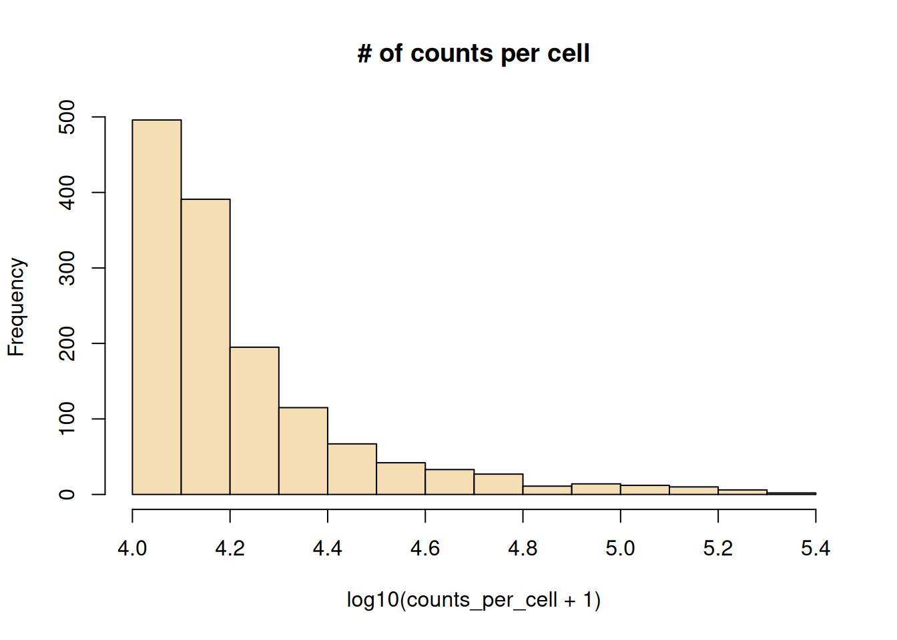
> >
> > ``` r
> > hist(log10(genes_per_cell+1), main = '# of expressed genes per cell', col = 'wheat')
> > ```
> >
> > 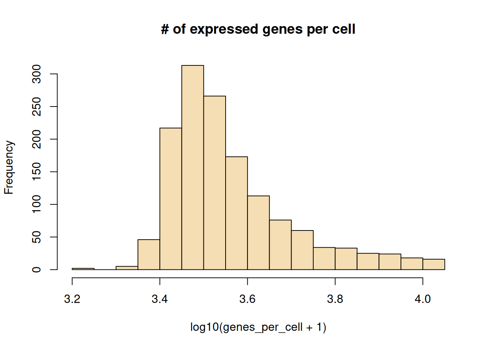
> >
> > ``` r
> > plot(counts_per_cell, genes_per_cell, log = 'xy', col = 'wheat')
> > title('Counts vs genes per cell')
> > ```
> >
> > 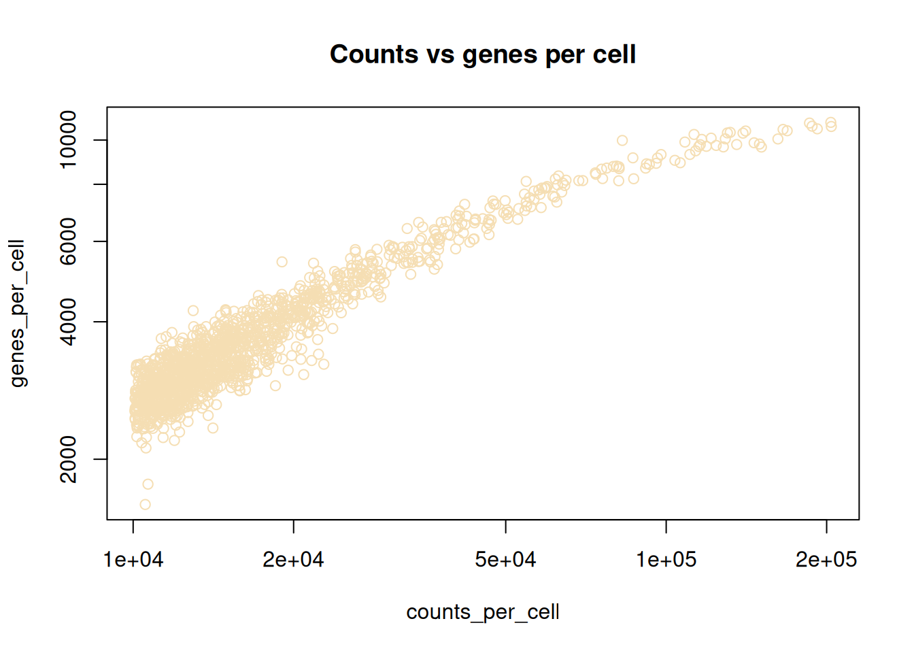

> **NOTE:**
>
> Look at the summary counts for genes and cells. Can you plot a histogram of counts per gene in log10 scale?
>
> > **NOTE:**
> >
> > ``` r
> > cells_per_gene <- Matrix::rowSums(counts > 0) # only count cells where the gene is expressed
> > hist(log10(cells_per_gene+1), main = '# of cells expressing each gene', col = 'wheat')
> > ```
> >
> > 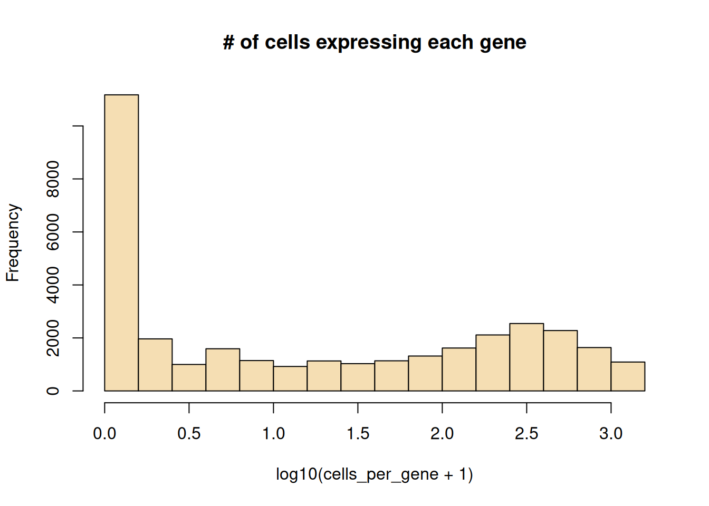

A very useful plot is the distribution of library complexity in the sequencing run, typically shown as a lineplot of the number of detected UMI per cell, with cells ranked in decreasing order. One can use such plot to investigate observations (potential cells) that are actually failed libraries (lower end outliers) or observations that are cell doublets (higher end outliers).

> **NOTE:**
>
> Plot cells ranked by their number of detected genes. Comment.
>
> > **NOTE:**
> >
> > ``` r
> > plot(
> >     sort(genes_per_cell, decreasing = TRUE),
> >     xlab = 'cell', log = 'y', main = '# of genes per cell (ordered)',
> >     type = 'l'
> > )
> > ```
> >
> > 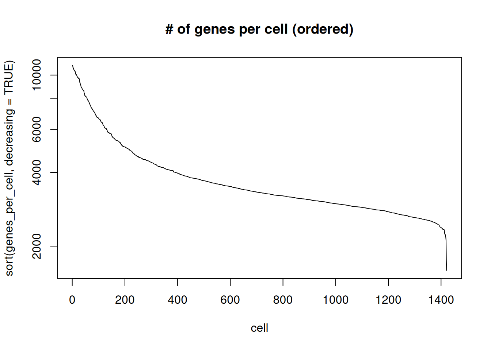

Several QCs can be automatically computed using `quickRnaQc.se()` from the `scrapper` package. `scrapper` provides fast `C++` implementations of most steps of a scRNA-seq analysis (QC, normalization, variance modelling, PCA, clustering, marker detection…).

> **NOTE:**
>
> In previous `Bioconductor` releases, quality control metrics were computed with [`scuttle::quickPerCellQC()`](https://rdrr.io/pkg/scuttle/man/quickPerCellQC.html) or [`scuttle::addPerCellQCMetrics()`](https://rdrr.io/pkg/scuttle/man/addPerCellQCMetrics.html). Since `Bioconductor 3.24`, these functions (and most of `scuttle` and `scran`) are deprecated in favour of `scrapper`. You will still find them in many tutorials and in the [OSCA book](https://bioconductor.org/books/release/OSCA/).

`quickRnaQc.se()` computes, for each cell, the total number of counts (`sum`), the number of detected genes (`detected`) and the proportion of counts assigned to any `subsets` of genes (e.g. mitochondrial genes). It then suggests filtering thresholds (cells with too few counts or detected genes, or with a too high proportion of mitochondrial counts, compared to the bulk of cells), and adds a `keep` column to the [`colData()`](https://rdrr.io/pkg/SummarizedExperiment/man/SummarizedExperiment-class.html).

``` r
toy_sce <- scrapper::quickRnaQc.se(toy_sce, subsets = list())
colData(toy_sce)
##  DataFrame with 100 rows and 4 columns
##              idx       sum  detected      keep
##      <character> <numeric> <integer> <logical>
##  1         cell1        62        10     FALSE
##  2         cell2        48        10     FALSE
##  3         cell3        57        10     FALSE
##  4         cell4        42        10     FALSE
##  5         cell5        42        10     FALSE
##  ...         ...       ...       ...       ...
##  96       cell96        41        10     FALSE
##  97       cell97        48        10     FALSE
##  98       cell98        40        10     FALSE
##  99       cell99        58        10     FALSE
##  100     cell100        41        10     FALSE
metadata(toy_sce)$qc$thresholds
##  $sum
##  [1] 29.31332
##  
##  $detected
##  [1] 10
##  
##  $subset.proportion
##  named list()
table(toy_sce$keep)
##  
##  FALSE 
##    100
```

> **NOTE:**
>
> Run `quickRnaQc.se()` on the `SingleCellExperiment` object, providing the list of mitochondrial genes as a subset. Inspect the new `colData` of the object. How many cells would be filtered out? Why?
>
> > **NOTE:**
> >
> > ``` r
> > mito <- rownames(sce)[grepl("^MT-", rowData(sce)$X2)]
> > mito
> > ##   [1] "ENSG00000198888" "ENSG00000198763" "ENSG00000198804" "ENSG00000198712"
> > ##   [5] "ENSG00000228253" "ENSG00000198899" "ENSG00000198938" "ENSG00000198840"
> > ##   [9] "ENSG00000212907" "ENSG00000198886" "ENSG00000198786" "ENSG00000198695"
> > ##  [13] "ENSG00000198727"
> > sce <- scrapper::quickRnaQc.se(sce, subsets = list(mito = mito))
> > colData(sce)
> > ##  DataFrame with 1421 rows and 5 columns
> > ##                                     X1       sum  detected
> > ##                            <character> <numeric> <integer>
> > ##  AAACCTGAGGCTCATT-1 AAACCTGAGGCTCATT-1     18836      4512
> > ##  AAACCTGAGGTGCACA-1 AAACCTGAGGTGCACA-1     22583      3915
> > ##  AAACCTGCAGGTGCCT-1 AAACCTGCAGGTGCCT-1     34931      6449
> > ##  AAACCTGGTTAGAACA-1 AAACCTGGTTAGAACA-1     14382      3910
> > ##  AAACCTGTCACCACCT-1 AAACCTGTCACCACCT-1     19542      4469
> > ##  ...                               ...       ...       ...
> > ##  TTTGGTTTCGGTGTCG-1 TTTGGTTTCGGTGTCG-1    139350     10354
> > ##  TTTGTCAAGGATGGAA-1 TTTGTCAAGGATGGAA-1     10629      2382
> > ##  TTTGTCAGTACCTACA-1 TTTGTCAGTACCTACA-1     11836      3140
> > ##  TTTGTCAGTCTCACCT-1 TTTGTCAGTCTCACCT-1     19054      3316
> > ##  TTTGTCAGTGAAATCA-1 TTTGTCAGTGAAATCA-1     12646      3268
> > ##                     subset.proportion.mito      keep
> > ##                                  <numeric> <logical>
> > ##  AAACCTGAGGCTCATT-1              0.0210767      TRUE
> > ##  AAACCTGAGGTGCACA-1              0.0564141      TRUE
> > ##  AAACCTGCAGGTGCCT-1              0.0411382      TRUE
> > ##  AAACCTGGTTAGAACA-1              0.0441524      TRUE
> > ##  AAACCTGTCACCACCT-1              0.0471804      TRUE
> > ##  ...                                   ...       ...
> > ##  TTTGGTTTCGGTGTCG-1              0.0399139      TRUE
> > ##  TTTGTCAAGGATGGAA-1              0.0162762      TRUE
> > ##  TTTGTCAGTACCTACA-1              0.0154613      TRUE
> > ##  TTTGTCAGTCTCACCT-1              0.0397817      TRUE
> > ##  TTTGTCAGTGAAATCA-1              0.0454689      TRUE
> > metadata(sce)$qc$thresholds
> > ##  $sum
> > ##  [1] 5521.605
> > ##  
> > ##  $detected
> > ##  [1] 1655.833
> > ##  
> > ##  $subset.proportion
> > ##  $subset.proportion$mito
> > ##  [1] 0.09319202
> > table(sce$keep)
> > ##  
> > ##  FALSE  TRUE 
> > ##     30  1391
> > ```

## 7.3 Access to stored informations

### 7.3.1 Assay slots

For typical scRNA-seq experiments, a `SingleCellExperiment` can have multiple assays, corresponding to different metrics. The most basic one is `counts`. Different assays store different ‘transformations’ of the `counts` (e.g. `logcounts`).

For example, one can compute mean-centered counts and store it in a new slot.

``` r
mean_centered_counts <- scale(counts(toy_sce), center = TRUE, scale = FALSE)
assay(toy_sce, 'mean_centered') <- mean_centered_counts
assays(toy_sce)
##  List of length 2
##  names(2): counts mean_centered
assay(toy_sce, 'mean_centered')[1:10, 1:10]
##        [,1] [,2] [,3] [,4] [,5] [,6] [,7] [,8] [,9] [,10]
##   [1,] -2.2  0.2  1.3 -0.2  3.8  2.9  0.7 -0.6  0.5  -1.9
##   [2,] -2.2  0.2  0.3  1.8 -1.2  1.9  1.7  0.4  1.5   2.1
##   [3,] -1.2  0.2  1.3 -0.2  1.8 -2.1 -1.3  3.4 -1.5  -1.9
##   [4,]  1.8  0.2  1.3  0.8 -0.2  1.9  2.7  1.4 -2.5  -0.9
##   [5,] -0.2  0.2 -2.7 -0.2  0.8 -3.1 -1.3 -3.6 -0.5  -0.9
##   [6,]  0.8  1.2 -1.7 -0.2 -1.2 -1.1 -1.3  0.4  1.5   1.1
##   [7,] -1.2 -1.8  3.3 -1.2 -0.2  0.9 -1.3  0.4 -2.5   2.1
##   [8,]  1.8 -1.8  0.3 -2.2 -2.2 -2.1  0.7  2.4  2.5   1.1
##   [9,]  1.8  0.2 -0.7 -1.2  1.8 -3.1 -1.3 -0.6 -0.5   0.1
##  [10,]  0.8  1.2 -2.7  2.8 -3.2  3.9  0.7 -3.6  1.5  -0.9
mean(assay(toy_sce, 'mean_centered'))
##  [1] 8.894361e-18
```

> **NOTE:**
>
> Try to manually compute logcounts from counts and store it in a new slot.
>
> > **NOTE:**
> >
> > ``` r
> > assay(sce, 'logcounts') <- log10(counts(sce) + 1)
> > logcounts(sce)[1:10, 1:10]
> > ##  10 x 10 Matrix of class "dgeMatrix"
> > ##                  AAACCTGAGGCTCATT-1 AAACCTGAGGTGCACA-1 AAACCTGCAGGTGCCT-1
> > ##  ENSG00000243485                  0                  0            0.00000
> > ##  ENSG00000237613                  0                  0            0.00000
> > ##  ENSG00000186092                  0                  0            0.00000
> > ##  ENSG00000238009                  0                  0            0.00000
> > ##  ENSG00000239945                  0                  0            0.00000
> > ##  ENSG00000239906                  0                  0            0.00000
> > ##  ENSG00000241599                  0                  0            0.00000
> > ##  ENSG00000279928                  0                  0            0.00000
> > ##  ENSG00000279457                  0                  0            0.00000
> > ##  ENSG00000228463                  0                  0            0.60206
> > ##                  AAACCTGGTTAGAACA-1 AAACCTGTCACCACCT-1 AAACCTGTCCGAGCCA-1
> > ##  ENSG00000243485          0.0000000                  0                  0
> > ##  ENSG00000237613          0.0000000                  0                  0
> > ##  ENSG00000186092          0.0000000                  0                  0
> > ##  ENSG00000238009          0.0000000                  0                  0
> > ##  ENSG00000239945          0.0000000                  0                  0
> > ##  ENSG00000239906          0.0000000                  0                  0
> > ##  ENSG00000241599          0.0000000                  0                  0
> > ##  ENSG00000279928          0.0000000                  0                  0
> > ##  ENSG00000279457          0.0000000                  0                  0
> > ##  ENSG00000228463          0.4771213                  0                  0
> > ##                  AAACCTGTCGTGACAT-1 AAACGGGAGTAGTGCG-1 AAACGGGCAGCGTTCG-1
> > ##  ENSG00000243485                  0                  0            0.00000
> > ##  ENSG00000237613                  0                  0            0.00000
> > ##  ENSG00000186092                  0                  0            0.00000
> > ##  ENSG00000238009                  0                  0            0.00000
> > ##  ENSG00000239945                  0                  0            0.00000
> > ##  ENSG00000239906                  0                  0            0.00000
> > ##  ENSG00000241599                  0                  0            0.00000
> > ##  ENSG00000279928                  0                  0            0.00000
> > ##  ENSG00000279457                  0                  0            0.00000
> > ##  ENSG00000228463                  0                  0            0.30103
> > ##                  AAACGGGCATGTTCCC-1
> > ##  ENSG00000243485                  0
> > ##  ENSG00000237613                  0
> > ##  ENSG00000186092                  0
> > ##  ENSG00000238009                  0
> > ##  ENSG00000239945                  0
> > ##  ENSG00000239906                  0
> > ##  ENSG00000241599                  0
> > ##  ENSG00000279928                  0
> > ##  ENSG00000279457                  0
> > ##  ENSG00000228463                  0
> > ```
> >
> > Note that this is a very crude transformation, which does not account for differences in sequencing depth between cells: we will see in the next lectures and labs how to properly normalize counts (e.g. with [`scrapper::normalizeRnaCounts.se()`](https://rdrr.io/pkg/scrapper/man/normalizeRnaCounts.se.html)).

### 7.3.2 Embeddings

Embeddings allow for a representation of large-scale data (N cells x M genes) into smaller dimensions (e.g. 2-50 dimensions). Typical embeddings can be PCA, t-SNE, UMAP, etc… Many embeddings can be computed using `run...()` functions from Bioconductor packages (e.g. `scater`, `scrapper`, …).

For example, one can compute PCA and store it in a new slot.

``` r
library(scater)
##  Loading required package: scuttle

logcounts(toy_sce) <- log10(counts(toy_sce) + 1)
toy_sce <- scater::runPCA(toy_sce, ncomponents = 2)
reducedDims(toy_sce)
##  List of length 1
##  names(1): PCA
reducedDim(toy_sce, 'PCA')[1:10, ]
##                PC1         PC2
##   [1,]  0.27308113  0.25631958
##   [2,]  0.10974722  0.09945732
##   [3,]  0.06339004 -0.06786177
##   [4,] -0.08099880  0.04187606
##   [5,]  0.05162194 -0.37921657
##   [6,] -0.09214025 -0.04434565
##   [7,] -0.16436803  0.04899389
##   [8,] -0.28559519  0.02423707
##   [9,] -0.12654088  0.12162150
##  [10,] -0.34225994  0.02170625
plotReducedDim(toy_sce, 'PCA')
```

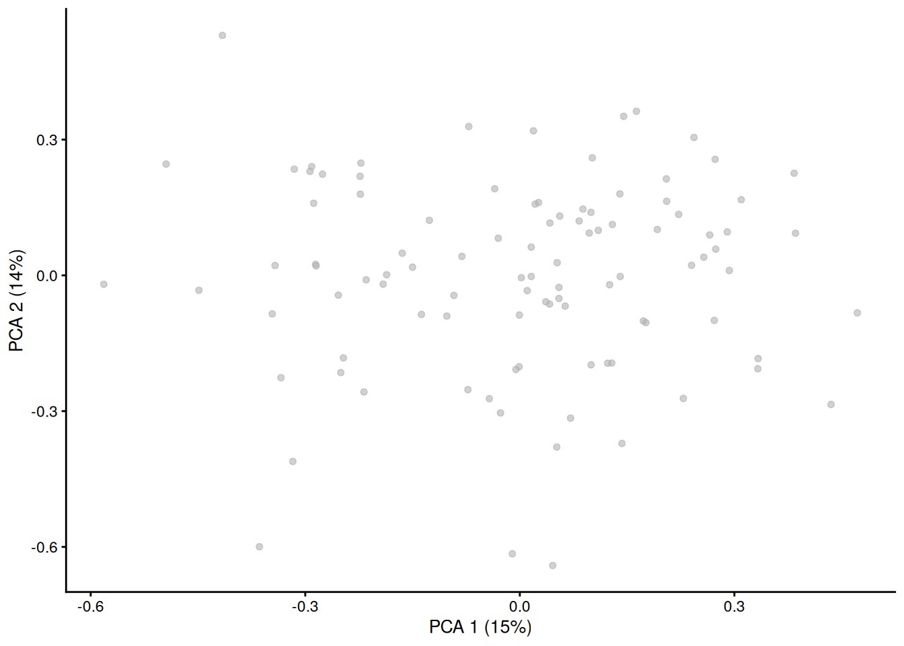

> **NOTE:**
>
> Try to compute PCA, t-SNE and UMAP embeddings of the kidney organoid dataset using [`runPCA()`](https://rdrr.io/pkg/BiocSingular/man/runPCA.html), [`runTSNE()`](https://rdrr.io/pkg/scater/man/runTSNE.html) and [`runUMAP()`](https://rdrr.io/pkg/scater/man/runUMAP.html) from `scater` package.
>
> > **NOTE:**
> >
> > ``` r
> > sce <- scater::runPCA(sce)
> > plotReducedDim(sce, "PCA")
> > ```
> >
> > 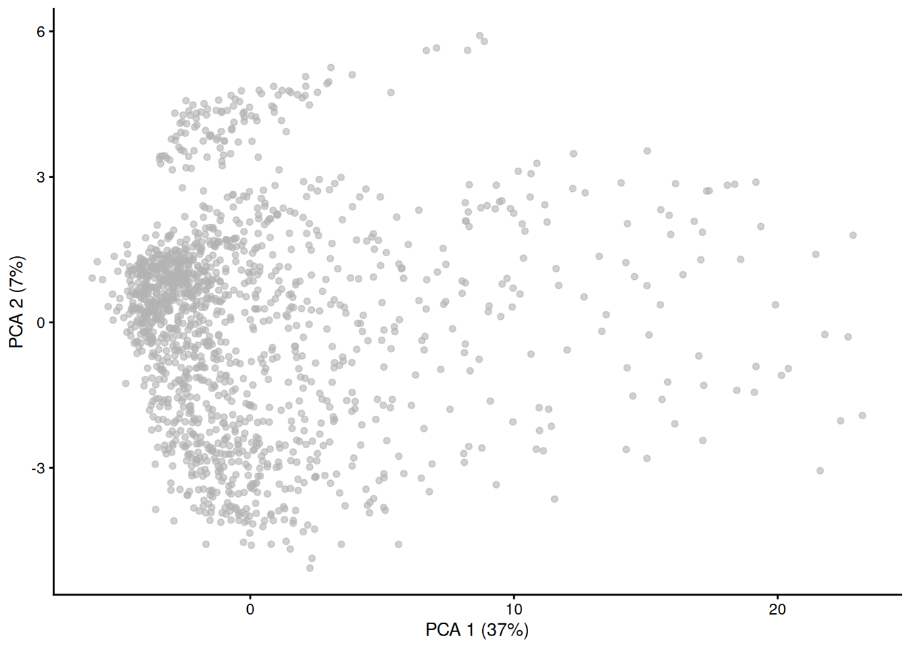
> >
> > ``` r
> >
> > sce <- scater::runTSNE(sce)
> > plotReducedDim(sce, "TSNE")
> > ```
> >
> > 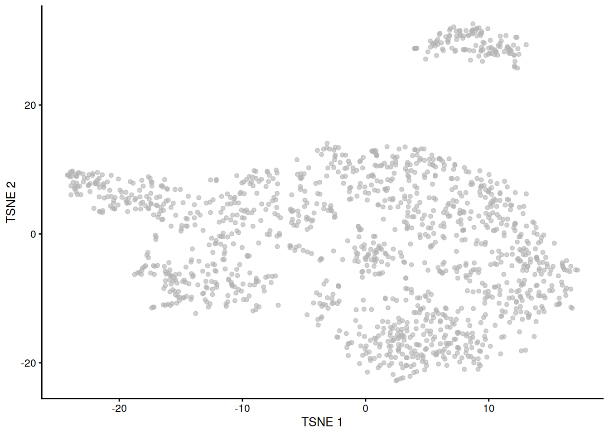
> >
> > ``` r
> >
> > sce <- scater::runUMAP(sce)
> > plotReducedDim(sce, "UMAP", colour_by = 'sum')
> > ```
> >
> > 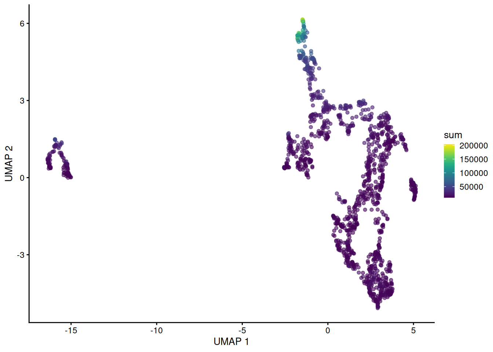
> >
> > ``` r
> > plotReducedDim(sce, "UMAP", colour_by = 'detected')
> > ```
> >
> > 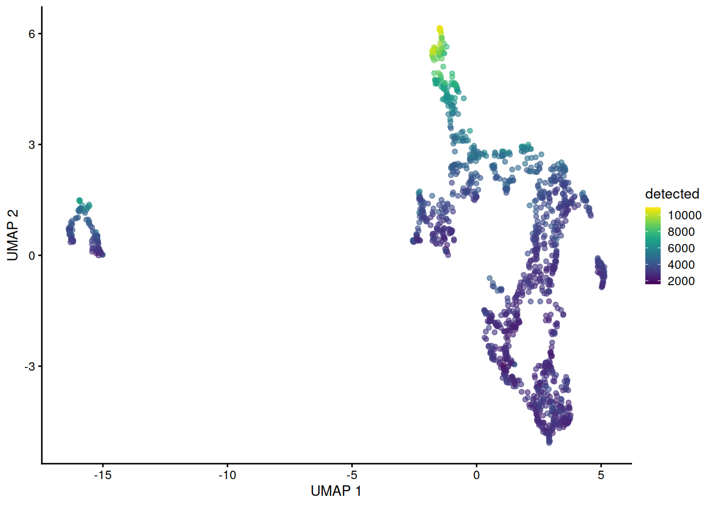

## 7.4 Filtering cells and features

### 7.4.1 Pre-filtering

Filtering operations are often performed on the `SingleCellExperiment` object, for example to remove low-quality cells (columns) or genes (rows).

To do this, one can use standard R syntax to subset the `SingleCellExperiment` object.

``` r
toy_sce_filtered <- toy_sce[rowData(toy_sce)$gene_type == 'protein_coding', toy_sce$sum > 50]
toy_sce_filtered
##  class: SingleCellExperiment 
##  dim: 5 44 
##  metadata(1): qc
##  assays(3): counts mean_centered logcounts
##  rownames: NULL
##  rowData names(2): gene_name gene_type
##  colnames: NULL
##  colData names(4): idx sum detected keep
##  reducedDimNames(1): PCA
##  mainExpName: NULL
##  altExpNames(0):
```

> **NOTE:**
>
> Filter the SCE to only include cells that have a complexity of 2000 genes or more and genes that are are expressed in 10 or more cells.
>
> > **NOTE:**
> >
> > ``` r
> > sce_filtered <- sce[
> >     Matrix::rowSums(counts(sce) > 0) >= 10,
> >     Matrix::colSums(counts(sce) > 0) >= 2000
> > ]
> > sce_filtered
> > ##  class: SingleCellExperiment 
> > ##  dim: 16820 1419 
> > ##  metadata(1): qc
> > ##  assays(2): counts logcounts
> > ##  rownames(16820): ENSG00000279457 ENSG00000228463 ... ENSG00000276345
> > ##    ENSG00000271254
> > ##  rowData names(2): X1 X2
> > ##  colnames(1419): AAACCTGAGGCTCATT-1 AAACCTGAGGTGCACA-1 ...
> > ##    TTTGTCAGTCTCACCT-1 TTTGTCAGTGAAATCA-1
> > ##  colData names(5): X1 sum detected subset.proportion.mito keep
> > ##  reducedDimNames(3): PCA TSNE UMAP
> > ##  mainExpName: NULL
> > ##  altExpNames(0):
> > ```

Almost all our analysis will be on this single object, of class `SingleCellExperiment`. This object contains various “slots” that will store not only the raw count data, but also the results from various computations below. This has the advantage that we do not need to keep track of inidividual variables of interest - they can all be collapsed into a single object as long as these slots are pre-defined.

### 7.4.2 Filtering low-quality cells: mitochondrial counts

For each cell, we can calculate the percentage of counts mapping on mitochondrial genes and store it in a column `percent_mito` in our [`colData()`](https://rdrr.io/pkg/SummarizedExperiment/man/SummarizedExperiment-class.html).

``` r
rowData(sce_filtered)
##  DataFrame with 16820 rows and 2 columns
##                               X1            X2
##                      <character>   <character>
##  ENSG00000279457 ENSG00000279457    FO538757.2
##  ENSG00000228463 ENSG00000228463    AP006222.2
##  ENSG00000237094 ENSG00000237094 RP4-669L17.10
##  ENSG00000237491 ENSG00000237491 RP11-206L10.9
##  ENSG00000225880 ENSG00000225880     LINC00115
##  ...                         ...           ...
##  ENSG00000276256 ENSG00000276256    AC011043.1
##  ENSG00000273748 ENSG00000273748    AL592183.1
##  ENSG00000278817 ENSG00000278817    AC007325.4
##  ENSG00000276345 ENSG00000276345    AC004556.1
##  ENSG00000271254 ENSG00000271254    AC240274.1
mito_genes <- rownames(sce_filtered)[grep(pattern = "^MT-", x = rowData(sce_filtered)$X2)]
mito_genes
##   [1] "ENSG00000198888" "ENSG00000198763" "ENSG00000198804" "ENSG00000198712"
##   [5] "ENSG00000228253" "ENSG00000198899" "ENSG00000198938" "ENSG00000198840"
##   [9] "ENSG00000212907" "ENSG00000198886" "ENSG00000198786" "ENSG00000198695"
##  [13] "ENSG00000198727"
mito_genes_counts <- counts(sce_filtered)[mito_genes, ]
percent_mito <- Matrix::colSums(mito_genes_counts) / sce_filtered$sum
hist(percent_mito*100, main = '% of total counts over mitochondrial genes', col = 'wheat')
```

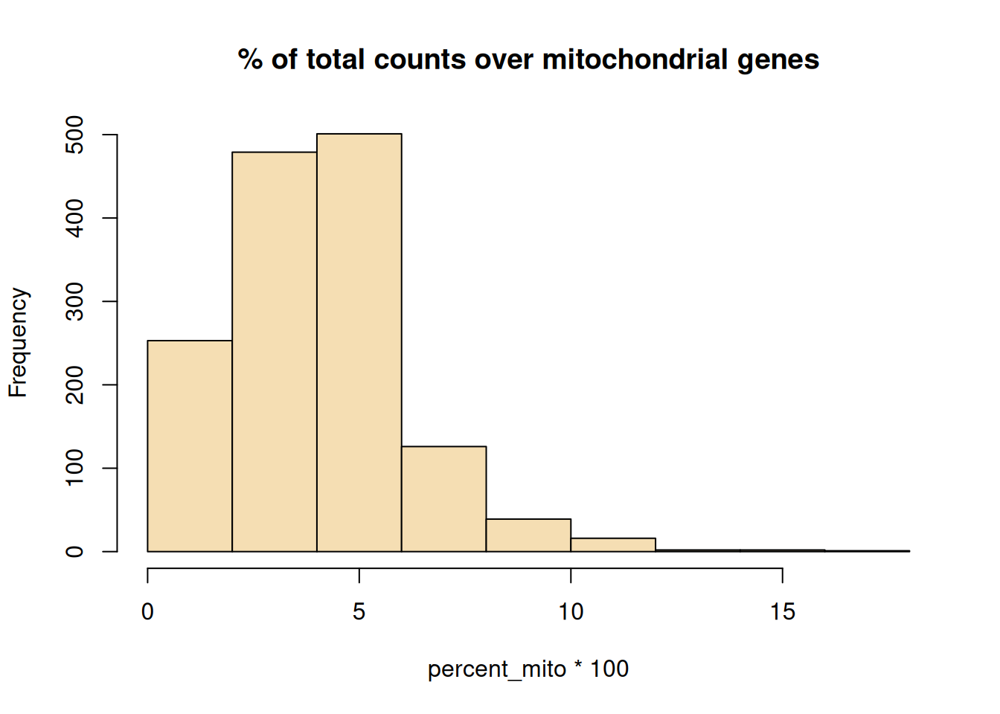

``` r
colData(sce_filtered)$percent_mito <- percent_mito
table(colData(sce_filtered)$percent_mito > 0.1)
##  
##  FALSE  TRUE 
##   1398    21
```

> **NOTE:**
>
> Remove cells with a % of mitochondrial counts greater than 10%.
>
> > **NOTE:**
> >
> > ``` r
> > sce_filtered <- sce_filtered[
> >     ,
> >     sce_filtered$percent_mito <= 0.10
> > ]
> > sce_filtered
> > ##  class: SingleCellExperiment 
> > ##  dim: 16820 1398 
> > ##  metadata(1): qc
> > ##  assays(2): counts logcounts
> > ##  rownames(16820): ENSG00000279457 ENSG00000228463 ... ENSG00000276345
> > ##    ENSG00000271254
> > ##  rowData names(2): X1 X2
> > ##  colnames(1398): AAACCTGAGGCTCATT-1 AAACCTGAGGTGCACA-1 ...
> > ##    TTTGTCAGTCTCACCT-1 TTTGTCAGTGAAATCA-1
> > ##  colData names(6): X1 sum ... keep percent_mito
> > ##  reducedDimNames(3): PCA TSNE UMAP
> > ##  mainExpName: NULL
> > ##  altExpNames(0):
> > ```

### 7.4.3 Checking housekeeping genes

Another metric we use is the number of house keeping genes expressed in a cell. These genes reflect commomn processes active in a cell and hence are a good global quality measure. They are also abundant and are usually steadliy expressed in cells, thus less sensitive to the high dropout.

We first load the list of housekeeping genes curated by [Tirosh et al., Science 2016](https://doi.org/10.1126/science.aad0501) (shipped with this book), match them to the genes in the `rowData` of the `SingleCellExperiment` object (using `match` and `rownames`), remove `NA`s (genes not found in the `rowData`), and store the list of housekeeping genes in a new variable.

``` r
# Load the list of housekeeping genes
hk_file <- system.file("extdata", "tirosh_house_keeping.txt", package = "scRNAseqPhysalia2026")
hkgenes <- read.table(hk_file, skip = 2)
hkgenes <- as.vector(hkgenes$V1)
hkgenes <- rownames(sce_filtered)[match(hkgenes, rowData(sce_filtered)$X2)]
hkgenes <- hkgenes[!is.na(hkgenes)]
hkgenes
##   [1] "ENSG00000075624" "ENSG00000166710" "ENSG00000126067" "ENSG00000159377"
##   [5] "ENSG00000196262" "ENSG00000147224" "ENSG00000101911" "ENSG00000161542"
##   [9] "ENSG00000141127" "ENSG00000147403" "ENSG00000198755" "ENSG00000142676"
##  [13] "ENSG00000197958" "ENSG00000167526" "ENSG00000188846" "ENSG00000174748"
##  [17] "ENSG00000265681" "ENSG00000063177" "ENSG00000108298" "ENSG00000122026"
##  [21] "ENSG00000116251" "ENSG00000163584" "ENSG00000125691" "ENSG00000114391"
##  [25] "ENSG00000161970" "ENSG00000131469" "ENSG00000108107" "ENSG00000162244"
##  [29] "ENSG00000100316" "ENSG00000156482" "ENSG00000144713" "ENSG00000109475"
##  [33] "ENSG00000136942" "ENSG00000130255" "ENSG00000145592" "ENSG00000172809"
##  [37] "ENSG00000198918" "ENSG00000163923" "ENSG00000174444" "ENSG00000229117"
##  [41] "ENSG00000122406" "ENSG00000089009" "ENSG00000147604" "ENSG00000148303"
##  [45] "ENSG00000146223" "ENSG00000161016" "ENSG00000163682" "ENSG00000089157"
##  [49] "ENSG00000137818" "ENSG00000177600" "ENSG00000124614" "ENSG00000142534"
##  [53] "ENSG00000112306" "ENSG00000110700" "ENSG00000164587" "ENSG00000115268"
##  [57] "ENSG00000134419" "ENSG00000105193" "ENSG00000182774" "ENSG00000231500"
##  [61] "ENSG00000105372" "ENSG00000008988" "ENSG00000171858" "ENSG00000138326"
##  [65] "ENSG00000118181" "ENSG00000197728" "ENSG00000177954" "ENSG00000143947"
##  [69] "ENSG00000185088" "ENSG00000233927" "ENSG00000213741" "ENSG00000149273"
##  [73] "ENSG00000145425" "ENSG00000198034" "ENSG00000083845" "ENSG00000137154"
##  [77] "ENSG00000117676" "ENSG00000071242" "ENSG00000177189" "ENSG00000162302"
##  [81] "ENSG00000100784" "ENSG00000072133" "ENSG00000108443" "ENSG00000175634"
##  [85] "ENSG00000136643" "ENSG00000198208" "ENSG00000171863" "ENSG00000142937"
##  [89] "ENSG00000170889" "ENSG00000168028" "ENSG00000104447" "ENSG00000170315"
```

> **NOTE:**
>
> Calculate the number of expressed housekeeping genes per cell (genes with a count \> 0) and store the number of expressed housekeeping genes per cell in `colData`.
>
> > **NOTE:**
> >
> > ``` r
> > colData(sce_filtered)$n_expressed_hkgenes <- Matrix::colSums(counts(sce_filtered)[hkgenes, ] > 0)
> > table(colData(sce_filtered)$n_expressed_hkgenes)
> > ##  
> > ##   73  74  75  76  77  78  79  80  81  82  83  84  85  86  87  88  89  91 
> > ##    5  10  50 108 201 225 242 189 115  80  65  41  25  13  11  11   4   3
> > ```

> **NOTE:**
>
> Plot (in a boxplot) the relationship between the \# of detected housekeeping genes and the total UMI count (or \# of detected genes) per cell. Comment.
>
> > **NOTE:**
> >
> > ``` r
> > boxplot(colData(sce_filtered)$sum ~ colData(sce_filtered)$n_expressed_hkgenes)
> > ```
> >
> > 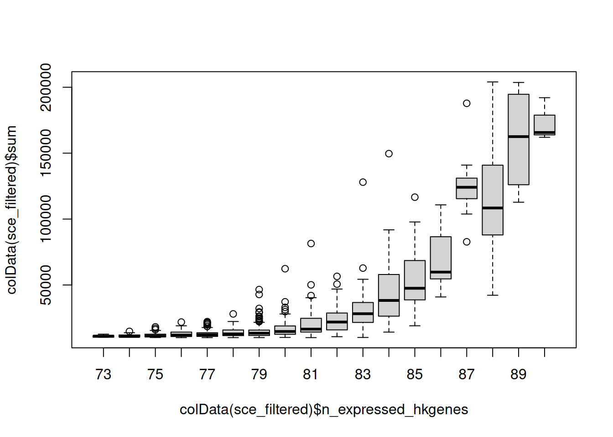
> >
> > ``` r
> > boxplot(colData(sce_filtered)$detected ~ colData(sce_filtered)$n_expressed_hkgenes)
> > ```
> >
> > 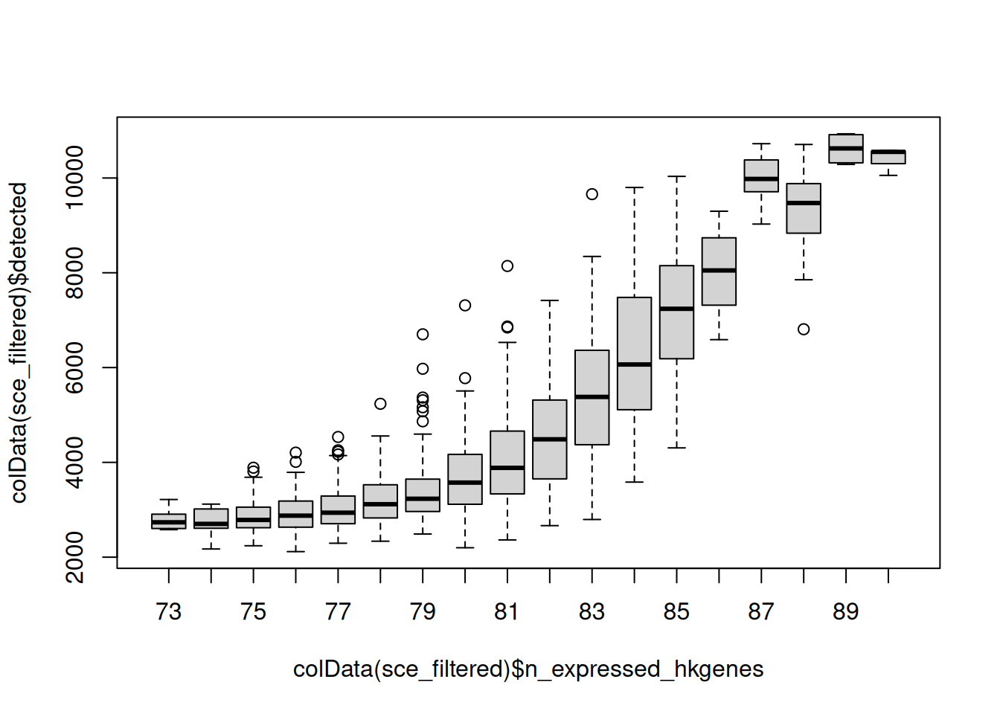

> **NOTE:**
>
> Remove cells with a \# of expressed housekeeping genes greater than 85.
>
> > **NOTE:**
> >
> > ``` r
> > sce_filtered <- sce_filtered[, sce_filtered$n_expressed_hkgenes <= 85]
> > sce_filtered
> > ##  class: SingleCellExperiment 
> > ##  dim: 16820 1356 
> > ##  metadata(1): qc
> > ##  assays(2): counts logcounts
> > ##  rownames(16820): ENSG00000279457 ENSG00000228463 ... ENSG00000276345
> > ##    ENSG00000271254
> > ##  rowData names(2): X1 X2
> > ##  colnames(1356): AAACCTGAGGCTCATT-1 AAACCTGAGGTGCACA-1 ...
> > ##    TTTGTCAGTCTCACCT-1 TTTGTCAGTGAAATCA-1
> > ##  colData names(7): X1 sum ... percent_mito n_expressed_hkgenes
> > ##  reducedDimNames(3): PCA TSNE UMAP
> > ##  mainExpName: NULL
> > ##  altExpNames(0):
> > ```

### 7.4.4 Checking gene set expression

Sometimes we want to ask what is the expression of a gene / a set of a genes across cells. This set of genes may make up a gene expression program we are interested in. Another benefit at looking at gene sets is it reduces the effects of drop outs.

Let’s look at genes involved in the stress signature upon cell dissociation. We calculate these genes average expression levels on the single cell level.

``` r
genes_dissoc <- c("ATF3", "BTG2", "CEBPB", "CEBPD", "CXCL3", "CXCL2", "CXCL1", "DNAJA1", "DNAJB1", "DUSP1", "EGR1", "FOS", "FOSB", "HSP90AA1", "HSP90AB1", "HSPA1A", "HSPA1B", "HSPA1A", "HSPA1B", "HSPA8", "HSPB1", "HSPE1", "HSPH1", "ID3", "IER2", "JUN", "JUNB", "JUND", "MT1X", "NFKBIA", "NR4A1", "PPP1R15A", "SOCS3", "ZFP36")
genes_dissoc <- rownames(sce_filtered)[match(genes_dissoc, rowData(sce_filtered)$X2)]
genes_dissoc <- unique(genes_dissoc[!is.na(genes_dissoc)])
```

> **NOTE:**
>
> Calculate the average gene set expression for each cell.
>
> > **NOTE:**
> >
> > ``` r
> > ave_expr_genes_dissoc <- Matrix::colMeans(logcounts(sce_filtered[genes_dissoc, ]))
> > colData(sce_filtered)$ave_expr_genes_dissoc <- ave_expr_genes_dissoc
> > ```

> **NOTE:**
>
> Plot an embedding of the dataset, using a color scale representing the average expression of genes involved in the stress signature upon cell dissociation. Comment.
>
> > **NOTE:**
> >
> > ``` r
> > plotReducedDim(sce_filtered, dimred = 'PCA', colour_by = 'ave_expr_genes_dissoc')
> > ```
> >
> > 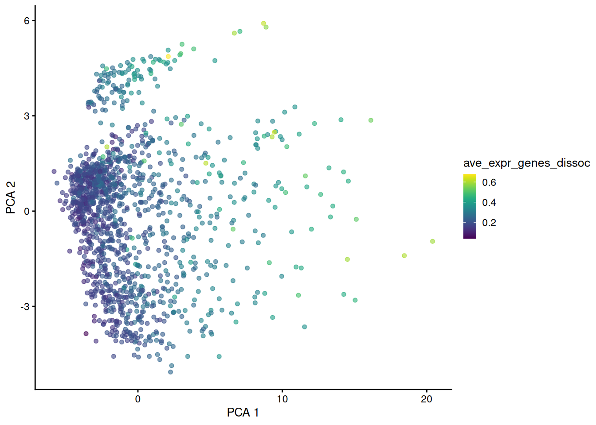
> >
> > ``` r
> > plotReducedDim(sce_filtered, dimred = 'UMAP', colour_by = 'ave_expr_genes_dissoc')
> > ```
> >
> > 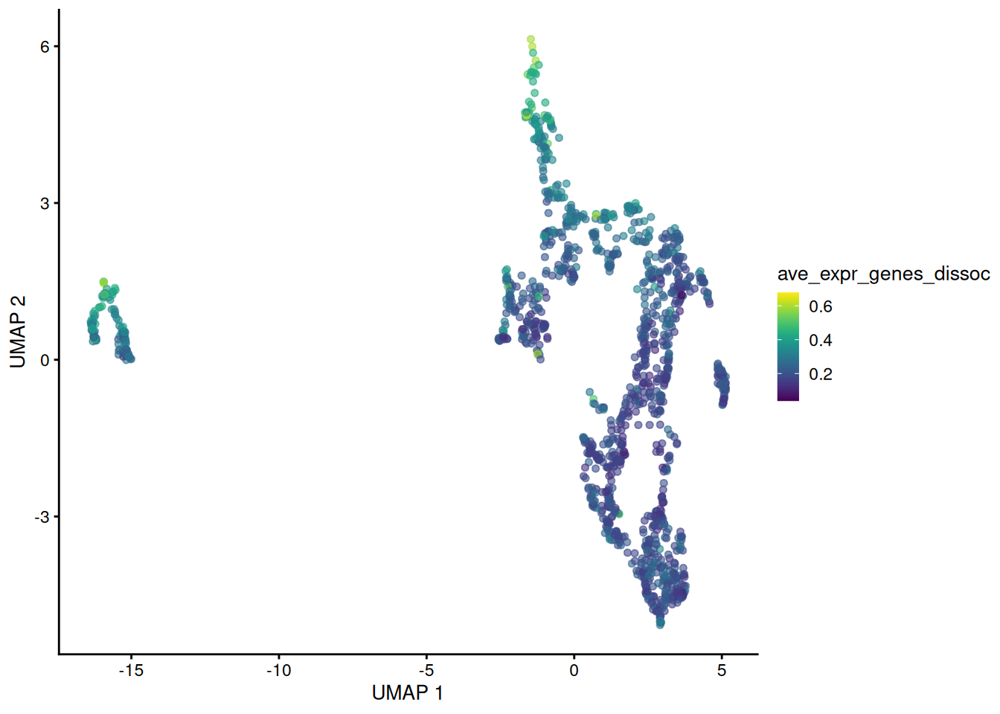

## 7.5 Session info

> **NOTE:**
>
>     ##  ─ Session info ────────────────────────────────────────────────────────────
>     ##   setting  value
>     ##   version  R version 4.6.1 (2026-06-24)
>     ##   os       Ubuntu 24.04.5 LTS
>     ##   system   x86_64, linux-gnu
>     ##   ui       X11
>     ##   language (EN)
>     ##   collate  C
>     ##   ctype    en_US.UTF-8
>     ##   tz       Etc/UTC
>     ##   date     2026-11-06
>     ##   pandoc   3.13 @ /usr/bin/ (via rmarkdown)
>     ##   quarto   1.11.5 @ /usr/local/bin/quarto
>     ##  
>     ##  ─ Packages ────────────────────────────────────────────────────────────────
>     ##   package              * version date (UTC) lib source
>     ##   abind                  1.4-8   2024-09-12 [2] RSPM (R 4.6.0)
>     ##   beachmat               2.29.3  2026-09-23 [2] Bioconductor 3.24 (R 4.6.1)
>     ##   beeswarm               0.4.0   2021-06-01 [2] RSPM (R 4.6.0)
>     ##   Biobase              * 2.73.2  2026-07-29 [2] Bioconductor 3.24 (R 4.6.1)
>     ##   BiocFileCache        * 3.3.2   2026-11-06 [2] xgit (https://git.bioconductor.org/packages/BiocFileCache@709e8bb)
>     ##   BiocGenerics         * 0.59.12 2026-08-11 [2] Bioconductor 3.24 (R 4.6.1)
>     ##   BiocNeighbors          2.7.3   2026-08-21 [2] Bioconductor 3.24 (R 4.6.1)
>     ##   BiocParallel           1.47.0  2026-04-28 [2] Bioconductor 3.24 (R 4.6.1)
>     ##   BiocSingular           1.29.2  2026-10-08 [2] Bioconductor 3.24 (R 4.6.1)
>     ##   bit                    4.6.0   2025-03-06 [2] RSPM (R 4.6.0)
>     ##   bit64                  4.8.6   2026-09-01 [2] RSPM (R 4.6.0)
>     ##   blob                   1.3.0   2026-01-14 [2] RSPM (R 4.6.0)
>     ##   cachem                 1.1.0   2024-05-16 [2] RSPM (R 4.6.0)
>     ##   cli                    3.6.6   2026-04-09 [2] RSPM (R 4.6.0)
>     ##   codetools              0.2-20  2024-03-31 [3] CRAN (R 4.6.1)
>     ##   cowplot                1.2.0   2025-07-07 [2] RSPM (R 4.6.0)
>     ##   crayon                 1.5.3   2024-06-20 [2] RSPM (R 4.6.0)
>     ##   curl                   8.1.0   2026-10-14 [2] RSPM (R 4.6.0)
>     ##   DBI                    1.3.0   2026-02-25 [2] RSPM (R 4.6.0)
>     ##   dbplyr               * 2.6.0   2026-06-17 [2] RSPM (R 4.6.0)
>     ##   DelayedArray           0.39.8  2026-09-30 [2] Bioconductor 3.24 (R 4.6.1)
>     ##   dichromat              2.0-1   2026-07-22 [2] RSPM (R 4.6.0)
>     ##   digest                 0.6.39  2025-11-19 [2] RSPM (R 4.6.0)
>     ##   dplyr                * 1.2.1   2026-04-03 [2] RSPM (R 4.6.0)
>     ##   evaluate               1.0.5   2025-08-27 [2] RSPM (R 4.6.0)
>     ##   farver                 2.1.2   2024-05-13 [2] RSPM (R 4.6.0)
>     ##   fastmap                1.2.0   2024-05-15 [2] RSPM (R 4.6.0)
>     ##   filelock               1.0.3   2023-12-11 [2] RSPM (R 4.6.0)
>     ##   FNN                    1.1.4.1 2024-09-22 [2] RSPM (R 4.6.0)
>     ##   forcats              * 1.0.1   2025-09-25 [2] RSPM (R 4.6.0)
>     ##   generics             * 0.1.4   2025-05-09 [2] RSPM (R 4.6.0)
>     ##   GenomicRanges        * 1.65.4  2026-09-02 [2] Bioconductor 3.24 (R 4.6.1)
>     ##   ggbeeswarm             0.7.3   2025-11-29 [2] RSPM (R 4.6.0)
>     ##   ggplot2              * 4.0.3   2026-04-22 [2] RSPM (R 4.6.0)
>     ##   ggrepel                0.9.8   2026-03-17 [2] RSPM (R 4.6.0)
>     ##   glue                   1.8.1   2026-04-17 [2] RSPM (R 4.6.0)
>     ##   gridExtra              2.3.1   2026-06-25 [2] RSPM (R 4.6.0)
>     ##   gtable                 0.3.6   2024-10-25 [2] RSPM (R 4.6.0)
>     ##   hms                    1.1.4   2025-10-17 [2] RSPM (R 4.6.0)
>     ##   htmltools              0.5.9   2025-12-04 [2] RSPM (R 4.6.0)
>     ##   htmlwidgets            1.6.4   2023-12-06 [2] RSPM (R 4.6.0)
>     ##   httr2                  1.3.0   2026-07-13 [2] RSPM (R 4.6.0)
>     ##   IRanges              * 2.47.5  2026-08-27 [2] Bioconductor 3.24 (R 4.6.1)
>     ##   irlba                  2.4.1   2026-10-05 [2] RSPM (R 4.6.0)
>     ##   jsonlite               2.0.0   2025-03-27 [2] RSPM (R 4.6.0)
>     ##   knitr                  1.52    2026-09-06 [2] RSPM (R 4.6.0)
>     ##   labeling               0.4.3   2023-08-29 [2] RSPM (R 4.6.0)
>     ##   lattice                0.23-1  2026-08-12 [2] RSPM (R 4.6.1)
>     ##   lifecycle              1.0.5   2026-01-08 [2] RSPM (R 4.6.0)
>     ##   lubridate            * 1.9.5   2026-02-04 [2] RSPM (R 4.6.0)
>     ##   magrittr               2.0.5   2026-04-04 [2] RSPM (R 4.6.0)
>     ##   Matrix                 1.7-6   2026-07-25 [2] RSPM (R 4.6.1)
>     ##   MatrixGenerics       * 1.25.0  2026-04-28 [2] Bioconductor 3.24 (R 4.6.1)
>     ##   matrixStats          * 1.5.0   2025-01-07 [2] RSPM (R 4.6.0)
>     ##   memoise                2.0.1   2021-11-26 [2] RSPM (R 4.6.0)
>     ##   otel                   0.2.0   2025-08-29 [2] RSPM (R 4.6.0)
>     ##   pillar                 1.11.1  2025-09-17 [2] RSPM (R 4.6.0)
>     ##   pkgconfig              2.0.3   2019-09-22 [2] RSPM (R 4.6.0)
>     ##   purrr                * 1.2.2   2026-04-10 [2] RSPM (R 4.6.0)
>     ##   R6                     2.6.1   2025-02-15 [2] RSPM (R 4.6.0)
>     ##   RColorBrewer           1.1-3   2022-04-03 [2] RSPM (R 4.6.0)
>     ##   Rcpp                   1.1.2   2026-07-05 [2] RSPM (R 4.6.0)
>     ##   readr                * 2.2.0   2026-02-19 [2] RSPM (R 4.6.0)
>     ##   rlang                  1.3.0   2026-07-05 [2] RSPM (R 4.6.0)
>     ##   rmarkdown              2.32    2026-09-01 [2] RSPM (R 4.6.0)
>     ##   RSpectra               0.16-2  2024-07-18 [2] RSPM (R 4.6.0)
>     ##   RSQLite                3.53.3  2026-06-30 [2] RSPM (R 4.6.0)
>     ##   rsvd                   1.0.6   2026-10-17 [2] RSPM (R 4.6.0)
>     ##   Rtsne                  0.17    2023-12-07 [2] RSPM (R 4.6.0)
>     ##   S4Arrays               1.13.2  2026-09-30 [2] Bioconductor 3.24 (R 4.6.1)
>     ##   S4Vectors            * 0.51.10 2026-09-16 [2] Bioconductor 3.24 (R 4.6.1)
>     ##   S7                     0.2.2   2026-04-22 [2] RSPM (R 4.6.0)
>     ##   ScaledMatrix           1.21.0  2026-04-28 [2] Bioconductor 3.24 (R 4.6.1)
>     ##   scales                 1.4.0   2025-04-24 [2] RSPM (R 4.6.0)
>     ##   scater               * 1.41.3  2026-10-25 [2] Bioconductor 3.24 (R 4.6.1)
>     ##   scrapper               1.7.11  2026-11-04 [2] Bioconductor 3.24 (R 4.6.1)
>     ##   scuttle              * 1.23.2  2026-08-27 [2] Bioconductor 3.24 (R 4.6.1)
>     ##   Seqinfo              * 1.3.2   2026-08-27 [2] Bioconductor 3.24 (R 4.6.1)
>     ##   sessioninfo            1.2.4   2026-06-04 [2] RSPM (R 4.6.0)
>     ##   SingleCellExperiment * 1.35.2  2026-07-16 [2] Bioconductor 3.24 (R 4.6.1)
>     ##   SparseArray            1.13.4  2026-09-30 [2] Bioconductor 3.24 (R 4.6.1)
>     ##   stringi                1.8.9   2026-08-04 [2] RSPM (R 4.6.0)
>     ##   stringr              * 1.6.0   2025-11-04 [2] RSPM (R 4.6.0)
>     ##   SummarizedExperiment * 1.43.0  2026-04-28 [2] Bioconductor 3.24 (R 4.6.1)
>     ##   tibble               * 3.3.1   2026-01-11 [2] RSPM (R 4.6.0)
>     ##   tidyr                * 1.3.2   2025-12-19 [2] RSPM (R 4.6.0)
>     ##   tidyselect             1.2.1   2024-03-11 [2] RSPM (R 4.6.0)
>     ##   tidyverse            * 2.0.0   2023-02-22 [2] RSPM (R 4.6.0)
>     ##   timechange             0.4.0   2026-01-29 [2] RSPM (R 4.6.0)
>     ##   tzdb                   0.5.0   2025-03-15 [2] RSPM (R 4.6.0)
>     ##   utf8                   1.2.6   2025-06-08 [2] RSPM (R 4.6.0)
>     ##   uwot                   0.2.5   2026-08-29 [2] RSPM (R 4.6.0)
>     ##   vctrs                  0.7.3   2026-04-11 [2] RSPM (R 4.6.0)
>     ##   vipor                  0.4.7   2023-12-18 [2] RSPM (R 4.6.0)
>     ##   viridis                0.6.5   2024-01-29 [2] RSPM (R 4.6.0)
>     ##   viridisLite            0.4.3   2026-02-04 [2] RSPM (R 4.6.0)
>     ##   vroom                  1.7.1   2026-03-31 [2] RSPM (R 4.6.0)
>     ##   withr                  3.0.3   2026-06-19 [2] RSPM (R 4.6.0)
>     ##   xfun                   0.62    2026-10-16 [2] RSPM (R 4.6.0)
>     ##   XVector                0.53.0  2026-04-28 [2] Bioconductor 3.24 (R 4.6.1)
>     ##  
>     ##   [1] /tmp/RtmpYDUaaM/Rinstca9466ba
>     ##   [2] /usr/local/lib/R/site-library
>     ##   [3] /usr/local/lib/R/library
>     ##   * ── Packages attached to the search path.
>     ##  
>     ##  ───────────────────────────────────────────────────────────────────────────
