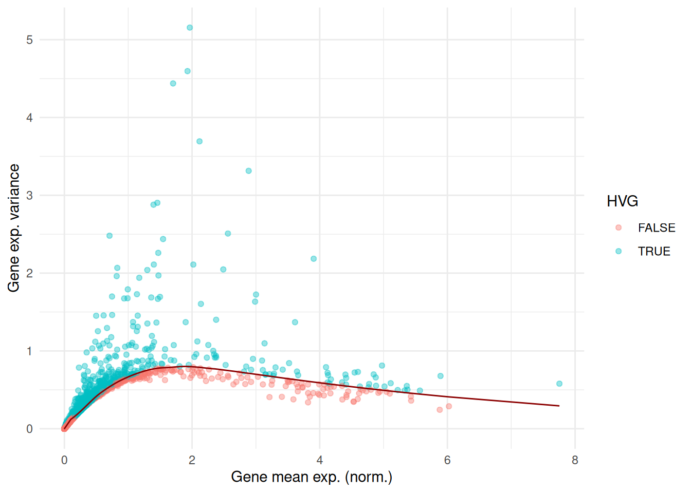
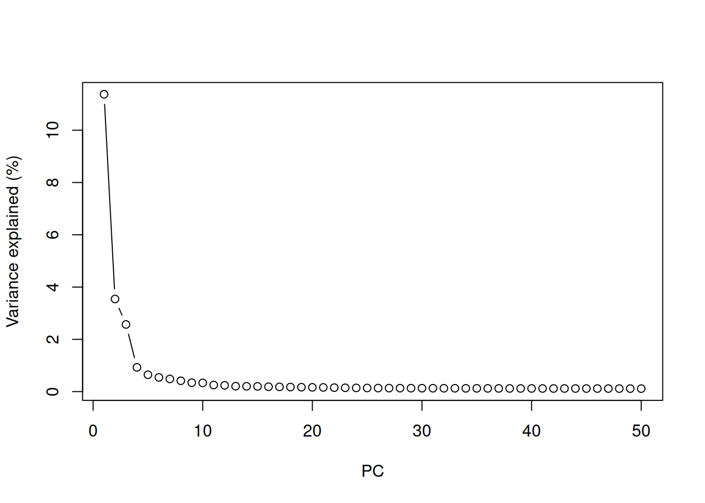
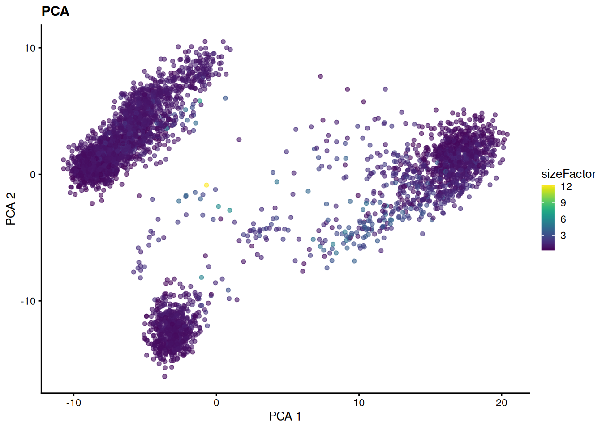
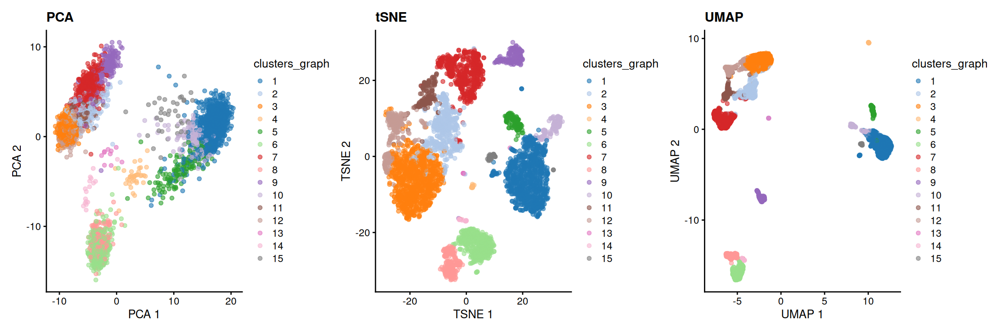
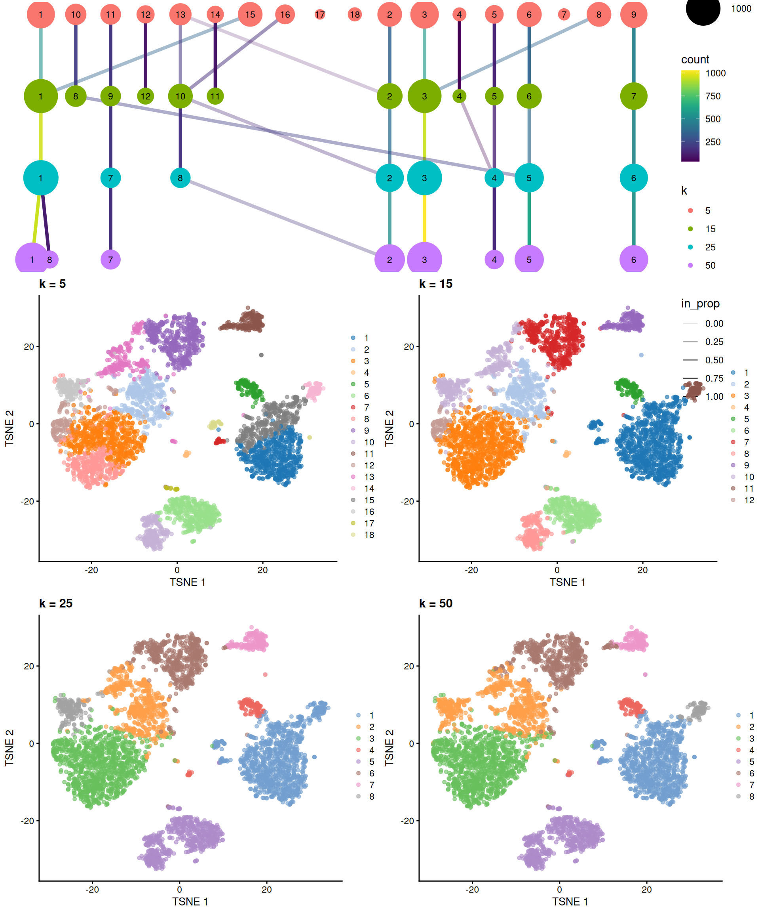
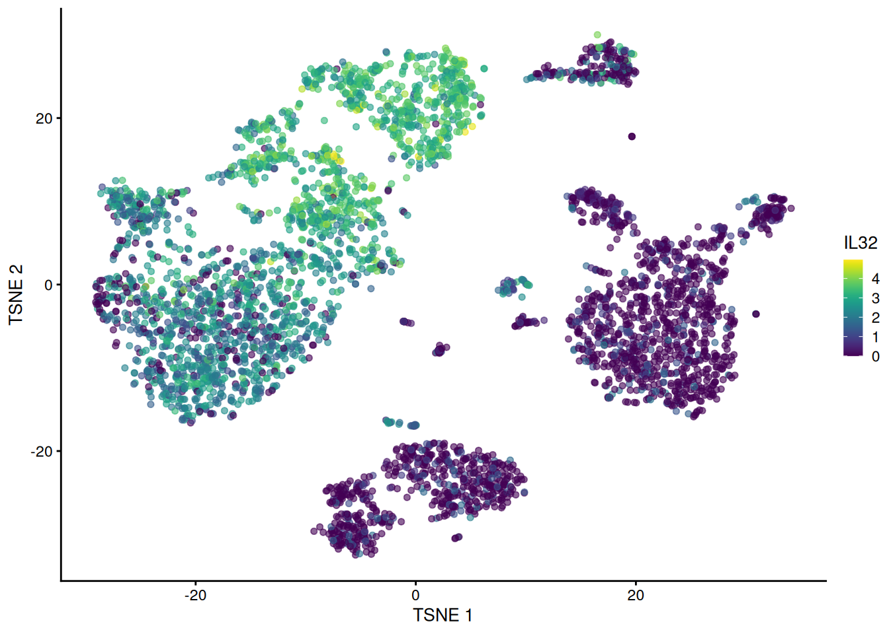
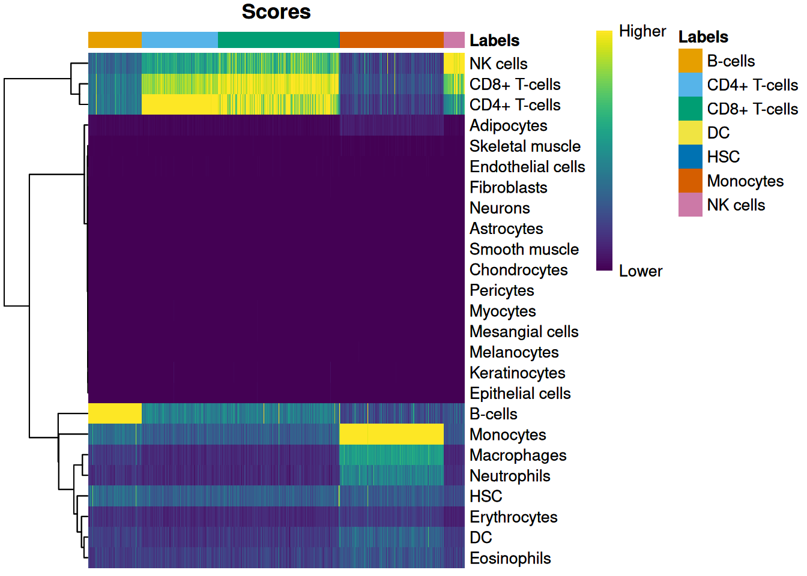
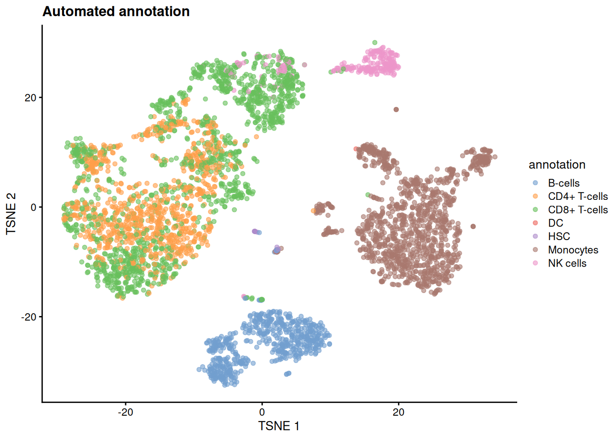
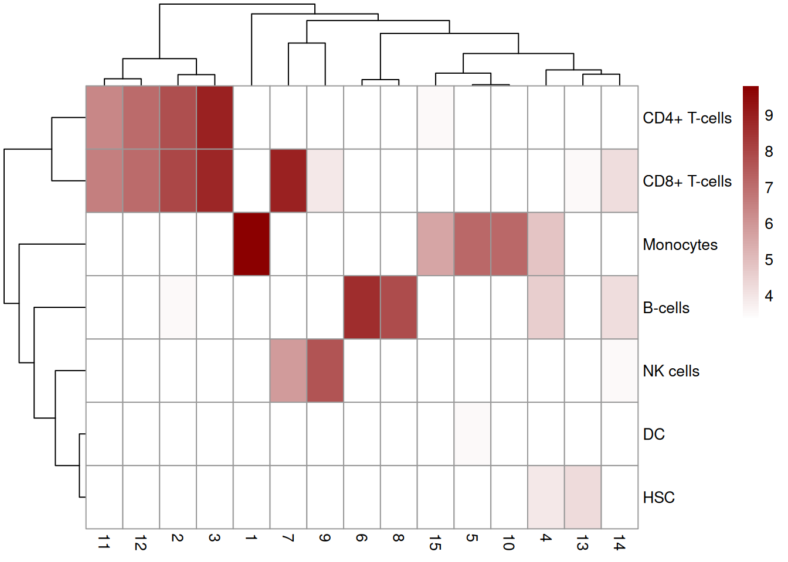

# 9  Lab 5: Dimension reduction, clustering and annotation

> **NOTE:**
>
> The estimated time for this lab is around 1h20.

> **TIP:**
>
> - Learn how to perform dimension reduction on scRNAseq data
> - Understand the importance of feature selection
> - Learn how to perform clustering on scRNAseq data
> - Learn how to (automatically) annotate cells based on clustering results

## 9.1 Dimensional reduction for clustering

### 9.1.1 Preparing dataset

We will prepare scRNAseq data from a PBMC run, provided by 10X and hosted by `Bioconductor` as a package.

> **NOTE:**
>
> Which package from `Bioconductor` gives streamlined access to PBMC scRNAseq dataset from 10X Genomics?
>
> What does the object contain (type of data, number of cells, batches, organism, …)? Can you get the same data from somewhere else?
>
> > **NOTE:**
> >
> > ``` r
> > library(tidyverse)
> > ##  ── Attaching core tidyverse packages ───────────────────── tidyverse 2.0.0 ──
> > ##  ✔ dplyr     1.2.1     ✔ readr     2.2.0
> > ##  ✔ forcats   1.0.1     ✔ stringr   1.6.0
> > ##  ✔ ggplot2   4.0.3     ✔ tibble    3.3.1
> > ##  ✔ lubridate 1.9.5     ✔ tidyr     1.3.2
> > ##  ✔ purrr     1.2.2     
> > ##  ── Conflicts ─────────────────────────────────────── tidyverse_conflicts() ──
> > ##  ✖ dplyr::filter() masks stats::filter()
> > ##  ✖ dplyr::lag()    masks stats::lag()
> > ##  ℹ Use the conflicted package (<http://conflicted.r-lib.org/>) to force all conflicts to become errors
> > library(SingleCellExperiment)
> > ##  Loading required package: SummarizedExperiment
> > ##  Loading required package: MatrixGenerics
> > ##  Loading required package: matrixStats
> > ##  
> > ##  Attaching package: 'matrixStats'
> > ##  
> > ##  The following object is masked from 'package:dplyr':
> > ##  
> > ##      count
> > ##  
> > ##  
> > ##  Attaching package: 'MatrixGenerics'
> > ##  
> > ##  The following objects are masked from 'package:matrixStats':
> > ##  
> > ##      colAlls, colAnyNAs, colAnys, colAvgsPerRowSet, colCollapse,
> > ##      colCounts, colCummaxs, colCummins, colCumprods, colCumsums,
> > ##      colDiffs, colIQRDiffs, colIQRs, colLogSumExps, colMadDiffs,
> > ##      colMads, colMaxs, colMeans2, colMedians, colMins, colOrderStats,
> > ##      colProds, colQuantiles, colRanges, colRanks, colSdDiffs, colSds,
> > ##      colSums2, colTabulates, colVarDiffs, colVars, colWeightedMads,
> > ##      colWeightedMeans, colWeightedMedians, colWeightedSds,
> > ##      colWeightedVars, rowAlls, rowAnyNAs, rowAnys, rowAvgsPerColSet,
> > ##      rowCollapse, rowCounts, rowCummaxs, rowCummins, rowCumprods,
> > ##      rowCumsums, rowDiffs, rowIQRDiffs, rowIQRs, rowLogSumExps,
> > ##      rowMadDiffs, rowMads, rowMaxs, rowMeans2, rowMedians, rowMins,
> > ##      rowOrderStats, rowProds, rowQuantiles, rowRanges, rowRanks,
> > ##      rowSdDiffs, rowSds, rowSums2, rowTabulates, rowVarDiffs,
> > ##      rowVars, rowWeightedMads, rowWeightedMeans, rowWeightedMedians,
> > ##      rowWeightedSds, rowWeightedVars
> > ##  
> > ##  Loading required package: GenomicRanges
> > ##  Loading required package: stats4
> > ##  Loading required package: BiocGenerics
> > ##  Loading required package: generics
> > ##  
> > ##  Attaching package: 'generics'
> > ##  
> > ##  The following object is masked from 'package:lubridate':
> > ##  
> > ##      as.difftime
> > ##  
> > ##  The following object is masked from 'package:dplyr':
> > ##  
> > ##      explain
> > ##  
> > ##  The following objects are masked from 'package:base':
> > ##  
> > ##      as.difftime, as.factor, as.ordered, intersect, is.element,
> > ##      setdiff, setequal, union
> > ##  
> > ##  
> > ##  Attaching package: 'BiocGenerics'
> > ##  
> > ##  The following object is masked from 'package:dplyr':
> > ##  
> > ##      combine
> > ##  
> > ##  The following objects are masked from 'package:stats':
> > ##  
> > ##      IQR, mad, sd, var, xtabs
> > ##  
> > ##  The following object is masked from 'package:utils':
> > ##  
> > ##      data
> > ##  
> > ##  The following objects are masked from 'package:base':
> > ##  
> > ##      Filter, Find, Map, Position, Reduce, anyDuplicated, aperm,
> > ##      append, as.data.frame, basename, cbind, colnames, dirname,
> > ##      do.call, duplicated, eval, evalq, get, grep, grepl, is.unsorted,
> > ##      lapply, mapply, match, mget, order, paste, pmax, pmax.int, pmin,
> > ##      pmin.int, rank, rbind, rownames, sapply, saveRDS, scale,
> > ##      sequence, table, tapply, transform, unique, unsplit, which.max,
> > ##      which.min
> > ##  
> > ##  Loading required package: S4Vectors
> > ##  
> > ##  Attaching package: 'S4Vectors'
> > ##  
> > ##  The following objects are masked from 'package:lubridate':
> > ##  
> > ##      second, second<-
> > ##  
> > ##  The following objects are masked from 'package:dplyr':
> > ##  
> > ##      first, rename
> > ##  
> > ##  The following object is masked from 'package:tidyr':
> > ##  
> > ##      expand
> > ##  
> > ##  The following object is masked from 'package:utils':
> > ##  
> > ##      findMatches
> > ##  
> > ##  The following objects are masked from 'package:base':
> > ##  
> > ##      I, expand.grid, unname
> > ##  
> > ##  Loading required package: IRanges
> > ##  
> > ##  Attaching package: 'IRanges'
> > ##  
> > ##  The following object is masked from 'package:lubridate':
> > ##  
> > ##      %within%
> > ##  
> > ##  The following objects are masked from 'package:dplyr':
> > ##  
> > ##      collapse, desc, slice
> > ##  
> > ##  The following object is masked from 'package:purrr':
> > ##  
> > ##      reduce
> > ##  
> > ##  Loading required package: Seqinfo
> > ##  Loading required package: Biobase
> > ##  Welcome to Bioconductor
> > ##  
> > ##      Vignettes contain introductory material; view with
> > ##      'browseVignettes()'. To cite Bioconductor, see
> > ##      'citation("Biobase")', and for packages 'citation("pkgname")'.
> > ##  
> > ##  
> > ##  Attaching package: 'Biobase'
> > ##  
> > ##  The following object is masked from 'package:MatrixGenerics':
> > ##  
> > ##      rowMedians
> > ##  
> > ##  The following objects are masked from 'package:matrixStats':
> > ##  
> > ##      anyMissing, rowMedians
> > sce <- TENxPBMCData::TENxPBMCData('pbmc4k')
> > ##  OpenTelemetry error: there is no package called 'otelsdk'
> > ##  OpenTelemetry error: there is no package called 'otelsdk'
> > ##  see ?TENxPBMCData and browseVignettes('TENxPBMCData') for documentation
> > ##  downloading 1 resources
> > ##  retrieving 1 resource
> > ##  loading from cache
> > rownames(sce) <- scuttle::uniquifyFeatureNames(rowData(sce)$ENSEMBL_ID, rowData(sce)$Symbol_TENx)
> > sce
> > ##  class: SingleCellExperiment 
> > ##  dim: 33694 4340 
> > ##  metadata(0):
> > ##  assays(1): counts
> > ##  rownames(33694): RP11-34P13.3 FAM138A ... AC213203.1 FAM231B
> > ##  rowData names(3): ENSEMBL_ID Symbol_TENx Symbol
> > ##  colnames: NULL
> > ##  colData names(11): Sample Barcode ... Individual Date_published
> > ##  reducedDimNames(0):
> > ##  mainExpName: NULL
> > ##  altExpNames(0):
> > rowData(sce)
> > ##  DataFrame with 33694 rows and 3 columns
> > ##                    ENSEMBL_ID  Symbol_TENx       Symbol
> > ##                   <character>  <character>  <character>
> > ##  RP11-34P13.3 ENSG00000243485 RP11-34P13.3           NA
> > ##  FAM138A      ENSG00000237613      FAM138A      FAM138A
> > ##  OR4F5        ENSG00000186092        OR4F5        OR4F5
> > ##  RP11-34P13.7 ENSG00000238009 RP11-34P13.7 LOC100996442
> > ##  RP11-34P13.8 ENSG00000239945 RP11-34P13.8           NA
> > ##  ...                      ...          ...          ...
> > ##  AC233755.2   ENSG00000277856   AC233755.2           NA
> > ##  AC233755.1   ENSG00000275063   AC233755.1 LOC102723407
> > ##  AC240274.1   ENSG00000271254   AC240274.1 LOC102724250
> > ##  AC213203.1   ENSG00000277475   AC213203.1           NA
> > ##  FAM231B      ENSG00000268674      FAM231B      FAM231C
> > colData(sce)
> > ##  DataFrame with 4340 rows and 11 columns
> > ##            Sample            Barcode         Sequence   Library
> > ##       <character>        <character>      <character> <integer>
> > ##  1         pbmc4k AAACCTGAGAAGGCCT-1 AAACCTGAGAAGGCCT         1
> > ##  2         pbmc4k AAACCTGAGACAGACC-1 AAACCTGAGACAGACC         1
> > ##  3         pbmc4k AAACCTGAGATAGTCA-1 AAACCTGAGATAGTCA         1
> > ##  4         pbmc4k AAACCTGAGCGCCTCA-1 AAACCTGAGCGCCTCA         1
> > ##  5         pbmc4k AAACCTGAGGCATGGT-1 AAACCTGAGGCATGGT         1
> > ##  ...          ...                ...              ...       ...
> > ##  4336      pbmc4k TTTGGTTTCGCTAGCG-1 TTTGGTTTCGCTAGCG         1
> > ##  4337      pbmc4k TTTGTCACACTTAACG-1 TTTGTCACACTTAACG         1
> > ##  4338      pbmc4k TTTGTCACAGGTCCAC-1 TTTGTCACAGGTCCAC         1
> > ##  4339      pbmc4k TTTGTCAGTTAAGACA-1 TTTGTCAGTTAAGACA         1
> > ##  4340      pbmc4k TTTGTCATCCCAAGAT-1 TTTGTCATCCCAAGAT         1
> > ##       Cell_ranger_version Tissue_status Barcode_type   Chemistry
> > ##               <character>   <character>  <character> <character>
> > ##  1                   v2.1            NA     Chromium Chromium_v2
> > ##  2                   v2.1            NA     Chromium Chromium_v2
> > ##  3                   v2.1            NA     Chromium Chromium_v2
> > ##  4                   v2.1            NA     Chromium Chromium_v2
> > ##  5                   v2.1            NA     Chromium Chromium_v2
> > ##  ...                  ...           ...          ...         ...
> > ##  4336                v2.1            NA     Chromium Chromium_v2
> > ##  4337                v2.1            NA     Chromium Chromium_v2
> > ##  4338                v2.1            NA     Chromium Chromium_v2
> > ##  4339                v2.1            NA     Chromium Chromium_v2
> > ##  4340                v2.1            NA     Chromium Chromium_v2
> > ##       Sequence_platform    Individual Date_published
> > ##             <character>   <character>    <character>
> > ##  1            Hiseq4000 HealthyDonor1     2017-11-08
> > ##  2            Hiseq4000 HealthyDonor1     2017-11-08
> > ##  3            Hiseq4000 HealthyDonor1     2017-11-08
> > ##  4            Hiseq4000 HealthyDonor1     2017-11-08
> > ##  5            Hiseq4000 HealthyDonor1     2017-11-08
> > ##  ...                ...           ...            ...
> > ##  4336         Hiseq4000 HealthyDonor1     2017-11-08
> > ##  4337         Hiseq4000 HealthyDonor1     2017-11-08
> > ##  4338         Hiseq4000 HealthyDonor1     2017-11-08
> > ##  4339         Hiseq4000 HealthyDonor1     2017-11-08
> > ##  4340         Hiseq4000 HealthyDonor1     2017-11-08
> > table(sce$Library)
> > ##  
> > ##     1 
> > ##  4340
> > ```
> >
> > The counts are stored on disk, in a `HDF5` file (this is what the `DelayedMatrix` class means): this is great to work with datasets which do not fit in memory, but it is slower than working with an in-memory matrix. This dataset is small enough to be loaded in memory, as a sparse matrix:
> >
> > ``` r
> > counts(sce)
> > ##  <33694 x 4340> sparse DelayedMatrix object of type "integer":
> > ##                  [,1]    [,2]    [,3]    [,4] ... [,4337] [,4338] [,4339]
> > ##  RP11-34P13.3       0       0       0       0   .       0       0       0
> > ##       FAM138A       0       0       0       0   .       0       0       0
> > ##         OR4F5       0       0       0       0   .       0       0       0
> > ##  RP11-34P13.7       0       0       0       0   .       0       0       0
> > ##  RP11-34P13.8       0       0       0       0   .       0       0       0
> > ##           ...       .       .       .       .   .       .       .       .
> > ##    AC233755.2       0       0       0       0   .       0       0       0
> > ##    AC233755.1       0       0       0       0   .       0       0       0
> > ##    AC240274.1       0       0       0       0   .       0       0       0
> > ##    AC213203.1       0       0       0       0   .       0       0       0
> > ##       FAM231B       0       0       0       0   .       0       0       0
> > ##               [,4340]
> > ##  RP11-34P13.3       0
> > ##       FAM138A       0
> > ##         OR4F5       0
> > ##  RP11-34P13.7       0
> > ##  RP11-34P13.8       0
> > ##           ...       .
> > ##    AC233755.2       0
> > ##    AC233755.1       0
> > ##    AC240274.1       0
> > ##    AC213203.1       0
> > ##       FAM231B       0
> > counts(sce) <- as(counts(sce), 'dgCMatrix')
> > counts(sce)[1:10, 1:10]
> > ##  10 x 10 sparse Matrix of class "dgCMatrix"
> > ##                                   
> > ##  RP11-34P13.3  . . . . . . . . . .
> > ##  FAM138A       . . . . . . . . . .
> > ##  OR4F5         . . . . . . . . . .
> > ##  RP11-34P13.7  . . . . . . . . . .
> > ##  RP11-34P13.8  . . . . . . . . . .
> > ##  RP11-34P13.14 . . . . . . . . . .
> > ##  RP11-34P13.9  . . . . . . . . . .
> > ##  FO538757.3    . . . . . . . . . .
> > ##  FO538757.2    . . . . . . . . . 1
> > ##  AP006222.2    . . . . . . . . . .
> > ```

### 9.1.2 Normalize counts using `scran`

Just like in bulk high-throughput sequencing experiments, scRNAseq counts have to be normalized to the sequencing depth for each cell. We can define the library size as the total sum of counts across all genes for each cell, the expected value of which is assumed to scale with any cell-specific biases. However, this relies on the assumption that within the entire dataset, most genes are non-differentially expressed and expressed roughly within the same range. Depending on the set up of the scRNAseq experiment, this can be entirely false. To avoid relying on this hypothesis, we can (1) quickly pre-cluster cells, then (2) normalize cells using their library size factor separately in each cluster, then (3) rescaling size factors so that they are comparable across clusters.

All of this can be done very simply using the combo `quickCluster() + computeSumFactors()` from the `scran` package, followed by `normalizeRnaCounts.se()` from the `scrapper` package.

> **NOTE:**
>
> What is the purpose of the `quickCluster()` function? What does it return?
>
> What is the purpose of the `computeSumFactors()` function? What does it return?
>
> What is the purpose of the `normalizeRnaCounts.se()` function? What does it return?
>
> > **NOTE:**
> >
> > ``` r
> > set.seed(1000)
> > clusters <- scran::quickCluster(sce)
> > table(clusters)
> > ##  clusters
> > ##    1   2   3   4   5   6   7   8   9  10  11 
> > ##  588 361 264 161 866 365 531 536 360 207 101
> > sce <- scran::computeSumFactors(sce, cluster = clusters)
> > colData(sce)
> > ##  DataFrame with 4340 rows and 12 columns
> > ##            Sample            Barcode         Sequence   Library
> > ##       <character>        <character>      <character> <integer>
> > ##  1         pbmc4k AAACCTGAGAAGGCCT-1 AAACCTGAGAAGGCCT         1
> > ##  2         pbmc4k AAACCTGAGACAGACC-1 AAACCTGAGACAGACC         1
> > ##  3         pbmc4k AAACCTGAGATAGTCA-1 AAACCTGAGATAGTCA         1
> > ##  4         pbmc4k AAACCTGAGCGCCTCA-1 AAACCTGAGCGCCTCA         1
> > ##  5         pbmc4k AAACCTGAGGCATGGT-1 AAACCTGAGGCATGGT         1
> > ##  ...          ...                ...              ...       ...
> > ##  4336      pbmc4k TTTGGTTTCGCTAGCG-1 TTTGGTTTCGCTAGCG         1
> > ##  4337      pbmc4k TTTGTCACACTTAACG-1 TTTGTCACACTTAACG         1
> > ##  4338      pbmc4k TTTGTCACAGGTCCAC-1 TTTGTCACAGGTCCAC         1
> > ##  4339      pbmc4k TTTGTCAGTTAAGACA-1 TTTGTCAGTTAAGACA         1
> > ##  4340      pbmc4k TTTGTCATCCCAAGAT-1 TTTGTCATCCCAAGAT         1
> > ##       Cell_ranger_version Tissue_status Barcode_type   Chemistry
> > ##               <character>   <character>  <character> <character>
> > ##  1                   v2.1            NA     Chromium Chromium_v2
> > ##  2                   v2.1            NA     Chromium Chromium_v2
> > ##  3                   v2.1            NA     Chromium Chromium_v2
> > ##  4                   v2.1            NA     Chromium Chromium_v2
> > ##  5                   v2.1            NA     Chromium Chromium_v2
> > ##  ...                  ...           ...          ...         ...
> > ##  4336                v2.1            NA     Chromium Chromium_v2
> > ##  4337                v2.1            NA     Chromium Chromium_v2
> > ##  4338                v2.1            NA     Chromium Chromium_v2
> > ##  4339                v2.1            NA     Chromium Chromium_v2
> > ##  4340                v2.1            NA     Chromium Chromium_v2
> > ##       Sequence_platform    Individual Date_published sizeFactor
> > ##             <character>   <character>    <character>  <numeric>
> > ##  1            Hiseq4000 HealthyDonor1     2017-11-08   0.403246
> > ##  2            Hiseq4000 HealthyDonor1     2017-11-08   0.739777
> > ##  3            Hiseq4000 HealthyDonor1     2017-11-08   0.429493
> > ##  4            Hiseq4000 HealthyDonor1     2017-11-08   0.527001
> > ##  5            Hiseq4000 HealthyDonor1     2017-11-08   0.600344
> > ##  ...                ...           ...            ...        ...
> > ##  4336         Hiseq4000 HealthyDonor1     2017-11-08   1.422566
> > ##  4337         Hiseq4000 HealthyDonor1     2017-11-08   0.947146
> > ##  4338         Hiseq4000 HealthyDonor1     2017-11-08   1.962193
> > ##  4339         Hiseq4000 HealthyDonor1     2017-11-08   0.615199
> > ##  4340         Hiseq4000 HealthyDonor1     2017-11-08   0.771550
> > summary(sizeFactors(sce))
> > ##     Min. 1st Qu.  Median    Mean 3rd Qu.    Max. 
> > ##   0.2287  0.6949  0.8721  1.0000  1.1117 12.1761
> > sce <- scrapper::normalizeRnaCounts.se(sce, size.factors = sizeFactors(sce))
> > assays(sce)
> > ##  List of length 2
> > ##  names(2): counts logcounts
> > logcounts(sce)
> > ##  <33694 x 4340> sparse LogNormalizedMatrix object of type "double":
> > ##                  [,1]    [,2]    [,3] ... [,4339] [,4340]
> > ##  RP11-34P13.3       0       0       0   .       0       0
> > ##       FAM138A       0       0       0   .       0       0
> > ##         OR4F5       0       0       0   .       0       0
> > ##  RP11-34P13.7       0       0       0   .       0       0
> > ##  RP11-34P13.8       0       0       0   .       0       0
> > ##           ...       .       .       .   .       .       .
> > ##    AC233755.2       0       0       0   .       0       0
> > ##    AC233755.1       0       0       0   .       0       0
> > ##    AC240274.1       0       0       0   .       0       0
> > ##    AC213203.1       0       0       0   .       0       0
> > ##       FAM231B       0       0       0   .       0       0
> > ```
> >
> > `normalizeRnaCounts.se()` divides the counts of each cell by its size factor, then log-transforms them (`log2(x + 1)`). Note that the `logcounts` assay is not a regular matrix: it is a `LogNormalizedMatrix`, which only stores the counts and the size factors, and computes the log-normalized values on the fly. This saves a lot of memory for large datasets!

### 9.1.3 Feature selection

We often use scRNAseq data in exploratory analyses to characterize heterogeneity across cells. Procedures like clustering and dimensionality reduction compare cells based on their gene expression profiles. The choice of genes to include in this comparison may have a major impact on the performance of downstream methods. Ideally, one wants to only select genes that contain useful information about the biology of the system while removing genes that contain random noise. This aims to preserve interesting biological structure without the variance that obscures that structure.

The simplest approach to feature selection is to compute the variance of the log-normalized expression values, to select the most variable genes. Modelling of the mean-variance relationship can be achieved by the `modelGeneVariances()` function from the `scrapper` package: it computes the mean and the variance of the log-normalized expression of each gene, fits a trend to the variance with respect to the mean (the *technical* variance), and computes the residual from this trend for each gene (the *biological* variance).

> **NOTE:**
>
> Apply the `modelGeneVariances()` function to the normalized counts. What does the returned object contain?
>
> > **NOTE:**
> >
> > ``` r
> > gene_variances <- scrapper::modelGeneVariances(logcounts(sce))
> > names(gene_variances)
> > ##  [1] "statistics"
> > gene_variances$statistics
> > ##  DataFrame with 33694 rows and 4 columns
> > ##                     means   variances      fitted    residuals
> > ##                 <numeric>   <numeric>   <numeric>    <numeric>
> > ##  RP11-34P13.3 0.000000000 0.000000000 0.000000000  0.000000000
> > ##  FAM138A      0.000000000 0.000000000 0.000000000  0.000000000
> > ##  OR4F5        0.000000000 0.000000000 0.000000000  0.000000000
> > ##  RP11-34P13.7 0.001973297 0.002003373 0.002357441 -0.000354068
> > ##  RP11-34P13.8 0.000491705 0.000531807 0.000587426 -0.000055619
> > ##  ...                  ...         ...         ...          ...
> > ##  AC233755.2    0.00000000   0.0000000     0.00000  0.000000000
> > ##  AC233755.1    0.00000000   0.0000000     0.00000  0.000000000
> > ##  AC240274.1    0.00961767   0.0112683     0.01149 -0.000221649
> > ##  AC213203.1    0.00000000   0.0000000     0.00000  0.000000000
> > ##  FAM231B       0.00000000   0.0000000     0.00000  0.000000000
> > ```
>
> Identify the top 10% most variable genes from this object.
>
> > **NOTE:**
> >
> > ``` r
> > HVGs_idx <- scrapper::chooseHighlyVariableGenes(
> >     gene_variances$statistics$residuals,
> >     top = round(0.1 * nrow(sce))
> > )
> > HVGs <- rownames(sce)[HVGs_idx]
> > rowData(sce)$isHVG <- rownames(sce) %in% HVGs
> > head(rowData(sce))
> > ##  DataFrame with 6 rows and 4 columns
> > ##                     ENSEMBL_ID   Symbol_TENx       Symbol     isHVG
> > ##                    <character>   <character>  <character> <logical>
> > ##  RP11-34P13.3  ENSG00000243485  RP11-34P13.3           NA     FALSE
> > ##  FAM138A       ENSG00000237613       FAM138A      FAM138A     FALSE
> > ##  OR4F5         ENSG00000186092         OR4F5        OR4F5     FALSE
> > ##  RP11-34P13.7  ENSG00000238009  RP11-34P13.7 LOC100996442     FALSE
> > ##  RP11-34P13.8  ENSG00000239945  RP11-34P13.8           NA     FALSE
> > ##  RP11-34P13.14 ENSG00000239906 RP11-34P13.14           NA     FALSE
> > table(rowData(sce)$isHVG)
> > ##  
> > ##  FALSE  TRUE 
> > ##  30325  3369
> > ```
> >
> > [`scrapper::chooseRnaHvgs.se()`](https://rdrr.io/pkg/scrapper/man/chooseRnaHvgs.se.html) performs both steps at once, and stores the results in the [`rowData()`](https://rdrr.io/pkg/SummarizedExperiment/man/SummarizedExperiment-class.html) of the `SingleCellExperiment` object.
>
> Visualize the mean-variance fit of the data, coloring points by whether they are in the top 10% most variable genes.
>
> > **NOTE:**
> >
> > ``` r
> > df <- tibble(
> >     mean = gene_variances$statistics$means,
> >     var = gene_variances$statistics$variances,
> >     trend = gene_variances$statistics$fitted,
> >     HVG = rowData(sce)$isHVG
> > )
> > ggplot(df) +
> >     geom_point(aes(x = mean, y = var, col = HVG), alpha = 0.4) +
> >     geom_line(aes(x = mean, y = trend), col = 'darkred') +
> >     theme_minimal() +
> >     labs(x = 'Gene mean exp. (norm.)', y = 'Gene exp. variance')
> > ```
> >
> > 

### 9.1.4 PCA on filtered dataset

We now have normalized counts filtered for the top 10% genes varying with the greatest biological significance. Still, that represents a ~3,400 x nCells (~4,300) dataset (each row being a feature). This is still too big to reliably use in standard clustering approaches. We can further compress the dataset. The most widely used approach is `PCA`: it computes a small number of “components” (typically 5-50) optimally summarizing the variability of the whole dataset, while retaining linearity of the underlying numerical data and being computationallt quite efficient.

> **NOTE:**
>
> Use the `runPca.se()` function from the `scrapper` package to compute a `PCA` embedding of the data, using the highly variable genes only.
>
> How much of the variance is explained by each principal component? How many components would you keep for downstream analyses?
>
> > **NOTE:**
> >
> > ``` r
> > set.seed(1000)
> > sce <- scrapper::runPca.se(sce, features = rowData(sce)$isHVG, number = 50)
> > reducedDim(sce, 'PCA')[1:5, 1:5]
> > ##             PC1       PC2        PC3       PC4         PC5
> > ##  [1,] 16.874448 0.8689463 -1.0040325 4.6334941  1.75547776
> > ##  [2,] 16.334695 1.7263185 -3.9471546 2.2686646  0.04918039
> > ##  [3,] 19.328208 2.2938734  2.1556838 4.7900223 -3.00881519
> > ##  [4,] -6.381954 2.8499857  0.3208111 0.2344315  3.75205924
> > ##  [5,] -8.227185 1.5069442 -5.0113033 1.6077754  0.83386219
> > percent_var <- metadata(sce)$PCA$variance.explained / metadata(sce)$PCA$total.variance * 100
> > plot(percent_var, xlab = 'PC', ylab = 'Variance explained (%)', type = 'b')
> > ```
> >
> > 
> >
> > The “elbow” of this curve suggests that the first ~15 PCs capture most of the biological signal, and that the next ones mostly capture noise. We keep the first 15 PCs for downstream analyses:
> >
> > ``` r
> > reducedDim(sce, 'PCA') <- reducedDim(sce, 'PCA')[, 1:15]
> > p <- scater::plotReducedDim(sce, 'PCA', colour_by = 'sizeFactor') + ggtitle('PCA')
> > p
> > ```
> >
> > 

## 9.2 Clustering

Clustering is an unsupervised learning procedure that is used in scRNA-seq data analysis to empirically define groups of cells with similar expression profiles. Its primary purpose is to summarize the data in a digestible format for human interpretation.

After annotation based on marker genes, the clusters can be treated as proxies for more abstract biological concepts such as cell types or states. Clustering is thus a critical step for extracting biological insights from scRNA-seq data.

### 9.2.1 Clustering algorithms

Three main approaches can be used:

1.  Hierarchical clustering
2.  k-means clustering
3.  Graph-based clustering

Today, we will focus on graph-based clustering, as it is becoming the standard for scRNAseq: it is a flexible and scalable technique for clustering even the largest scRNA-seq datasets. We first build a graph where each node is a cell that is connected by edges to its nearest neighbors in the high-dimensional space. Edges are weighted based on the similarity between the cells involved, with higher weight given to cells that are more closely related.

> **NOTE:**
>
> Compute a graph-based clustering of the PBMC dataset.
>
> > **NOTE:**
> >
> > ``` r
> > set.seed(1000)
> > graph <- bluster::makeSNNGraph(reducedDim(sce, 'PCA'), k = 5)
> > graph
> > ##  IGRAPH 46f9ff5 U-W- 4340 68716 -- 
> > ##  + attr: weight (e/n)
> > ##  + edges from 46f9ff5:
> > ##   [1]   6-- 16   6-- 21   6-- 22   4-- 23  12-- 25   1-- 26  12-- 28  23-- 32
> > ##   [9]  15-- 35  14-- 36  32-- 48  18-- 52   6-- 53  16-- 53  47-- 54  52-- 55
> > ##  [17]  49-- 55  26-- 55   2-- 57  27-- 58   7-- 61  15-- 64  39-- 67  31-- 67
> > ##  [25]  21-- 69  27-- 70  58-- 70  27-- 72  70-- 72  58-- 72  65-- 77  68-- 79
> > ##  [33]  71-- 84  46-- 85   3-- 85  35-- 88  15-- 88  28-- 90  12-- 90  12-- 91
> > ##  [41]  25-- 91  28-- 91  90-- 91  15-- 97  35-- 97  88-- 97  74-- 99  61--101
> > ##  [49]   7--101  54--102  33--102  13--102  56--104  92--105  51--106 105--106
> > ##  [57]   2--107  55--107  34--108  68--109 100--114  12--116  69--116  67--120
> > ##  + ... omitted several edges
> > sce_clust <- igraph::cluster_louvain(graph)$membership
> > sce$clusters_graph <- factor(sce_clust)
> > table(sce$clusters_graph)
> > ##  
> > ##    1   2   3   4   5   6   7   8   9  10  11  12  13  14  15 
> > ##  883 456 910  37 130 377 530 216 192 133 158 252  10  17  39
> > ```
> >
> > The same can be achieved in a single step with [`scrapper::clusterGraph.se()`](https://rdrr.io/pkg/scrapper/man/clusterGraph.se.html), which builds the shared nearest-neighbor graph from the `PCA` embedding and clusters it with the “multilevel” (a.k.a. Louvain) algorithm:
> >
> > ``` r
> > sce <- scrapper::clusterGraph.se(sce, num.neighbors = 5, method = "multilevel")
> > table(sce$clusters)
> > ##  
> > ##    1   2   3   4   5   6   7   8   9  10  11  12  13  14  15  16  17 
> > ##  566 375 939 143  37 130 374  22 417 219 192 195  97 331 178  87  38
> > table(sce$clusters_graph, sce$clusters)
> > ##      
> > ##         1   2   3   4   5   6   7   8   9  10  11  12  13  14  15  16  17
> > ##    1  566   0   0   0   0   0   0  22   0   0   0   0   1 294   0   0   0
> > ##    2    0 359  43  51   0   0   0   0   1   0   0   2   0   0   0   0   0
> > ##    3    0   0 892   0   0   0   0   0   0   0   0   0   0   0   1  17   0
> > ##    4    0   0   0   0  37   0   0   0   0   0   0   0   0   0   0   0   0
> > ##    5    0   0   0   0   0 130   0   0   0   0   0   0   0   0   0   0   0
> > ##    6    0   0   0   0   0   0 372   0   0   5   0   0   0   0   0   0   0
> > ##    7    0   3   0  73   0   0   0   0 416   0   0  38   0   0   0   0   0
> > ##    8    0   0   0   0   0   0   2   0   0 214   0   0   0   0   0   0   0
> > ##    9    0   0   0   0   0   0   0   0   0   0 192   0   0   0   0   0   0
> > ##    10   0   0   0   0   0   0   0   0   0   0   0   0  96  37   0   0   0
> > ##    11   0   2   1   1   0   0   0   0   0   0   0 153   0   0   1   0   0
> > ##    12   0   1   2   1   0   0   0   0   0   0   0   2   0   0 176  70   0
> > ##    13   0  10   0   0   0   0   0   0   0   0   0   0   0   0   0   0   0
> > ##    14   0   0   0  17   0   0   0   0   0   0   0   0   0   0   0   0   0
> > ##    15   0   0   1   0   0   0   0   0   0   0   0   0   0   0   0   0  38
> > ```

> **NOTE:**
>
> What are the main parameters to choose when building the graph? How do they impact the clustering?
>
> > **NOTE:**
> >
> > ``` r
> > set.seed(1000)
> > graph2 <- bluster::makeSNNGraph(reducedDim(sce, 'PCA'), k = 50)
> > sce_clust2 <- igraph::cluster_louvain(graph2)$membership
> > table(sce_clust, sce_clust2)
> > ##           sce_clust2
> > ##  sce_clust   1   2   3   4   5   6   7   8
> > ##         1  879   0   0   0   2   0   2   0
> > ##         2    0 365  80   0   0  11   0   0
> > ##         3    0   4 906   0   0   0   0   0
> > ##         4    0   0   0  36   1   0   0   0
> > ##         5   15   0   0 115   0   0   0   0
> > ##         6    0   0   0   0 377   0   0   0
> > ##         7    0   4   0   0   0 526   0   0
> > ##         8    0   0   0   0 216   0   0   0
> > ##         9    0   0   0   0   1  21 170   0
> > ##         10  21   0   0   0   0   0   0 112
> > ##         11   0 132   2   0   0  24   0   0
> > ##         12   0 182  70   0   0   0   0   0
> > ##         13   0   6   2   1   0   1   0   0
> > ##         14   0   0   0   0  16   1   0   0
> > ##         15  38   0   1   0   0   0   0   0
> > ```

### 9.2.2 Dimensional reduction for clustering visualization

`PCA` is a powerful linear approach to compress large datasets into smaller dimensional spaces. However, it struggles at emphasizing the existence of clusters in complex datasets, when visualized in 2D.

`scater` (and `scrapper`, with `runTsne.se()` and `runUmap.se()`) provides a handy way to perform more complex data embeddings:

- tSNE
- UMAP
- Diffusion Map
- Multi-Dimensional Scaling (MDS)
- Non-negative Matrix Factorization (NMF)

> **NOTE:**
>
> Explore the different dimensional reduction algorithms, trying different hyperparameters combinations.
>
> When you run these commands, pay attention to how long each command takes to run! While this run, check the `Help` page for each function (e.g. `?runTSNE`)
>
> > **NOTE:**
> >
> > ``` r
> > set.seed(1000)
> > reducedDims(sce)
> > ##  List of length 1
> > ##  names(1): PCA
> > sce <- scater::runTSNE(sce, dimred = 'PCA')
> > sce <- scater::runUMAP(sce, dimred = 'PCA')
> > reducedDims(sce)
> > ##  List of length 3
> > ##  names(3): PCA TSNE UMAP
> > reducedDim(sce, 'UMAP')[1:10, ]
> > ##            UMAP1      UMAP2
> > ##   [1,] 11.249780  -2.899521
> > ##   [2,] 11.692815  -2.042597
> > ##   [3,] 11.768314  -3.106799
> > ##   [4,] -3.842811   3.897236
> > ##   [5,] -3.010130   7.146582
> > ##   [6,] -2.798562   5.125863
> > ##   [7,] 10.040070   9.562628
> > ##   [8,] 10.458092   2.492838
> > ##   [9,] -5.173162 -15.649355
> > ##  [10,]  9.038997  -2.854003
> > ```

> **NOTE:**
>
> Use the [`scater::plotReducedDim()`](https://rdrr.io/pkg/scater/man/plotReducedDim.html) function to plot cells in each embedding. Comment.
>
> > **NOTE:**
> >
> > ``` r
> > library(patchwork)
> > p <- scater::plotReducedDim(sce, 'PCA', colour_by = 'clusters_graph') + ggtitle('PCA') +
> >     scater::plotReducedDim(sce, 'TSNE', colour_by = 'clusters_graph') + ggtitle('tSNE') +
> >     scater::plotReducedDim(sce, 'UMAP', colour_by = 'clusters_graph') + ggtitle('UMAP')
> > p
> > ```
> >
> > 

### 9.2.3 [BONUS](#bonus) For the pros of clustering… Compare different clustering approaches

Leveraging the `bluster` package, different clustering approaches can be performed using a uniformed syntax, to compare their output.

> **NOTE:**
>
> Using `clusterSweep()`, compare the effect of different `k` neighbor values when performing graph-based clustering.
>
> > **NOTE:**
> >
> > ``` r
> > set.seed(1000)
> > clusters <- bluster::clusterSweep(
> >     reducedDim(sce, 'PCA'),
> >     BLUSPARAM = bluster::SNNGraphParam(),
> >     k = c(5L, 15L, 25L, 50L),
> >     cluster.fun = c("louvain")
> > )
> > colnames(clusters$clusters)
> > ##  [1] "k.5_cluster.fun.louvain"  "k.15_cluster.fun.louvain"
> > ##  [3] "k.25_cluster.fun.louvain" "k.50_cluster.fun.louvain"
> > head(clusters$clusters)
> > ##  DataFrame with 6 rows and 4 columns
> > ##    k.5_cluster.fun.louvain k.15_cluster.fun.louvain k.25_cluster.fun.louvain
> > ##                   <factor>                 <factor>                 <factor>
> > ##  1                       1                        1                        1
> > ##  2                       1                        1                        1
> > ##  3                       1                        1                        1
> > ##  4                       2                        2                        2
> > ##  5                       3                        3                        3
> > ##  6                       2                        3                        3
> > ##    k.50_cluster.fun.louvain
> > ##                    <factor>
> > ##  1                        1
> > ##  2                        1
> > ##  3                        1
> > ##  4                        2
> > ##  5                        3
> > ##  6                        3
> > clusters$parameters
> > ##  DataFrame with 4 rows and 2 columns
> > ##                                   k cluster.fun
> > ##                           <integer> <character>
> > ##  k.5_cluster.fun.louvain          5     louvain
> > ##  k.15_cluster.fun.louvain        15     louvain
> > ##  k.25_cluster.fun.louvain        25     louvain
> > ##  k.50_cluster.fun.louvain        50     louvain
> > library(ggraph)
> > p <- cowplot::plot_grid(
> >     clustree::clustree(
> >         as.data.frame(clusters$clusters) |> setNames(paste0('k', c(5, 15, 25, 50))),
> >         prefix = 'k',
> >         edge_arrow = FALSE
> >     ),
> >     cowplot::plot_grid(
> >         scater::plotReducedDim(sce, 'TSNE', colour_by = I(clusters$clusters[, 'k.5_cluster.fun.louvain'])) + ggtitle('k = 5'),
> >         scater::plotReducedDim(sce, 'TSNE', colour_by = I(clusters$clusters[, 'k.15_cluster.fun.louvain'])) + ggtitle('k = 15'),
> >         scater::plotReducedDim(sce, 'TSNE', colour_by = I(clusters$clusters[, 'k.25_cluster.fun.louvain'])) + ggtitle('k = 25'),
> >         scater::plotReducedDim(sce, 'TSNE', colour_by = I(clusters$clusters[, 'k.50_cluster.fun.louvain'])) + ggtitle('k = 50')
> >     ),
> >     nrow = 2,
> >     rel_heights = c(0.3, 0.7)
> > )
> > p
> > ```
> >
> > 
> >
> > ``` r
> > table(clusters$clusters[, 'k.5_cluster.fun.louvain'])
> > ##  
> > ##    1   2   3   4   5   6   7   8   9  10  11  12  13  14  15  16  17  18 
> > ##  543 359 571  37 130 377  22 360 493 216 192 116 253  92 359 164  17  39
> > ```

## 9.3 Cell annotation

### 9.3.1 Find marker genes

To interpret clustering results, one needs to identify the genes that drive separation between clusters. These marker genes allow to assign biological meaning to each cluster based on their functional annotation. In the most obvious case, the marker genes for each cluster are *a priori* associated with particular cell types, allowing us to treat the clustering as a *proxy* for cell type identity.

A general strategy is to compare each cluster to each of the other clusters, gene by gene, and then to combine the results of all these pairwise comparisons into a single ranking of marker genes for each cluster.

Rather than p-values (which are not really meaningful here: the clusters were defined from the very same data!), [`scrapper::scoreMarkers.se()`](https://rdrr.io/pkg/scrapper/man/scoreMarkers.se.html) computes several *effect sizes* for each pairwise comparison:

- `cohens.d`: the difference in mean log-expression, divided by the standard deviation;
- `auc`: the probability that a random cell from the cluster has a higher expression than a random cell from the other cluster;
- `delta.mean`: the difference in mean log-expression (i.e. a log-fold change);
- `delta.detected`: the difference in the proportion of cells in which the gene is detected.

For each gene and each cluster, these effect sizes are then summarized across all the pairwise comparisons (`min`, `mean`, `median`, `max`, `min.rank`).

``` r
markers <- scrapper::scoreMarkers.se(sce, groups = sce$clusters_graph)
names(markers)
##   [1] "1"  "2"  "3"  "4"  "5"  "6"  "7"  "8"  "9"  "10" "11" "12" "13" "14"
##  [15] "15"
markers[[1]]
##  DataFrame with 33694 rows and 22 columns
##              mean  detected cohens.d.min cohens.d.mean cohens.d.median
##         <numeric> <numeric>    <numeric>     <numeric>       <numeric>
##  LYZ      5.79881  0.998867     0.918981       6.56184         7.35930
##  FTL      6.21842  1.000000    -0.225557       4.89812         5.42271
##  TYROBP   4.03207  0.996602     0.484083       4.88980         6.26444
##  S100A9   5.62039  0.994337     0.719917       4.39863         4.86862
##  S100A8   5.35410  0.996602     0.656368       4.11869         4.58434
##  ...          ...       ...          ...           ...             ...
##  RPSA     1.83750  0.860702     -2.71296      -1.84706        -2.03202
##  RPL3     3.54900  0.993205     -3.51825      -1.85484        -2.03853
##  RPL23A   3.38480  0.993205     -3.11481      -1.85500        -2.00169
##  RPS27    4.95015  1.000000     -4.57761      -2.13122        -2.14967
##  RPS29    3.83702  0.998867     -4.15567      -2.19747        -2.44224
##         cohens.d.max cohens.d.min.rank     auc.min  auc.mean auc.median
##            <numeric>         <integer>   <numeric> <numeric>  <numeric>
##  LYZ         9.43019                 1    0.764021  0.973069   0.999024
##  FTL         7.65334                 1    0.458229  0.952104   0.999928
##  TYROBP      7.69014                 2    0.659840  0.951139   0.997527
##  S100A9      5.55524                 2    0.720098  0.969221   0.995018
##  S100A8      5.14268                 1    0.697331  0.969291   0.995238
##  ...             ...               ...         ...       ...        ...
##  RPSA     -0.5165340             33694 0.012923856  0.108047  0.0637134
##  RPL3     -0.0621702             33694 0.001666397  0.129753  0.0656794
##  RPL23A   -0.2246136             33694 0.003730598  0.128103  0.0668927
##  RPS27     0.3984984             33694 0.000619765  0.170162  0.0675333
##  RPS29    -0.0913481             33694 0.000170498  0.117048  0.0377960
##           auc.max auc.min.rank delta.mean.min delta.mean.mean
##         <numeric>    <integer>      <numeric>       <numeric>
##  LYZ     0.999171            2       0.585860         4.32330
##  FTL     1.000000            1      -0.105343         2.60837
##  TYROBP  0.997829            3       0.257390         2.77002
##  S100A9  0.995650            2       0.731800         4.26926
##  S100A8  0.996546            1       0.746458         4.26178
##  ...          ...          ...            ...             ...
##  RPSA    0.363280        33694       -2.02435       -1.438995
##  RPL3    0.502406        33694       -1.80694       -1.029146
##  RPL23A  0.452240        33694       -1.68962       -1.044715
##  RPS27   0.635977          390       -1.75416       -0.877458
##  RPS29   0.498543        33694       -2.00323       -1.125578
##         delta.mean.median delta.mean.max delta.mean.min.rank
##                 <numeric>      <numeric>           <integer>
##  LYZ              5.09884        5.32569                   1
##  FTL              2.92665        3.57447                   4
##  TYROBP           3.69374        3.76116                   4
##  S100A9           4.79115        4.98590                   2
##  S100A8           4.69164        4.88058                   1
##  ...                  ...            ...                 ...
##  RPSA            -1.66918     -0.4609780               33694
##  RPL3            -1.20442     -0.0374089               33694
##  RPL23A          -1.19250     -0.1509225               33694
##  RPS27           -1.01944      0.2310889               33694
##  RPS29           -1.32185     -0.0583310               33694
##         delta.detected.min delta.detected.mean delta.detected.median
##                  <numeric>           <numeric>             <numeric>
##  LYZ           -0.00113250           0.3433220              0.457941
##  FTL            0.00000000           0.0043775              0.000000
##  TYROBP        -0.00339751           0.4524122              0.646381
##  S100A9        -0.00566251           0.2736669              0.373358
##  S100A8        -0.00339751           0.3602137              0.481501
##  ...                   ...                 ...                   ...
##  RPSA          -0.13929785        -0.133338413           -0.13479005
##  RPL3          -0.00679502        -0.006795017           -0.00679502
##  RPL23A        -0.00679502        -0.006605551           -0.00679502
##  RPS27          0.00000000         0.000189466            0.00000000
##  RPS29         -0.00113250        -0.000975861           -0.00113250
##         delta.detected.max delta.detected.min.rank
##                  <numeric>               <integer>
##  LYZ             0.5980738                      34
##  FTL             0.0198413                   33694
##  TYROBP          0.7704120                      12
##  S100A9          0.5099625                      61
##  S100A8          0.5955608                      35
##  ...                   ...                     ...
##  RPSA          -0.09763118                   33694
##  RPL3          -0.00679502                   33694
##  RPL23A        -0.00414250                   33694
##  RPS27          0.00265252                   33694
##  RPS29          0.00106048                   33694
```

> **NOTE:**
>
> Find the top markers of each cluster, ranking genes by their mean AUC across all pairwise comparisons. Check [`?scrapper::scoreMarkers.se`](https://rdrr.io/pkg/scrapper/man/scoreMarkers.se.html) and [`?scrapper::previewMarkers`](https://rdrr.io/pkg/scrapper/man/scoreMarkers.se.html) to find the right options to use.
>
> > **NOTE:**
> >
> > ``` r
> > scrapper::previewMarkers(markers[[1]], order.by = 'auc.mean')
> > ##  DataFrame with 10 rows and 4 columns
> > ##                     mean  detected       lfc  auc.mean
> > ##                <numeric> <numeric> <numeric> <numeric>
> > ##  LYZ             5.79881  0.998867   4.32330  0.973069
> > ##  S100A8          5.35410  0.996602   4.26178  0.969291
> > ##  S100A9          5.62039  0.994337   4.26926  0.969221
> > ##  FTL             6.21842  1.000000   2.60837  0.952104
> > ##  TYROBP          4.03207  0.996602   2.77002  0.951139
> > ##  CTSS            3.79268  0.997735   2.56415  0.948547
> > ##  RP11-1143G9.4   2.89853  0.977350   2.50622  0.948394
> > ##  S100A6          4.46800  0.998867   2.28024  0.945661
> > ##  FCN1            2.73346  0.960362   2.29155  0.939723
> > ##  CSTA            2.31479  0.947905   1.95050  0.930436
> > top_markers <- lapply(markers, function(df) {
> >     df <- df[order(df$auc.mean, decreasing = TRUE), ]
> >     rownames(df)[1:5]
> > })
> > top_markers
> > ##  $`1`
> > ##  [1] "LYZ"    "S100A8" "S100A9" "FTL"    "TYROBP"
> > ##  
> > ##  $`2`
> > ##  [1] "IL32" "TRAC" "JUNB" "CD3D" "LTB" 
> > ##  
> > ##  $`3`
> > ##  [1] "RPL21"  "RPL34"  "RPS14"  "RPL32"  "RPS15A"
> > ##  
> > ##  $`4`
> > ##  [1] "LILRA4" "IRF7"   "JCHAIN" "PLD4"   "ITM2C" 
> > ##  
> > ##  $`5`
> > ##  [1] "HLA-DQA1" "CST3"     "HLA-DPB1" "HLA-DRB1" "HLA-DRA" 
> > ##  
> > ##  $`6`
> > ##  [1] "IGKC"  "CD79A" "CD79B" "MS4A1" "CD37" 
> > ##  
> > ##  $`7`
> > ##  [1] "CCL5"  "IL32"  "NKG7"  "HLA-B" "CST7" 
> > ##  
> > ##  $`8`
> > ##  [1] "CD79A" "CD79B" "CD37"  "CD74"  "MS4A1"
> > ##  
> > ##  $`9`
> > ##  [1] "NKG7"  "GNLY"  "CTSW"  "KLRF1" "HOPX" 
> > ##  
> > ##  $`10`
> > ##  [1] "LST1"  "AIF1"  "SAT1"  "COTL1" "FTH1" 
> > ##  
> > ##  $`11`
> > ##  [1] "IL32" "IL7R" "TRAC" "B2M"  "LTB" 
> > ##  
> > ##  $`12`
> > ##  [1] "RPS14" "RPL21" "RPL32" "RPS27" "RPS6" 
> > ##  
> > ##  $`13`
> > ##  [1] "STMN1"         "RP11-620J15.3" "GLUL"          "TSC22D1"      
> > ##  [5] "SOX4"         
> > ##  
> > ##  $`14`
> > ##  [1] "CD79A" "CD79B" "IGHM"  "MS4A1" "IGHD" 
> > ##  
> > ##  $`15`
> > ##  [1] "S100A8"        "S100A9"        "RP11-1143G9.4" "S100A12"      
> > ##  [5] "VCAN"
> > ```

> **NOTE:**
>
> Plot the expression of the first marker of the second cluster in tSNE.
>
> > **NOTE:**
> >
> > ``` r
> > p <- scater::plotReducedDim(sce, 'TSNE', colour_by = top_markers[[2]][[1]])
> > p
> > ```
> >
> > 

### 9.3.2 Automated cell annotation

Many cell type reference databases are available over the Internet. Today, we will use a reference constructed from `Blueprint` and `ENCODE` data (`Martens and Stunnenberg 2013`; `The ENCODE Project Consortium 2012`). This reference is available from the `celldex` package as a `SummarizedExperiment` containing log-normalized gene expression for manually annotated samples.

``` r
celldex::surveyReferences()
##  DataFrame with 7 rows and 10 columns
##                      name     version        path                  title
##               <character> <character> <character>            <character>
##  1                   dice  2024-02-26          NA Human bulk RNA-seq d..
##  2       blueprint_encode  2024-02-26          NA Human bulk RNA-seq d..
##  3                 immgen  2024-02-26          NA Mouse microarray exp..
##  4           mouse_rnaseq  2024-02-26          NA Bulk RNA-seq data of..
##  5                   hpca  2024-02-26          NA Microarray data from..
##  6 novershtern_hematopo..  2024-02-26          NA Bulk microarray expr..
##  7          monaco_immune  2024-02-26          NA Human bulk RNA-seq d..
##               description taxonomy_id  genome   samples
##               <character>      <List>  <List> <integer>
##  1 Human bulk RNA-seq d..        9606              1561
##  2 Human bulk RNA-seq d..        9606               259
##  3 Mouse microarray exp..       10090               830
##  4 Bulk RNA-seq data of..       10090 MGSCv37       358
##  5 Microarray data from..        9606               713
##  6 Bulk microarray expr..        9606               211
##  7 Human bulk RNA-seq d..        9606  GRCh38       114
##                             labels
##                             <List>
##  1 label.main,label.fine,label.ont
##  2 label.main,label.fine,label.ont
##  3 label.main,label.fine,label.ont
##  4 label.main,label.fine,label.ont
##  5 label.main,label.fine,label.ont
##  6 label.main,label.fine,label.ont
##  7 label.main,label.fine,label.ont
##                                                                                 sources
##                                                                    <SplitDataFrameList>
##  1                   PubMed:30449622:NA,ExperimentHub:EH3488:NA,ExperimentHub:EH3489:NA
##  2                             PubMed:22955616:NA,PubMed:24091925:NA,PubMed:30643263:NA
##  3                                   PubMed:18800157:NA,GEO:GSE15907:NA,GEO:GSE37448:NA
##  4                  PubMed:30858345:NA,URL:https://github.com/B..:NA,PubMed:30643263:NA
##  5 PubMed:24053356:NA,PubMed:30643263:NA,GitHub:dviraran/SingleR:adc4a0e4d5cfa79db18f..
##  6                           PubMed:21241896:NA,GEO:GSE24759:NA,ExperimentHub:EH3490:NA
##  7                          PubMed:30726743:NA,GEO:GSE107011:NA,ExperimentHub:EH3496:NA
ref <- celldex::fetchReference("blueprint_encode", "2024-02-26")
ref
##  class: SummarizedExperiment 
##  dim: 19859 259 
##  metadata(0):
##  assays(1): logcounts
##  rownames(19859): TSPAN6 TNMD ... LINC00550 GIMAP1-GIMAP5
##  rowData names(0):
##  colnames(259): mature.neutrophil
##    CD14.positive..CD16.negative.classical.monocyte ...
##    epithelial.cell.of.umbilical.artery.1
##    dermis.lymphatic.vessel.endothelial.cell.1
##  colData names(3): label.main label.fine label.ont
prediction_types <- SingleR::SingleR(
    test = sce,
    ref = ref,
    labels = ref$label.main
)
##  using unknown matrix fallback for 'HDF5ArraySeed'
##  using unknown matrix fallback for 'HDF5ArraySeed'
##  using unknown matrix fallback for 'HDF5ArraySeed'
sce$annotation <- prediction_types$labels
table(sce$annotation)
##  
##       B-cells CD4+ T-cells CD8+ T-cells           DC          HSC 
##           616          883         1388            1           14 
##     Monocytes     NK cells 
##          1201          237
table(sce$annotation, sce$clusters_graph)
##                
##                   1   2   3   4   5   6   7   8   9  10  11  12  13  14  15
##    B-cells        0   1   0  14   0 377   0 216   0   0   0   0   0   8   0
##    CD4+ T-cells   0 212 470   0   0   0   0   0   0   0  73 127   0   0   1
##    CD8+ T-cells   0 243 440   0   0   0 481   0   5   0  85 125   1   8   0
##    DC             0   0   0   0   1   0   0   0   0   0   0   0   0   0   0
##    HSC            0   0   0   5   0   0   0   0   0   0   0   0   9   0   0
##    Monocytes    883   0   0  18 129   0   0   0   0 133   0   0   0   0  38
##    NK cells       0   0   0   0   0   0  49   0 187   0   0   0   0   1   0
```

> **NOTE:**
>
> Using `scater` and `SingleR` utilities, visually compare the annotation scores for cells in each cluster.
>
> Did the automated annotation work robuslty? How does it compare to our clustering? Is automated annotation as sensitive as graph-based clustering?
>
> > **NOTE:**
> >
> > ``` r
> > p <- SingleR::plotScoreHeatmap(prediction_types)
> > p
> > ```
> >
> > 
> >
> > ``` r
> > p <- scater::plotReducedDim(sce, 'TSNE', colour_by = 'annotation') + ggtitle('Automated annotation')
> > p
> > ```
> >
> > 
> >
> > ``` r
> > p <- pheatmap::pheatmap(
> >     log2(table(Annotation = sce$annotation, Cluster = sce$clusters_graph)+10),
> >     color = colorRampPalette(c("white", "darkred"))(101)
> > )
> > ```
> >
> > 

## 9.4 Bonus

Try to re-run the full analysis (normalization, feature selection, PCA, clustering, annotation) on another PBMC dataset provided by `TENxPBMCData` (e.g. `pbmc3k` or `pbmc8k`), in a single script. Do you recover the same populations? If you prefer using `Seurat`, don’t hesitate to do the same with the `Seurat` workflow!

## 9.5 Acknowledgements

This exercise was adapted from Chapts. 7-12 of [Orchestrating Single-Cell Analysis with Bioconductor](https://bioconductor.org/books/release/OSCA/).

## 9.6 Session info

> **NOTE:**
>
>     ##  ─ Session info ────────────────────────────────────────────────────────────
>     ##   setting  value
>     ##   version  R version 4.6.1 (2026-06-24)
>     ##   os       Ubuntu 24.04.5 LTS
>     ##   system   x86_64, linux-gnu
>     ##   ui       X11
>     ##   language (EN)
>     ##   collate  C
>     ##   ctype    en_US.UTF-8
>     ##   tz       Etc/UTC
>     ##   date     2026-11-06
>     ##   pandoc   3.13 @ /usr/bin/ (via rmarkdown)
>     ##   quarto   1.11.5 @ /usr/local/bin/quarto
>     ##  
>     ##  ─ Packages ────────────────────────────────────────────────────────────────
>     ##   package              * version date (UTC) lib source
>     ##   abind                * 1.4-8   2024-09-12 [2] RSPM (R 4.6.0)
>     ##   alabaster.base         1.13.5  2026-11-04 [2] Bioconductor 3.24 (R 4.6.1)
>     ##   alabaster.matrix       1.13.4  2026-09-23 [2] Bioconductor 3.24 (R 4.6.1)
>     ##   alabaster.ranges       1.13.1  2026-09-06 [2] Bioconductor 3.24 (R 4.6.1)
>     ##   alabaster.schemas      1.13.0  2026-04-28 [2] Bioconductor 3.24 (R 4.6.1)
>     ##   alabaster.se           1.13.1  2026-09-06 [2] Bioconductor 3.24 (R 4.6.1)
>     ##   AnnotationDbi          1.75.2  2026-07-21 [2] Bioconductor 3.24 (R 4.6.1)
>     ##   AnnotationHub          4.3.3   2026-10-23 [2] Bioconductor 3.24 (R 4.6.1)
>     ##   backports              1.5.1   2026-04-03 [2] RSPM (R 4.6.0)
>     ##   beachmat               2.29.3  2026-09-23 [2] Bioconductor 3.24 (R 4.6.1)
>     ##   beeswarm               0.4.0   2021-06-01 [2] RSPM (R 4.6.0)
>     ##   Biobase              * 2.73.2  2026-07-29 [2] Bioconductor 3.24 (R 4.6.1)
>     ##   BiocBaseUtils          1.15.1  2026-05-10 [2] Bioconductor 3.24 (R 4.6.1)
>     ##   BiocFileCache          3.3.2   2026-11-06 [2] xgit (https://git.bioconductor.org/packages/BiocFileCache@709e8bb)
>     ##   BiocGenerics         * 0.59.12 2026-08-11 [2] Bioconductor 3.24 (R 4.6.1)
>     ##   BiocManager            1.30.27 2025-11-14 [2] CRAN (R 4.6.1)
>     ##   BiocNeighbors          2.7.3   2026-08-21 [2] Bioconductor 3.24 (R 4.6.1)
>     ##   BiocParallel           1.47.0  2026-04-28 [2] Bioconductor 3.24 (R 4.6.1)
>     ##   BiocSingular           1.29.2  2026-10-08 [2] Bioconductor 3.24 (R 4.6.1)
>     ##   BiocVersion            3.24.0  2026-04-28 [2] Bioconductor 3.24 (R 4.6.1)
>     ##   Biostrings             2.81.9  2026-09-06 [2] Bioconductor 3.24 (R 4.6.1)
>     ##   bit                    4.6.0   2025-03-06 [2] RSPM (R 4.6.0)
>     ##   bit64                  4.8.6   2026-09-01 [2] RSPM (R 4.6.0)
>     ##   blob                   1.3.0   2026-01-14 [2] RSPM (R 4.6.0)
>     ##   bluster                1.23.1  2026-08-25 [2] Bioconductor 3.24 (R 4.6.1)
>     ##   cachem                 1.1.0   2024-05-16 [2] RSPM (R 4.6.0)
>     ##   celldex                1.23.0  2026-04-30 [2] Bioconductor 3.24 (R 4.6.1)
>     ##   checkmate              2.3.4   2026-02-03 [2] RSPM (R 4.6.0)
>     ##   cli                    3.6.6   2026-04-09 [2] RSPM (R 4.6.0)
>     ##   cluster                2.1.8.3 2026-07-30 [2] RSPM (R 4.6.1)
>     ##   clustree               0.5.1   2023-11-05 [2] RSPM (R 4.6.0)
>     ##   codetools              0.2-20  2024-03-31 [3] CRAN (R 4.6.1)
>     ##   cowplot                1.2.0   2025-07-07 [2] RSPM (R 4.6.0)
>     ##   crayon                 1.5.3   2024-06-20 [2] RSPM (R 4.6.0)
>     ##   curl                   8.1.0   2026-10-14 [2] RSPM (R 4.6.0)
>     ##   DBI                    1.3.0   2026-02-25 [2] RSPM (R 4.6.0)
>     ##   dbplyr                 2.6.0   2026-06-17 [2] RSPM (R 4.6.0)
>     ##   DelayedArray         * 0.39.8  2026-09-30 [2] Bioconductor 3.24 (R 4.6.1)
>     ##   DelayedMatrixStats     1.35.0  2026-04-28 [2] Bioconductor 3.24 (R 4.6.1)
>     ##   dichromat              2.0-1   2026-07-22 [2] RSPM (R 4.6.0)
>     ##   digest                 0.6.39  2025-11-19 [2] RSPM (R 4.6.0)
>     ##   dplyr                * 1.2.1   2026-04-03 [2] RSPM (R 4.6.0)
>     ##   dqrng                  0.4.1   2024-05-28 [2] RSPM (R 4.6.0)
>     ##   edgeR                  4.99.12 2026-11-04 [2] Bioconductor 3.24 (R 4.6.1)
>     ##   evaluate               1.0.5   2025-08-27 [2] RSPM (R 4.6.0)
>     ##   ExperimentHub          3.3.2   2026-08-12 [2] Bioconductor 3.24 (R 4.6.1)
>     ##   farver                 2.1.2   2024-05-13 [2] RSPM (R 4.6.0)
>     ##   fastmap                1.2.0   2024-05-15 [2] RSPM (R 4.6.0)
>     ##   filelock               1.0.3   2023-12-11 [2] RSPM (R 4.6.0)
>     ##   forcats              * 1.0.1   2025-09-25 [2] RSPM (R 4.6.0)
>     ##   generics             * 0.1.4   2025-05-09 [2] RSPM (R 4.6.0)
>     ##   GenomicRanges        * 1.65.4  2026-09-02 [2] Bioconductor 3.24 (R 4.6.1)
>     ##   ggbeeswarm             0.7.3   2025-11-29 [2] RSPM (R 4.6.0)
>     ##   ggforce                0.5.0   2025-06-18 [2] RSPM (R 4.6.0)
>     ##   ggplot2              * 4.0.3   2026-04-22 [2] RSPM (R 4.6.0)
>     ##   ggraph               * 2.2.2   2025-08-24 [2] RSPM (R 4.6.0)
>     ##   ggrepel                0.9.8   2026-03-17 [2] RSPM (R 4.6.0)
>     ##   glue                   1.8.1   2026-04-17 [2] RSPM (R 4.6.0)
>     ##   graphlayouts           1.2.5   2026-07-22 [2] RSPM (R 4.6.0)
>     ##   gridExtra              2.3.1   2026-06-25 [2] RSPM (R 4.6.0)
>     ##   gtable                 0.3.6   2024-10-25 [2] RSPM (R 4.6.0)
>     ##   gypsum                 1.9.0   2026-04-28 [2] Bioconductor 3.24 (R 4.6.1)
>     ##   h5mread              * 1.5.3   2026-09-02 [2] Bioconductor 3.24 (R 4.6.1)
>     ##   HDF5Array            * 1.41.3  2026-08-21 [2] Bioconductor 3.24 (R 4.6.1)
>     ##   hms                    1.1.4   2025-10-17 [2] RSPM (R 4.6.0)
>     ##   htmltools              0.5.9   2025-12-04 [2] RSPM (R 4.6.0)
>     ##   htmlwidgets            1.6.4   2023-12-06 [2] RSPM (R 4.6.0)
>     ##   httr                   1.4.9   2026-09-01 [2] RSPM (R 4.6.0)
>     ##   httr2                  1.3.0   2026-07-13 [2] RSPM (R 4.6.0)
>     ##   igraph                 2.3.4   2026-09-30 [2] RSPM (R 4.6.0)
>     ##   IRanges              * 2.47.5  2026-08-27 [2] Bioconductor 3.24 (R 4.6.1)
>     ##   irlba                  2.4.1   2026-10-05 [2] RSPM (R 4.6.0)
>     ##   jsonlite               2.0.0   2025-03-27 [2] RSPM (R 4.6.0)
>     ##   KEGGREST               1.53.6  2026-07-23 [2] Bioconductor 3.24 (R 4.6.1)
>     ##   knitr                  1.52    2026-09-06 [2] RSPM (R 4.6.0)
>     ##   labeling               0.4.3   2023-08-29 [2] RSPM (R 4.6.0)
>     ##   lattice                0.23-1  2026-08-12 [2] RSPM (R 4.6.1)
>     ##   lifecycle              1.0.5   2026-01-08 [2] RSPM (R 4.6.0)
>     ##   limma                  3.99.4  2026-11-04 [2] Bioconductor 3.24 (R 4.6.1)
>     ##   lubridate            * 1.9.5   2026-02-04 [2] RSPM (R 4.6.0)
>     ##   magrittr               2.0.5   2026-04-04 [2] RSPM (R 4.6.0)
>     ##   MASS                   7.3-66  2026-07-15 [2] RSPM (R 4.6.1)
>     ##   Matrix               * 1.7-6   2026-07-25 [2] RSPM (R 4.6.1)
>     ##   MatrixGenerics       * 1.25.0  2026-04-28 [2] Bioconductor 3.24 (R 4.6.1)
>     ##   matrixStats          * 1.5.0   2025-01-07 [2] RSPM (R 4.6.0)
>     ##   memoise                2.0.1   2021-11-26 [2] RSPM (R 4.6.0)
>     ##   metapod                1.21.0  2026-04-28 [2] Bioconductor 3.24 (R 4.6.1)
>     ##   otel                   0.2.0   2025-08-29 [2] RSPM (R 4.6.0)
>     ##   patchwork            * 1.3.2   2025-08-25 [2] RSPM (R 4.6.0)
>     ##   pheatmap               1.0.13  2025-06-05 [2] RSPM (R 4.6.0)
>     ##   pillar                 1.11.1  2025-09-17 [2] RSPM (R 4.6.0)
>     ##   pkgconfig              2.0.3   2019-09-22 [2] RSPM (R 4.6.0)
>     ##   png                    0.1-9   2026-03-15 [2] RSPM (R 4.6.0)
>     ##   polyclip               1.10-7  2024-07-23 [2] RSPM (R 4.6.0)
>     ##   purrr                * 1.2.2   2026-04-10 [2] RSPM (R 4.6.0)
>     ##   R6                     2.6.1   2025-02-15 [2] RSPM (R 4.6.0)
>     ##   rappdirs               0.3.4   2026-01-17 [2] RSPM (R 4.6.0)
>     ##   RColorBrewer           1.1-3   2022-04-03 [2] RSPM (R 4.6.0)
>     ##   Rcpp                   1.1.2   2026-07-05 [2] RSPM (R 4.6.0)
>     ##   RcppAnnoy              0.0.23  2026-01-12 [2] RSPM (R 4.6.0)
>     ##   readr                * 2.2.0   2026-02-19 [2] RSPM (R 4.6.0)
>     ##   rhdf5                * 2.57.20 2026-10-06 [2] Bioconductor 3.24 (R 4.6.1)
>     ##   rhdf5filters           1.25.5  2026-10-28 [2] Bioconductor 3.24 (R 4.6.1)
>     ##   Rhdf5lib               2.1.0   2026-04-28 [2] Bioconductor 3.24 (R 4.6.1)
>     ##   rlang                  1.3.0   2026-07-05 [2] RSPM (R 4.6.0)
>     ##   rmarkdown              2.32    2026-09-01 [2] RSPM (R 4.6.0)
>     ##   RSpectra               0.16-2  2024-07-18 [2] RSPM (R 4.6.0)
>     ##   RSQLite                3.53.3  2026-06-30 [2] RSPM (R 4.6.0)
>     ##   rsvd                   1.0.6   2026-10-17 [2] RSPM (R 4.6.0)
>     ##   Rtsne                  0.17    2023-12-07 [2] RSPM (R 4.6.0)
>     ##   S4Arrays             * 1.13.2  2026-09-30 [2] Bioconductor 3.24 (R 4.6.1)
>     ##   S4Vectors            * 0.51.10 2026-09-16 [2] Bioconductor 3.24 (R 4.6.1)
>     ##   S7                     0.2.2   2026-04-22 [2] RSPM (R 4.6.0)
>     ##   ScaledMatrix           1.21.0  2026-04-28 [2] Bioconductor 3.24 (R 4.6.1)
>     ##   scales                 1.4.0   2025-04-24 [2] RSPM (R 4.6.0)
>     ##   scater                 1.41.3  2026-10-25 [2] Bioconductor 3.24 (R 4.6.1)
>     ##   scran                  1.41.1  2026-05-20 [2] Bioconductor 3.24 (R 4.6.1)
>     ##   scrapper               1.7.11  2026-11-04 [2] Bioconductor 3.24 (R 4.6.1)
>     ##   scuttle                1.23.2  2026-08-27 [2] Bioconductor 3.24 (R 4.6.1)
>     ##   Seqinfo              * 1.3.2   2026-08-27 [2] Bioconductor 3.24 (R 4.6.1)
>     ##   sessioninfo            1.2.4   2026-06-04 [2] RSPM (R 4.6.0)
>     ##   SingleCellExperiment * 1.35.2  2026-07-16 [2] Bioconductor 3.24 (R 4.6.1)
>     ##   SingleR                2.15.4  2026-09-10 [2] Bioconductor 3.24 (R 4.6.1)
>     ##   SparseArray          * 1.13.4  2026-09-30 [2] Bioconductor 3.24 (R 4.6.1)
>     ##   sparseMatrixStats      1.25.0  2026-04-28 [2] Bioconductor 3.24 (R 4.6.1)
>     ##   statmod                1.5.2   2026-05-17 [2] RSPM (R 4.6.0)
>     ##   stringi                1.8.9   2026-08-04 [2] RSPM (R 4.6.0)
>     ##   stringr              * 1.6.0   2025-11-04 [2] RSPM (R 4.6.0)
>     ##   SummarizedExperiment * 1.43.0  2026-04-28 [2] Bioconductor 3.24 (R 4.6.1)
>     ##   TENxPBMCData         * 1.31.0  2026-04-30 [2] Bioconductor 3.24 (R 4.6.1)
>     ##   tibble               * 3.3.1   2026-01-11 [2] RSPM (R 4.6.0)
>     ##   tidygraph              1.3.1   2024-01-30 [2] RSPM (R 4.6.0)
>     ##   tidyr                * 1.3.2   2025-12-19 [2] RSPM (R 4.6.0)
>     ##   tidyselect             1.2.1   2024-03-11 [2] RSPM (R 4.6.0)
>     ##   tidyverse            * 2.0.0   2023-02-22 [2] RSPM (R 4.6.0)
>     ##   timechange             0.4.0   2026-01-29 [2] RSPM (R 4.6.0)
>     ##   tweenr                 2.0.3   2024-02-26 [2] RSPM (R 4.6.0)
>     ##   tzdb                   0.5.0   2025-03-15 [2] RSPM (R 4.6.0)
>     ##   uwot                   0.2.5   2026-08-29 [2] RSPM (R 4.6.0)
>     ##   vctrs                  0.7.3   2026-04-11 [2] RSPM (R 4.6.0)
>     ##   vipor                  0.4.7   2023-12-18 [2] RSPM (R 4.6.0)
>     ##   viridis                0.6.5   2024-01-29 [2] RSPM (R 4.6.0)
>     ##   viridisLite            0.4.3   2026-02-04 [2] RSPM (R 4.6.0)
>     ##   withr                  3.0.3   2026-06-19 [2] RSPM (R 4.6.0)
>     ##   xfun                   0.62    2026-10-16 [2] RSPM (R 4.6.0)
>     ##   XVector                0.53.0  2026-04-28 [2] Bioconductor 3.24 (R 4.6.1)
>     ##   yaml                   2.3.12  2025-12-10 [2] RSPM (R 4.6.0)
>     ##  
>     ##   [1] /tmp/Rtmpf3sVJv/Rinstc7708f5d3
>     ##   [2] /usr/local/lib/R/site-library
>     ##   [3] /usr/local/lib/R/library
>     ##   * ── Packages attached to the search path.
>     ##  
>     ##  ───────────────────────────────────────────────────────────────────────────
