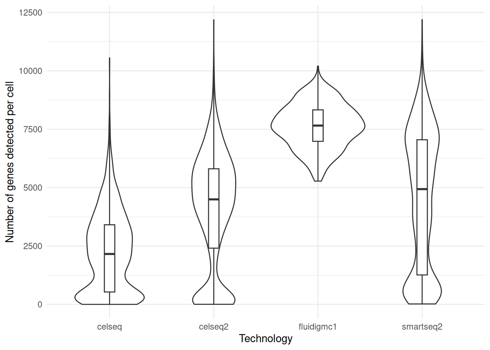
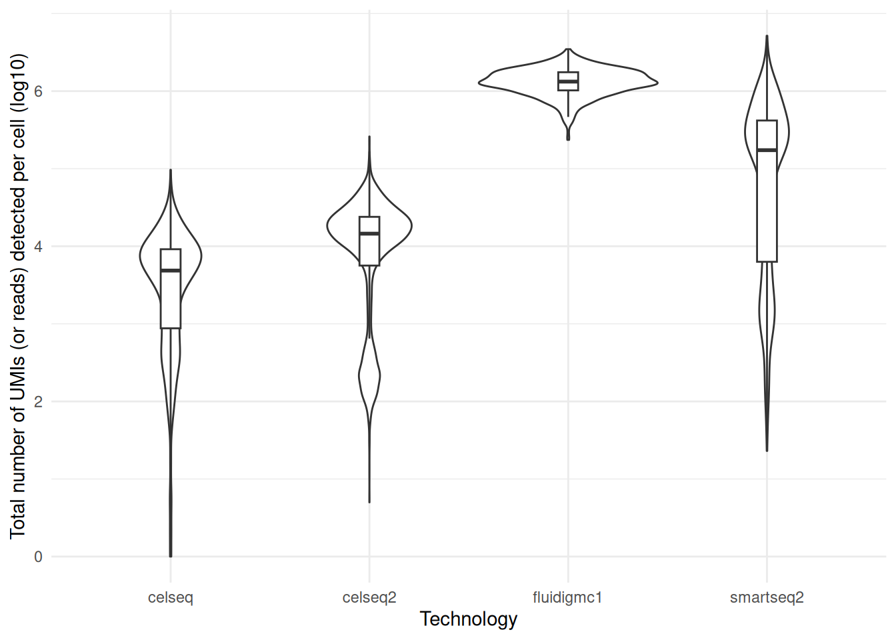
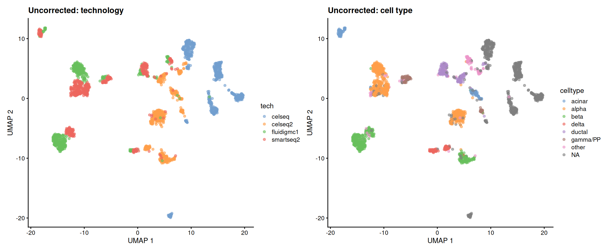
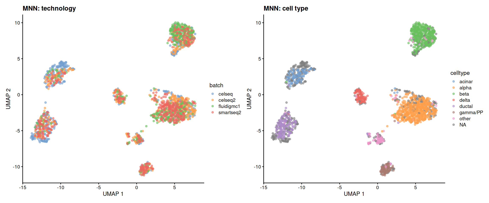
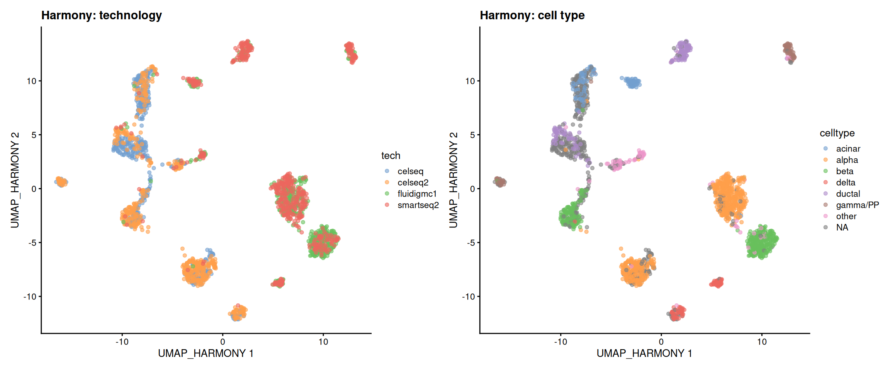
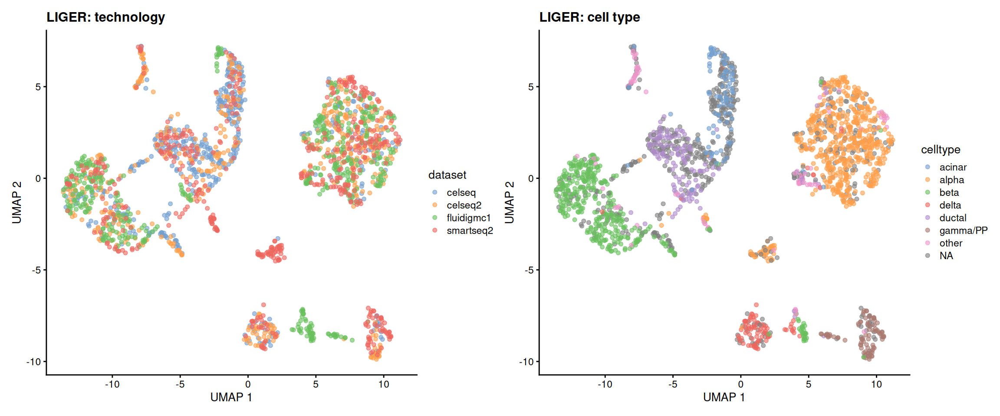

# 11  Lab 6: Batch correction

> **NOTE:**
>
> The estimated time for this lab is around 1h20.

> **TIP:**
>
> - Process pancreas scRNAseq datasets from different technologies.
> - Merge the datasets and analyse them without batch correction.
> - Use MNN (`batchelor`) and `Harmony` to perform batch correction in a reduced dimensional space.
> - Use LIGER to perform batch correction using integrative non-negative matrix factorization.
> - Perform pseudobulk differential expression analysis on integrated data.

In this lab, we will look at different single cell RNA-seq datasets collected from pancreatic islets. We will look at how different batch correction methods affect our data analysis.

## 11.1 Read in pancreas expression matrices

Four different datasets of human pancreatic islets are distributed by the `scRNAseq` package. These datasets were collected using different single cell RNA-seq technologies:

- `CEL-seq`: [Grün et al., Cell Stem Cell 2016](https://doi.org/10.1016/j.stem.2016.05.010)
- `CEL-seq2`: [Muraro et al., Cell Systems 2016](https://doi.org/10.1016/j.cels.2016.09.002)
- `Fluidigm C1`: [Lawlor et al., Genome Research 2017](https://doi.org/10.1101/gr.212720.116)
- `Smart-seq2`: [Segerstolpe et al., Cell Metabolism 2016](https://doi.org/10.1016/j.cmet.2016.08.020)

> **NOTE:**
>
> Import the four datasets into R. What is the size and sparsity of each dataset?
>
> > **NOTE:**
> >
> > ``` r
> > library(SingleCellExperiment)
> > ##  Loading required package: SummarizedExperiment
> > ##  Loading required package: MatrixGenerics
> > ##  Loading required package: matrixStats
> > ##  
> > ##  Attaching package: 'MatrixGenerics'
> > ##  The following objects are masked from 'package:matrixStats':
> > ##  
> > ##      colAlls, colAnyNAs, colAnys, colAvgsPerRowSet, colCollapse,
> > ##      colCounts, colCummaxs, colCummins, colCumprods, colCumsums,
> > ##      colDiffs, colIQRDiffs, colIQRs, colLogSumExps, colMadDiffs,
> > ##      colMads, colMaxs, colMeans2, colMedians, colMins, colOrderStats,
> > ##      colProds, colQuantiles, colRanges, colRanks, colSdDiffs, colSds,
> > ##      colSums2, colTabulates, colVarDiffs, colVars, colWeightedMads,
> > ##      colWeightedMeans, colWeightedMedians, colWeightedSds,
> > ##      colWeightedVars, rowAlls, rowAnyNAs, rowAnys, rowAvgsPerColSet,
> > ##      rowCollapse, rowCounts, rowCummaxs, rowCummins, rowCumprods,
> > ##      rowCumsums, rowDiffs, rowIQRDiffs, rowIQRs, rowLogSumExps,
> > ##      rowMadDiffs, rowMads, rowMaxs, rowMeans2, rowMedians, rowMins,
> > ##      rowOrderStats, rowProds, rowQuantiles, rowRanges, rowRanks,
> > ##      rowSdDiffs, rowSds, rowSums2, rowTabulates, rowVarDiffs,
> > ##      rowVars, rowWeightedMads, rowWeightedMeans, rowWeightedMedians,
> > ##      rowWeightedSds, rowWeightedVars
> > ##  Loading required package: GenomicRanges
> > ##  Loading required package: stats4
> > ##  Loading required package: BiocGenerics
> > ##  Loading required package: generics
> > ##  
> > ##  Attaching package: 'generics'
> > ##  The following objects are masked from 'package:base':
> > ##  
> > ##      as.difftime, as.factor, as.ordered, intersect, is.element,
> > ##      setdiff, setequal, union
> > ##  
> > ##  Attaching package: 'BiocGenerics'
> > ##  The following objects are masked from 'package:stats':
> > ##  
> > ##      IQR, mad, sd, var, xtabs
> > ##  The following object is masked from 'package:utils':
> > ##  
> > ##      data
> > ##  The following objects are masked from 'package:base':
> > ##  
> > ##      Filter, Find, Map, Position, Reduce, anyDuplicated, aperm,
> > ##      append, as.data.frame, basename, cbind, colnames, dirname,
> > ##      do.call, duplicated, eval, evalq, get, grep, grepl, is.unsorted,
> > ##      lapply, mapply, match, mget, order, paste, pmax, pmax.int, pmin,
> > ##      pmin.int, rank, rbind, rownames, sapply, saveRDS, scale,
> > ##      sequence, table, tapply, transform, unique, unsplit, which.max,
> > ##      which.min
> > ##  Loading required package: S4Vectors
> > ##  
> > ##  Attaching package: 'S4Vectors'
> > ##  The following object is masked from 'package:utils':
> > ##  
> > ##      findMatches
> > ##  The following objects are masked from 'package:base':
> > ##  
> > ##      I, expand.grid, unname
> > ##  Loading required package: IRanges
> > ##  Loading required package: Seqinfo
> > ##  Loading required package: Biobase
> > ##  Welcome to Bioconductor
> > ##  
> > ##      Vignettes contain introductory material; view with
> > ##      'browseVignettes()'. To cite Bioconductor, see
> > ##      'citation("Biobase")', and for packages 'citation("pkgname")'.
> > ##  
> > ##  Attaching package: 'Biobase'
> > ##  The following object is masked from 'package:MatrixGenerics':
> > ##  
> > ##      rowMedians
> > ##  The following objects are masked from 'package:matrixStats':
> > ##  
> > ##      anyMissing, rowMedians
> > library(scRNAseq)
> > ##  OpenTelemetry error: there is no package called 'otelsdk'
> > ##  OpenTelemetry error: there is no package called 'otelsdk'
> > celseq <- fetchDataset("grun-pancreas-2016", "2023-12-14")
> > celseq2 <- fetchDataset("muraro-pancreas-2016", "2023-12-19")
> > fluidigmc1 <- fetchDataset("lawlor-pancreas-2017", "2023-12-17")
> > smartseq2 <- fetchDataset("segerstolpe-pancreas-2016", "2023-12-19")
> > celseq
> > ##  class: SingleCellExperiment 
> > ##  dim: 20064 1728 
> > ##  metadata(0):
> > ##  assays(1): counts
> > ##  rownames(20064): A1BG-AS1__chr19 A1BG__chr19 ... ZZEF1__chr17
> > ##    ZZZ3__chr1
> > ##  rowData names(2): symbol chr
> > ##  colnames(1728): D2ex_1 D2ex_2 ... D17TGFB_95 D17TGFB_96
> > ##  colData names(2): donor sample
> > ##  reducedDimNames(0):
> > ##  mainExpName: endogenous
> > ##  altExpNames(1): ERCC
> > celseq2
> > ##  class: SingleCellExperiment 
> > ##  dim: 19059 3072 
> > ##  metadata(0):
> > ##  assays(1): counts
> > ##  rownames(19059): A1BG-AS1__chr19 A1BG__chr19 ... ZZEF1__chr17
> > ##    ZZZ3__chr1
> > ##  rowData names(2): symbol chr
> > ##  colnames(3072): D28-1_1 D28-1_2 ... D30-8_95 D30-8_96
> > ##  colData names(3): label donor plate
> > ##  reducedDimNames(0):
> > ##  mainExpName: endogenous
> > ##  altExpNames(1): ERCC
> > fluidigmc1
> > ##  class: SingleCellExperiment 
> > ##  dim: 26616 638 
> > ##  metadata(0):
> > ##  assays(1): counts
> > ##  rownames(26616): ENSG00000229483 ENSG00000232849 ... ENSG00000251576
> > ##    ENSG00000082898
> > ##  rowData names(0):
> > ##  colnames(638): 10th_C10_S104 10th_C11_S96 ... 9th-C96_S81 9th-C9_S13
> > ##  colData names(7): age bmi ... race Sex
> > ##  reducedDimNames(0):
> > ##  mainExpName: NULL
> > ##  altExpNames(0):
> > smartseq2
> > ##  class: SingleCellExperiment 
> > ##  dim: 26179 3514 
> > ##  metadata(0):
> > ##  assays(1): counts
> > ##  rownames(26179): SGIP1 AZIN2 ... BIVM-ERCC5 eGFP
> > ##  rowData names(1): refseq
> > ##  colnames(3514): HP1502401_N13 HP1502401_D14 ... HP1526901T2D_O11
> > ##    HP1526901T2D_A8
> > ##  colData names(9): individual sex ... submitted single cell quality
> > ##    inferred cell type
> > ##  reducedDimNames(0):
> > ##  mainExpName: endogenous
> > ##  altExpNames(1): ERCC
> > ```

## 11.2 Harmonize the four datasets

Datasets published by different labs rarely look alike: genes may be named differently, cell annotations may be stored in different columns (with different names for the same cell types), counts may not be integers… Before anything else, we need to make the four datasets consistent.

> **NOTE:**
>
> - How are genes named in each dataset? Use gene symbols for all of them.
> - Which cell annotations are available? Gather them in a common `celltype` column.
>
> > **NOTE:**
> >
> > ``` r
> > head(rownames(celseq))
> > ##  [1] "A1BG-AS1__chr19" "A1BG__chr19"     "A1CF__chr10"     "A2M-AS1__chr12" 
> > ##  [5] "A2ML1__chr12"    "A2MP1__chr12"
> > head(rownames(celseq2))
> > ##  [1] "A1BG-AS1__chr19" "A1BG__chr19"     "A1CF__chr10"     "A2M-AS1__chr12" 
> > ##  [5] "A2ML1__chr12"    "A2M__chr12"
> > head(rownames(fluidigmc1))
> > ##  [1] "ENSG00000229483" "ENSG00000232849" "ENSG00000229558" "ENSG00000232977"
> > ##  [5] "ENSG00000227893" "ENSG00000238230"
> > head(rownames(smartseq2))
> > ##  [1] "SGIP1"   "AZIN2"   "CLIC4"   "AGBL4"   "NECAP2"  "SLC45A1"
> > ```
> >
> > `CEL-seq` and `CEL-seq2` datasets store gene symbols in their `rowData`, and the `Fluidigm C1` dataset uses Ensembl gene IDs, which we can translate into gene symbols with the `org.Hs.eg.db` annotation package.
> >
> > ``` r
> > rownames(celseq) <- rowData(celseq)$symbol
> > rownames(celseq2) <- rowData(celseq2)$symbol
> > rownames(fluidigmc1) <- AnnotationDbi::mapIds(
> >     org.Hs.eg.db::org.Hs.eg.db, keys = rownames(fluidigmc1),
> >     keytype = "ENSEMBL", column = "SYMBOL"
> > )
> > ##  
> > ##  'select()' returned 1:many mapping between keys and columns
> >
> > ## - Remove genes without a symbol, or with a duplicated symbol
> > clean_genes <- function(sce) {
> >     sce[!is.na(rownames(sce)) & !duplicated(rownames(sce)), ]
> > }
> > celseq <- clean_genes(celseq)
> > celseq2 <- clean_genes(celseq2)
> > fluidigmc1 <- clean_genes(fluidigmc1)
> > smartseq2 <- clean_genes(smartseq2)
> > ```
> >
> > Cell annotations are found in the `label` (`CEL-seq2`), `cell type` (`Fluidigm C1`) and `inferred cell type` (`Smart-seq2`) columns. The `CEL-seq` dataset does not come with cell annotations.
> >
> > ``` r
> > harmonize_labels <- function(x) {
> >     x <- sub(" cell$", "", tolower(x))
> >     dplyr::case_when(
> >         x %in% c("alpha", "beta", "delta", "acinar") ~ x,
> >         x %in% c("gamma", "pp", "gamma/pp") ~ "gamma/PP",
> >         x %in% c("duct", "ductal") ~ "ductal",
> >         is.na(x) ~ NA_character_,
> >         TRUE ~ "other"
> >     )
> > }
> > celseq$celltype <- NA_character_
> > celseq2$celltype <- harmonize_labels(celseq2$label)
> > fluidigmc1$celltype <- harmonize_labels(fluidigmc1$`cell type`)
> > smartseq2$celltype <- harmonize_labels(smartseq2$`inferred cell type`)
> > table(smartseq2$`inferred cell type`, smartseq2$celltype, useNA = 'ifany')
> > ##                               
> > ##                                acinar alpha beta delta ductal gamma/PP other
> > ##    MHC class II cell                0     0    0     0      0        0     5
> > ##    PSC cell                         0     0    0     0      0        0    54
> > ##    acinar cell                    185     0    0     0      0        0     0
> > ##    alpha cell                       0   886    0     0      0        0     0
> > ##    beta cell                        0     0  270     0      0        0     0
> > ##    co-expression cell               0     0    0     0      0        0    39
> > ##    delta cell                       0     0    0   114      0        0     0
> > ##    ductal cell                      0     0    0     0    386        0     0
> > ##    endothelial cell                 0     0    0     0      0        0    16
> > ##    epsilon cell                     0     0    0     0      0        0     7
> > ##    gamma cell                       0     0    0     0      0      197     0
> > ##    mast cell                        0     0    0     0      0        0     7
> > ##    unclassified cell                0     0    0     0      0        0     2
> > ##    unclassified endocrine cell      0     0    0     0      0        0    41
> > ##    <NA>                             0     0    0     0      0        0     0
> > ##                               
> > ##                                <NA>
> > ##    MHC class II cell              0
> > ##    PSC cell                       0
> > ##    acinar cell                    0
> > ##    alpha cell                     0
> > ##    beta cell                      0
> > ##    co-expression cell             0
> > ##    delta cell                     0
> > ##    ductal cell                    0
> > ##    endothelial cell               0
> > ##    epsilon cell                   0
> > ##    gamma cell                     0
> > ##    mast cell                      0
> > ##    unclassified cell              0
> > ##    unclassified endocrine cell    0
> > ##    <NA>                        1305
> > ```
> >
> > Finally, we keep a minimal and consistent set of information for each dataset: the counts (rounded to integers and stored as sparse matrices), the cell type and the technology.
> >
> > ``` r
> > tidy_sce <- function(sce, tech) {
> >     SingleCellExperiment(
> >         assays = list(counts = as(round(counts(sce)), "dgCMatrix")),
> >         colData = DataFrame(celltype = sce$celltype, tech = tech, row.names = colnames(sce))
> >     )
> > }
> > celseq <- tidy_sce(celseq, "celseq")
> > celseq2 <- tidy_sce(celseq2, "celseq2")
> > fluidigmc1 <- tidy_sce(fluidigmc1, "fluidigmc1")
> > smartseq2 <- tidy_sce(smartseq2, "smartseq2")
> > ```

## 11.3 Analyze each pancreas dataset without batch correction

We will first analyze each dataset separately to see if there are any differences between the datasets.

> **NOTE:**
>
> What is the size of each single cell RNA-seq dataset?
>
> Briefly describe the technology used to collect each dataset.
>
> Which datasets do you expect to be different and which do you expect to be similar?
>
> > **NOTE:**
> >
> > ``` r
> > dim(celseq)
> > ##  [1] 20053  1728
> > dim(celseq2)
> > ##  [1] 19046  3072
> > dim(fluidigmc1)
> > ##  [1] 20983   638
> > dim(smartseq2)
> > ##  [1] 25454  3514
> > ```

> **NOTE:**
>
> Compute QC metrics for each dataset, and look at the distributions of number of genes per cell.
>
> > **NOTE:**
> >
> > ``` r
> > library(ggplot2)
> >
> > celseq_raw <- scrapper::quickRnaQc.se(celseq, subsets = list())
> > celseq2_raw <- scrapper::quickRnaQc.se(celseq2, subsets = list())
> > fluidigmc1_raw <- scrapper::quickRnaQc.se(fluidigmc1, subsets = list())
> > smartseq2_raw <- scrapper::quickRnaQc.se(smartseq2, subsets = list())
> >
> > df <- rbind(
> >     data.frame(tech = celseq_raw$tech, nGenes = celseq_raw$detected, totalUMIs = celseq_raw$sum),
> >     data.frame(tech = celseq2_raw$tech, nGenes = celseq2_raw$detected, totalUMIs = celseq2_raw$sum),
> >     data.frame(tech = fluidigmc1_raw$tech, nGenes = fluidigmc1_raw$detected, totalUMIs = fluidigmc1_raw$sum),
> >     data.frame(tech = smartseq2_raw$tech, nGenes = smartseq2_raw$detected, totalUMIs = smartseq2_raw$sum)
> > )
> >
> > ggplot(df, aes(x = tech, y = nGenes)) +
> >     geom_violin(trim = TRUE) +
> >     geom_boxplot(width = 0.1, position = position_dodge(0.9), outlier.shape = NA) +
> >     theme_minimal() +
> >     ylab("Number of genes detected per cell") +
> >     xlab("Technology")
> > ```
> >
> > 
> >
> > ``` r
> >
> > ggplot(df, aes(x = tech, y = log10(totalUMIs + 1))) +
> >     geom_violin(trim = TRUE) +
> >     geom_boxplot(width = 0.1, position = position_dodge(0.9), outlier.shape = NA) +
> >     theme_minimal() +
> >     ylab("Total number of UMIs (or reads) detected per cell (log10)") +
> >     xlab("Technology")
> > ```
> >
> > 

Now we will subset the data to remove cells with low gene counts.

> **NOTE:**
>
> Subset the data to remove cells with:
>
> - fewer than 1750 genes for CEL-Seq;
> - fewer than 2500 genes for CEL-Seq2;
> - fewer than 2500 genes for SMART-Seq2.
>
> > **NOTE:**
> >
> > ``` r
> > celseq <- celseq_raw[ , celseq_raw$detected > 1750 ]
> > celseq2 <- celseq2_raw[ , celseq2_raw$detected > 2500 ]
> > smartseq2 <- smartseq2_raw[ , smartseq2_raw$detected > 2500 ]
> > fluidigmc1 <- fluidigmc1_raw
> > c(celseq = ncol(celseq), celseq2 = ncol(celseq2), fluidigmc1 = ncol(fluidigmc1), smartseq2 = ncol(smartseq2))
> > ##      celseq    celseq2 fluidigmc1  smartseq2 
> > ##         998       2283        638       2394
> > ```

Now we will subsample each dataset to only have 500 cells. This is to speed up subsequent analyses. Often when we are setting up our analysis, we work with a subset of the data to make iteration across analysis decisions faster, and once we have finalized how we want to do the analysis, we work with the full dataset.

> **NOTE:**
>
> Randomly subsample each full dataset to 500 cells.
>
> > **NOTE:**
> >
> > ``` r
> > set.seed(42)
> > celseq <- celseq[ , sample(colnames(celseq), 500) ]
> > celseq2 <- celseq2[ , sample(colnames(celseq2), 500) ]
> > fluidigmc1 <- fluidigmc1[ , sample(colnames(fluidigmc1), 500) ]
> > smartseq2 <- smartseq2[ , sample(colnames(smartseq2), 500) ]
> > ```

Now we will subset each dataset to only retain the common genes across all four datasets.

> **NOTE:**
>
> - Using `Reduce`, find the common genes across all four datasets.
> - Subset each dataset to only retain these common genes.
>
> > **NOTE:**
> >
> > ``` r
> > common_genes <- Reduce(intersect, list(
> >     rownames(celseq),
> >     rownames(celseq2),
> >     rownames(fluidigmc1),
> >     rownames(smartseq2)
> > ))
> > length(common_genes)
> > ##  [1] 14958
> >
> > celseq <- celseq[common_genes, ]
> > celseq2 <- celseq2[common_genes, ]
> > fluidigmc1 <- fluidigmc1[common_genes, ]
> > smartseq2 <- smartseq2[common_genes, ]
> > ```

## 11.4 Individual processing

Like what we have done in previous labs, we will now normalize, identify variable genes, and perform PCA embedding. Note that we ask `normalizeRnaCounts.se()` to store the log-normalized counts as an actual sparse matrix (`delayed = FALSE`) rather than as a `LogNormalizedMatrix`: some tools, such as `batchelor`, are much faster with it.

``` r
process_batch <- function(sce) {
    clusters <- scran::quickCluster(sce)
    sce <- scran::computeSumFactors(sce, clusters = clusters)
    sce <- scrapper::normalizeRnaCounts.se(
        sce, size.factors = sizeFactors(sce), more.norm.args = list(delayed = FALSE)
    )
    sce <- scrapper::chooseRnaHvgs.se(sce, top = 2000)
    sce <- scrapper::runPca.se(sce, features = rowData(sce)$hvg, number = 50)
    return(sce)
}
set.seed(42)
celseq <- process_batch(celseq)
celseq2 <- process_batch(celseq2)
fluidigmc1 <- process_batch(fluidigmc1)
smartseq2 <- process_batch(smartseq2)
```

The integration workflows require the identification of shared variable genes. Why would we need such a requirement?

> **NOTE:**
>
> Find the genes which are highly variable in all four datasets.
>
> > **NOTE:**
> >
> > ``` r
> > shared_hvgs <- Reduce(intersect, list(
> >     rownames(celseq)[rowData(celseq)$hvg],
> >     rownames(celseq2)[rowData(celseq2)$hvg],
> >     rownames(fluidigmc1)[rowData(fluidigmc1)$hvg],
> >     rownames(smartseq2)[rowData(smartseq2)$hvg]
> > ))
> >
> > length(shared_hvgs)
> > ##  [1] 377
> > ```

## 11.5 Without batch correction

Let’s first merge the four datasets and analyze them together, *without* any batch correction.

> **NOTE:**
>
> - Merge the four datasets in a single `SingleCellExperiment` object.
> - Compute a PCA and a UMAP embedding of the merged data, using the shared highly variable genes.
> - Plot the UMAP embedding, coloring cells by technology and by cell type. Comment.
>
> > **NOTE:**
> >
> > ``` r
> > library(scater)
> > ##  Loading required package: scuttle
> > library(patchwork)
> > batches <- list(celseq = celseq, celseq2 = celseq2, fluidigmc1 = fluidigmc1, smartseq2 = smartseq2)
> > merged <- SingleCellExperiment(
> >     assays = list(
> >         counts = do.call(cbind, lapply(batches, counts)),
> >         logcounts = do.call(cbind, lapply(batches, logcounts))
> >     ),
> >     colData = do.call(rbind, lapply(batches, function(x) colData(x)[, c("celltype", "tech")]))
> > )
> > merged
> > ##  class: SingleCellExperiment 
> > ##  dim: 14958 2000 
> > ##  metadata(0):
> > ##  assays(2): counts logcounts
> > ##  rownames(14958): A1BG A1CF ... ZZEF1 ZZZ3
> > ##  rowData names(0):
> > ##  colnames(2000): D102_50 D17TGFB_94 ... HP1502401_C12 HP1525301T2D_O2
> > ##  colData names(2): celltype tech
> > ##  reducedDimNames(0):
> > ##  mainExpName: NULL
> > ##  altExpNames(0):
> > set.seed(42)
> > merged <- scrapper::runPca.se(merged, features = rownames(merged) %in% shared_hvgs, number = 50)
> > merged <- runUMAP(merged, dimred = "PCA", n_neighbors = 15, min_dist = 0.5)
> > plotUMAP(merged, colour_by = "tech") + ggtitle("Uncorrected: technology") +
> >     plotUMAP(merged, colour_by = "celltype") + ggtitle("Uncorrected: cell type")
> > ```
> >
> > 

## 11.6 Batch correction with MNN

We will now use MNN to see to what extent it can remove potential batch effects.

> **NOTE:**
>
> - Use the `fastMNN` function to perform MNN batch correction across the four datasets.
>
> > **NOTE:**
> >
> > ``` r
> > library(batchelor)
> >
> > set.seed(42)
> > merged_mnn <- fastMNN(
> >     celseq = celseq,
> >     celseq2 = celseq2,
> >     fluidigmc1 = fluidigmc1,
> >     smartseq2 = smartseq2,
> >     subset.row = shared_hvgs,
> >     d = 50,
> >     correct.all = TRUE
> > )
> >
> > merged_mnn
> > ##  class: SingleCellExperiment 
> > ##  dim: 14958 2000 
> > ##  metadata(2): merge.info pca.info
> > ##  assays(1): reconstructed
> > ##  rownames(14958): A1BG A1CF ... ZZEF1 ZZZ3
> > ##  rowData names(1): rotation
> > ##  colnames(2000): D102_50 D17TGFB_94 ... HP1502401_C12 HP1525301T2D_O2
> > ##  colData names(1): batch
> > ##  reducedDimNames(1): corrected
> > ##  mainExpName: NULL
> > ##  altExpNames(0):
> >
> > assay(merged_mnn, "reconstructed")[1:5, 1:5]
> > ##  <5 x 5> LowRankMatrix object of type "double":
> > ##               D102_50    D17TGFB_94        D71_53      D3en4_22       D2ex_86
> > ##  A1BG   -0.0009091680 -0.0045212763 -0.0103527286  0.0043815470 -0.0172441022
> > ##  A1CF   -0.0061661558  0.0008142993 -0.0130316068 -0.0274703567  0.0023763017
> > ##  A2ML1  -0.0026224573 -0.0038791854  0.0031942516 -0.0016367379 -0.0011788216
> > ##  A2M    -0.0041393253 -0.0094219225 -0.0097573537 -0.0077131679  0.0051770968
> > ##  A4GALT -0.0020953755 -0.0013512276 -0.0022443460 -0.0029360834 -0.0010738670
> > dim(assay(merged_mnn, "reconstructed"))
> > ##  [1] 14958  2000
> > range(assay(merged_mnn, "reconstructed"))
> > ##  [1] -0.1141985  0.3019973
> > mean(assay(merged_mnn, "reconstructed"))
> > ##  [1] -0.005460381
> > ```
>
> - Add back the raw counts and the cell types from each dataset to the merged object for downstream analysis.
>
> > **NOTE:**
> >
> > ``` r
> > assay(merged_mnn, "counts") <- counts(merged)
> > merged_mnn$celltype <- merged$celltype
> > ```

Let’s look at how well the batches have mixed after MNN correction.

``` r
set.seed(42)
merged_mnn <- runUMAP(merged_mnn, dimred = "corrected", n_neighbors = 15, min_dist = 0.5)
plotUMAP(merged_mnn, colour_by = "batch") + ggtitle("MNN: technology") +
    plotUMAP(merged_mnn, colour_by = "celltype") + ggtitle("MNN: cell type")
```



## 11.7 Batch correction with Harmony

[`Harmony`](https://doi.org/10.1038/s41592-019-0619-0) is another widely used method, which iteratively clusters cells in the PCA space and corrects the cluster centroids of each batch towards the global centroids. It is very fast, and also works directly on the PCA embedding.

> **NOTE:**
>
> Use [`harmony::RunHarmony()`](https://pati-ni.github.io/harmony/reference/RunHarmony.html) to correct the PCA embedding of the merged (uncorrected) data, then plot a UMAP embedding of the corrected data. Compare it to the MNN results.
>
> > **NOTE:**
> >
> > ``` r
> > set.seed(42)
> > merged <- harmony::RunHarmony(merged, group.by.vars = "tech")
> > ##  Transposing data matrix
> > ##  Using automatic lambda estimation
> > ##  Thetas: 2
> > ##  Initializing state using k-means centroids initialization
> > ##  Initializing centroids
> > ##  Harmony 1/10
> > ##  Harmony 2/10
> > ##  Harmony 3/10
> > ##  Harmony 4/10
> > ##  Harmony 5/10
> > ##  Harmony converged after 5 iterations
> > reducedDimNames(merged)
> > ##  [1] "PCA"     "UMAP"    "HARMONY"
> > merged <- runUMAP(merged, dimred = "HARMONY", n_neighbors = 15, min_dist = 0.5, name = "UMAP_HARMONY")
> > plotReducedDim(merged, "UMAP_HARMONY", colour_by = "tech") + ggtitle("Harmony: technology") +
> >     plotReducedDim(merged, "UMAP_HARMONY", colour_by = "celltype") + ggtitle("Harmony: cell type")
> > ```
> >
> > 

## 11.8 Batch correction: integrative non-negative matrix factorization (NMF)

Here we use integrative non-negative matrix factorization (NMF/LIGER) to see to what extent it can remove potential batch effects.

The important parameters in the batch correction are the number of factors (k), the penalty parameter (lambda), and the clustering resolution. The number of factors sets the number of factors (consisting of shared and dataset-specific factors) used in factorizing the matrix. The penalty parameter sets the balance between factors shared across the batches and factors specific to the individual batches. The default setting of lambda=5.0 is usually used by the Macosko lab. Resolution=1.0 is used in the Louvain clustering of the shared neighbor factors that have been quantile normalized.

``` r
ob.list <- list(
    "celseq" = counts(celseq),
    "celseq2" = counts(celseq2),
    "fluidigmc1" = counts(fluidigmc1),
    "smartseq2" = counts(smartseq2)
)

# Create a LIGER object with raw counts data from each batch.
library(rliger)
##  Package `rliger` has been updated massively since version 1.99.0, including the object structure which is not compatible with old versions.
##  
##  We recommand you backup your old analysis before overwriting any existing result.
##  
##  `readLiger()` is provided for reading an RDS file storing an old object and it converts the object to the up-to-date structure.
##  
##  Attaching package: 'rliger'
##  The following objects are masked from 'package:scater':
##  
##      normalize, runTSNE, runUMAP
##  The following object is masked from 'package:BiocGenerics':
##  
##      normalize
options(ligerVerbose = FALSE)
data.liger <- createLiger(ob.list)
##  ! No human mitochondrial gene found in the union of dataset "celseq"
##  ℹ Updated QC variables: "nUMI", "nGene", "mito", "ribo", and "hemo"
##  ! No human mitochondrial gene found in the union of dataset "celseq2"
##  ℹ Updated QC variables: "nUMI", "nGene", "mito", "ribo", and "hemo"
##  ! No human mitochondrial gene found in the union of dataset "fluidigmc1"
##  ℹ Updated QC variables: "nUMI", "nGene", "mito", "ribo", and "hemo"
##  ! No human mitochondrial gene found in the union of dataset "smartseq2"
##  ℹ Updated QC variables: "nUMI", "nGene", "mito", "ribo", and "hemo"

# Normalize gene expression for each batch.
data.liger <- rliger::normalize(data.liger)

# Find variable genes for LIGER analysis. Identify variable genes that are variable across most samples.
data.liger <- selectGenes(data.liger)
```

> **NOTE:**
>
> Scale the gene expression across the datasets.
>
> > **NOTE:**
> >
> > ``` r
> > data.liger <- scaleNotCenter(data.liger)
> > ```

Next, we will run the integrative non-negative matrix factorization.

> **NOTE:**
>
> Use the `runIntegration` function to perform the integrative non-negative matrix factorization.
>
> > **NOTE:**
> >
> > ``` r
> > data.liger <- runIntegration(data.liger, k = 30)
> > ```
>
> What do matrices H, V, and W represent, and what are their dimensions?
>
> > **NOTE:**
> >
> > ``` r
> > dim(getMatrix(data.liger, "H")$celseq)
> > ##  [1]  30 500
> > dim(getMatrix(data.liger, "V")$celseq)
> > ##  [1] 14605    30
> > dim(getMatrix(data.liger, "W"))
> > ##  [1] 14605    30
> > ```

Next, do normalization and clustering of cells in shared nearest factor space.

> **NOTE:**
>
> Do quantile normalization, cluster quantile normalized data
>
> > **NOTE:**
> >
> > ``` r
> > data.liger <- quantileNorm(data.liger)
> > ##  ℹ Using largest dataset of recommended type as reference: "celseq" with 500 cells
> > data.liger <- runCluster(data.liger, resolution = 1)
> > ```
>
> What are the dimensions of `H.norm`. What does this represent?
>
> > **NOTE:**
> >
> > ``` r
> > dim(getMatrix(data.liger, "H.norm"))
> > ##  [1] 2000   30
> > ```

Let’s see what the liger data looks like mapped onto a UMAP visualization.

> **NOTE:**
>
> Run UMAP on the quantile normalized data and visualize the clusters.
>
> > **NOTE:**
> >
> > ``` r
> > merged_liger <- SingleCellExperiment(
> >     colData = cellMeta(data.liger),
> >     reducedDims = list(liger = getMatrix(data.liger, "H.norm"))
> > )
> > merged_liger$celltype <- merged$celltype[match(merged_liger$barcode, colnames(merged))]
> > set.seed(42)
> > ## `rliger` also provides a `runUMAP()` function: we explicitly use the one from `scater`
> > merged_liger <- scater::runUMAP(merged_liger, dimred = 'liger', n_neighbors = 15, min_dist = 0.5)
> > plotUMAP(merged_liger, colour_by = "dataset") + ggtitle("LIGER: technology") +
> >     plotUMAP(merged_liger, colour_by = "celltype") + ggtitle("LIGER: cell type")
> > ```
> >
> > 

## 11.9 Clustering and differential gene expression

Clustering can now be performed over the integrated data (using `merged_mnn` here). Here we use the Louvain clustering algorithm.

Then, differential gene expression is performed between clusters, using a *pseudobulk* approach: counts are summed across all cells of each cluster, in each batch. Note that we use the original count data in all DE tests. We should never use values from the integrated data in DE tests, as they violate assumptions of independence among samples that are required for DE tests!

> **NOTE:**
>
> - Perform clustering on the MNN integrated data.
>
> > **NOTE:**
> >
> > ``` r
> > merged_mnn <- scrapper::clusterGraph.se(merged_mnn, reddim.type = "corrected", output.name = "cluster")
> > merged_mnn$cluster <- factor(merged_mnn$cluster)
> >
> > table(merged_mnn$cluster, merged_mnn$batch)
> > ##     
> > ##      celseq celseq2 fluidigmc1 smartseq2
> > ##    1     27      42         19        27
> > ##    2     77     152         99       111
> > ##    3    137      53         24        79
> > ##    4    140      58         18        34
> > ##    5     82     102        202        70
> > ##    6     13      24         16        52
> > ##    7     14      32         20        21
> > ##    8     10      37        102       106
> > table(merged_mnn$cluster, merged_mnn$celltype)
> > ##     
> > ##      acinar alpha beta delta ductal gamma/PP other
> > ##    1      0     1    1    81      0        0     2
> > ##    2      0   338    0     0      0        0     3
> > ##    3      0     0    0     2    137        0     4
> > ##    4     96     1    1     0      1        1     0
> > ##    5      0     0  356     1      1        0     9
> > ##    6      0     0    1     0      1       83     3
> > ##    7      0     1    0     1      5        0    57
> > ##    8      0   218    2     0      1        0     9
> > ```
>
> - Aggregate cells across batches and clusters to prepare pseudobulk data.
>
> > **NOTE:**
> >
> > ``` r
> > pseudobulk <- scrapper::aggregateAcrossCells.se(
> >     merged_mnn,
> >     factors = list(batch = merged_mnn$batch, cluster = merged_mnn$cluster),
> >     assay.type = "counts"
> > )
> > pseudobulk
> > ##  class: RangedSummarizedExperiment 
> > ##  dim: 14958 32 
> > ##  metadata(1): aggregated
> > ##  assays(2): sums detected
> > ##  rownames(14958): A1BG A1CF ... ZZEF1 ZZZ3
> > ##  rowData names(1): rotation
> > ##  colnames: NULL
> > ##  colData names(6): factor.batch factor.cluster ... celltype cluster
> > colData(pseudobulk)[, c("factor.batch", "factor.cluster", "counts")]
> > ##  DataFrame with 32 rows and 3 columns
> > ##      factor.batch factor.cluster    counts
> > ##       <character>       <factor> <integer>
> > ##  1         celseq              1        27
> > ##  2         celseq              2        77
> > ##  3         celseq              3       137
> > ##  4         celseq              4       140
> > ##  5         celseq              5        82
> > ##  ...          ...            ...       ...
> > ##  28     smartseq2              4        34
> > ##  29     smartseq2              5        70
> > ##  30     smartseq2              6        52
> > ##  31     smartseq2              7        21
> > ##  32     smartseq2              8       106
> >
> > ## - Only keep pseudo-samples aggregating at least 10 cells
> > pseudobulk <- pseudobulk[, pseudobulk$counts >= 10]
> > pseudobulk_se <- SummarizedExperiment(
> >     assays = list(counts = assay(pseudobulk, "sums")),
> >     colData = DataFrame(
> >         batch = factor(pseudobulk$factor.batch),
> >         cluster = factor(pseudobulk$factor.cluster)
> >     )
> > )
> > pseudobulk_se
> > ##  class: SummarizedExperiment 
> > ##  dim: 14958 32 
> > ##  metadata(0):
> > ##  assays(1): counts
> > ##  rownames(14958): A1BG A1CF ... ZZEF1 ZZZ3
> > ##  rowData names(0):
> > ##  colnames: NULL
> > ##  colData names(2): batch cluster
> > ```
>
> - Perform differential gene expression analysis across clusters.
>
> > **NOTE:**
> >
> > ``` r
> > library(DESeq2)
> > ##  
> > ##  Attaching package: 'DESeq2'
> > ##  The following object is masked from 'package:scater':
> > ##  
> > ##      fpkm
> > dds <- DESeqDataSet(pseudobulk_se, design = ~ batch + cluster)
> > ##  converting counts to integer mode
> > dds <- DESeq(dds)
> > ##  estimating size factors
> > ##  estimating dispersions
> > ##  gene-wise dispersion estimates
> > ##  mean-dispersion relationship
> > ##  final dispersion estimates
> > ##  fitting model and testing
> > resultsNames(dds)
> > ##   [1] "Intercept"                  "batch_celseq2_vs_celseq"   
> > ##   [3] "batch_fluidigmc1_vs_celseq" "batch_smartseq2_vs_celseq" 
> > ##   [5] "cluster_2_vs_1"             "cluster_3_vs_1"            
> > ##   [7] "cluster_4_vs_1"             "cluster_5_vs_1"            
> > ##   [9] "cluster_6_vs_1"             "cluster_7_vs_1"            
> > ##  [11] "cluster_8_vs_1"
> > res <- results(dds, contrast = c("cluster", levels(dds$cluster)[2], levels(dds$cluster)[1]))
> > res[order(res$padj), ]
> > ##  log2 fold change (MLE): cluster 2 vs 1 
> > ##  Wald test p-value: cluster 2 vs 1 
> > ##  DataFrame with 14958 rows and 6 columns
> > ##           baseMean log2FoldChange     lfcSE      stat      pvalue        padj
> > ##          <numeric>      <numeric> <numeric> <numeric>   <numeric>   <numeric>
> > ##  GLS     1166.7423        3.54686  0.284002   12.4888 8.59116e-36 1.23438e-31
> > ##  NPY1R     22.7093      -26.03353  2.121906  -12.2689 1.32989e-34 9.55389e-31
> > ##  FXYD5    525.5051        4.96155  0.432435   11.4735 1.79221e-30 8.58349e-27
> > ##  SYNE2   1046.8371       -3.63234  0.335651  -10.8218 2.71439e-27 9.75008e-24
> > ##  HADH    1133.6204       -5.84007  0.544800  -10.7197 8.23040e-27 2.36509e-23
> > ##  ...           ...            ...       ...       ...         ...         ...
> > ##  ZIC4     0.622271        0.00000   5.94781  0.000000    1.000000          NA
> > ##  ZNF536   0.688615       -1.21246   5.94243 -0.204035    0.838326          NA
> > ##  ZNF705D  0.789832       -2.72691   5.94625 -0.458593    0.646527          NA
> > ##  ZP2      0.731602        5.39535   5.86147  0.920479    0.357323          NA
> > ##  ZPBP2    0.240945       -1.34337   5.90616 -0.227453    0.820072          NA
> > ```

## 11.10 Session info

> **NOTE:**
>
>     ##  ─ Session info ────────────────────────────────────────────────────────────
>     ##   setting  value
>     ##   version  R version 4.6.1 (2026-06-24)
>     ##   os       Ubuntu 24.04.5 LTS
>     ##   system   x86_64, linux-gnu
>     ##   ui       X11
>     ##   language (EN)
>     ##   collate  C
>     ##   ctype    en_US.UTF-8
>     ##   tz       Etc/UTC
>     ##   date     2026-11-06
>     ##   pandoc   3.13 @ /usr/bin/ (via rmarkdown)
>     ##   quarto   1.11.5 @ /usr/local/bin/quarto
>     ##  
>     ##  ─ Packages ────────────────────────────────────────────────────────────────
>     ##   package              * version   date (UTC) lib source
>     ##   abind                  1.4-8     2024-09-12 [2] RSPM (R 4.6.0)
>     ##   alabaster.base         1.13.5    2026-11-04 [2] Bioconductor 3.24 (R 4.6.1)
>     ##   alabaster.matrix       1.13.4    2026-09-23 [2] Bioconductor 3.24 (R 4.6.1)
>     ##   alabaster.ranges       1.13.1    2026-09-06 [2] Bioconductor 3.24 (R 4.6.1)
>     ##   alabaster.sce          1.13.1    2026-09-06 [2] Bioconductor 3.24 (R 4.6.1)
>     ##   alabaster.schemas      1.13.0    2026-04-28 [2] Bioconductor 3.24 (R 4.6.1)
>     ##   alabaster.se           1.13.1    2026-09-06 [2] Bioconductor 3.24 (R 4.6.1)
>     ##   AnnotationDbi          1.75.2    2026-07-21 [2] Bioconductor 3.24 (R 4.6.1)
>     ##   AnnotationFilter       1.37.0    2026-04-28 [2] Bioconductor 3.24 (R 4.6.1)
>     ##   AnnotationHub          4.3.3     2026-10-23 [2] Bioconductor 3.24 (R 4.6.1)
>     ##   batchelor            * 1.29.0    2026-04-28 [2] Bioconductor 3.24 (R 4.6.1)
>     ##   beachmat               2.29.3    2026-09-23 [2] Bioconductor 3.24 (R 4.6.1)
>     ##   beeswarm               0.4.0     2021-06-01 [2] RSPM (R 4.6.0)
>     ##   Biobase              * 2.73.2    2026-07-29 [2] Bioconductor 3.24 (R 4.6.1)
>     ##   BiocBaseUtils          1.15.1    2026-05-10 [2] Bioconductor 3.24 (R 4.6.1)
>     ##   BiocFileCache          3.3.2     2026-11-06 [2] xgit (https://git.bioconductor.org/packages/BiocFileCache@709e8bb)
>     ##   BiocGenerics         * 0.59.12   2026-08-11 [2] Bioconductor 3.24 (R 4.6.1)
>     ##   BiocIO                 1.23.3    2026-04-29 [2] Bioconductor 3.24 (R 4.6.1)
>     ##   BiocManager            1.30.27   2025-11-14 [2] CRAN (R 4.6.1)
>     ##   BiocNeighbors          2.7.3     2026-08-21 [2] Bioconductor 3.24 (R 4.6.1)
>     ##   BiocParallel           1.47.0    2026-04-28 [2] Bioconductor 3.24 (R 4.6.1)
>     ##   BiocSingular           1.29.2    2026-10-08 [2] Bioconductor 3.24 (R 4.6.1)
>     ##   BiocVersion            3.24.0    2026-04-28 [2] Bioconductor 3.24 (R 4.6.1)
>     ##   Biostrings             2.81.9    2026-09-06 [2] Bioconductor 3.24 (R 4.6.1)
>     ##   bit                    4.6.0     2025-03-06 [2] RSPM (R 4.6.0)
>     ##   bit64                  4.8.6     2026-09-01 [2] RSPM (R 4.6.0)
>     ##   bitops                 1.1-0     2026-07-30 [2] RSPM (R 4.6.0)
>     ##   blob                   1.3.0     2026-01-14 [2] RSPM (R 4.6.0)
>     ##   bluster                1.23.1    2026-08-25 [2] Bioconductor 3.24 (R 4.6.1)
>     ##   cachem                 1.1.0     2024-05-16 [2] RSPM (R 4.6.0)
>     ##   cigarillo              1.3.1     2026-07-13 [2] Bioconductor 3.24 (R 4.6.1)
>     ##   cli                    3.6.6     2026-04-09 [2] RSPM (R 4.6.0)
>     ##   cluster                2.1.8.3   2026-07-30 [2] RSPM (R 4.6.1)
>     ##   codetools              0.2-20    2024-03-31 [3] CRAN (R 4.6.1)
>     ##   cowplot                1.2.0     2025-07-07 [2] RSPM (R 4.6.0)
>     ##   crayon                 1.5.3     2024-06-20 [2] RSPM (R 4.6.0)
>     ##   curl                   8.1.0     2026-10-14 [2] RSPM (R 4.6.0)
>     ##   DBI                    1.3.0     2026-02-25 [2] RSPM (R 4.6.0)
>     ##   dbplyr                 2.6.0     2026-06-17 [2] RSPM (R 4.6.0)
>     ##   DelayedArray           0.39.8    2026-09-30 [2] Bioconductor 3.24 (R 4.6.1)
>     ##   DelayedMatrixStats     1.35.0    2026-04-28 [2] Bioconductor 3.24 (R 4.6.1)
>     ##   DESeq2               * 1.53.7    2026-11-04 [2] Bioconductor 3.24 (R 4.6.1)
>     ##   dichromat              2.0-1     2026-07-22 [2] RSPM (R 4.6.0)
>     ##   digest                 0.6.39    2025-11-19 [2] RSPM (R 4.6.0)
>     ##   dplyr                  1.2.1     2026-04-03 [2] RSPM (R 4.6.0)
>     ##   dqrng                  0.4.1     2024-05-28 [2] RSPM (R 4.6.0)
>     ##   edgeR                  4.99.12   2026-11-04 [2] Bioconductor 3.24 (R 4.6.1)
>     ##   ensembldb              2.37.3    2026-06-07 [2] Bioconductor 3.24 (R 4.6.1)
>     ##   evaluate               1.0.5     2025-08-27 [2] RSPM (R 4.6.0)
>     ##   ExperimentHub          3.3.2     2026-08-12 [2] Bioconductor 3.24 (R 4.6.1)
>     ##   farver                 2.1.2     2024-05-13 [2] RSPM (R 4.6.0)
>     ##   fastmap                1.2.0     2024-05-15 [2] RSPM (R 4.6.0)
>     ##   filelock               1.0.3     2023-12-11 [2] RSPM (R 4.6.0)
>     ##   FNN                    1.1.4.1   2024-09-22 [2] RSPM (R 4.6.0)
>     ##   generics             * 0.1.4     2025-05-09 [2] RSPM (R 4.6.0)
>     ##   GenomeInfoDb           1.49.1    2026-05-24 [2] Bioconductor 3.24 (R 4.6.1)
>     ##   GenomicAlignments      1.49.2    2026-09-02 [2] Bioconductor 3.24 (R 4.6.1)
>     ##   GenomicFeatures        1.65.0    2026-04-28 [2] Bioconductor 3.24 (R 4.6.1)
>     ##   GenomicRanges        * 1.65.4    2026-09-02 [2] Bioconductor 3.24 (R 4.6.1)
>     ##   ggbeeswarm             0.7.3     2025-11-29 [2] RSPM (R 4.6.0)
>     ##   ggplot2              * 4.0.3     2026-04-22 [2] RSPM (R 4.6.0)
>     ##   ggrepel                0.9.8     2026-03-17 [2] RSPM (R 4.6.0)
>     ##   glue                   1.8.1     2026-04-17 [2] RSPM (R 4.6.0)
>     ##   gridExtra              2.3.1     2026-06-25 [2] RSPM (R 4.6.0)
>     ##   gtable                 0.3.6     2024-10-25 [2] RSPM (R 4.6.0)
>     ##   gypsum                 1.9.0     2026-04-28 [2] Bioconductor 3.24 (R 4.6.1)
>     ##   h5mread                1.5.3     2026-09-02 [2] Bioconductor 3.24 (R 4.6.1)
>     ##   harmony                2.0.5     2026-06-12 [2] RSPM (R 4.6.0)
>     ##   HDF5Array              1.41.3    2026-08-21 [2] Bioconductor 3.24 (R 4.6.1)
>     ##   htmltools              0.5.9     2025-12-04 [2] RSPM (R 4.6.0)
>     ##   htmlwidgets            1.6.4     2023-12-06 [2] RSPM (R 4.6.0)
>     ##   httr                   1.4.9     2026-09-01 [2] RSPM (R 4.6.0)
>     ##   httr2                  1.3.0     2026-07-13 [2] RSPM (R 4.6.0)
>     ##   igraph                 2.3.4     2026-09-30 [2] RSPM (R 4.6.0)
>     ##   IRanges              * 2.47.5    2026-08-27 [2] Bioconductor 3.24 (R 4.6.1)
>     ##   irlba                  2.4.1     2026-10-05 [2] RSPM (R 4.6.0)
>     ##   jsonlite               2.0.0     2025-03-27 [2] RSPM (R 4.6.0)
>     ##   KEGGREST               1.53.6    2026-07-23 [2] Bioconductor 3.24 (R 4.6.1)
>     ##   knitr                  1.52      2026-09-06 [2] RSPM (R 4.6.0)
>     ##   labeling               0.4.3     2023-08-29 [2] RSPM (R 4.6.0)
>     ##   lattice                0.23-1    2026-08-12 [2] RSPM (R 4.6.1)
>     ##   lazyeval               0.2.3     2026-04-04 [2] RSPM (R 4.6.0)
>     ##   leidenAlg              1.1.8     2026-05-31 [2] RSPM (R 4.6.0)
>     ##   lifecycle              1.0.5     2026-01-08 [2] RSPM (R 4.6.0)
>     ##   limma                  3.99.4    2026-11-04 [2] Bioconductor 3.24 (R 4.6.1)
>     ##   locfit                 1.5-9.12  2025-03-05 [2] RSPM (R 4.6.0)
>     ##   magrittr               2.0.5     2026-04-04 [2] RSPM (R 4.6.0)
>     ##   Matrix                 1.7-6     2026-07-25 [2] RSPM (R 4.6.1)
>     ##   MatrixGenerics       * 1.25.0    2026-04-28 [2] Bioconductor 3.24 (R 4.6.1)
>     ##   matrixStats          * 1.5.0     2025-01-07 [2] RSPM (R 4.6.0)
>     ##   memoise                2.0.1     2021-11-26 [2] RSPM (R 4.6.0)
>     ##   metapod                1.21.0    2026-04-28 [2] Bioconductor 3.24 (R 4.6.1)
>     ##   org.Hs.eg.db           3.24.4    2026-11-06 [2] Bioconductor
>     ##   otel                   0.2.0     2025-08-29 [2] RSPM (R 4.6.0)
>     ##   patchwork            * 1.3.2     2025-08-25 [2] RSPM (R 4.6.0)
>     ##   pillar                 1.11.1    2025-09-17 [2] RSPM (R 4.6.0)
>     ##   pkgconfig              2.0.3     2019-09-22 [2] RSPM (R 4.6.0)
>     ##   png                    0.1-9     2026-03-15 [2] RSPM (R 4.6.0)
>     ##   ProtGenerics           1.45.0    2026-04-28 [2] Bioconductor 3.24 (R 4.6.1)
>     ##   R6                     2.6.1     2025-02-15 [2] RSPM (R 4.6.0)
>     ##   RANN                   2.6.3     2026-08-24 [2] RSPM (R 4.6.0)
>     ##   rappdirs               0.3.4     2026-01-17 [2] RSPM (R 4.6.0)
>     ##   RColorBrewer           1.1-3     2022-04-03 [2] RSPM (R 4.6.0)
>     ##   Rcpp                   1.1.2     2026-07-05 [2] RSPM (R 4.6.0)
>     ##   RcppPlanc              2.0.16    2026-09-09 [2] RSPM (R 4.6.0)
>     ##   RCurl                  1.98-1.20 2026-08-21 [2] RSPM (R 4.6.0)
>     ##   ResidualMatrix         1.23.0    2026-04-28 [2] Bioconductor 3.24 (R 4.6.1)
>     ##   restfulr               0.0.17    2026-06-11 [2] RSPM (R 4.6.0)
>     ##   rhdf5                  2.57.20   2026-10-06 [2] Bioconductor 3.24 (R 4.6.1)
>     ##   rhdf5filters           1.25.5    2026-10-28 [2] Bioconductor 3.24 (R 4.6.1)
>     ##   Rhdf5lib               2.1.0     2026-04-28 [2] Bioconductor 3.24 (R 4.6.1)
>     ##   RhpcBLASctl            0.23-42   2023-02-11 [2] RSPM (R 4.6.0)
>     ##   rjson                  0.2.23    2024-09-16 [2] RSPM (R 4.6.0)
>     ##   rlang                  1.3.0     2026-07-05 [2] RSPM (R 4.6.0)
>     ##   rliger               * 2.2.1     2025-08-26 [2] RSPM (R 4.6.0)
>     ##   rmarkdown              2.32      2026-09-01 [2] RSPM (R 4.6.0)
>     ##   Rsamtools              2.29.0    2026-04-28 [2] Bioconductor 3.24 (R 4.6.1)
>     ##   RSpectra               0.16-2    2024-07-18 [2] RSPM (R 4.6.0)
>     ##   RSQLite                3.53.3    2026-06-30 [2] RSPM (R 4.6.0)
>     ##   rsvd                   1.0.6     2026-10-17 [2] RSPM (R 4.6.0)
>     ##   rtracklayer            1.73.0    2026-04-28 [2] Bioconductor 3.24 (R 4.6.1)
>     ##   S4Arrays               1.13.2    2026-09-30 [2] Bioconductor 3.24 (R 4.6.1)
>     ##   S4Vectors            * 0.51.10   2026-09-16 [2] Bioconductor 3.24 (R 4.6.1)
>     ##   S7                     0.2.2     2026-04-22 [2] RSPM (R 4.6.0)
>     ##   ScaledMatrix           1.21.0    2026-04-28 [2] Bioconductor 3.24 (R 4.6.1)
>     ##   scales                 1.4.0     2025-04-24 [2] RSPM (R 4.6.0)
>     ##   scater               * 1.41.3    2026-10-25 [2] Bioconductor 3.24 (R 4.6.1)
>     ##   sccore                 1.0.7     2026-04-06 [2] RSPM (R 4.6.0)
>     ##   scran                  1.41.1    2026-05-20 [2] Bioconductor 3.24 (R 4.6.1)
>     ##   scrapper               1.7.11    2026-11-04 [2] Bioconductor 3.24 (R 4.6.1)
>     ##   scRNAseq             * 2.27.0    2026-04-30 [2] Bioconductor 3.24 (R 4.6.1)
>     ##   scuttle              * 1.23.2    2026-08-27 [2] Bioconductor 3.24 (R 4.6.1)
>     ##   Seqinfo              * 1.3.2     2026-08-27 [2] Bioconductor 3.24 (R 4.6.1)
>     ##   sessioninfo            1.2.4     2026-06-04 [2] RSPM (R 4.6.0)
>     ##   SingleCellExperiment * 1.35.2    2026-07-16 [2] Bioconductor 3.24 (R 4.6.1)
>     ##   SparseArray            1.13.4    2026-09-30 [2] Bioconductor 3.24 (R 4.6.1)
>     ##   sparseMatrixStats      1.25.0    2026-04-28 [2] Bioconductor 3.24 (R 4.6.1)
>     ##   statmod                1.5.2     2026-05-17 [2] RSPM (R 4.6.0)
>     ##   SummarizedExperiment * 1.43.0    2026-04-28 [2] Bioconductor 3.24 (R 4.6.1)
>     ##   tibble                 3.3.1     2026-01-11 [2] RSPM (R 4.6.0)
>     ##   tidyselect             1.2.1     2024-03-11 [2] RSPM (R 4.6.0)
>     ##   UCSC.utils             1.9.0     2026-04-28 [2] Bioconductor 3.24 (R 4.6.1)
>     ##   uwot                   0.2.5     2026-08-29 [2] RSPM (R 4.6.0)
>     ##   vctrs                  0.7.3     2026-04-11 [2] RSPM (R 4.6.0)
>     ##   vipor                  0.4.7     2023-12-18 [2] RSPM (R 4.6.0)
>     ##   viridis                0.6.5     2024-01-29 [2] RSPM (R 4.6.0)
>     ##   viridisLite            0.4.3     2026-02-04 [2] RSPM (R 4.6.0)
>     ##   withr                  3.0.3     2026-06-19 [2] RSPM (R 4.6.0)
>     ##   xfun                   0.62      2026-10-16 [2] RSPM (R 4.6.0)
>     ##   XML                    3.99-0.25 2026-09-27 [2] RSPM (R 4.6.0)
>     ##   XVector                0.53.0    2026-04-28 [2] Bioconductor 3.24 (R 4.6.1)
>     ##   yaml                   2.3.12    2025-12-10 [2] RSPM (R 4.6.0)
>     ##  
>     ##   [1] /tmp/RtmpYDUaaM/Rinstca9466ba
>     ##   [2] /usr/local/lib/R/site-library
>     ##   [3] /usr/local/lib/R/library
>     ##   * ── Packages attached to the search path.
>     ##  
>     ##  ───────────────────────────────────────────────────────────────────────────
