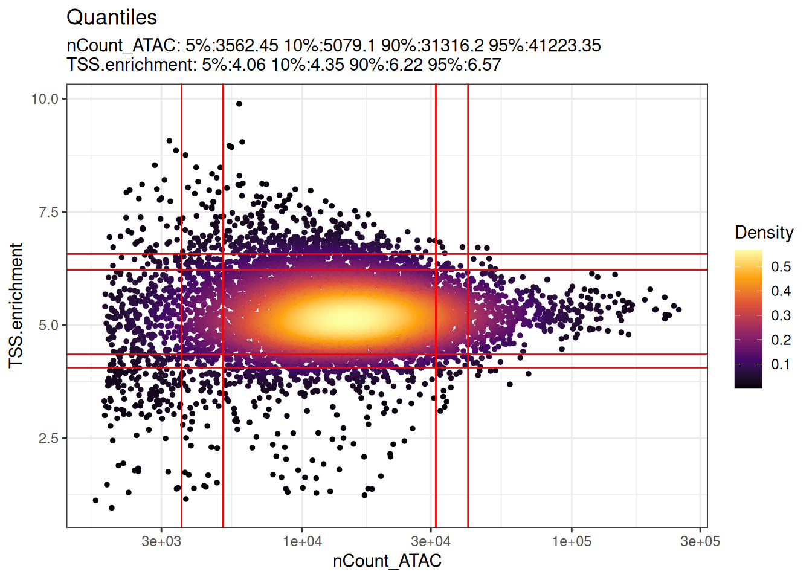
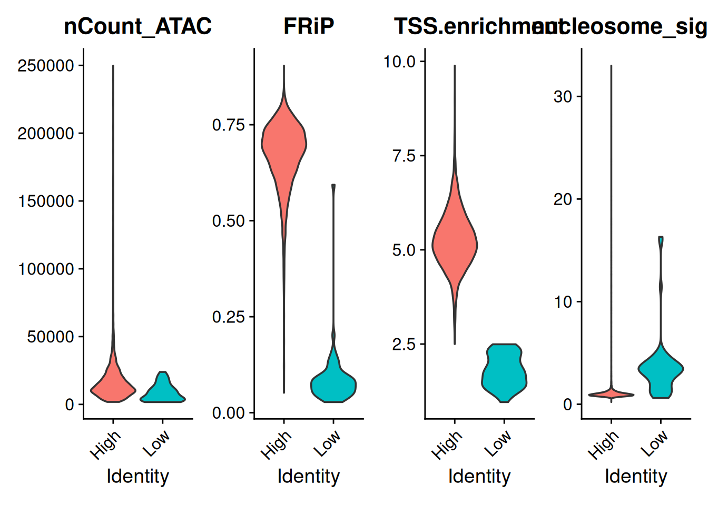
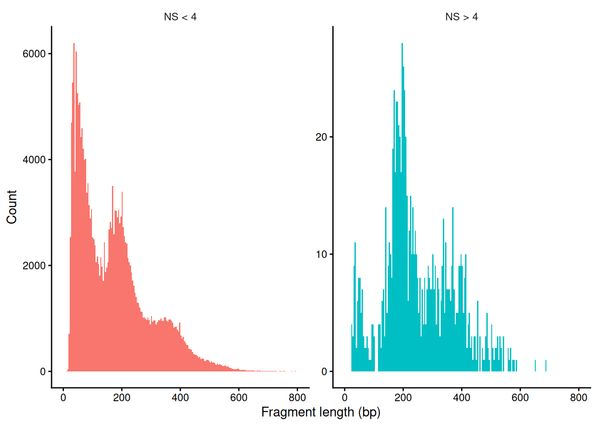
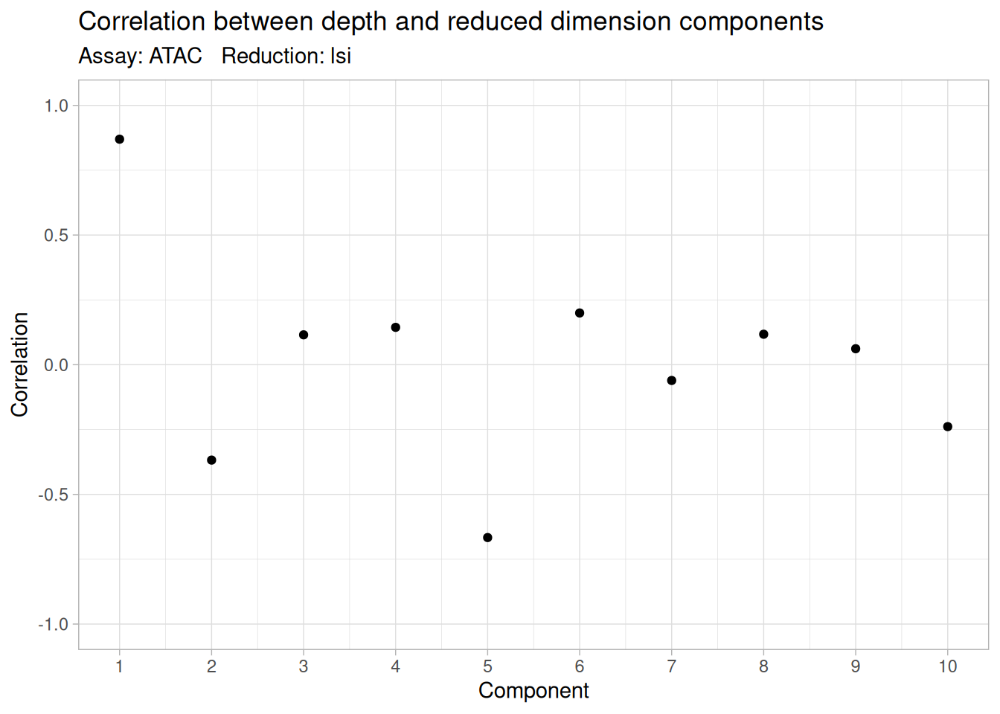
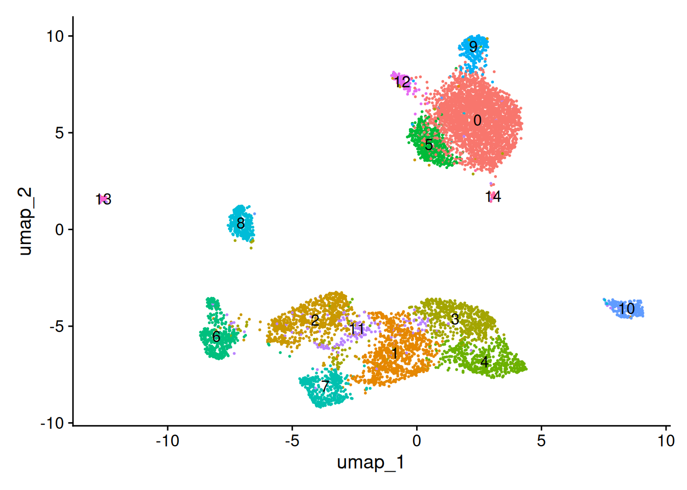
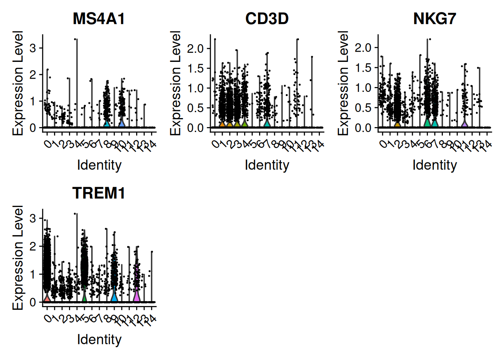
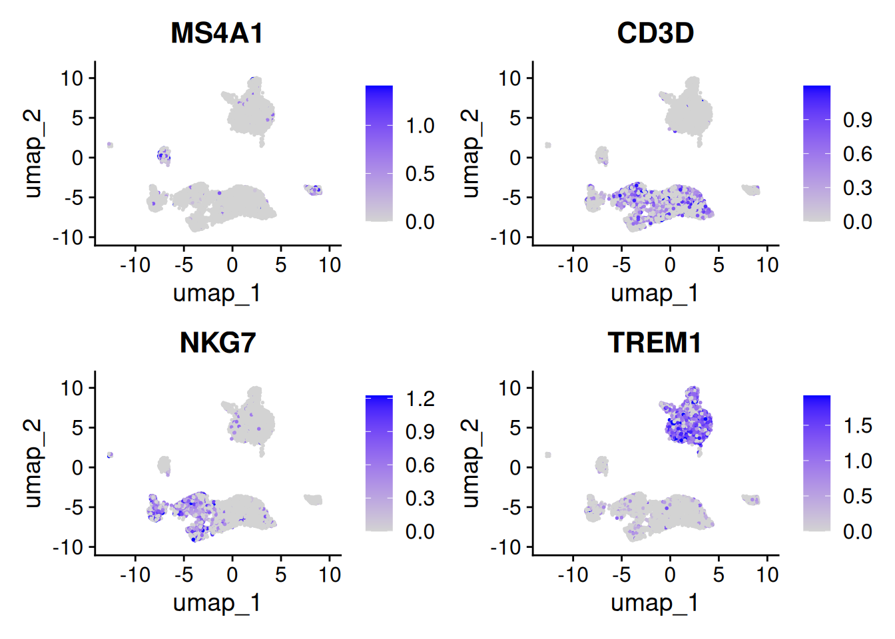
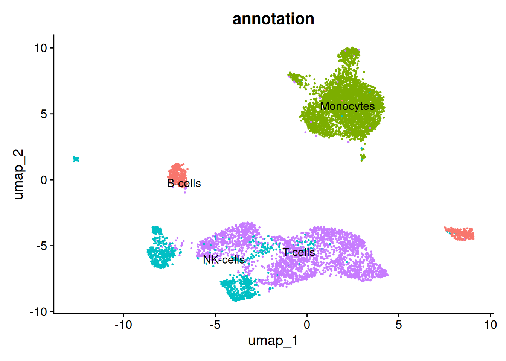
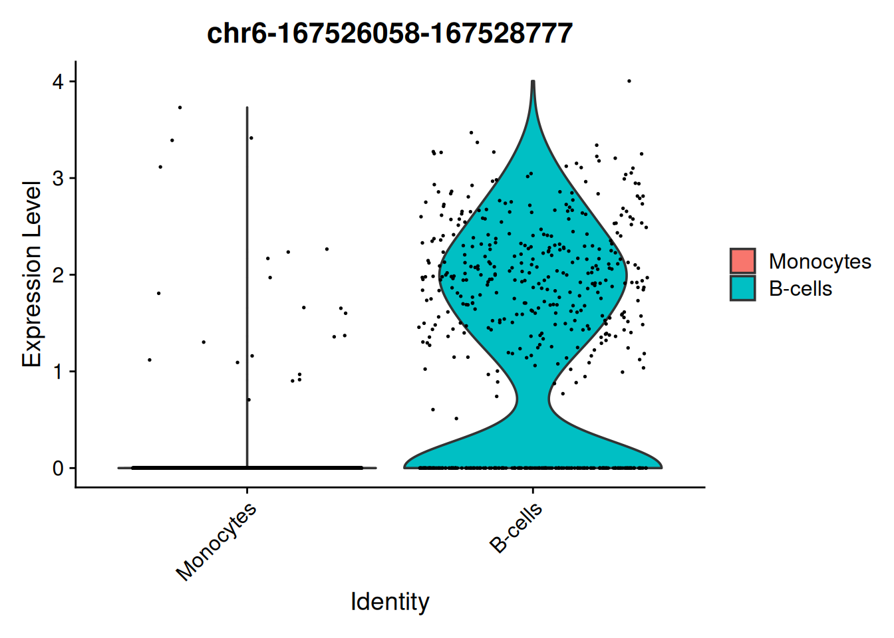
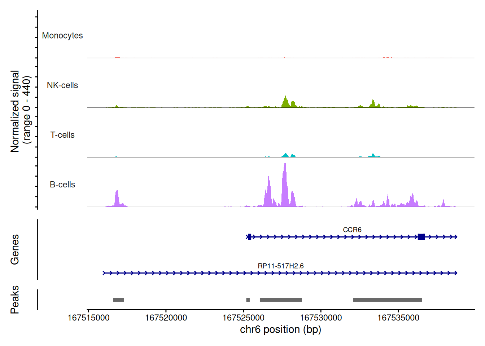

# 13  Lab 7: Single-cell ATAC-seq analysis workflow

> **NOTE:**
>
> The estimated time for this lab is around 1h10.
>
> This lab relies on the `fragments` file of a 10x Genomics scATAC-seq experiment (~2 GB), already available in your workshop session. It needs ~12 GB of memory, and takes ~15 minutes to run from start to end.

> **TIP:**
>
> - Import cells from human PBMC scATACseq dataset
> - Perform scATACseq quality controls and checks
> - Filter, normalize and plot PBMC scATACseq dataset
> - Compute gene activity scores, check known markers and annotate scATAC clusters
> - Perform differential peak accessibility analysis

ATAC-seq data may be obtained in isolation using a single-cell ATAC-seq protocol (e.g. [10X scATACseq](https://www.10xgenomics.com/products/single-cell-atac)) or in combination with gene expression data using a single-cell multiome protocole (e.g. [10X multiome](https://www.10xgenomics.com/products/single-cell-multiome-atac-plus-gene-expression) and [SHARE-seq](https://pubmed.ncbi.nlm.nih.gov/33098772/)).

Several packages are currently avaialble to process scATAC-seq data in R. These include [Signac](https://stuartlab.org/signac/) and [ArchR](https://www.archrproject.com/bookdown/index.html). This lab will closely follow the [processing steps](https://stuartlab.org/signac/articles/pbmc_vignette) outlined in `Signac`, which interfaces well with `Seurat` for single-cell analysis.

In this lab, we will process a PBMC single-cell ATAC-seq (scATAC-seq) dataset and perform preliminary analysis to assess quality of these data. The data for this lab comes from [10X Genomics](https://www.10xgenomics.com/datasets/10-k-peripheral-blood-mononuclear-cells-pbm-cs-from-a-healthy-donor-1-standard-1-0-1). The dataset contains roughly ~ 10,000 cells.

## 13.1 Process human PBMC dataset

### 13.1.1 Data

The files we need are directly available from the 10x Genomics website. They have already been downloaded in your workshop session, in the `~/Share/scATAC/` folder. Note that the `fragments` file and its index (`.tbi`) must sit next to each other, with matching names.

``` r
scatac_dir <- file.path(path.expand("~"), "Share", "scATAC")
list.files(scatac_dir)
##  [1] "atac_v1_pbmc_10k_filtered_peak_bc_matrix.h5"
##  [2] "atac_v1_pbmc_10k_fragments.tsv.gz"          
##  [3] "atac_v1_pbmc_10k_fragments.tsv.gz.tbi"      
##  [4] "atac_v1_pbmc_10k_peaks.bed"                 
##  [5] "atac_v1_pbmc_10k_singlecell.csv"
h5_file <- file.path(scatac_dir, "atac_v1_pbmc_10k_filtered_peak_bc_matrix.h5")
peaks_file <- file.path(scatac_dir, "atac_v1_pbmc_10k_peaks.bed")
metadata_file <- file.path(scatac_dir, "atac_v1_pbmc_10k_singlecell.csv")
fragments_file <- file.path(scatac_dir, "atac_v1_pbmc_10k_fragments.tsv.gz")
```

> **TIP:**
>
> To run this lab outside of the workshop session, download the files from the 10x Genomics website, e.g. in a `~/data/scATAC` folder (this may take a few minutes, the `fragments` file weighs ~2 GB):
>
> ``` r
> scatac_dir <- file.path(path.expand("~"), "data", "scATAC")
> dir.create(scatac_dir, recursive = TRUE, showWarnings = FALSE)
> options(timeout = 3600)
> url <- "https://cf.10xgenomics.com/samples/cell-atac/1.0.1/atac_v1_pbmc_10k/"
> files <- c(
>     "atac_v1_pbmc_10k_filtered_peak_bc_matrix.h5",
>     "atac_v1_pbmc_10k_peaks.bed",
>     "atac_v1_pbmc_10k_singlecell.csv",
>     "atac_v1_pbmc_10k_fragments.tsv.gz",
>     "atac_v1_pbmc_10k_fragments.tsv.gz.tbi"
> )
> for (f in files) {
>     if (!file.exists(file.path(scatac_dir, f)))
>         download.file(paste0(url, f), destfile = file.path(scatac_dir, f))
> }
> list.files(scatac_dir)
> h5_file <- file.path(scatac_dir, "atac_v1_pbmc_10k_filtered_peak_bc_matrix.h5")
> peaks_file <- file.path(scatac_dir, "atac_v1_pbmc_10k_peaks.bed")
> metadata_file <- file.path(scatac_dir, "atac_v1_pbmc_10k_singlecell.csv")
> fragments_file <- file.path(scatac_dir, "atac_v1_pbmc_10k_fragments.tsv.gz")
> ```

### 13.1.2 Import data

Notice how the count matrix is in a `.h5` format. We have already encountered this kind of 10x Genomics outputs in [Lab 3](../../pages/day2/Lab3_Rbioc.md). Back then, we imported them with [`DropletUtils::read10xCounts`](https://rdrr.io/pkg/DropletUtils/man/read10xCounts.html).

> **NOTE:**
>
> Does this function work here?
>
> > **NOTE:**
> >
> > ``` r
> > scatac <- DropletUtils::read10xCounts(h5_file)
> > scatac
> > ##  class: SingleCellExperiment 
> > ##  dim: 89796 8728 
> > ##  metadata(1): Samples
> > ##  assays(1): counts
> > ##  rownames(89796): chr1:565107-565550 chr1:569174-569639 ...
> > ##    chrY:59001782-59002175 chrY:59017143-59017246
> > ##  rowData names(3): ID Symbol Type
> > ##  colnames: NULL
> > ##  colData names(2): Sample Barcode
> > ##  reducedDimNames(0):
> > ##  mainExpName: NULL
> > ##  altExpNames(0):
> > ```

This works because 10X Genomics make sure to distribute files in `.h5` format that are consistent accross single-cell sequencing methodologies.

However, the `SingleCellExperiment` obtained with this approach is not the most convenient, as it cannot natively leverage `fragments` file (see below).

Instead, we can create a `Signac` object, a flavour of `Seurat` objects.

> **NOTE:**
>
> Import counts matrix and feature annotations using an import function provided by `Seurat`.
>
> > **NOTE:**
> >
> > ``` r
> > library(Seurat)
> > library(Signac)
> > library(rtracklayer)
> > library(stringr)
> > cnts <- Read10X_h5(h5_file)
> > features <- import(peaks_file)
> > features$peak <- as.character(features) |> str_replace(':', '-')
> > metadata <- read.csv(
> >   file = metadata_file,
> >   header = TRUE,
> >   row.names = 1
> > )
> > ```
>
> How many accessible genomic segments were found in this dataset?
>
> > **NOTE:**
> >
> > ``` r
> > features
> > ##  GRanges object with 89796 ranges and 1 metadata column:
> > ##            seqnames            ranges strand |                   peak
> > ##               <Rle>         <IRanges>  <Rle> |            <character>
> > ##        [1]     chr1     565108-565550      * |     chr1-565108-565550
> > ##        [2]     chr1     569175-569639      * |     chr1-569175-569639
> > ##        [3]     chr1     713461-714823      * |     chr1-713461-714823
> > ##        [4]     chr1     752423-753038      * |     chr1-752423-753038
> > ##        [5]     chr1     762107-763359      * |     chr1-762107-763359
> > ##        ...      ...               ...    ... .                    ...
> > ##    [89792]     chrY 58993393-58993760      * | chrY-58993393-58993760
> > ##    [89793]     chrY 58994572-58994823      * | chrY-58994572-58994823
> > ##    [89794]     chrY 58996353-58997331      * | chrY-58996353-58997331
> > ##    [89795]     chrY 59001783-59002175      * | chrY-59001783-59002175
> > ##    [89796]     chrY 59017144-59017246      * | chrY-59017144-59017246
> > ##    -------
> > ##    seqinfo: 24 sequences from an unspecified genome; no seqlengths
> > length(features)
> > ##  [1] 89796
> > ```

### 13.1.3 Create a `Seurat` object

The next step is to aggregate `counts` and `features` into a `ChromatinAssay`, a scATAC-seq flavour of `Seurat` standard `Assays`. The documentation for [`?CreateChromatinAssay`](https://stuartlab.org/signac/reference/CreateChromatinAssay.html) indicates that the user can provide:

1.  A `fragments` file, corresponding to the full list of all unique fragments mapped across all single cells.
2.  Genomic annotations to the `ChromatinAssay`, corresponding to gene annotations, promoter positions, etc. Such annotations can be generated from Ensembl.

> **NOTE:**
>
> Generate human annotations from Ensembl using a parsing function from `Signac`.
>
> > **NOTE:**
> >
> > ``` r
> > ## - Get human gene annotations (hg19/GRCh37) to feed it into the future `ChromatinAssay`
> > annotations <- GetGRangesFromEnsDb(ensdb = EnsDb.Hsapiens.v75::EnsDb.Hsapiens.v75)
> > ##  OpenTelemetry error: there is no package called 'otelsdk'
> > GenomeInfoDb::seqlevelsStyle(annotations) <- 'UCSC'
> > GenomeInfoDb::genome(annotations) <- "hg19"
> > ```
>
> Create a `ChromatinAssay` using `counts`, `features`, `fragments` and `annotations`.
>
> > **NOTE:**
> >
> > ``` r
> > ## - Create Chromatin Assay
> > assay <- Signac::CreateChromatinAssay(
> >     counts = cnts,
> >     ranges = features,
> >     fragments = fragments_file,
> >     annotation = annotations,
> >     genome = "hg19",
> >     min.cells = 10,
> >     min.features = 10
> > )
> > ##  Computing hash
> > assay
> > ##  ChromatinAssay data with 87561 features for 8728 cells
> > ##  Variable features: 0 
> > ##  Genome: hg19 
> > ##  Annotation present: TRUE 
> > ##  Motifs present: FALSE 
> > ##  Fragment files: 1
> > ```
>
> What are the dimensions of this object? Are they comparable to the count matrix? Comment.
>
> > **NOTE:**
> >
> > ``` r
> > dim(cnts)
> > ##  [1] 89796  8728
> > dim(assay)
> > ##  [1] 87561  8728
> > ```

It’s finally time to wrap the `ChromatinAssay` into a `Seurat` standard object! This is done using the `CreateSeuratObject`.

> **NOTE:**
>
> Create a `Seurat` object from the `ChromatinAssay` object.
>
> > **NOTE:**
> >
> > ``` r
> > ## - Create Seurat object
> > PBMC <- Seurat::CreateSeuratObject(
> >     counts = assay,
> >     assay = 'ATAC',
> >     meta.data = metadata[metadata$is__cell_barcode == 1, ]
> > )
> > PBMC
> > ##  An object of class Seurat 
> > ##  87561 features across 8728 samples within 1 assay 
> > ##  Active assay: ATAC (87561 features, 0 variable features)
> > ##   2 layers present: counts, data
> >
> > PBMC[['ATAC']]
> > ##  ChromatinAssay data with 87561 features for 8728 cells
> > ##  Variable features: 0 
> > ##  Genome: hg19 
> > ##  Annotation present: TRUE 
> > ##  Motifs present: FALSE 
> > ##  Fragment files: 1
> > granges(PBMC)
> > ##  GRanges object with 87561 ranges and 1 metadata column:
> > ##            seqnames            ranges strand |                   peak
> > ##               <Rle>         <IRanges>  <Rle> |            <character>
> > ##        [1]     chr1     565108-565550      * |     chr1-565108-565550
> > ##        [2]     chr1     569175-569639      * |     chr1-569175-569639
> > ##        [3]     chr1     713461-714823      * |     chr1-713461-714823
> > ##        [4]     chr1     752423-753038      * |     chr1-752423-753038
> > ##        [5]     chr1     762107-763359      * |     chr1-762107-763359
> > ##        ...      ...               ...    ... .                    ...
> > ##    [87557]     chrY 58993393-58993760      * | chrY-58993393-58993760
> > ##    [87558]     chrY 58994572-58994823      * | chrY-58994572-58994823
> > ##    [87559]     chrY 58996353-58997331      * | chrY-58996353-58997331
> > ##    [87560]     chrY 59001783-59002175      * | chrY-59001783-59002175
> > ##    [87561]     chrY 59017144-59017246      * | chrY-59017144-59017246
> > ##    -------
> > ##    seqinfo: 24 sequences from an unspecified genome; no seqlengths
> > Annotation(PBMC)
> > ##  GRanges object with 3072120 ranges and 5 metadata columns:
> > ##                    seqnames        ranges strand |           tx_id
> > ##                       <Rle>     <IRanges>  <Rle> |     <character>
> > ##    ENSE00001489430     chrX 192989-193061      + | ENST00000399012
> > ##    ENSE00001536003     chrX 192991-193061      + | ENST00000484611
> > ##    ENSE00002160563     chrX 193020-193061      + | ENST00000430923
> > ##    ENSE00001750899     chrX 197722-197788      + | ENST00000445062
> > ##    ENSE00001489388     chrX 197859-198351      + | ENST00000381657
> > ##                ...      ...           ...    ... .             ...
> > ##    ENST00000361739    chrMT     7586-8269      + | ENST00000361739
> > ##    ENST00000361789    chrMT   14747-15887      + | ENST00000361789
> > ##    ENST00000361851    chrMT     8366-8572      + | ENST00000361851
> > ##    ENST00000361899    chrMT     8527-9207      + | ENST00000361899
> > ##    ENST00000362079    chrMT     9207-9990      + | ENST00000362079
> > ##                      gene_name         gene_id   gene_biotype     type
> > ##                    <character>     <character>    <character> <factor>
> > ##    ENSE00001489430      PLCXD1 ENSG00000182378 protein_coding     exon
> > ##    ENSE00001536003      PLCXD1 ENSG00000182378 protein_coding     exon
> > ##    ENSE00002160563      PLCXD1 ENSG00000182378 protein_coding     exon
> > ##    ENSE00001750899      PLCXD1 ENSG00000182378 protein_coding     exon
> > ##    ENSE00001489388      PLCXD1 ENSG00000182378 protein_coding     exon
> > ##                ...         ...             ...            ...      ...
> > ##    ENST00000361739      MT-CO2 ENSG00000198712 protein_coding      cds
> > ##    ENST00000361789      MT-CYB ENSG00000198727 protein_coding      cds
> > ##    ENST00000361851     MT-ATP8 ENSG00000228253 protein_coding      cds
> > ##    ENST00000361899     MT-ATP6 ENSG00000198899 protein_coding      cds
> > ##    ENST00000362079      MT-CO3 ENSG00000198938 protein_coding      cds
> > ##    -------
> > ##    seqinfo: 25 sequences (1 circular) from hg19 genome
> >
> > ## - Free some memory: the intermediate objects are no longer needed
> > rm(scatac, cnts, assay); invisible(gc())
> > ```

### 13.1.4 Check QCs

#### 13.1.4.1 Cell-based QCs

The fraction of reads in peaks (FRiP) is a good indicator of how well each cell was handled during scATACseq processing.

``` r
PBMC$FRiP <- PBMC$peak_region_fragments / PBMC$passed_filters
PBMC$nCount_ATAC <- colSums(GetAssayData(PBMC, layer = "counts"))
PBMC$nFeature_ATAC <- colSums(GetAssayData(PBMC, layer = "counts") > 0)

quantile(PBMC$FRiP, seq(0, 1, 0.1))
##          0%        10%        20%        30%        40%        50%        60% 
##  0.02770289 0.55266699 0.60895480 0.64086129 0.66583010 0.68520756 0.70194678 
##         70%        80%        90%       100% 
##  0.71993709 0.73801044 0.76004660 0.90383142
quantile(PBMC$nCount_ATAC, seq(0, 1, 0.1))
##        0%      10%      20%      30%      40%      50%      60%      70% 
##    1710.0   5079.1   7619.8   9522.5  11300.8  13367.5  15754.6  19005.5 
##       80%      90%     100% 
##   23502.6  31316.2 249799.0
quantile(PBMC$nFeature_ATAC, seq(0, 1, 0.1))
##       0%     10%     20%     30%     40%     50%     60%     70%     80% 
##    654.0  2308.4  3349.4  4108.1  4765.0  5447.0  6234.2  7100.9  8241.6 
##      90%    100% 
##   9983.4 30313.0
```

#### 13.1.4.2 Peaks-based QCs

> **NOTE:**
>
> Which analysis are the `fragments` required for, exactly?
>
> Could we still perform normalization/clustering/annotation without them? And motif enrichment analysis?
>
> Since we do have the `fragments` file at hand, most of the QC steps are available (e.g. `TSSEnrichment`, `NucleosomeSignal` or fragment size distribution). Let’s go through them one by one.
>
> > **NOTE:**
> >
> > ``` r
> > # compute nucleosome signal score per cell
> > PBMC <- NucleosomeSignal(object = PBMC)
> > PBMC
> > ##  An object of class Seurat 
> > ##  87561 features across 8728 samples within 1 assay 
> > ##  Active assay: ATAC (87561 features, 0 variable features)
> > ##   2 layers present: counts, data
> >
> > # compute TSS enrichment score per cell
> > PBMC <- Signac::TSSEnrichment(object = PBMC)
> > ##  Extracting TSS positions
> > ##  Extracting fragments at TSSs
> > ##  
> > ##  Computing TSS enrichment score
> > PBMC
> > ##  An object of class Seurat 
> > ##  87561 features across 8728 samples within 1 assay 
> > ##  Active assay: ATAC (87561 features, 0 variable features)
> > ##   2 layers present: counts, data
> >
> > # plot TSS enrichment vs. number of fragments in peaks
> > DensityScatter(PBMC, x = 'nCount_ATAC', y = 'TSS.enrichment', log_x = TRUE, quantiles = TRUE)
> > ```
> >
> > 
> >
> > > **NOTE:**
> > >
> > > In the current development version of `Signac`, [`NucleosomeSignal()`](https://stuartlab.org/signac/reference/NucleosomeSignal.html) and [`TSSEnrichment()`](https://stuartlab.org/signac/reference/TSSEnrichment.html) are deprecated in favour of [`ATACqc()`](https://stuartlab.org/signac/reference/ATACqc.html), which computes all these QC metrics at once with the external `fragtk` tool. `fragtk` is not installed in the workshop environment: we keep using the deprecated functions, which still work (their deprecation warnings are hidden on this page).

Let’s compare the distributions of the different QC metrics, for cells with a high or a low TSS enrichment score.

``` r
PBMC$high.tss <- ifelse(PBMC$TSS.enrichment > 2.5, 'High', 'Low')
table(PBMC$high.tss)
##  
##  High  Low 
##  8673   55
VlnPlot(
    object = PBMC,
    features = c('nCount_ATAC', 'FRiP', 'TSS.enrichment', 'nucleosome_signal'),
    group.by = 'high.tss',
    pt.size = 0,
    ncol = 4
)
```



> **TIP:**
>
> The [`TSSPlot()`](https://stuartlab.org/signac/reference/TSSPlot.html) function from `Signac` plots the average accessibility profile around TSSs, for groups of cells. It requires running [`TSSEnrichment()`](https://stuartlab.org/signac/reference/TSSEnrichment.html) with `fast = FALSE`, which stores the accessibility of each position around each TSS: this takes a lot of memory (\> 16 GB for this dataset), so we do not run it in the workshop sessions.

The `FragmentHistogram` function from `Signac` can be used to plot the fragment size distribution in peaks with different nucleosome signals.

> **NOTE:**
>
> Group genomic loci by their nucleosome signal (\> 4 or \< 4) and plot the fragment size distribution.
>
> > **NOTE:**
> >
> > ``` r
> > PBMC$nucleosome_group <- ifelse(PBMC$nucleosome_signal > 4, 'NS > 4', 'NS < 4')
> > FragmentHistogram(object = PBMC, group.by = 'nucleosome_group')
> > ```
> >
> > 

### 13.1.5 Filter cells and features

Just like standard scRNAseq data, scATACseq data needs to be filtered to remove low-quality cells and peaks.

> **NOTE:**
>
> Filter the `Seurat` object (cells and features) as deemed appropriate.
>
> > **NOTE:**
> >
> > ``` r
> > ## - Filter data
> > PBMC <- subset(PBMC, subset = nCount_ATAC > 3000 & nCount_ATAC < 100000)
> > PBMC <- subset(PBMC, subset = nFeature_ATAC > 1000 & nFeature_ATAC < 20000)
> > PBMC <- subset(PBMC, subset = FRiP > 0.30)
> > PBMC <- subset(PBMC, subset = TSS.enrichment > 2.5 & nucleosome_signal < 4)
> > PBMC
> > ##  An object of class Seurat 
> > ##  87561 features across 8165 samples within 1 assay 
> > ##  Active assay: ATAC (87561 features, 0 variable features)
> > ##   2 layers present: counts, data
> >
> > ## - Remove peaks with low coverage
> > PBMC <- PBMC[rowSums(GetAssayData(PBMC, layer = "counts")) > 10, ]
> > PBMC <- PBMC[rowSums(GetAssayData(PBMC, layer = "counts") > 0) > 10, ]
> > PBMC
> > ##  An object of class Seurat 
> > ##  87207 features across 8165 samples within 1 assay 
> > ##  Active assay: ATAC (87207 features, 0 variable features)
> > ##   2 layers present: counts, data
> > ```

### 13.1.6 Dimensionality reduction and clustering

Now that the dataset is filtered, we can proceed to data normalization, dimensionality reduction and clustering. Compared to scRNAseq, scATACseq data is much sparser and has a higher dimensionality. This has important implications for the choice of normalization and dimensionality reduction methods. scATACseq data are generally normalized using a `TF-IDF` normalization, which is implemented in the `RunTFIDF` function in `Signac`, and dimensionality reduction is performed using `LSI` (Latent Semantic Indexing) implemented in the `RunSVD` function.

> **NOTE:**
>
> Normalize then further reduce the dimensionality for visualization purposes.
>
> > **NOTE:**
> >
> > ``` r
> > ## - Normalize data
> > PBMC <- RunTFIDF(PBMC)
> > ##  Performing TF-IDF normalization
> >
> > ## - Reduce dimensionality
> > PBMC <- FindTopFeatures(PBMC, min.cutoff = 'q50')
> > PBMC <- RunSVD(PBMC)
> > ##  Running SVD
> > ##  Scaling cell embeddings
> >
> > ## - The first LSI component is often correlated with sequencing depth
> > DepthCor(PBMC)
> > ```
> >
> > 
> >
> > ``` r
> >
> > ## - Embed in 2D UMAP
> > PBMC <- RunUMAP(object = PBMC, reduction = 'lsi', dims = 2:30, verbose = FALSE)
> >
> > ## - Cluster cells
> > PBMC <- FindNeighbors(object = PBMC, reduction = 'lsi', dims = 2:30)
> > ##  Computing nearest neighbor graph
> > ##  Computing SNN
> > PBMC <- FindClusters(object = PBMC, verbose = FALSE, algorithm = 3)
> >
> > ## - Visualize data
> > DimPlot(PBMC, label = TRUE) + NoLegend()
> > ```
> >
> > 
>
> What can you observe in the `UMAP` projection of the dataset? Comment on the separation of some cell types into different spatially-resolved clusters.

## 13.2 Compute gene activity scores

Signac’s [`GeneActivity()`](https://stuartlab.org/signac/reference/GeneActivity.html) function require scATACseq fragment information. Since we have them, we can estimate a gene activity score for each gene in the `annotations`.

``` r
gene.activities <- GeneActivity(PBMC)
##  Extracting gene coordinates
##  Warning in SingleFeatureMatrix(fragment = fragments[[x]], features =
##  features, : 13 features are on seqnames not present in the fragment file.
##  These will be removed.
##  Extracting reads overlapping genomic regions
```

We can now save this new object as an `Assay` in the `PBMC` object and normalize it.

``` r
PBMC[['RNA']] <- CreateAssayObject(counts = gene.activities)
##  Warning: Non-unique features (rownames) present in the input matrix, making
##  unique

# - Normalize the new RNA assay.
PBMC <- NormalizeData(
    object = PBMC,
    assay = 'RNA',
    normalization.method = 'LogNormalize',
    scale.factor = median(PBMC$nCount_RNA)
)
PBMC
##  An object of class Seurat 
##  107217 features across 8165 samples within 2 assays 
##  Active assay: ATAC (87207 features, 43610 variable features)
##   2 layers present: counts, data
##   1 other assay present: RNA
##   2 dimensional reductions calculated: lsi, umap
```

One can now visualize expression of individual markers across clusters to infer cluster identity.

> **NOTE:**
>
> Assess the expression of known markers across clusters, projecting the cells in a 2D UMAP.
>
> > **NOTE:**
> >
> > ``` r
> > DefaultAssay(PBMC) <- 'RNA'
> > VlnPlot(
> >   object = PBMC,
> >   features = c(
> >     'MS4A1', # B-cell
> >     'CD3D', # T-cell
> >     'NKG7', # NK cell
> >     'TREM1' # Monocytes
> >   )
> > )
> > ```
> >
> > 
> >
> > ``` r
> > FeaturePlot(
> >   object = PBMC,
> >   features = c('MS4A1', 'CD3D', 'NKG7', 'TREM1'),
> >   max.cutoff = 'q95'
> > )
> > ```
> >
> > 
> >
> > Based on these markers, we can annotate clusters. Here, each cluster is annotated with the cell type whose marker has the highest average gene activity in the cluster: check this annotation against the plots above! Rarer cell types (e.g. dendritic cells) would require additional markers.
> >
> > ``` r
> > markers <- c('B-cells' = 'MS4A1', 'T-cells' = 'CD3D', 'NK-cells' = 'NKG7', 'Monocytes' = 'TREM1')
> > activity <- GetAssayData(PBMC, assay = 'RNA', layer = 'data')[markers, ]
> > avg_activity <- sapply(
> >   split(colnames(PBMC), PBMC$seurat_clusters),
> >   function(cells) Matrix::rowMeans(activity[, cells, drop = FALSE])
> > )
> > rownames(avg_activity) <- names(markers)
> > round(avg_activity, 2)
> > ##               0    1    2    3    4    5    6    7    8    9   10   11   12
> > ##  B-cells   0.01 0.01 0.02 0.01 0.01 0.01 0.02 0.01 0.39 0.02 0.37 0.03 0.03
> > ##  T-cells   0.01 0.24 0.35 0.29 0.24 0.00 0.07 0.24 0.02 0.01 0.02 0.19 0.01
> > ##  NK-cells  0.03 0.08 0.35 0.03 0.04 0.04 0.42 0.38 0.01 0.02 0.01 0.21 0.03
> > ##  Monocytes 0.93 0.06 0.08 0.09 0.05 1.08 0.07 0.06 0.12 0.66 0.07 0.06 0.53
> > ##              13   14
> > ##  B-cells   0.02 0.00
> > ##  T-cells   0.07 0.00
> > ##  NK-cells  0.17 0.00
> > ##  Monocytes 0.08 0.11
> > cluster_types <- rownames(avg_activity)[apply(avg_activity, 2, which.max)]
> > names(cluster_types) <- colnames(avg_activity)
> > cluster_types
> > ##            0           1           2           3           4           5 
> > ##  "Monocytes"   "T-cells"   "T-cells"   "T-cells"   "T-cells" "Monocytes" 
> > ##            6           7           8           9          10          11 
> > ##   "NK-cells"  "NK-cells"   "B-cells" "Monocytes"   "B-cells"  "NK-cells" 
> > ##           12          13          14 
> > ##  "Monocytes"  "NK-cells" "Monocytes"
> > PBMC$annotation <- unname(cluster_types[as.character(PBMC$seurat_clusters)])
> > table(PBMC$annotation)
> > ##  
> > ##    B-cells Monocytes  NK-cells   T-cells 
> > ##        549      3822      1074      2720
> > DimPlot(PBMC, group.by = 'annotation', label = TRUE) + NoLegend()
> > ```
> >
> > 

## 13.3 Find peaks differentially accessible across clusters

Finally, we can perform differential peak accessibility analysis to identify peaks that are differentially accessible between clusters. This is done using the `FindMarkers` function from `Seurat`, run on the `ATAC` assay. By default, `FindMarkers` uses a (fast) Wilcoxon rank sum test.

> **TIP:**
>
> The `Signac` documentation recommends a logistic regression test, using the total number of fragments per cell as a latent variable to account for differences in sequencing depth (`test.use = 'LR', latent.vars = 'nCount_ATAC'`). This is more rigorous, but much slower (\> 30 minutes for this comparison): try it after the workshop!

``` r
DefaultAssay(PBMC) <- 'ATAC'
Idents(PBMC) <- PBMC$annotation
da_peaks <- FindMarkers(
  object = PBMC,
  ident.1 = "Monocytes",
  ident.2 = "B-cells",
  min.pct = 0.05
)
head(da_peaks)
##                           p_val avg_log2FC pct.1 pct.2 p_val_adj
##  chr6-167526058-167528777     0  -6.935443 0.006 0.634         0
##  chr19-5130024-5132419        0  -5.468023 0.018 0.641         0
##  chr2-232535688-232538032     0  -4.979220 0.020 0.570         0
##  chr9-37408890-37409812       0  -7.087202 0.004 0.503         0
##  chr14-64701789-64703445      0  -7.604425 0.002 0.497         0
##  chr22-42329467-42333086      0  -6.077067 0.007 0.497         0
VlnPlot(
  object = PBMC,
  features = rownames(da_peaks)[1],
  pt.size = 0.1,
  idents = c("Monocytes","B-cells")
)
```



``` r
CoveragePlot(
  object = PBMC,
  region = rownames(da_peaks)[1],
  extend.upstream = 10000,
  extend.downstream = 10000
)
```



## 13.4 Session info

> **NOTE:**
>
>     ##  ─ Session info ────────────────────────────────────────────────────────────
>     ##   setting  value
>     ##   version  R version 4.6.1 (2026-06-24)
>     ##   os       Ubuntu 24.04.5 LTS
>     ##   system   x86_64, linux-gnu
>     ##   ui       X11
>     ##   language (EN)
>     ##   collate  C
>     ##   ctype    en_US.UTF-8
>     ##   tz       Etc/UTC
>     ##   date     2026-11-13
>     ##   pandoc   3.13 @ /usr/bin/ (via rmarkdown)
>     ##   quarto   1.11.5 @ /usr/local/bin/quarto
>     ##  
>     ##  ─ Packages ────────────────────────────────────────────────────────────────
>     ##   package              * version   date (UTC) lib source
>     ##   abind                  1.4-8     2024-09-12 [2] RSPM (R 4.6.0)
>     ##   AnnotationDbi          1.75.2    2026-07-21 [2] Bioconductor 3.24 (R 4.6.1)
>     ##   AnnotationFilter       1.37.0    2026-04-28 [2] Bioconductor 3.24 (R 4.6.1)
>     ##   backports              1.5.1     2026-04-03 [2] RSPM (R 4.6.0)
>     ##   base64enc              0.1-6     2026-02-02 [2] RSPM (R 4.6.0)
>     ##   beachmat               2.29.3    2026-09-23 [2] Bioconductor 3.24 (R 4.6.1)
>     ##   Biobase                2.73.2    2026-07-29 [2] Bioconductor 3.24 (R 4.6.1)
>     ##   BiocBaseUtils          1.15.1    2026-05-10 [2] Bioconductor 3.24 (R 4.6.1)
>     ##   BiocGenerics         * 0.59.13   2026-11-11 [2] Bioconductor 3.24 (R 4.6.1)
>     ##   BiocIO                 1.23.3    2026-04-29 [2] Bioconductor 3.24 (R 4.6.1)
>     ##   BiocParallel           1.47.0    2026-04-28 [2] Bioconductor 3.24 (R 4.6.1)
>     ##   Biostrings             2.81.9    2026-09-06 [2] Bioconductor 3.24 (R 4.6.1)
>     ##   biovizBase             1.61.0    2026-04-28 [2] Bioconductor 3.24 (R 4.6.1)
>     ##   bit                    4.6.0     2025-03-06 [2] RSPM (R 4.6.0)
>     ##   bit64                  4.8.6     2026-09-01 [2] RSPM (R 4.6.0)
>     ##   bitops                 1.1-0     2026-07-30 [2] RSPM (R 4.6.0)
>     ##   blob                   1.3.0     2026-01-14 [2] RSPM (R 4.6.0)
>     ##   BSgenome               1.81.1    2026-07-29 [2] Bioconductor 3.24 (R 4.6.1)
>     ##   cachem                 1.1.0     2024-05-16 [2] RSPM (R 4.6.0)
>     ##   checkmate              2.3.4     2026-02-03 [2] RSPM (R 4.6.0)
>     ##   cigarillo              1.3.1     2026-07-13 [2] Bioconductor 3.24 (R 4.6.1)
>     ##   cli                    3.6.6     2026-04-09 [2] RSPM (R 4.6.0)
>     ##   cluster                2.1.8.3   2026-07-30 [2] RSPM (R 4.6.1)
>     ##   codetools              0.2-20    2024-03-31 [3] CRAN (R 4.6.1)
>     ##   colorspace             2.1-4     2026-10-08 [2] RSPM (R 4.6.0)
>     ##   cowplot                1.2.0     2025-07-07 [2] RSPM (R 4.6.0)
>     ##   crayon                 1.5.3     2024-06-20 [2] RSPM (R 4.6.0)
>     ##   curl                   8.1.0     2026-10-14 [2] RSPM (R 4.6.0)
>     ##   data.table             1.18.6.1  2026-08-24 [2] RSPM (R 4.6.0)
>     ##   DBI                    1.3.0     2026-02-25 [2] RSPM (R 4.6.0)
>     ##   DelayedArray           0.39.8    2026-09-30 [2] Bioconductor 3.24 (R 4.6.1)
>     ##   DelayedMatrixStats     1.35.0    2026-04-28 [2] Bioconductor 3.24 (R 4.6.1)
>     ##   deldir                 2.0-4     2024-02-28 [2] RSPM (R 4.6.0)
>     ##   dichromat              2.0-1     2026-07-22 [2] RSPM (R 4.6.0)
>     ##   digest                 0.6.39    2025-11-19 [2] RSPM (R 4.6.0)
>     ##   dotCall64              1.2       2024-10-04 [2] RSPM (R 4.6.0)
>     ##   dplyr                  1.2.1     2026-04-03 [2] RSPM (R 4.6.0)
>     ##   dqrng                  0.4.1     2024-05-28 [2] RSPM (R 4.6.0)
>     ##   DropletUtils           1.33.2    2026-09-24 [2] Bioconductor 3.24 (R 4.6.1)
>     ##   edgeR                  4.99.12   2026-11-04 [2] Bioconductor 3.24 (R 4.6.1)
>     ##   EnsDb.Hsapiens.v75     2.99.0    2026-07-20 [2] Bioconductor
>     ##   ensembldb              2.37.3    2026-06-07 [2] Bioconductor 3.24 (R 4.6.1)
>     ##   evaluate               1.0.5     2025-08-27 [2] RSPM (R 4.6.0)
>     ##   farver                 2.1.2     2024-05-13 [2] RSPM (R 4.6.0)
>     ##   fastDummies            1.7.6     2026-04-22 [2] RSPM (R 4.6.0)
>     ##   fastmap                1.2.0     2024-05-15 [2] RSPM (R 4.6.0)
>     ##   fastmatch              1.1-8     2026-01-17 [2] RSPM (R 4.6.0)
>     ##   fitdistrplus           1.2-6     2026-01-24 [2] RSPM (R 4.6.0)
>     ##   foreign                0.8-92    2026-10-17 [2] RSPM (R 4.6.1)
>     ##   Formula                1.2-6     2026-08-03 [2] RSPM (R 4.6.0)
>     ##   future                 1.80.0    2026-10-16 [2] RSPM (R 4.6.0)
>     ##   future.apply           1.21.0    2026-10-16 [2] RSPM (R 4.6.0)
>     ##   generics             * 0.1.4     2025-05-09 [2] RSPM (R 4.6.0)
>     ##   GenomeInfoDb           1.49.1    2026-05-24 [2] Bioconductor 3.24 (R 4.6.1)
>     ##   GenomicAlignments      1.49.2    2026-09-02 [2] Bioconductor 3.24 (R 4.6.1)
>     ##   GenomicFeatures        1.65.0    2026-04-28 [2] Bioconductor 3.24 (R 4.6.1)
>     ##   GenomicRanges        * 1.65.4    2026-09-02 [2] Bioconductor 3.24 (R 4.6.1)
>     ##   ggplot2                4.0.3     2026-04-22 [2] RSPM (R 4.6.0)
>     ##   ggrepel                0.9.8     2026-03-17 [2] RSPM (R 4.6.0)
>     ##   ggridges               0.5.7     2025-08-27 [2] RSPM (R 4.6.0)
>     ##   globals                0.20.0    2026-10-11 [2] RSPM (R 4.6.0)
>     ##   glue                   1.8.1     2026-04-17 [2] RSPM (R 4.6.0)
>     ##   goftest                1.2-3     2021-10-07 [2] RSPM (R 4.6.0)
>     ##   gridExtra              2.3.1     2026-06-25 [2] RSPM (R 4.6.0)
>     ##   gtable                 0.3.6     2024-10-25 [2] RSPM (R 4.6.0)
>     ##   h5mread                1.5.3     2026-09-02 [2] Bioconductor 3.24 (R 4.6.1)
>     ##   HDF5Array              1.41.3    2026-08-21 [2] Bioconductor 3.24 (R 4.6.1)
>     ##   hdf5r                  1.3.16    2026-09-11 [2] RSPM (R 4.6.0)
>     ##   Hmisc                  5.3-0     2026-09-06 [2] RSPM (R 4.6.0)
>     ##   htmlTable              2.5.0     2026-04-22 [2] RSPM (R 4.6.0)
>     ##   htmltools              0.5.9     2025-12-04 [2] RSPM (R 4.6.0)
>     ##   htmlwidgets            1.6.4     2023-12-06 [2] RSPM (R 4.6.0)
>     ##   httpuv                 1.6.17    2026-03-18 [2] RSPM (R 4.6.0)
>     ##   httr                   1.4.9     2026-09-01 [2] RSPM (R 4.6.0)
>     ##   ica                    1.0-3     2022-07-08 [2] RSPM (R 4.6.0)
>     ##   igraph                 2.3.4     2026-09-30 [2] RSPM (R 4.6.0)
>     ##   IRanges              * 2.47.5    2026-08-27 [2] Bioconductor 3.24 (R 4.6.1)
>     ##   irlba                  2.4.1     2026-10-05 [2] RSPM (R 4.6.0)
>     ##   jsonlite               2.0.0     2025-03-27 [2] RSPM (R 4.6.0)
>     ##   KEGGREST               1.53.6    2026-07-23 [2] Bioconductor 3.24 (R 4.6.1)
>     ##   KernSmooth             2.23-27   2026-08-12 [2] RSPM (R 4.6.1)
>     ##   knitr                  1.52      2026-09-06 [2] RSPM (R 4.6.0)
>     ##   labeling               0.4.3     2023-08-29 [2] RSPM (R 4.6.0)
>     ##   later                  1.4.8     2026-03-05 [2] RSPM (R 4.6.0)
>     ##   lattice                0.23-1    2026-08-12 [2] RSPM (R 4.6.1)
>     ##   lazyeval               0.2.3     2026-04-04 [2] RSPM (R 4.6.0)
>     ##   lifecycle              1.0.5     2026-01-08 [2] RSPM (R 4.6.0)
>     ##   limma                  3.99.4    2026-11-04 [2] Bioconductor 3.24 (R 4.6.1)
>     ##   listenv                1.1.0     2026-10-04 [2] RSPM (R 4.6.0)
>     ##   lmtest                 0.9-40    2022-03-21 [2] RSPM (R 4.6.0)
>     ##   magrittr               2.0.5     2026-04-04 [2] RSPM (R 4.6.0)
>     ##   MASS                   7.3-66    2026-07-15 [2] RSPM (R 4.6.1)
>     ##   Matrix                 1.7-6     2026-07-25 [2] RSPM (R 4.6.1)
>     ##   MatrixGenerics         1.25.0    2026-04-28 [2] Bioconductor 3.24 (R 4.6.1)
>     ##   matrixStats            1.5.0     2025-01-07 [2] RSPM (R 4.6.0)
>     ##   memoise                2.0.1     2021-11-26 [2] RSPM (R 4.6.0)
>     ##   mime                   0.13      2025-03-17 [2] RSPM (R 4.6.0)
>     ##   miniUI                 0.1.2     2025-04-17 [2] RSPM (R 4.6.0)
>     ##   nlme                   3.1-171   2026-09-01 [2] RSPM (R 4.6.1)
>     ##   nnet                   7.3-21    2026-08-03 [2] RSPM (R 4.6.1)
>     ##   otel                   0.2.0     2025-08-29 [2] RSPM (R 4.6.0)
>     ##   parallelly             1.48.0    2026-06-29 [2] RSPM (R 4.6.0)
>     ##   patchwork              1.3.2     2025-08-25 [2] RSPM (R 4.6.0)
>     ##   pbapply                1.7-5     2026-09-01 [2] RSPM (R 4.6.0)
>     ##   pillar                 1.11.1    2025-09-17 [2] RSPM (R 4.6.0)
>     ##   pkgconfig              2.0.3     2019-09-22 [2] RSPM (R 4.6.0)
>     ##   plotly                 4.12.1    2026-07-22 [2] RSPM (R 4.6.0)
>     ##   plyr                   1.8.9     2023-10-02 [2] RSPM (R 4.6.0)
>     ##   png                    0.1-9     2026-03-15 [2] RSPM (R 4.6.0)
>     ##   polyclip               1.10-7    2024-07-23 [2] RSPM (R 4.6.0)
>     ##   presto                 1.1.0     2026-09-30 [2] RSPM (R 4.6.0)
>     ##   progressr              1.1.0     2026-10-18 [2] RSPM (R 4.6.0)
>     ##   promises               1.5.0     2025-11-01 [2] RSPM (R 4.6.0)
>     ##   ProtGenerics           1.45.0    2026-04-28 [2] Bioconductor 3.24 (R 4.6.1)
>     ##   purrr                  1.2.2     2026-04-10 [2] RSPM (R 4.6.0)
>     ##   R.methodsS3            1.8.2     2022-06-13 [2] RSPM (R 4.6.0)
>     ##   R.oo                   1.27.1    2025-05-02 [2] RSPM (R 4.6.0)
>     ##   R.utils                2.13.0    2025-02-24 [2] RSPM (R 4.6.0)
>     ##   R6                     2.6.1     2025-02-15 [2] RSPM (R 4.6.0)
>     ##   RANN                   2.6.3     2026-08-24 [2] RSPM (R 4.6.0)
>     ##   RColorBrewer           1.1-3     2022-04-03 [2] RSPM (R 4.6.0)
>     ##   Rcpp                   1.1.2     2026-07-05 [2] RSPM (R 4.6.0)
>     ##   RcppAnnoy              0.0.23    2026-01-12 [2] RSPM (R 4.6.0)
>     ##   RcppHNSW               0.7.0     2026-05-26 [2] RSPM (R 4.6.0)
>     ##   RcppRoll               0.4.0     2026-09-06 [2] RSPM (R 4.6.0)
>     ##   RCurl                  1.98-1.20 2026-08-21 [2] RSPM (R 4.6.0)
>     ##   reshape2               1.4.5     2025-11-12 [2] RSPM (R 4.6.0)
>     ##   restfulr               0.0.17    2026-06-11 [2] RSPM (R 4.6.0)
>     ##   reticulate             1.47.0    2026-09-03 [2] RSPM (R 4.6.0)
>     ##   rhdf5                  2.57.20   2026-10-06 [2] Bioconductor 3.24 (R 4.6.1)
>     ##   rhdf5filters           1.25.5    2026-10-28 [2] Bioconductor 3.24 (R 4.6.1)
>     ##   Rhdf5lib               2.1.0     2026-04-28 [2] Bioconductor 3.24 (R 4.6.1)
>     ##   rjson                  0.2.23    2024-09-16 [2] RSPM (R 4.6.0)
>     ##   rlang                  1.3.0     2026-07-05 [2] RSPM (R 4.6.0)
>     ##   rmarkdown              2.32      2026-09-01 [2] RSPM (R 4.6.0)
>     ##   ROCR                   1.0-12    2026-01-23 [2] RSPM (R 4.6.0)
>     ##   rpart                  4.1.27    2026-03-27 [3] CRAN (R 4.6.1)
>     ##   Rsamtools              2.29.0    2026-04-28 [2] Bioconductor 3.24 (R 4.6.1)
>     ##   RSpectra               0.16-2    2024-07-18 [2] RSPM (R 4.6.0)
>     ##   RSQLite                3.53.3    2026-06-30 [2] RSPM (R 4.6.0)
>     ##   rstudioapi             0.19.0    2026-06-11 [2] RSPM (R 4.6.0)
>     ##   rtracklayer          * 1.73.0    2026-04-28 [2] Bioconductor 3.24 (R 4.6.1)
>     ##   Rtsne                  0.17      2023-12-07 [2] RSPM (R 4.6.0)
>     ##   S4Arrays               1.13.2    2026-09-30 [2] Bioconductor 3.24 (R 4.6.1)
>     ##   S4Vectors            * 0.51.10   2026-09-16 [2] Bioconductor 3.24 (R 4.6.1)
>     ##   S7                     0.2.2     2026-04-22 [2] RSPM (R 4.6.0)
>     ##   scales                 1.4.0     2025-04-24 [2] RSPM (R 4.6.0)
>     ##   scattermore            1.2       2023-06-12 [2] RSPM (R 4.6.0)
>     ##   sctransform            0.4.3     2026-01-10 [2] RSPM (R 4.6.0)
>     ##   scuttle                1.23.2    2026-08-27 [2] Bioconductor 3.24 (R 4.6.1)
>     ##   Seqinfo              * 1.3.2     2026-08-27 [2] Bioconductor 3.24 (R 4.6.1)
>     ##   sessioninfo            1.2.4     2026-06-04 [2] RSPM (R 4.6.0)
>     ##   Seurat               * 5.6.0     2026-10-03 [2] RSPM (R 4.6.0)
>     ##   SeuratObject         * 5.4.0     2026-04-11 [2] RSPM (R 4.6.0)
>     ##   shiny                  1.14.0    2026-06-21 [2] RSPM (R 4.6.0)
>     ##   Signac               * 1.17.1    2026-04-06 [2] RSPM (R 4.6.0)
>     ##   SingleCellExperiment   1.35.2    2026-07-16 [2] Bioconductor 3.24 (R 4.6.1)
>     ##   sp                   * 2.2-4     2026-10-11 [2] RSPM (R 4.6.0)
>     ##   spam                   2.11-4    2026-05-29 [2] RSPM (R 4.6.0)
>     ##   SparseArray            1.13.4    2026-09-30 [2] Bioconductor 3.24 (R 4.6.1)
>     ##   sparseMatrixStats      1.25.0    2026-04-28 [2] Bioconductor 3.24 (R 4.6.1)
>     ##   spatstat.data          3.1-9     2025-10-18 [2] RSPM (R 4.6.0)
>     ##   spatstat.explore       3.8-3     2026-09-23 [2] RSPM (R 4.6.0)
>     ##   spatstat.geom          3.8-3     2026-09-18 [2] RSPM (R 4.6.0)
>     ##   spatstat.random        3.5-2     2026-09-22 [2] RSPM (R 4.6.0)
>     ##   spatstat.sparse        3.2-0     2026-05-21 [2] RSPM (R 4.6.0)
>     ##   spatstat.univar        3.2-0     2026-05-18 [2] RSPM (R 4.6.0)
>     ##   spatstat.utils         3.2-5     2026-09-11 [2] RSPM (R 4.6.0)
>     ##   statmod                1.5.2     2026-05-17 [2] RSPM (R 4.6.0)
>     ##   stringi                1.8.9     2026-08-04 [2] RSPM (R 4.6.0)
>     ##   stringr              * 1.6.0     2025-11-04 [2] RSPM (R 4.6.0)
>     ##   SummarizedExperiment   1.43.0    2026-04-28 [2] Bioconductor 3.24 (R 4.6.1)
>     ##   survival               3.8-12    2026-09-09 [2] RSPM (R 4.6.1)
>     ##   tensor                 1.5.1     2025-06-17 [2] RSPM (R 4.6.0)
>     ##   tibble                 3.3.1     2026-01-11 [2] RSPM (R 4.6.0)
>     ##   tidyr                  1.3.2     2025-12-19 [2] RSPM (R 4.6.0)
>     ##   tidyselect             1.2.1     2024-03-11 [2] RSPM (R 4.6.0)
>     ##   UCSC.utils             1.9.0     2026-04-28 [2] Bioconductor 3.24 (R 4.6.1)
>     ##   uwot                   0.2.5     2026-08-29 [2] RSPM (R 4.6.0)
>     ##   VariantAnnotation      1.59.4    2026-07-24 [2] Bioconductor 3.24 (R 4.6.1)
>     ##   vctrs                  0.7.3     2026-04-11 [2] RSPM (R 4.6.0)
>     ##   viridisLite            0.4.3     2026-02-04 [2] RSPM (R 4.6.0)
>     ##   withr                  3.0.3     2026-06-19 [2] RSPM (R 4.6.0)
>     ##   xfun                   0.62      2026-10-16 [2] RSPM (R 4.6.0)
>     ##   XML                    3.99-0.25 2026-09-27 [2] RSPM (R 4.6.0)
>     ##   xtable                 1.8-8     2026-02-22 [2] RSPM (R 4.6.0)
>     ##   XVector                0.53.0    2026-04-28 [2] Bioconductor 3.24 (R 4.6.1)
>     ##   yaml                   2.3.12    2025-12-10 [2] RSPM (R 4.6.0)
>     ##   zoo                    1.9-1     2026-09-25 [2] RSPM (R 4.6.0)
>     ##  
>     ##   [1] /tmp/RtmpyQdi1U/Rinstc2e9543f3
>     ##   [2] /usr/local/lib/R/site-library
>     ##   [3] /usr/local/lib/R/library
>     ##   * ── Packages attached to the search path.
>     ##  
>     ##  ───────────────────────────────────────────────────────────────────────────
