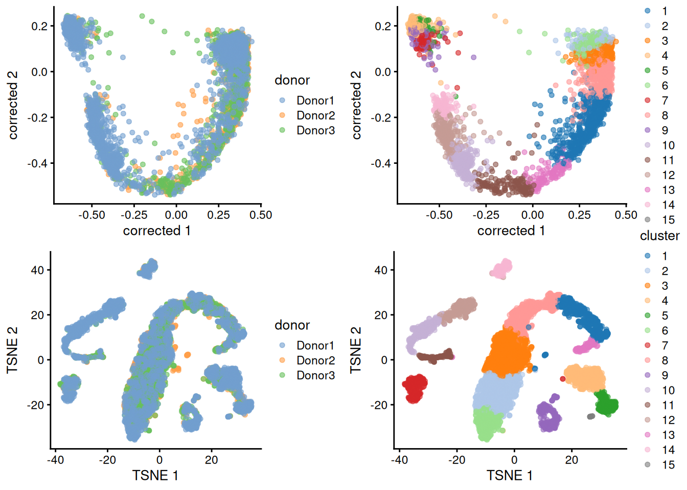
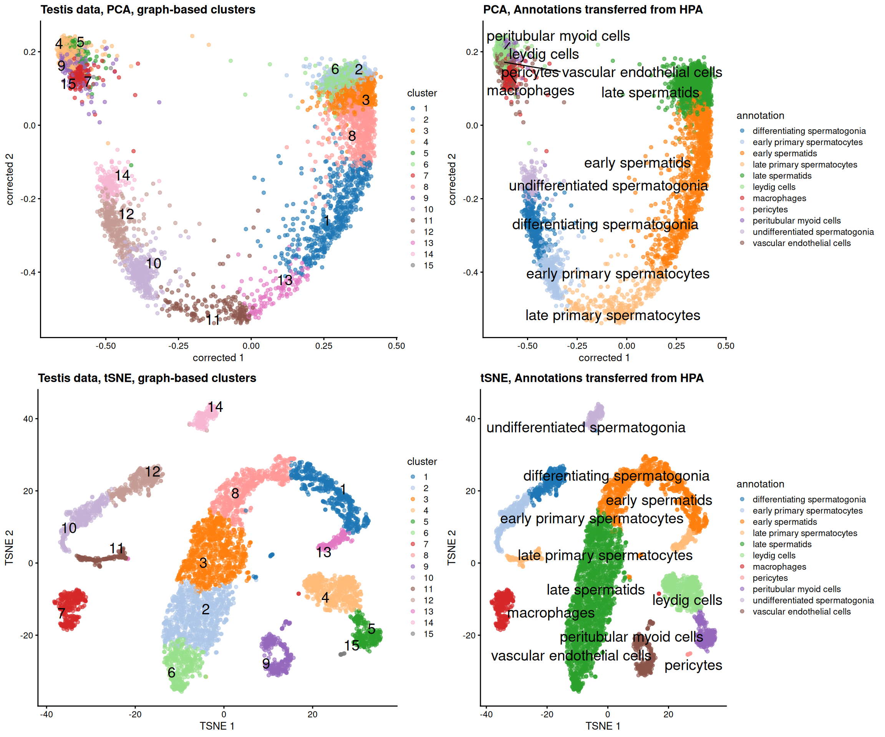
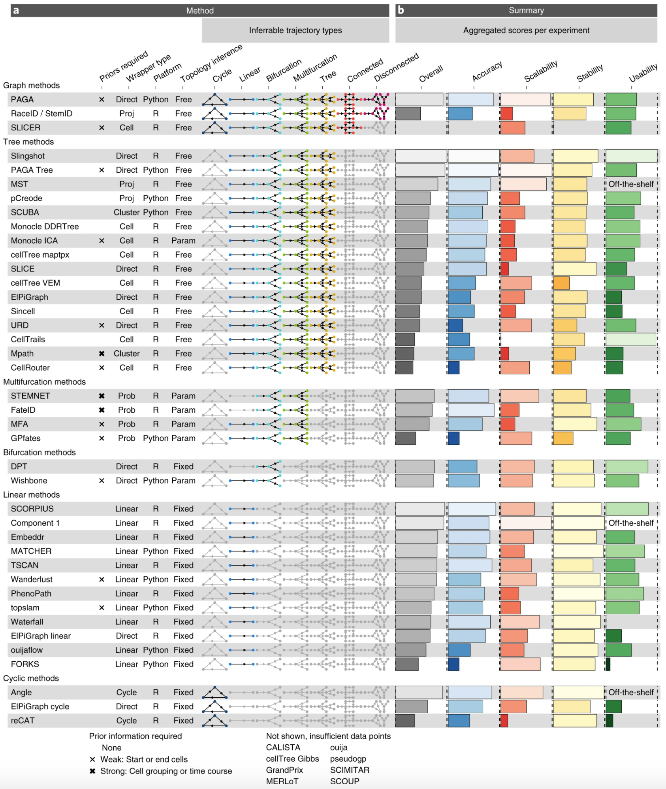
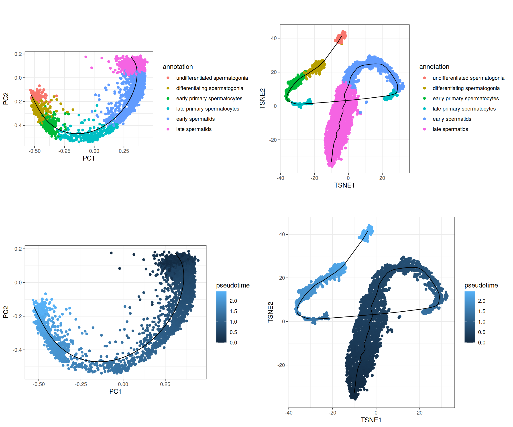
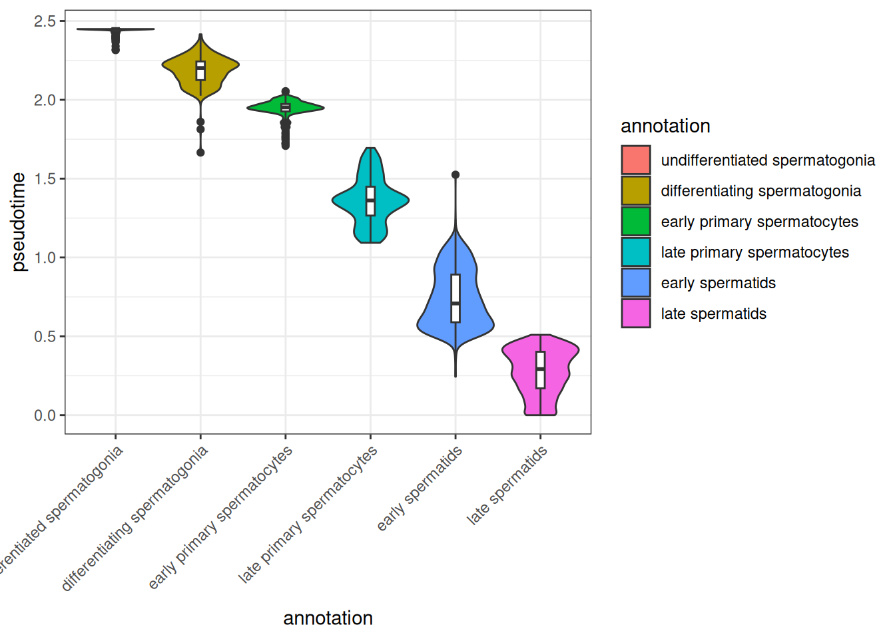
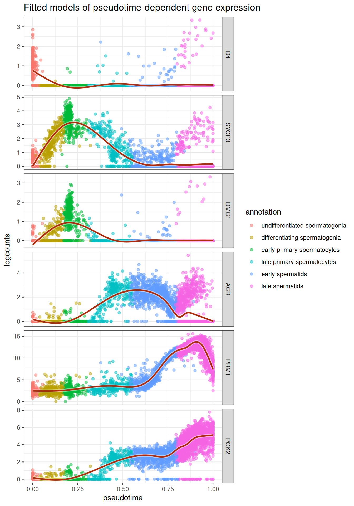

# 15  Lab 8: Pseudotime analyses

> **NOTE:**
>
> The estimated time for this lab is around 1h30.

> **TIP:**
>
> - Perform pseudotime and lineage analysis
> - Model and visualize gene expression along pseudotime
> - Understand the requirements for RNA velocity computation
> - Compute RNA velocity and use it to orientate lineages

## 15.1 Process testis data in R

### 15.1.1 Import testis data from GSE112013 and pre-process it

We will work on a `testis` dataset, from the “The adult human testis transcriptional cell atlas” study ([Guo et al., Cell Research 2018](https://doi.org/10.1038/s41422-018-0099-2)). This dataset contains single-cell RNAseq data from human testis. It is available on the GEO database under the accession number [GSE112013](https://www.ncbi.nlm.nih.gov/geo/query/acc.cgi?acc=GSE112013).

We have applied the different analysis steps we have learned over the past three days to the count matrix `GSE112013_Combined_UMI_table.txt.gz`. See the code below for the details of pre-processing steps, and run it in your session (this takes a few minutes, and requires ~8 GB of memory).

> **NOTE:**
>
> Check the GEO page for supplementary processed data, and download the `GSE112013_Combined_UMI_table.txt.gz` table.
>
> With this data, we will:
>
> - Import the dataset in R as a `SingleCellExperiment` object,
> - Remove doublets,
> - Filter genes and cells,
> - Normalize `counts`,
> - Correct for batch effect,
> - Cluster cells.
>
> ``` r
> library(SingleCellExperiment)
> ##  Loading required package: SummarizedExperiment
> ##  Loading required package: MatrixGenerics
> ##  Loading required package: matrixStats
> ##  
> ##  Attaching package: 'MatrixGenerics'
> ##  The following objects are masked from 'package:matrixStats':
> ##  
> ##      colAlls, colAnyNAs, colAnys, colAvgsPerRowSet, colCollapse,
> ##      colCounts, colCummaxs, colCummins, colCumprods, colCumsums,
> ##      colDiffs, colIQRDiffs, colIQRs, colLogSumExps, colMadDiffs,
> ##      colMads, colMaxs, colMeans2, colMedians, colMins, colOrderStats,
> ##      colProds, colQuantiles, colRanges, colRanks, colSdDiffs, colSds,
> ##      colSums2, colTabulates, colVarDiffs, colVars, colWeightedMads,
> ##      colWeightedMeans, colWeightedMedians, colWeightedSds,
> ##      colWeightedVars, rowAlls, rowAnyNAs, rowAnys, rowAvgsPerColSet,
> ##      rowCollapse, rowCounts, rowCummaxs, rowCummins, rowCumprods,
> ##      rowCumsums, rowDiffs, rowIQRDiffs, rowIQRs, rowLogSumExps,
> ##      rowMadDiffs, rowMads, rowMaxs, rowMeans2, rowMedians, rowMins,
> ##      rowOrderStats, rowProds, rowQuantiles, rowRanges, rowRanks,
> ##      rowSdDiffs, rowSds, rowSums2, rowTabulates, rowVarDiffs,
> ##      rowVars, rowWeightedMads, rowWeightedMeans, rowWeightedMedians,
> ##      rowWeightedSds, rowWeightedVars
> ##  Loading required package: GenomicRanges
> ##  Loading required package: stats4
> ##  Loading required package: BiocGenerics
> ##  Loading required package: generics
> ##  
> ##  Attaching package: 'generics'
> ##  The following objects are masked from 'package:base':
> ##  
> ##      as.difftime, as.factor, as.ordered, intersect, is.element,
> ##      setdiff, setequal, union
> ##  
> ##  Attaching package: 'BiocGenerics'
> ##  The following objects are masked from 'package:stats':
> ##  
> ##      IQR, mad, sd, var, xtabs
> ##  The following object is masked from 'package:utils':
> ##  
> ##      data
> ##  The following objects are masked from 'package:base':
> ##  
> ##      Filter, Find, Map, Position, Reduce, anyDuplicated, aperm,
> ##      append, as.data.frame, basename, cbind, colnames, dirname,
> ##      do.call, duplicated, eval, evalq, get, grep, grepl, is.unsorted,
> ##      lapply, mapply, match, mget, order, paste, pmax, pmax.int, pmin,
> ##      pmin.int, rank, rbind, rownames, sapply, saveRDS, scale,
> ##      sequence, table, tapply, transform, unique, unsplit, which.max,
> ##      which.min
> ##  Loading required package: S4Vectors
> ##  
> ##  Attaching package: 'S4Vectors'
> ##  The following object is masked from 'package:utils':
> ##  
> ##      findMatches
> ##  The following objects are masked from 'package:base':
> ##  
> ##      I, expand.grid, unname
> ##  Loading required package: IRanges
> ##  Loading required package: Seqinfo
> ##  Loading required package: Biobase
> ##  Welcome to Bioconductor
> ##  
> ##      Vignettes contain introductory material; view with
> ##      'browseVignettes()'. To cite Bioconductor, see
> ##      'citation("Biobase")', and for packages 'citation("pkgname")'.
> ##  
> ##  Attaching package: 'Biobase'
> ##  The following object is masked from 'package:MatrixGenerics':
> ##  
> ##      rowMedians
> ##  The following objects are masked from 'package:matrixStats':
> ##  
> ##      anyMissing, rowMedians
> library(tidyverse)
> ##  ── Attaching core tidyverse packages ───────────────────── tidyverse 2.0.0 ──
> ##  ✔ dplyr     1.2.1     ✔ readr     2.2.0
> ##  ✔ forcats   1.0.1     ✔ stringr   1.6.0
> ##  ✔ ggplot2   4.0.3     ✔ tibble    3.3.1
> ##  ✔ lubridate 1.9.5     ✔ tidyr     1.3.2
> ##  ✔ purrr     1.2.2
> ##  ── Conflicts ─────────────────────────────────────── tidyverse_conflicts() ──
> ##  ✖ lubridate::%within%() masks IRanges::%within%()
> ##  ✖ ggplot2::Position()   masks BiocGenerics::Position(), base::Position()
> ##  ✖ dplyr::collapse()     masks IRanges::collapse()
> ##  ✖ dplyr::combine()      masks Biobase::combine(), BiocGenerics::combine()
> ##  ✖ dplyr::count()        masks matrixStats::count()
> ##  ✖ dplyr::desc()         masks IRanges::desc()
> ##  ✖ tidyr::expand()       masks S4Vectors::expand()
> ##  ✖ dplyr::filter()       masks stats::filter()
> ##  ✖ dplyr::first()        masks S4Vectors::first()
> ##  ✖ dplyr::lag()          masks stats::lag()
> ##  ✖ purrr::reduce()       masks GenomicRanges::reduce(), IRanges::reduce()
> ##  ✖ dplyr::rename()       masks S4Vectors::rename()
> ##  ✖ lubridate::second()   masks S4Vectors::second()
> ##  ✖ lubridate::second<-() masks S4Vectors::second<-()
> ##  ✖ dplyr::slice()        masks IRanges::slice()
> ##  ℹ Use the conflicted package (<http://conflicted.r-lib.org/>) to force all conflicts to become errors
>
> # Download raw file
> library(BiocFileCache)
> ##  Loading required package: dbplyr
> ##  
> ##  Attaching package: 'dbplyr'
> ##  
> ##  The following objects are masked from 'package:dplyr':
> ##  
> ##      ident, sql, sql_escape_ident, sql_escape_string
> ##  
> ##  OpenTelemetry error: there is no package called 'otelsdk'
> ##  OpenTelemetry error: there is no package called 'otelsdk'
> bfc <- BiocFileCache(ask = FALSE)
> umi_file <- bfcrpath(bfc, 'https://ftp.ncbi.nlm.nih.gov/geo/series/GSE112nnn/GSE112013/suppl/GSE112013_Combined_UMI_table.txt.gz')
> ##  adding rname 'https://ftp.ncbi.nlm.nih.gov/geo/series/GSE112nnn/GSE112013/suppl/GSE112013_Combined_UMI_table.txt.gz'
>
> # Create SingleCellExperiment object
> x <- data.table::fread(umi_file, data.table = FALSE)
> counts <- as(as.matrix(x[, -1]), 'dgCMatrix')
> rownames(counts) <- x[, 1]
> rm(x); invisible(gc())
> testis <- SingleCellExperiment(
>     assays = list(counts = counts),
>     colData = DataFrame(cellid = colnames(counts))
> )
> testis$Barcode <- str_replace(testis$cellid, 'Donor.-', '') |> str_replace('-.', '')
> testis$donor <- str_replace(testis$cellid, '-.*', '')
> testis$replicate <- str_replace(testis$cellid, '.*-', '')
> testis$sample <- paste0(testis$donor, '_rep', testis$replicate)
> table(testis$donor, testis$replicate)
> ##          
> ##              1    2
> ##    Donor1 1000 1248
> ##    Donor2  985 1009
> ##    Donor3 1116 1132
>
> # Remove doublets
> set.seed(1000)
> testis <- scDblFinder::scDblFinder(testis, samples = testis$sample)
> ##  
>   |                                                                         
>   |                                                                   |   0%
>   |                                                                         
>   |===========                                                        |  17%
>   |                                                                         
>   |======================                                             |  33%
>   |                                                                         
>   |==================================                                 |  50%
>   |                                                                         
>   |=============================================                      |  67%
>   |                                                                         
>   |========================================================           |  83%
>   |                                                                         
>   |===================================================================| 100%
> table(testis$scDblFinder.class)
> ##  
> ##  singlet doublet 
> ##     6224     266
> testis <- testis[, testis$scDblFinder.class == 'singlet']
>
> # Recover Ensembl IDs and biotypes for genes, and keep protein-coding genes
> gene_info <- AnnotationDbi::select(
>     org.Hs.eg.db::org.Hs.eg.db,
>     keys = rownames(testis), keytype = 'SYMBOL',
>     columns = c('ENSEMBL', 'GENETYPE')
> ) |>
>     filter(GENETYPE == 'protein-coding') |>
>     distinct(SYMBOL, .keep_all = TRUE)
> ##  
> ##  'select()' returned 1:many mapping between keys and columns
> testis <- testis[gene_info$SYMBOL, ]
> rowData(testis)$gene_name <- gene_info$SYMBOL
> rowData(testis)$gene_id <- gene_info$ENSEMBL
>
> # Get QCs per cell, flag low-quality cells and filter them out
> mito <- grep('^MT-', rownames(testis), value = TRUE)
> testis <- scrapper::quickRnaQc.se(testis, subsets = list(mito = mito), block = testis$sample)
> table(testis$keep)
> ##  
> ##  FALSE  TRUE 
> ##    832  5392
> testis <- testis[, testis$keep]
>
> # Filter out genes not expressed in at least 10 cells
> testis <- testis[Matrix::rowSums(counts(testis) > 0) >= 10, ]
>
> # Normalize counts
> clusters <- scran::quickCluster(testis, block = testis$sample)
> testis <- scran::computeSumFactors(testis, clusters = clusters)
> testis <- scrapper::normalizeRnaCounts.se(
>     testis, size.factors = sizeFactors(testis), block = testis$sample,
>     more.norm.args = list(delayed = FALSE)
> )
>
> # Computing biological variance of each gene
> testis <- scrapper::chooseRnaHvgs.se(testis, block = testis$donor, top = 2000)
> rowData(testis)$isHVG <- rowData(testis)$hvg
> HVGs <- rownames(testis)[rowData(testis)$isHVG]
>
> # Embedding dataset in PCA space, correcting for batch effect
> mergedBatches <- batchelor::fastMNN(
>     testis,
>     batch = testis$donor,
>     subset.row = HVGs
> )
> reducedDim(testis, 'corrected') <- reducedDim(mergedBatches, 'corrected')
>
> # Cluster cells using shared nearest-neighbors graph and Louvain community finding algorithm
> testis <- scrapper::clusterGraph.se(testis, reddim.type = 'corrected', output.name = 'cluster')
> testis$cluster <- factor(testis$cluster)
> table(testis$cluster)
> ##  
> ##    1   2   3   4   5   6   7   8   9  10  11  12  13  14  15 
> ##  519 754 806 471 241 347 288 534 302 335 176 304 128 168  19
>
> # Embedding dataset in TSNE space for visualization
> set.seed(10)
> testis <- scater::runTSNE(testis, dimred = 'corrected')
>
> # Visualize embeddings
> p <- cowplot::plot_grid(
>     scater::plotReducedDim(testis, 'corrected', colour_by = 'donor'),
>     scater::plotReducedDim(testis, 'corrected', colour_by = 'cluster'),
>     scater::plotReducedDim(testis, 'TSNE', colour_by = 'donor'),
>     scater::plotReducedDim(testis, 'TSNE', colour_by = 'cluster')
> )
> p
> ```
>
> 

### 15.1.2 Annotate cells using HPA resources

The [Human Protein Atlas (HPA)](https://www.proteinatlas.org) is a valuable resource for cell type annotations. It provides single-cell RNAseq data for a large number of cell types.

> **NOTE:**
>
> Download `HPA` scRNAseq atlas (combined per cell type) [from here](https://www.proteinatlas.org/download/tsv/rna_single_cell_type.tsv.zip), and import it in R as a `SummarizedExperiment` object.
>
> > **NOTE:**
> >
> > ``` r
> > hpa_file <- bfcrpath(bfc, 'https://www.proteinatlas.org/download/tsv/rna_single_cell_type.tsv.zip')
> > ##  adding rname 'https://www.proteinatlas.org/download/tsv/rna_single_cell_type.tsv.zip'
> > HPA <- read_tsv(hpa_file) |>
> >     dplyr::select(-Gene) |>
> >     pivot_wider(names_from = `Cell type`, values_from = 'nCPM', values_fn = mean) |>
> >     distinct(`Gene name`, .keep_all = TRUE) |>
> >     column_to_rownames('Gene name') |>
> >     as.matrix()
> > ##  Rows: 3087080 Columns: 4
> > ##  ── Column specification ─────────────────────────────────────────────────────
> > ##  Delimiter: "\t"
> > ##  chr (3): Gene, Gene name, Cell type
> > ##  dbl (1): nCPM
> > ##  
> > ##  ℹ Use `spec()` to retrieve the full column specification for this data.
> > ##  ℹ Specify the column types or set `show_col_types = FALSE` to quiet this message.
> > HPA[is.na(HPA)] <- 0
> > HPA_se <- SummarizedExperiment::SummarizedExperiment(
> >     assays = list('logcounts' = log2(HPA + 1)),
> >     colData = DataFrame(cell_type = colnames(HPA))
> > )
> > HPA_se
> > ##  class: SummarizedExperiment 
> > ##  dim: 20151 154 
> > ##  metadata(0):
> > ##  assays(1): logcounts
> > ##  rownames(20151): TSPAN6 TNMD ... ENSG00000291316 TMEM276
> > ##  rowData names(0):
> > ##  colnames(154): adipocytes adrenal cortex cells ... vascular
> > ##    endothelial cells vascular smooth muscle cells
> > ##  colData names(1): cell_type
> > ```
>
> How many and what cell types are profiled?
>
> > **NOTE:**
> >
> > ``` r
> > length(HPA_se$cell_type)
> > ##  [1] 154
> > HPA_se$cell_type
> > ##    [1] "adipocytes"                               
> > ##    [2] "adrenal cortex cells"                     
> > ##    [3] "adrenal medulla cells"                    
> > ##    [4] "alveolar cells type 1"                    
> > ##    [5] "alveolar cells type 2"                    
> > ##    [6] "astrocytes"                               
> > ##    [7] "b-cells"                                  
> > ##    [8] "basal keratinocytes"                      
> > ##    [9] "basal prostatic cells"                    
> > ##   [10] "bergmann glia"                            
> > ##   [11] "brain excitatory neurons"                 
> > ##   [12] "brain inhibitory neurons"                 
> > ##   [13] "breast hormone-responsive cells"          
> > ##   [14] "breast lactating cells"                   
> > ##   [15] "breast myoepithelial cells"               
> > ##   [16] "breast secretory cells"                   
> > ##   [17] "cardiomyocytes"                           
> > ##   [18] "cdc"                                      
> > ##   [19] "cholangiocytes"                           
> > ##   [20] "choroid plexus epithelial cells"          
> > ##   [21] "colonocytes"                              
> > ##   [22] "cone photoreceptor cells"                 
> > ##   [23] "conjunctival goblet cells"                
> > ##   [24] "corticotrophs"                            
> > ##   [25] "cytotrophoblasts"                         
> > ##   [26] "decidual stromal cells"                   
> > ##   [27] "differentiating spermatogonia"            
> > ##   [28] "distal convoluted tubule cells"           
> > ##   [29] "early primary spermatocytes"              
> > ##   [30] "early spermatids"                         
> > ##   [31] "endometrial ciliated cells"               
> > ##   [32] "endometrial glandular cells"              
> > ##   [33] "endometrial luminal cells"                
> > ##   [34] "endometrial secretory cells"              
> > ##   [35] "endometrial stromal cells"                
> > ##   [36] "enteric stem cells"                       
> > ##   [37] "enteric transient amplifying cells"       
> > ##   [38] "enterocytes"                              
> > ##   [39] "ependymal cells"                          
> > ##   [40] "epicardial cells"                         
> > ##   [41] "epididymal basal cells"                   
> > ##   [42] "epididymal clear cells"                   
> > ##   [43] "epididymal efferent duct absorptive cells"
> > ##   [44] "epididymal efferent duct ciliated cells"  
> > ##   [45] "epididymal principal cells"               
> > ##   [46] "erythrocyte progenitors"                  
> > ##   [47] "erythrocytes"                             
> > ##   [48] "esophageal apical cells"                  
> > ##   [49] "esophageal basal cells"                   
> > ##   [50] "esophageal suprabasal cells"              
> > ##   [51] "extravillous trophoblasts"                
> > ##   [52] "fallopian secretory cells"                
> > ##   [53] "fallopian tube ciliated cells"            
> > ##   [54] "fibro-adipogenic progenitors"             
> > ##   [55] "fibroblasts"                              
> > ##   [56] "foveolar cells"                           
> > ##   [57] "gastric chief cells"                      
> > ##   [58] "gastric progenitor cells"                 
> > ##   [59] "goblet cells"                             
> > ##   [60] "gonadotrophs"                             
> > ##   [61] "granulosa cells"                          
> > ##   [62] "hematopoietic stem cells"                 
> > ##   [63] "hepatic stellate cells"                   
> > ##   [64] "hepatocytes"                              
> > ##   [65] "hofbauer cells"                           
> > ##   [66] "innate lymphoid cells"                    
> > ##   [67] "kupffer cells"                            
> > ##   [68] "lacrimal acinar cells"                    
> > ##   [69] "lactotrophs"                              
> > ##   [70] "late primary spermatocytes"               
> > ##   [71] "late spermatids"                          
> > ##   [72] "leydig cells"                             
> > ##   [73] "loop of henle epithelial cells"           
> > ##   [74] "lymphatic endothelial cells"              
> > ##   [75] "macrophages"                              
> > ##   [76] "mast cells"                               
> > ##   [77] "medullary thymic epithelial cells"        
> > ##   [78] "megakaryocyte progenitors"                
> > ##   [79] "megakaryocyte-erythroid progenitors"      
> > ##   [80] "megakaryocytes"                           
> > ##   [81] "melanocytes"                              
> > ##   [82] "mesothelial cells"                        
> > ##   [83] "microglia"                                
> > ##   [84] "migrating cytotrophoblasts"               
> > ##   [85] "monocyte progenitors"                     
> > ##   [86] "monocytes"                                
> > ##   [87] "mucous neck cells"                        
> > ##   [88] "müller glia"                              
> > ##   [89] "myonuclei"                                
> > ##   [90] "myosatellite cells"                       
> > ##   [91] "neuroendocrine cells"                     
> > ##   [92] "neutrophil progenitors"                   
> > ##   [93] "neutrophils"                              
> > ##   [94] "nk-cells"                                 
> > ##   [95] "ocular epithelial cells"                  
> > ##   [96] "oligodendrocyte progenitor cells"         
> > ##   [97] "oligodendrocytes"                         
> > ##   [98] "oocytes"                                  
> > ##   [99] "other brain neurons"                      
> > ##  [100] "ovarian stromal cells"                    
> > ##  [101] "pancreatic acinar cells"                  
> > ##  [102] "pancreatic duct cells"                    
> > ##  [103] "pancreatic islet cells"                   
> > ##  [104] "paneth cells"                             
> > ##  [105] "papillary tip epithelial cells"           
> > ##  [106] "parietal cells"                           
> > ##  [107] "pdcs"                                     
> > ##  [108] "pericytes"                                
> > ##  [109] "peritubular myoid cells"                  
> > ##  [110] "pituicytes/fscs"                          
> > ##  [111] "pituitary stem cells"                     
> > ##  [112] "plasma cells"                             
> > ##  [113] "platelets"                                
> > ##  [114] "podocytes"                                
> > ##  [115] "prostatic club cells"                     
> > ##  [116] "prostatic glandular cells"                
> > ##  [117] "prostatic hillock cells"                  
> > ##  [118] "proximal tubule cells"                    
> > ##  [119] "renal collecting duct intercalated cells" 
> > ##  [120] "renal collecting duct principal cells"    
> > ##  [121] "renal connecting tubule cells"            
> > ##  [122] "respiratory basal cells"                  
> > ##  [123] "respiratory ciliated cells"               
> > ##  [124] "respiratory deuterosomal cells"           
> > ##  [125] "respiratory ionocytes"                    
> > ##  [126] "respiratory secretory cells"              
> > ##  [127] "retinal amacrine cells"                   
> > ##  [128] "retinal bipolar cells"                    
> > ##  [129] "retinal ganglion cells"                   
> > ##  [130] "retinal horizontal cells"                 
> > ##  [131] "retinal pigment epithelial cells"         
> > ##  [132] "rod photoreceptor cells"                  
> > ##  [133] "salivary acinar cells"                    
> > ##  [134] "salivary basal cells"                     
> > ##  [135] "salivary duct cells"                      
> > ##  [136] "salivary ionocytes"                       
> > ##  [137] "salivary myoepithelial cells"             
> > ##  [138] "schwann cells"                            
> > ##  [139] "sertoli cells"                            
> > ##  [140] "smooth muscle cells"                      
> > ##  [141] "somatotrophs"                             
> > ##  [142] "submucosal glandular cells"               
> > ##  [143] "suprabasal keratinocytes"                 
> > ##  [144] "syncytiotrophoblasts"                     
> > ##  [145] "t-cells"                                  
> > ##  [146] "thymic myoid cells"                       
> > ##  [147] "thymocytes"                               
> > ##  [148] "thyrotrophs"                              
> > ##  [149] "transitional alveolar cells"              
> > ##  [150] "tuft cells"                               
> > ##  [151] "undifferentiated spermatogonia"           
> > ##  [152] "urothelial cells"                         
> > ##  [153] "vascular endothelial cells"               
> > ##  [154] "vascular smooth muscle cells"
> > ```

We can use the HPA reference to annotate cell types in the testis dataset.

> **NOTE:**
>
> Use `SingleR` to annotate cell types in the testis dataset using HPA reference.
>
> > **NOTE:**
> >
> > ``` r
> > predictions <- SingleR::SingleR(
> >     test = testis,
> >     ref = HPA_se,
> >     labels = colData(HPA_se)$cell_type,
> >     clusters = testis$cluster
> > )
> > testis$annotation <- predictions$labels[testis$cluster]
> > table(testis$annotation)
> > ##  
> > ##   differentiating spermatogonia    early primary spermatocytes 
> > ##                             304                            335 
> > ##                early spermatids     late primary spermatocytes 
> > ##                            1053                            304 
> > ##                 late spermatids                   leydig cells 
> > ##                            1907                            471 
> > ##                     macrophages                      pericytes 
> > ##                             288                             19 
> > ##         peritubular myoid cells undifferentiated spermatogonia 
> > ##                             241                            168 
> > ##      vascular endothelial cells 
> > ##                             302
> > cowplot::plot_grid(
> >     scater::plotReducedDim(testis, dimred = 'corrected', colour_by = 'cluster', text_by = 'cluster') + ggtitle('Testis data, PCA, graph-based clusters'),
> >     scater::plotReducedDim(testis, dimred = 'corrected', colour_by = 'annotation', text_by = 'annotation') + ggtitle('PCA, Annotations transferred from HPA'),
> >     scater::plotReducedDim(testis, dimred = 'TSNE', colour_by = 'cluster', text_by = 'cluster') + ggtitle('Testis data, tSNE, graph-based clusters'),
> >     scater::plotReducedDim(testis, dimred = 'TSNE', colour_by = 'annotation', text_by = 'annotation') + ggtitle('tSNE, Annotations transferred from HPA')
> > )
> > ```
> >
> > 

### 15.1.3 Filter the testis dataset to only germinal cells.

In this notebook, we will focus on germinal cells only.

> **NOTE:**
>
> Filter the `testis` dataset to only retain germinal cells.
>
> > **NOTE:**
> >
> > ``` r
> > germcell_types <- c(
> >     "undifferentiated spermatogonia", "differentiating spermatogonia",
> >     "early primary spermatocytes", "late primary spermatocytes",
> >     "early spermatids", "late spermatids"
> > )
> > germcells <- testis[, testis$annotation %in% germcell_types]
> > germcells$annotation <- factor(germcells$annotation, levels = intersect(germcell_types, germcells$annotation))
> > table(germcells$annotation)
> > ##  
> > ##  undifferentiated spermatogonia  differentiating spermatogonia 
> > ##                             168                            304 
> > ##     early primary spermatocytes     late primary spermatocytes 
> > ##                             335                            304 
> > ##                early spermatids                late spermatids 
> > ##                            1053                           1907
> > ```

## 15.2 Trajectory inference (TI) in scRNAseq

An important question in scRNAseq field of research is: how to identify a cell trajectory from high-dimensional expression data and map individual cells onto it? A large number of methods have currently emerged, each one with their own specificities, assumptions, and strengths. A nice breakdown (from 2019, so already very outdated!) is available from `Saelens et al., Nat. Biotech. 2019` (doi: 10.1038/s41587-019-0071-9):



### 15.2.1 Trajectory

`Slingshot` is perhaps one of the most widely used algorithms for users who want to focus on `R`-based approaches.

> **NOTE:**
>
> Read Slingshot documentation to understand how to identify lineages in a scRNAseq dataset in R.
>
> Why is it recommended to infer lineages from PCA space rather than t-SNE or UMAP space, even though these spaces do “reveal” an obvious trajectory in 2D?
>
> Infer lineages, using cluster annotations as information to build the MST. Note that you will first need to remove the 50th dimension of the `corrected` embedding for `slingshot` to work ([bug reported](https://github.com/kstreet13/slingshot/issues/87)).
>
> > **NOTE:**
> >
> > ``` r
> > reducedDim(germcells, 'corrected_2') <- reducedDim(germcells, 'corrected')[, 1:49]
> > germcells_slingshot <- slingshot::slingshot(
> >     germcells,
> >     reducedDim = 'corrected_2',
> >     clusterLabels = germcells$annotation
> > )
> > slingshot::slingLineages(germcells_slingshot)
> > ##  $Lineage1
> > ##  [1] "late spermatids"                "early spermatids"              
> > ##  [3] "late primary spermatocytes"     "early primary spermatocytes"   
> > ##  [5] "differentiating spermatogonia"  "undifferentiated spermatogonia"
> > ```

### 15.2.2 Pseudotime

`slingshot` automatically deduces a pseudotime for each cell, based on the inferred lineage. It can be useful to visualize the trajectory of cells in a 2D space, and to order cells along the trajectory.

> **NOTE:**
>
> Recover pseudotime values and principal curves from `slingshot` output.
>
> > **NOTE:**
> >
> > ``` r
> > # Fetching pseudotime
> > germcells$pseudotime <- slingshot::slingPseudotime(germcells_slingshot)[, 'Lineage1']
> >
> > # Fetching principal curve in PCA space
> > pca_curve <- slingshot::slingCurves(germcells_slingshot, as.df = TRUE)
> > colnames(pca_curve)
> > ##   [1] "Dim.1"   "Dim.2"   "Dim.3"   "Dim.4"   "Dim.5"   "Dim.6"   "Dim.7"  
> > ##   [8] "Dim.8"   "Dim.9"   "Dim.10"  "Dim.11"  "Dim.12"  "Dim.13"  "Dim.14" 
> > ##  [15] "Dim.15"  "Dim.16"  "Dim.17"  "Dim.18"  "Dim.19"  "Dim.20"  "Dim.21" 
> > ##  [22] "Dim.22"  "Dim.23"  "Dim.24"  "Dim.25"  "Dim.26"  "Dim.27"  "Dim.28" 
> > ##  [29] "Dim.29"  "Dim.30"  "Dim.31"  "Dim.32"  "Dim.33"  "Dim.34"  "Dim.35" 
> > ##  [36] "Dim.36"  "Dim.37"  "Dim.38"  "Dim.39"  "Dim.40"  "Dim.41"  "Dim.42" 
> > ##  [43] "Dim.43"  "Dim.44"  "Dim.45"  "Dim.46"  "Dim.47"  "Dim.48"  "Dim.49" 
> > ##  [50] "Order"   "Lineage"
> > ## Rename the coordinates columns (all but the last two, `Order` and `Lineage`)
> > ndims <- ncol(pca_curve) - 2
> > colnames(pca_curve)[seq_len(ndims)] <- paste0('PC', seq_len(ndims))
> > head(pca_curve[, c('PC1', 'PC2', 'Order', 'Lineage')])
> > ##          PC1       PC2 Order Lineage
> > ##  1 0.3085413 0.1750947     1       1
> > ##  2 0.3106834 0.1724270     2       1
> > ##  3 0.3128256 0.1697593     3       1
> > ##  4 0.3149677 0.1670916     4       1
> > ##  5 0.3171095 0.1644158     5       1
> > ##  6 0.3192504 0.1617224     6       1
> > ```
>
> We would like to visualize the trajectory of cells in our TSNE space, but the principal curve is only available in PCA space. We can use `slingshot` to embed it in the TSNE space!
>
> > **NOTE:**
> >
> > ``` r
> > tsne_curve <- slingshot::embedCurves(germcells_slingshot, 'TSNE', smoother = 'loess', span = 0.1) |>
> >     slingshot::slingCurves(as.df = TRUE)
> > tsne_curve <- tsne_curve[order(tsne_curve$Order), ]
> > head(tsne_curve)
> > ##                                TSNE1     TSNE2 Order Lineage
> > ##  Donor1-CGACCTTGTAGCGTCC-2 -10.02767 -32.94658     1       1
> > ##  Donor1-GCGCCAAAGTATGACA-1 -10.02767 -32.94658     2       1
> > ##  Donor1-GGACAGAAGAATAGGG-2 -10.02767 -32.94658     3       1
> > ##  Donor1-AGCGTCGAGTGAACGC-1 -10.02767 -32.94658     4       1
> > ##  Donor1-GGCTCGATCCTAGAAC-1 -10.02767 -32.94658     5       1
> > ##  Donor1-GTCATTTCACAGACAG-1 -10.02767 -32.94658     6       1
> > ```
>
> Plot PCA and tSNE embeddings, coloring cells by either their annotation or their pseudotime value. Overlay the principal curves to each embedding.
>
> > **NOTE:**
> >
> > ``` r
> > df <- tibble(
> >     PC1 = reducedDim(germcells, 'corrected')[,1],
> >     PC2 = reducedDim(germcells, 'corrected')[,2],
> >     TSNE1 = reducedDim(germcells, 'TSNE')[,1],
> >     TSNE2 = reducedDim(germcells, 'TSNE')[,2],
> >     annotation = germcells$annotation,
> >     pseudotime = germcells$pseudotime
> > )
> > cowplot::plot_grid(
> >     df |>
> >         ggplot() +
> >         geom_point(aes(PC1, PC2, col = annotation)) +
> >         geom_path(data = pca_curve |> filter(Lineage == 1), aes(x = PC1, y = PC2)) +
> >         theme_bw() +
> >         coord_fixed(),
> >     df |>
> >         ggplot() +
> >         geom_point(aes(TSNE1, TSNE2, col = annotation)) +
> >         geom_path(data = tsne_curve |> filter(Lineage == 1), aes(x = TSNE1, y = TSNE2)) +
> >         theme_bw() +
> >         coord_fixed(),
> >     df |>
> >         ggplot() +
> >         geom_point(aes(PC1, PC2, col = pseudotime)) +
> >         geom_path(data = pca_curve |> filter(Lineage == 1), aes(x = PC1, y = PC2)) +
> >         theme_bw() +
> >         coord_fixed(),
> >     df |>
> >         ggplot() +
> >         geom_point(aes(TSNE1, TSNE2, col = pseudotime)) +
> >         geom_path(data = tsne_curve |> filter(Lineage == 1), aes(x = TSNE1, y = TSNE2)) +
> >         theme_bw() +
> >         coord_fixed()
> > )
> > ```
> >
> > 

> **NOTE:**
>
> Check the distribution of pseudotime values across the different cell clusters.
>
> What do you observe? Where you expecting this?
>
> > **NOTE:**
> >
> > ``` r
> > tibble(
> >     annotation = germcells$annotation,
> >     pseudotime = germcells$pseudotime
> > ) |>
> >     ggplot(aes(x = annotation, y = pseudotime, fill = annotation)) +
> >     geom_violin(scale = 'width') +
> >     geom_boxplot(outlier.shape = NULL, width = 0.1, fill = 'white') +
> >     theme_bw() +
> >     theme(axis.text.x = element_text(angle = 45, hjust = 1, vjust = 1))
> > ```
> >
> > 
>
> `slingshot` does not know in which direction cells differentiate: the pseudotime may well increase from late spermatids to spermatogonia! Correct pseudotime values, so that they increase along the differentiation. Note that the `start.clus` argument of `slingshot()` can also be used to specify the starting point of a trajectory.
>
> ``` r
> pt <- slingshot::slingPseudotime(germcells_slingshot)[, 'Lineage1']
> first_type <- levels(germcells$annotation)[1]
> last_type <- rev(levels(germcells$annotation))[1]
> if (median(pt[germcells$annotation == first_type], na.rm = TRUE) > median(pt[germcells$annotation == last_type], na.rm = TRUE)) {
>     pt <- -1 * pt
> }
> germcells$pseudotime <- scales::rescale(pt, c(0, 1))
> ```

### 15.2.3 BONUS: Daunting snippet but that makes a cool figure for a paper: modeling pseudotime-dependent gene expression

Using pseudotime / cell, one can model gene expression along the differentiation process. This alleviates the need to study gene expression **per cell**, and allows one to focus on process-related effects (e.g. gene expression during a developmental trajectory).

> **NOTE:**
>
> Try to do so for few markers of spermatogonia, spermatocytes and spermatids.
>
> > **NOTE:**
> >
> > ``` r
> > genes <- c('ID4', 'SYCP3', 'DMC1', 'ACR', 'PRM1', 'PGK2')
> > fitExprs <- logcounts(germcells[genes, ]) |> # ----------------------------------- Get norm. counts for genes of interest
> >     as.matrix() |>
> >     t() |>
> >     as_tibble() |>
> >     mutate(  # ----------------------------------------------------------------- Add information for each cell
> >         cellID = colnames(germcells),
> >         annotation = germcells$annotation,
> >         pseudotime = germcells$pseudotime
> >     ) |>
> >     filter(!is.na(pseudotime)) |>
> >     pivot_longer(all_of(genes), names_to = 'gene', values_to = 'obs_expr') |> # - Pivot in "long" tidy format
> >     mutate(gene = factor(gene, genes)) |>
> >     group_by(gene) |> # ------------------------------------------------------- Group rows by genes
> >     nest() |> # --------------------------------------------------------------- For each gene, extract the subtable into a column named data
> >     mutate(
> >         gamModel = map(data, ~mgcv::gam(obs_expr ~ s(pseudotime, bs = "cs"), data = .)),
> >         gamFitted_expr = map(gamModel, predict) # ------------------------------ For each gene, fit the expression values ~ pseudotime with a GAM
> >     ) |>
> >     dplyr::select(-ends_with('Model')) |>
> >     unnest(c(data, ends_with('_expr'))) # -------------------------------------- Unnest all the modelled expressions
> > ggplot(fitExprs) +
> >     geom_point(aes(x = pseudotime, y = obs_expr, col = annotation), alpha = 0.5) +
> >     geom_line(aes(x = pseudotime, y = gamFitted_expr), col = 'white', linewidth = 2, alpha = 0.5) +
> >     geom_line(aes(x = pseudotime, y = gamFitted_expr), col = '#af2d0c', linewidth = 1) +
> >     theme_bw() +
> >     facet_grid(gene~., scales = 'free') +
> >     labs(y = 'logcounts') +
> >     ggtitle('Fitted models of pseudotime-dependent gene expression')
> > ```
> >
> > 

## 15.3 Ordering trajectory with RNA velocity

As we saw earlier, TI does not necessarily know which direction is right for a given trajectory. This orientation can be sometimes refined using RNA velocity. Let’s see whether RNA velocity helps orientating our spermatocyte differentiation lineage trajectory here.

> **WARNING:**
>
> RNA velocity requires the counts of spliced and unspliced reads, for each gene in each cell. These counts are not provided in GEO: they were computed from the raw reads of the study with [`velocyto`](https://velocyto.org/), and the resulting `loom` file (`Guo_testis_full-counts.loom`) will be made available by your instructors during the workshop. The code below is therefore not run when the book is built.

> **NOTE:**
>
> - Read `velociraptor` documentation. What do you need to compute RNA velocity scores in R?
> - Import `spliced` and `unspliced` counts computed with `velocyto` in R.
> - Try and compute RNA velocity.
>
> > **NOTE:**
> >
> > ``` r
> > ## - Import entire GSE112013 dataset with spliced/unspliced counts
> > full_GSE112013_counts <- LoomExperiment::import('Guo_testis_full-counts.loom')
> > full_GSE112013_counts
> >
> > ## - Filter `germcells` genes and cells to only retain those present in `full_GSE112013_counts`
> > germcells <- germcells[
> >     rowData(germcells)$gene_id %in% rowData(full_GSE112013_counts)$Accession,
> >     germcells$Barcode %in% full_GSE112013_counts$Barcode
> > ]
> >
> > ## - Reorder rows of `full_GSE112013_counts_germcells` to match those of `germcells`
> > full_GSE112013_counts_germcells <- full_GSE112013_counts[match(rowData(germcells)$gene_id, rowData(full_GSE112013_counts)$Accession), match(germcells$Barcode, full_GSE112013_counts$Barcode)]
> > dim(germcells)
> > dim(full_GSE112013_counts_germcells)
> >
> > ## - Add spliced/unspliced counts to germcells
> > assay(germcells, 'spliced', withDimnames=FALSE) <- as(assay(full_GSE112013_counts_germcells, 'spliced'), 'dgCMatrix')
> > assay(germcells, 'unspliced', withDimnames=FALSE) <- as(assay(full_GSE112013_counts_germcells, 'unspliced'), 'dgCMatrix')
> > germcells
> >
> > ## - Run velociraptor
> > velo_out <- velociraptor::scvelo(
> >     germcells,
> >     assay.X = "counts",
> >     subset.row = rowData(germcells)$isHVG,
> >     use.dimred = "corrected"
> > )
> > velo_out
> > ```

- **Embed the velocity field in tSNE scRNAseq embedding and plot the RNA velocity field on top of tSNE projection. Conclude.**

``` r
embedded_velo <- velociraptor::embedVelocity(reducedDim(germcells, "TSNE"), velo_out)
head(embedded_velo)
grid_df <- velociraptor::gridVectors(reducedDim(germcells, "TSNE"), embedded_velo, resolution = 30, scale = TRUE)
head(grid_df)
scater::plotReducedDim(germcells, 'TSNE', colour_by = "annotation", point_alpha = 0.5) +
    geom_segment(
        data = grid_df,
        mapping = aes(x = start.1, y = start.2, xend = end.1, yend = end.2),
        arrow = arrow(length = unit(0.05, "inches"), type = "closed")
    )
```

## 15.4 Session info

> **NOTE:**
>
>     ##  ─ Session info ────────────────────────────────────────────────────────────
>     ##   setting  value
>     ##   version  R version 4.6.1 (2026-06-24)
>     ##   os       Ubuntu 24.04.5 LTS
>     ##   system   x86_64, linux-gnu
>     ##   ui       X11
>     ##   language (EN)
>     ##   collate  C
>     ##   ctype    en_US.UTF-8
>     ##   tz       Etc/UTC
>     ##   date     2026-11-06
>     ##   pandoc   3.13 @ /usr/bin/ (via rmarkdown)
>     ##   quarto   1.11.5 @ /usr/local/bin/quarto
>     ##  
>     ##  ─ Packages ────────────────────────────────────────────────────────────────
>     ##   package              * version   date (UTC) lib source
>     ##   abind                  1.4-8     2024-09-12 [2] RSPM (R 4.6.0)
>     ##   AnnotationDbi          1.75.2    2026-07-21 [2] Bioconductor 3.24 (R 4.6.1)
>     ##   batchelor              1.29.0    2026-04-28 [2] Bioconductor 3.24 (R 4.6.1)
>     ##   beachmat               2.29.3    2026-09-23 [2] Bioconductor 3.24 (R 4.6.1)
>     ##   beeswarm               0.4.0     2021-06-01 [2] RSPM (R 4.6.0)
>     ##   Biobase              * 2.73.2    2026-07-29 [2] Bioconductor 3.24 (R 4.6.1)
>     ##   BiocBaseUtils          1.15.1    2026-05-10 [2] Bioconductor 3.24 (R 4.6.1)
>     ##   BiocFileCache        * 3.3.2     2026-11-06 [2] xgit (https://git.bioconductor.org/packages/BiocFileCache@709e8bb)
>     ##   BiocGenerics         * 0.59.12   2026-08-11 [2] Bioconductor 3.24 (R 4.6.1)
>     ##   BiocIO                 1.23.3    2026-04-29 [2] Bioconductor 3.24 (R 4.6.1)
>     ##   BiocNeighbors          2.7.3     2026-08-21 [2] Bioconductor 3.24 (R 4.6.1)
>     ##   BiocParallel           1.47.0    2026-04-28 [2] Bioconductor 3.24 (R 4.6.1)
>     ##   BiocSingular           1.29.2    2026-10-08 [2] Bioconductor 3.24 (R 4.6.1)
>     ##   Biostrings             2.81.9    2026-09-06 [2] Bioconductor 3.24 (R 4.6.1)
>     ##   bit                    4.6.0     2025-03-06 [2] RSPM (R 4.6.0)
>     ##   bit64                  4.8.6     2026-09-01 [2] RSPM (R 4.6.0)
>     ##   bitops                 1.1-0     2026-07-30 [2] RSPM (R 4.6.0)
>     ##   blob                   1.3.0     2026-01-14 [2] RSPM (R 4.6.0)
>     ##   bluster                1.23.1    2026-08-25 [2] Bioconductor 3.24 (R 4.6.1)
>     ##   cachem                 1.1.0     2024-05-16 [2] RSPM (R 4.6.0)
>     ##   cigarillo              1.3.1     2026-07-13 [2] Bioconductor 3.24 (R 4.6.1)
>     ##   cli                    3.6.6     2026-04-09 [2] RSPM (R 4.6.0)
>     ##   cluster                2.1.8.3   2026-07-30 [2] RSPM (R 4.6.1)
>     ##   codetools              0.2-20    2024-03-31 [3] CRAN (R 4.6.1)
>     ##   cowplot                1.2.0     2025-07-07 [2] RSPM (R 4.6.0)
>     ##   crayon                 1.5.3     2024-06-20 [2] RSPM (R 4.6.0)
>     ##   curl                   8.1.0     2026-10-14 [2] RSPM (R 4.6.0)
>     ##   data.table             1.18.6.1  2026-08-24 [2] RSPM (R 4.6.0)
>     ##   DBI                    1.3.0     2026-02-25 [2] RSPM (R 4.6.0)
>     ##   dbplyr               * 2.6.0     2026-06-17 [2] RSPM (R 4.6.0)
>     ##   DelayedArray           0.39.8    2026-09-30 [2] Bioconductor 3.24 (R 4.6.1)
>     ##   DelayedMatrixStats     1.35.0    2026-04-28 [2] Bioconductor 3.24 (R 4.6.1)
>     ##   dichromat              2.0-1     2026-07-22 [2] RSPM (R 4.6.0)
>     ##   digest                 0.6.39    2025-11-19 [2] RSPM (R 4.6.0)
>     ##   dplyr                * 1.2.1     2026-04-03 [2] RSPM (R 4.6.0)
>     ##   dqrng                  0.4.1     2024-05-28 [2] RSPM (R 4.6.0)
>     ##   edgeR                  4.99.12   2026-11-04 [2] Bioconductor 3.24 (R 4.6.1)
>     ##   evaluate               1.0.5     2025-08-27 [2] RSPM (R 4.6.0)
>     ##   farver                 2.1.2     2024-05-13 [2] RSPM (R 4.6.0)
>     ##   fastmap                1.2.0     2024-05-15 [2] RSPM (R 4.6.0)
>     ##   filelock               1.0.3     2023-12-11 [2] RSPM (R 4.6.0)
>     ##   forcats              * 1.0.1     2025-09-25 [2] RSPM (R 4.6.0)
>     ##   generics             * 0.1.4     2025-05-09 [2] RSPM (R 4.6.0)
>     ##   GenomeInfoDb           1.49.1    2026-05-24 [2] Bioconductor 3.24 (R 4.6.1)
>     ##   GenomicAlignments      1.49.2    2026-09-02 [2] Bioconductor 3.24 (R 4.6.1)
>     ##   GenomicRanges        * 1.65.4    2026-09-02 [2] Bioconductor 3.24 (R 4.6.1)
>     ##   ggbeeswarm             0.7.3     2025-11-29 [2] RSPM (R 4.6.0)
>     ##   ggplot2              * 4.0.3     2026-04-22 [2] RSPM (R 4.6.0)
>     ##   ggrepel                0.9.8     2026-03-17 [2] RSPM (R 4.6.0)
>     ##   glue                   1.8.1     2026-04-17 [2] RSPM (R 4.6.0)
>     ##   gridExtra              2.3.1     2026-06-25 [2] RSPM (R 4.6.0)
>     ##   gtable                 0.3.6     2024-10-25 [2] RSPM (R 4.6.0)
>     ##   hms                    1.1.4     2025-10-17 [2] RSPM (R 4.6.0)
>     ##   htmltools              0.5.9     2025-12-04 [2] RSPM (R 4.6.0)
>     ##   htmlwidgets            1.6.4     2023-12-06 [2] RSPM (R 4.6.0)
>     ##   httr                   1.4.9     2026-09-01 [2] RSPM (R 4.6.0)
>     ##   httr2                  1.3.0     2026-07-13 [2] RSPM (R 4.6.0)
>     ##   igraph                 2.3.4     2026-09-30 [2] RSPM (R 4.6.0)
>     ##   IRanges              * 2.47.5    2026-08-27 [2] Bioconductor 3.24 (R 4.6.1)
>     ##   irlba                  2.4.1     2026-10-05 [2] RSPM (R 4.6.0)
>     ##   jsonlite               2.0.0     2025-03-27 [2] RSPM (R 4.6.0)
>     ##   KEGGREST               1.53.6    2026-07-23 [2] Bioconductor 3.24 (R 4.6.1)
>     ##   knitr                  1.52      2026-09-06 [2] RSPM (R 4.6.0)
>     ##   labeling               0.4.3     2023-08-29 [2] RSPM (R 4.6.0)
>     ##   lattice                0.23-1    2026-08-12 [2] RSPM (R 4.6.1)
>     ##   lifecycle              1.0.5     2026-01-08 [2] RSPM (R 4.6.0)
>     ##   limma                  3.99.4    2026-11-04 [2] Bioconductor 3.24 (R 4.6.1)
>     ##   lubridate            * 1.9.5     2026-02-04 [2] RSPM (R 4.6.0)
>     ##   magrittr               2.0.5     2026-04-04 [2] RSPM (R 4.6.0)
>     ##   MASS                   7.3-66    2026-07-15 [2] RSPM (R 4.6.1)
>     ##   Matrix                 1.7-6     2026-07-25 [2] RSPM (R 4.6.1)
>     ##   MatrixGenerics       * 1.25.0    2026-04-28 [2] Bioconductor 3.24 (R 4.6.1)
>     ##   matrixStats          * 1.5.0     2025-01-07 [2] RSPM (R 4.6.0)
>     ##   memoise                2.0.1     2021-11-26 [2] RSPM (R 4.6.0)
>     ##   metapod                1.21.0    2026-04-28 [2] Bioconductor 3.24 (R 4.6.1)
>     ##   mgcv                   1.9-4     2025-11-07 [3] CRAN (R 4.6.1)
>     ##   nlme                   3.1-171   2026-09-01 [2] RSPM (R 4.6.1)
>     ##   org.Hs.eg.db           3.24.4    2026-11-06 [2] Bioconductor
>     ##   otel                   0.2.0     2025-08-29 [2] RSPM (R 4.6.0)
>     ##   pillar                 1.11.1    2025-09-17 [2] RSPM (R 4.6.0)
>     ##   pkgconfig              2.0.3     2019-09-22 [2] RSPM (R 4.6.0)
>     ##   png                    0.1-9     2026-03-15 [2] RSPM (R 4.6.0)
>     ##   princurve              2.1.6     2021-01-18 [2] RSPM (R 4.6.0)
>     ##   purrr                * 1.2.2     2026-04-10 [2] RSPM (R 4.6.0)
>     ##   R.methodsS3            1.8.2     2022-06-13 [2] RSPM (R 4.6.0)
>     ##   R.oo                   1.27.1    2025-05-02 [2] RSPM (R 4.6.0)
>     ##   R.utils                2.13.0    2025-02-24 [2] RSPM (R 4.6.0)
>     ##   R6                     2.6.1     2025-02-15 [2] RSPM (R 4.6.0)
>     ##   RColorBrewer           1.1-3     2022-04-03 [2] RSPM (R 4.6.0)
>     ##   Rcpp                   1.1.2     2026-07-05 [2] RSPM (R 4.6.0)
>     ##   RCurl                  1.98-1.20 2026-08-21 [2] RSPM (R 4.6.0)
>     ##   readr                * 2.2.0     2026-02-19 [2] RSPM (R 4.6.0)
>     ##   ResidualMatrix         1.23.0    2026-04-28 [2] Bioconductor 3.24 (R 4.6.1)
>     ##   restfulr               0.0.17    2026-06-11 [2] RSPM (R 4.6.0)
>     ##   rjson                  0.2.23    2024-09-16 [2] RSPM (R 4.6.0)
>     ##   rlang                  1.3.0     2026-07-05 [2] RSPM (R 4.6.0)
>     ##   rmarkdown              2.32      2026-09-01 [2] RSPM (R 4.6.0)
>     ##   Rsamtools              2.29.0    2026-04-28 [2] Bioconductor 3.24 (R 4.6.1)
>     ##   RSQLite                3.53.3    2026-06-30 [2] RSPM (R 4.6.0)
>     ##   rsvd                   1.0.6     2026-10-17 [2] RSPM (R 4.6.0)
>     ##   rtracklayer            1.73.0    2026-04-28 [2] Bioconductor 3.24 (R 4.6.1)
>     ##   Rtsne                  0.17      2023-12-07 [2] RSPM (R 4.6.0)
>     ##   S4Arrays               1.13.2    2026-09-30 [2] Bioconductor 3.24 (R 4.6.1)
>     ##   S4Vectors            * 0.51.10   2026-09-16 [2] Bioconductor 3.24 (R 4.6.1)
>     ##   S7                     0.2.2     2026-04-22 [2] RSPM (R 4.6.0)
>     ##   ScaledMatrix           1.21.0    2026-04-28 [2] Bioconductor 3.24 (R 4.6.1)
>     ##   scales                 1.4.0     2025-04-24 [2] RSPM (R 4.6.0)
>     ##   scater                 1.41.3    2026-10-25 [2] Bioconductor 3.24 (R 4.6.1)
>     ##   scDblFinder            1.27.12   2026-10-14 [2] Bioconductor 3.24 (R 4.6.1)
>     ##   scran                  1.41.1    2026-05-20 [2] Bioconductor 3.24 (R 4.6.1)
>     ##   scrapper               1.7.11    2026-11-04 [2] Bioconductor 3.24 (R 4.6.1)
>     ##   scuttle                1.23.2    2026-08-27 [2] Bioconductor 3.24 (R 4.6.1)
>     ##   Seqinfo              * 1.3.2     2026-08-27 [2] Bioconductor 3.24 (R 4.6.1)
>     ##   sessioninfo            1.2.4     2026-06-04 [2] RSPM (R 4.6.0)
>     ##   SingleCellExperiment * 1.35.2    2026-07-16 [2] Bioconductor 3.24 (R 4.6.1)
>     ##   SingleR                2.15.4    2026-09-10 [2] Bioconductor 3.24 (R 4.6.1)
>     ##   slingshot              2.21.0    2026-04-28 [2] Bioconductor 3.24 (R 4.6.1)
>     ##   SparseArray            1.13.4    2026-09-30 [2] Bioconductor 3.24 (R 4.6.1)
>     ##   sparseMatrixStats      1.25.0    2026-04-28 [2] Bioconductor 3.24 (R 4.6.1)
>     ##   statmod                1.5.2     2026-05-17 [2] RSPM (R 4.6.0)
>     ##   stringi                1.8.9     2026-08-04 [2] RSPM (R 4.6.0)
>     ##   stringr              * 1.6.0     2025-11-04 [2] RSPM (R 4.6.0)
>     ##   SummarizedExperiment * 1.43.0    2026-04-28 [2] Bioconductor 3.24 (R 4.6.1)
>     ##   tibble               * 3.3.1     2026-01-11 [2] RSPM (R 4.6.0)
>     ##   tidyr                * 1.3.2     2025-12-19 [2] RSPM (R 4.6.0)
>     ##   tidyselect             1.2.1     2024-03-11 [2] RSPM (R 4.6.0)
>     ##   tidyverse            * 2.0.0     2023-02-22 [2] RSPM (R 4.6.0)
>     ##   timechange             0.4.0     2026-01-29 [2] RSPM (R 4.6.0)
>     ##   TrajectoryUtils        1.21.0    2026-04-28 [2] Bioconductor 3.24 (R 4.6.1)
>     ##   tzdb                   0.5.0     2025-03-15 [2] RSPM (R 4.6.0)
>     ##   UCSC.utils             1.9.0     2026-04-28 [2] Bioconductor 3.24 (R 4.6.1)
>     ##   vctrs                  0.7.3     2026-04-11 [2] RSPM (R 4.6.0)
>     ##   vipor                  0.4.7     2023-12-18 [2] RSPM (R 4.6.0)
>     ##   viridis                0.6.5     2024-01-29 [2] RSPM (R 4.6.0)
>     ##   viridisLite            0.4.3     2026-02-04 [2] RSPM (R 4.6.0)
>     ##   vroom                  1.7.1     2026-03-31 [2] RSPM (R 4.6.0)
>     ##   withr                  3.0.3     2026-06-19 [2] RSPM (R 4.6.0)
>     ##   xfun                   0.62      2026-10-16 [2] RSPM (R 4.6.0)
>     ##   xgboost                3.2.1.1   2026-03-18 [2] RSPM (R 4.6.0)
>     ##   XML                    3.99-0.25 2026-09-27 [2] RSPM (R 4.6.0)
>     ##   XVector                0.53.0    2026-04-28 [2] Bioconductor 3.24 (R 4.6.1)
>     ##   yaml                   2.3.12    2025-12-10 [2] RSPM (R 4.6.0)
>     ##  
>     ##   [1] /tmp/Rtmpf3sVJv/Rinstc7708f5d3
>     ##   [2] /usr/local/lib/R/site-library
>     ##   [3] /usr/local/lib/R/library
>     ##   * ── Packages attached to the search path.
>     ##  
>     ##  ───────────────────────────────────────────────────────────────────────────
