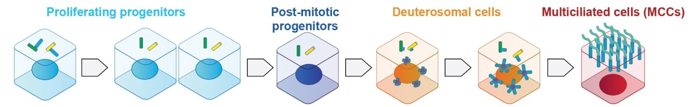

# 16  Group projects

> **NOTE:**
>
> - 14:00 - 18:00: project work, in groups
> - 18:00 - 20:00: group presentations (10’ each group, max 5 slides: what / why / where / when / how, conclusions)

> **TIP:**
>
> - Analyse a single-cell RNA-seq dataset by yourself, from A to Z
> - Make (and justify!) your own analysis choices
> - Present and discuss your results with the other participants

## 16.1 The dataset: multiciliated cell differentiation



Multiciliated cells (MCCs) line the brain ventricles, the airways and the reproductive tracts: each of them grows dozens to hundreds of motile cilia, which beat to move fluids. MCCs differentiate from progenitors which exit the cell cycle, become post-mitotic, then amplify their centrioles (in *deuterosomal* cells) to template the motile cilia of mature MCCs.

Each group will analyse scRNA-seq datasets of the **in vitro differentiation of mouse radial glial cell progenitors into multiciliated cells**:

- **WT**: 2 replicates (4,111 + 11,316 filtered cells), from two different genetic backgrounds (`C57Bl6J` and `C57Bl6N`);
- **Mutant**: a single replicate (6,639 filtered cells, `C57Bl6J` background).

The data is available in your session, in the `~/Share/group_exercises/` folder: for each dataset, a count matrix (`*_counts.mtx.gz`, in Matrix Market format), the genes (`*_genes.tsv.gz`) and the cells (`*_barcodes.tsv.gz`, with their sample, genetic background, total UMI counts and number of detected genes).

``` sh
ls -lh ~/Share/group_exercises/
```

Import both datasets in `R` as `SingleCellExperiment` objects (this takes ~30 seconds and ~4 GB of memory):

``` r
library(SingleCellExperiment)
read_sample <- function(sample, dir = "~/Share/group_exercises") {
    counts <- Matrix::readMM(file.path(dir, paste0(sample, "_counts.mtx.gz")))
    genes <- readr::read_tsv(file.path(dir, paste0(sample, "_genes.tsv.gz")))
    cells <- readr::read_tsv(file.path(dir, paste0(sample, "_barcodes.tsv.gz")))
    sce <- SingleCellExperiment(
        assays = list(counts = as(counts, "CsparseMatrix")),
        rowData = genes,
        colData = cells
    )
    rownames(sce) <- rowData(sce)$ID
    ## The two WT replicates share some barcodes: prefix them with the
    ## sample and genetic background
    colnames(sce) <- paste(sce$sample, sce$background, sce$barcode, sep = "_")
    sce
}
WT <- read_sample("WT")
mutant <- read_sample("mutant")
WT
mutant
table(WT$background)
```

## 16.2 Suggestions

- Is there a strong batch bias in the WT dataset?
- Can a trajectory be inferred from the in vitro WT differentiation scRNA-seq experiment?
- Annotate the putative cell cycle phase of each cell in the WT dataset, using the algorithm of your choice.
- Which cyclins are expressed in differentiating cells?
- Which cyclins are missing in differentiating cells in the mutant dataset, compared to the WT dataset?

## 16.3 Analyse it

Here is a checklist of the analysis steps we covered during the week. Not all of them will be relevant to your questions: decide which ones are, and why.

1.  Import the data into a `SingleCellExperiment` object ([Lab 3](../../pages/day2/Lab3_Rbioc.md), [Lab 4](../../pages/day2/Lab4_data_wrangling_scRNAseq.md))
2.  Quality control and filtering of cells and genes ([Lab 4](../../pages/day2/Lab4_data_wrangling_scRNAseq.md))
3.  Normalization, feature selection and dimensionality reduction ([Lab 5](../../pages/day3/Lab5_clustering.md))
4.  Batch correction, if required ([Lab 6](../../pages/day3/Lab6_batch_correction.md))
5.  Clustering, marker genes and cell annotation ([Lab 5](../../pages/day3/Lab5_clustering.md))
6.  Differential expression analysis between conditions, with pseudobulk ([Lab 6](../../pages/day3/Lab6_batch_correction.md))
7.  Trajectory inference and pseudotime ([Lab 8](../../pages/day4/Lab8_pseudotime.md))

## 16.4 Present it

Prepare a short presentation (10 minutes, max 5 slides), covering:

- **What**: what is the biological question, and what is the dataset?
- **Why**: why is single-cell RNA-seq relevant to answer this question?
- **Where / When / How**: which analysis steps did you perform, and which choices did you make?
- **Conclusions**: what did you learn, and what would you do next?

## 16.5 Working on another dataset

Groups who would rather analyse another dataset (e.g. from their own research, or from a paper they like) can do so: discuss it with the instructors first. The `scRNAseq` package distributes many processed datasets:

``` r
library(scRNAseq)
datasets <- surveyDatasets()
datasets
searchDatasets("pancreas")
sce <- fetchDataset("baron-pancreas-2016", "2023-12-14", path = "human")
```

The [CZ CELLxGENE Discover](https://cellxgene.cziscience.com/datasets) and [Human Cell Atlas](https://data.humancellatlas.org/explore/projects) portals, as well as [GEO](https://www.ncbi.nlm.nih.gov/geo/), are other good places to find processed count matrices.

> **NOTE:**
>
> These datasets were published in [Khoury Damaa, Serizay et al., *Cyclin O controls entry into the cell-cycle variant required for multiciliated cell differentiation*, Cell Reports 2025](https://doi.org/10.1016/j.celrep.2024.115117) (GEO: [GSE201773](https://www.ncbi.nlm.nih.gov/geo/query/acc.cgi?acc=GSE201773)).
