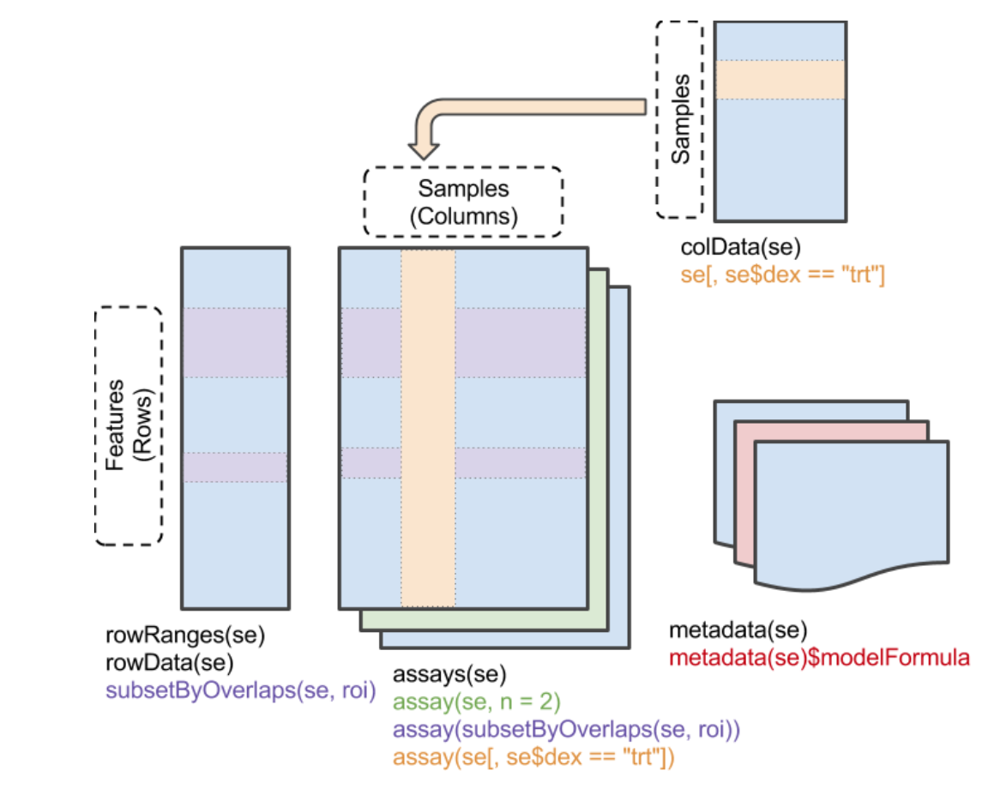
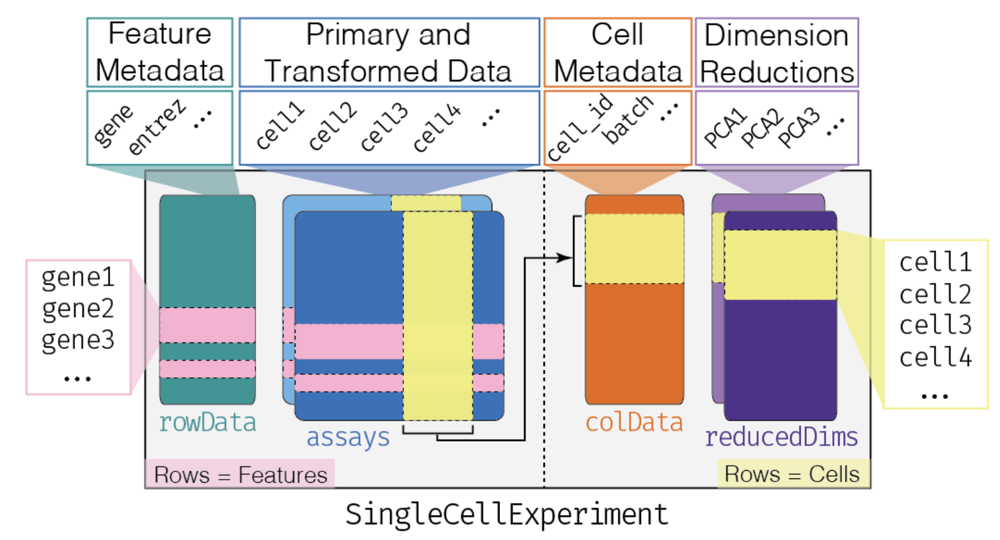

# Lab 3: Introduction to R/Bioconductor

::: {.callout-note icon='true'}

## Notes

The estimated time for this lab is around 1h20.

:::

::: {.callout-tip icon='true'}

## Aims

- Install and load `R` packages from different sources.
- Understand the basic classes used in `R` and `Bioconductor`.
- Load and manipulate single-cell RNA-seq data in `R` and `Bioconductor`.
- Compare `Bioconductor` and `Seurat` approaches to scRNAseq data analysis.
- Read scRNAseq data from local files.

:::

## Installing packages in `R`

> "Hey, I've heard so many good things about this piece of software, it's called 'slingshot'? Heard of it? I really want to try it out on my dataset!!"

Or, in other words: "how do I install this or that brand new cutting-edge fancy `package`?"

`R` works with `packages`, available from different sources:

- `CRAN`, the `R` developer team and official package provider: [CRAN](https://cran.r-project.org/).
- `Bioconductor`, another package provider, with a primary focus on genomic-related packages: [Bioconductor](https://www.bioconductor.org/).
-  Other unofficial sources, such as `GitHub`.

Let's start by going over package installation.

::: {.callout-question}
::: {.callout-note title="Question"}

Install `mgcv`, `HCAData` and `revelio` packages. Each of these three packages is available from a different source:

- `mgcv` is a `CRAN` package
- `HCAData` is a `Bioconductor` package
- `revelio` is a `GitHub` package

::: {.callout-answer}
::: {.callout-note title="Answer" collapse="true"}

`BiocManager::install()` is the recommended way to install packages for a
given version of `Bioconductor`: it installs packages from `Bioconductor`,
from `CRAN`, and from `GitHub` (given a `"<user>/<repo>"` name), while making
sure that all of them are compatible with each other.

```{r eval = FALSE, filename = "R"}
install.packages('mgcv')
BiocManager::install('HCAData')
BiocManager::install('danielschw188/Revelio')
```

You can check which version of `Bioconductor` you are using, and whether
any installed package is out-of-date or too recent for it:

```{r eval = FALSE, filename = "R"}
BiocManager::version()
BiocManager::valid()
```

:::
:::

:::
:::

::: {.callout-tip icon='true'}
## Packages in your workshop session

All the packages used in this workshop are already installed in your workshop
session (and in the Docker image it is started from).
:::

Package help pages are available at different places, depending on their source.
That being said, there is a place I like to go to easily find information related to most packages:

[https://rdrr.io/](https://rdrr.io/)

For instance, check out `Revelio` package help pages.

- What is this package designed for?
- What are its main functions? What type of input does it require?

## Basic `R` and `Bioconductor` classes

While `CRAN` is a repository of general-purpose packages, `Bioconductor` is the
greatest source of analytical tools, data and workflows dedicated to genomic
projects in `R`. [Read more about `Bioconductor`](https://www.bioconductor.org/about/)
to fully understand how it builds up on top of `R` general features, especially
with the specific classes it introduces.

The two main concepts behind `Bioconductor`'s success are the **non-redundant**
classes of objects it provides and their **inter-operability**.
[Huber et al., Nat. Methods 2015](https://www.nature.com/articles/nmeth.3252) summarizes it well.

### Important R concepts:

#### `tibble` tables:

`tibbles` are built on the fundamental `data.frame` objects. They follow "tidy"
concepts, all gathered in a common [`tidyverse`](https://www.tidyverse.org/).
This set of key concepts help general data investigation and data visualization
through a set of associated packages such as `ggplot2`.

```{r filename = "R"}
library(tidyverse)
dat <- tibble(
    x = 1:5,
    y = 1,
    z = x ^ 2 + y,
    class = c('a', 'a', 'b', 'b', 'c')
)
dat
```

- **Import a text file into `tibbles`**

`tibbles` can be created from text files (or Excel files) using the `readr`
package (part of `tidyverse`). We will read the list of genes quantified by
`cellranger` in the `AXH009` sample from `Leir et al.` (see [Lab 1](../day1/Lab1_Intro.qmd)).

Rather than downloading the file by hand, we use `BiocFileCache`: it downloads
a file the first time it is requested, stores it in a local cache, and simply
returns the path to the cached copy afterwards.

```{r filename = "R"}
library(BiocFileCache)
bfc <- BiocFileCache(ask = FALSE)
genes_file <- bfcrpath(bfc, "https://ftp.ncbi.nlm.nih.gov/geo/samples/GSM4486nnn/GSM4486714/suppl/GSM4486714_AXH009_genes.tsv.gz")
genes_file
genes <- read_tsv(genes_file, col_names = c('ID', 'Symbol'))
genes
```

#### Handling of `tibbles`:

`tibbles` can be readily "sliced" (i.e. selecting rows by number/name),
"filtered" (i.e. selecting rows by condition) and columns can be "selected".
All these operations are performed using _verbs_ (most of them provided by the
`dplyr` package, part of `tidyverse`).

```{r filename = "R"}
slice(genes, 1:4)
filter(genes, Symbol == 'CFTR')
filter(genes, grepl('^CCDC.*', Symbol))
filter(genes, grepl('^CCDC.*', Symbol), grepl('.*5$', Symbol))
select(genes, 1)
select(genes, ID)
select(genes, matches('Sym.*'))
```

Columns can also be quickly added/modified using the `mutate` verb.

```{r filename = "R"}
mutate(genes, chr = sample(1:22, n(), replace = TRUE))
```

#### `|>` pipe:

Actions on `tibbles` can be piped as a chain with `|>`, just like `|` pipes
`stdout` as the `stdin` of the next command in `bash`.
In this case, the first argument is always the output of the previous function
and is ommited. Because `tidyverse` functions generally return a modified
version of the input, pipping works remarkably well in such context.

```{r filename = "R"}
read_tsv(genes_file, col_names = c('ID', 'Symbol')) |>
    mutate(chr = sample(1:22, n(), replace = TRUE)) |>
    filter(chr == 2, grepl('^CCDC.*', Symbol)) |>
    select(ID) |>
    slice_head(n = 3)
```

### Important Bioconductor concepts:

#### `SummarizedExperiment` class:

The most fundamental class used to hold the content of large-scale quantitative
analyses, such as counts of RNA-seq experiments, or high-throughput cytometry
experiments or proteomics experiments.



Make sure you understand the structure of objects from this class. A dedicated
workshop that I would recommend quickly going over is available [here](https://www.bioconductor.org/help/course-materials/2019/BSS2019/04_Practical_CoreApproachesInBioconductor.html).
Generally speaking, a `SummarizedExperiment` object contains matrix-like objects
(the `assays`), with rows representing features (e.g. genes, transcripts, ...)
and each column representing a sample. Information specific to genes and samples
are stored in "parallel" data frames, for example to store gene locations,
tissue of expression, biotypes (for genes) or batch, generation date, or machine
ID (for samples). On top of that, metadata are also stored in the object (to
store description of a project, ...).

An important difference with S3 `list`-like objects usually used in `R` is that
most of the underlying data (organized in precisely structured `"slots"`)
is accessed using `getter` functions, rather than the familiar `$` or `[`. Here
are some important `getters`:

- `assay()`, `assays()`: Extract matrix-like or list of matrix-like objects of identical dimensions. Since the objects are `matrix`-like, `dim()`, `dimnames()`, and 2-dimensional `[`, `[<-` methods are available.
- `colData()`: Annotations on each column (as a DataFrame): usually, description of each sample
- `rowData()`: Annotations on each row (as a DataFrame): usually, description of each gene
- `metadata()`: List of unstructured metadata describing the overall content of the object.

Let's dig into an example, with the `airway` dataset (provided by the `airway` package from `Bioconductor`).

```{r filename = "R"}
library(SummarizedExperiment)
library(airway)
data(airway)
airway
```

::: {.callout-question}
::: {.callout-note title="Question"}

What are the dimensions of the dataset? What type of quantitative data is stored? Which features are assessed?

::: {.callout-answer}
::: {.callout-note title="Answer" collapse="true"}

```{r filename = "R"}
dim(airway)
rowData(airway)
colData(airway)
```
:::
:::

:::
:::

::: {.callout-question}
::: {.callout-note title="Question"}

Can you create a subset of the data corresponding to `LRG` genes in untreated samples?

::: {.callout-answer}
::: {.callout-note title="Answer" collapse="true"}

```{r filename = "R"}
untreated_LRG <- airway[grepl('^LRG_', rownames(airway)), airway$dex == 'untrt']
untreated_LRG
```

:::
:::

:::
:::

#### `GenomicRanges` class (a.k.a. `GRanges`):

`GenomicRanges` are a type of `IntervalRanges`, they are useful to describe
genomic intervals. Each entry in a `GRanges` object has a `seqnames()`, a
`start()` and an `end()` coordinates, a `strand()`, as well as associated
metadata (`mcols()`). They can be built from scratch using `tibbles` converted
with `makeGRangesFromDataFrame()`.

```{r filename = "R"}
library(GenomicRanges)
gr <- read_tsv(genes_file, col_names = c('ID', 'Symbol')) |>
    mutate(
        chr = sample(1:22, n(), replace = TRUE),
        start = sample(1:1000, n(), replace = TRUE),
        end = sample(10000:20000, n(), replace = TRUE),
        strand = sample(c('-', '+'), n(), replace = TRUE)
    ) |>
    makeGRangesFromDataFrame(keep.extra.columns = TRUE)
gr
mcols(gr)
```

Just like `tidyverse` in R, `tidy` functions are provided for `GRanges` by the `plyranges` package.

```{r filename = "R"}
library(plyranges)
gr |>
    filter(start < 400, end > 12000, end < 15000) |>
    seqnames() |>
    table()
```

::: {.callout-question}
::: {.callout-note title="Question"}

Can you find a way to easily read common input files such as `bed` files into
`GRanges`? Try it on the list of accessible chromatin regions (*peaks*)
identified by 10x Genomics in a single-cell ATAC-seq experiment of human PBMCs
(which we will analyse in [Lab 7](../day4/Lab7_atac-seq.qmd)):
`https://cf.10xgenomics.com/samples/cell-atac/1.0.1/atac_v1_pbmc_10k/atac_v1_pbmc_10k_peaks.bed`.

::: {.callout-answer}
::: {.callout-note title="Answer" collapse="true"}

```{r filename = "R"}
library(rtracklayer)
peaks_file <- file.path(tempdir(), "atac_v1_pbmc_10k_peaks.bed")
download.file(
    "https://cf.10xgenomics.com/samples/cell-atac/1.0.1/atac_v1_pbmc_10k/atac_v1_pbmc_10k_peaks.bed",
    destfile = peaks_file
)
peaks <- import(peaks_file)
peaks
```

:::
:::

:::
:::

::: {.callout-question}
::: {.callout-note title="Question"}

How would you have proceeded without `rtracklayer`? Check the `start`
coordinates: what do you see? Comment on the interest of using `Bioconductor`.

::: {.callout-answer}
::: {.callout-note title="Answer" collapse="true"}

```{r filename = "R"}
peaks_manual <- read_tsv(peaks_file, col_names = c('chr', 'start', 'end')) |>
    makeGRangesFromDataFrame()
peaks_manual
head(start(peaks))
head(start(peaks_manual))
```

`bed` files use 0-based, half-open coordinates, whereas `GRanges` (like most
of `Bioconductor`) use 1-based, closed coordinates: `rtracklayer::import()`
takes care of the conversion for us.

:::
:::

:::
:::

## CRAN & Bioconductor approaches to scRNAseq

### scRNAseq in Bioconductor

For single-cell RNA-seq projects, `Bioconductor` has been introducting new
classes and standards very rapidly in the past few years. Notably, several
packages are increasingly becoming central for single-cell analysis:

- **`SingleCellExperiment`**
- `scrapper`
- `scater`
- `scran`
- `scuttle`
- `bluster`
- `batchelor`
- `SingleR`
- `DropletUtils`
- `slingshot`
- `tradeSeq`
- ...

**`SingleCellExperiment`** is the fundamental class designed to contain
single-cell (RNA-seq) data in `Bioconductor` ecosystem. It is a modified version
of the `SummarizedExperiment` object, so most of the getters/setters are shared
with this class.



Let's load a dataset of mouse haematopoietic stem and progenitor cells
(`Nestorowa et al., Blood 2016`, doi: 10.1182/blood-2016-05-716480),
distributed by the `scRNAseq` package, and normalize its counts.

```{r filename = "R"}
library(SingleCellExperiment)
sce <- scRNAseq::fetchDataset("nestorowa-hsc-2016", "2024-04-18")

## Load the counts in memory, as a sparse matrix
counts(sce) <- as(counts(sce), "dgCMatrix")

## Compute normalized counts (more on this in the next labs!),
## and store them as a sparse matrix too
sce <- scrapper::normalizeRnaCounts.se(sce, more.norm.args = list(delayed = FALSE))
sce$label <- sce$broad
sce
class(sce)
```

Several slots can be accessed in a **`SingleCellExperiment`** object, just like
the `SummarizedExperiment` object it's been adapted from:

```{r filename = "R"}
colData(sce)
rowData(sce)
metadata(sce)
dim(sce)
assays(sce)
```

Quantitative metrics for scRNAseq studies can also be stored in `assays`:

```{r filename = "R"}
assays(sce)
assay(sce, 'counts')[1:10, 1:10]
assay(sce, 'logcounts')[1:10, 1:10]
counts(sce)[1:10, 1:10]
logcounts(sce)[1:10, 1:10]
```

::: {.callout-question}
::: {.callout-note title="Question"}

Check the `colData()` output of the `sce` object. What information is stored
there? How can you access the different objects stored in `colData`?

::: {.callout-answer}
::: {.callout-note title="Answer" collapse="true"}

```{r filename = "R"}
colData(sce)
lapply(colData(sce), class)
head(colData(sce)[[1]])
head(colData(sce)[['broad']])
table(sce$broad, useNA = 'ifany')
head(sce$sizeFactor)
```

Some information is stored as nested tables, e.g. the `metrics` column:

```{r filename = "R"}
head(colData(sce)[['metrics']])
```

:::
:::

:::
:::

A `SingleCellExperiment` can also hold *alternative experiments*, measured
on the same cells but for different features: here, the counts of spike-in
transcripts (`ERCC`) and the cell surface marker intensities measured by flow
cytometry when sorting the cells (`FACS`).

::: {.callout-question}
::: {.callout-note title="Question"}

Retrieve the FACS measurements of the first cells.

::: {.callout-answer}
::: {.callout-note title="Answer" collapse="true"}

```{r filename = "R"}
altExpNames(sce)
altExp(sce, 'FACS')
assay(altExp(sce, 'FACS'))[, 1:5]
```

:::
:::

:::
:::

::: {.callout-question}
::: {.callout-note title="Question"}

Are there any reduced dimensionality representation of the data stored in the
`sce` object? How can we run a `PCA` using normalized counts of the 1,000 most
variable genes?

::: {.callout-answer}
::: {.callout-note title="Answer" collapse="true"}
```{r filename = "R"}
reducedDims(sce)
vars <- MatrixGenerics::rowVars(logcounts(sce))
top_genes <- order(vars, decreasing = TRUE)[1:1000]
pca <- prcomp(t(as.matrix(logcounts(sce)[top_genes, ])), rank. = 50)
names(pca)
dim(pca$x)
head(pca$x[, 1:10])
```

:::
:::

:::
:::

::: {.callout-question}
::: {.callout-note title="Question"}

Now, let's compute a `UMAP` embedding from this `PCA` and compare it to the `PCA` embedding.

::: {.callout-answer}
::: {.callout-note title="Answer" collapse="true"}

```{r filename = "R"}
umap <- uwot::umap(pca$x)
colnames(umap) <- c('UMAP1', 'UMAP2')
plot(pca$x[,1], pca$x[,2])
plot(umap[,1], umap[,2])
```

:::
:::

:::
:::

We will see more advanced ways of reducing scRNAseq data dimensionality in the
coming lectures and labs.

### scRNAseq in R

[`Seurat`](https://satijalab.org/seurat/articles/get_started.html) is another
very popular ecosystem to investigate scRNAseq data. It is primarily developed
and maintained by [the Satija Lab](https://satijalab.org/seurat).
It originally begun as a single package aiming at encompassing "all" (most)
aspects of scRNAseq analysis. However, it rapidly evolved in a much larger
project, and now operates along with other ["wrappers" and extensions](https://satijalab.org/seurat/articles/extensions.html).
It also has a [very extended support](https://github.com/satijalab/seurat/discussions)
from the lab group. All in all, is provides a (somewhat) simple workflow to start
investigating scRNAseq data.

It is important to chose one standard that you feel comfortable with yourself.
Which standard provides the most intuitive approach for you? Do you prefer an
"all-in-one, plug-n-play" workflow (`Seurat`-style), or a modular approach
(`Bioconductor`-style)? Which documentation is easier to read for you, a central
full-featured website with extensive examples (`Seurat`-style), or
"programmatic"-style vignettes (`Bioconductor`-style)?

This course will mostly rely on `Bioconductor`-based methods, but sometimes use
`Seurat`-based methods. In the absence of coordination of data structures, the
next best solution is to write functions to coerce an object from a certain
class to another class (i.e. `Seurat` to `SingleCellExperiment`, or vice-versa).
Luckily, this is quite straightforward in `R` for these 2 data classes:

```{r filename = "R", message = FALSE, warning = FALSE}
sce_seurat <- Seurat::as.Seurat(removeAltExps(sce))
sce
sce_seurat
sce2 <- Seurat::as.SingleCellExperiment(sce_seurat)
```

Note that we had to remove the alternative experiments (`altExps`) before
converting the object: `Seurat` stores each of them as an additional `Assay`,
and cannot convert the `FACS` intensities, which are not counts.

::: {.callout-question}
::: {.callout-note title="Question"}

Do you see any change between `sce` and the corresponding, "back-converted",
`sce2` objects? Explain these differences.

::: {.callout-answer}
::: {.callout-note title="Answer" collapse="true"}

```{r filename = "R", message = FALSE}
sce
sce2
#
colData(sce)
colData(sce2)
```

:::
:::

:::
:::

::: {.callout-question}
::: {.callout-note title="Question"}

Try and access the underlying raw or normalized data from the `sce_seurat`
object. How does it compare to data access from an `SingleCellExperiment` object?

::: {.callout-answer}
::: {.callout-note title="Answer" collapse="true"}

```{r filename = "R", message = FALSE}
colnames(sce_seurat)
ncol(sce_seurat)
nrow(sce_seurat)
# cells and features access
head(Seurat::Cells(sce_seurat))
head(rownames(sce_seurat))
# cell data access
head(sce_seurat[[]])
head(sce_seurat$label)
# Counts access
Seurat::GetAssayData(object = sce_seurat, layer = "counts")[1:10, 1:10]
Seurat::GetAssayData(object = sce_seurat, layer = "data")[1:10, 1:10]
# Embeddings
head(Seurat::Embeddings(object = sce_seurat, reduction = "diffusion"))
```

:::
:::

:::
:::

## Reading scRNAseq data

::: {.callout-question}
::: {.callout-note title="Question"}

Try to load the processed `10X` single-cell RNA-seq data of the `AXH009` sample
from `Leir et al.` (see [Lab 1](../day1/Lab1_Intro.qmd)) into a
`SingleCellExperiment` object using the `DropletUtils` package.

::: {.callout-tip icon='true'}
`DropletUtils::read10xCounts()` expects a folder containing three files named
`matrix.mtx.gz`, `barcodes.tsv.gz` and `features.tsv.gz` (the names used by
`cellranger`), or a `.h5` file.
:::

::: {.callout-answer}
::: {.callout-note title="Answer" collapse="true"}

```{r filename = "R"}
## Download the three files and put them in a folder, with cellranger names
url <- "https://ftp.ncbi.nlm.nih.gov/geo/samples/GSM4486nnn/GSM4486714/suppl/GSM4486714_AXH009_"
AXH009_dir <- file.path(tempdir(), "AXH009")
dir.create(AXH009_dir, showWarnings = FALSE)
file.copy(bfcrpath(bfc, paste0(url, "matrix.mtx.gz")), file.path(AXH009_dir, "matrix.mtx.gz"))
file.copy(bfcrpath(bfc, paste0(url, "barcodes.tsv.gz")), file.path(AXH009_dir, "barcodes.tsv.gz"))
file.copy(bfcrpath(bfc, paste0(url, "genes.tsv.gz")), file.path(AXH009_dir, "features.tsv.gz"))
list.files(AXH009_dir)

## Import them as a SingleCellExperiment
sce <- DropletUtils::read10xCounts(AXH009_dir, col.names = TRUE)
sce
colData(sce)
rowData(sce)
```

:::
:::

:::
:::

Public single-cell RNA-seq data can be retrieved from within R directly, thanks
to several data packages, for instance `scRNAseq` or `HCAData`.

::: {.callout-question}
::: {.callout-note title="Question"}

Check out the `He et al., Genome Biol. 2020` paper. Can you find a way to load
the scRNAseq data from this paper without having to leave the `R` console?

::: {.callout-answer}
::: {.callout-note title="Answer" collapse="true"}

`scRNAseq::surveyDatasets()` lists all the datasets available from the
`scRNAseq` package, and `scRNAseq::searchDatasets()` finds datasets matching
some keywords. Each dataset can then be fetched with `fetchDataset()`.

```{r filename = "R"}
library(scRNAseq)
all_ds <- surveyDatasets()
all_ds
searchDatasets("organs")
```

The atlas from `He et al.` is split in one dataset per organ (the `path`
column). Let's fetch three of them and combine them in a single object,
keeping the genes measured in all three organs:

```{r filename = "R"}
organs <- lapply(c("blood", "liver", "spleen"), function(organ) {
    fetchDataset("he-organs-2020", "2023-12-21", path = organ)
})
common_genes <- Reduce(intersect, lapply(organs, rownames))
organs <- lapply(organs, function(x) x[common_genes, ])
organs <- do.call(cbind, organs)
organs
```

:::
:::

:::
:::

The interest of this approach is that one can recover a full-fledged
**SingleCellExperiment** (often) provided by the authors of the corresponding
study. This means that lots of information, such as batch ID, clustering, cell
annotation, etc., may be readily available.

::: {.callout-question}
::: {.callout-note title="Question"}

Check the data available for cells/features in the dataset from `He et al.`.

::: {.callout-answer}
::: {.callout-note title="Answer" collapse="true"}
```{r filename = "R"}
colData(organs)
table(organs$Tissue)
table(organs$reclustered.fine, organs$Tissue)
```

:::
:::

:::
:::

## Bonus

To compare the two different approaches, try preparing both a
`SingleCellExperiment` or a `Seurat` object from scratch, using the matrix files
downloaded in Lab 1. Read the documentation of the two related packages to
understand how to do this.
This will be extensively covered in the next lab for everybody.

## Session info

::: {.callout-note collapse="true"}

## Click to expand 👇

```{r echo = FALSE}
sessioninfo::session_info()
```

:::
