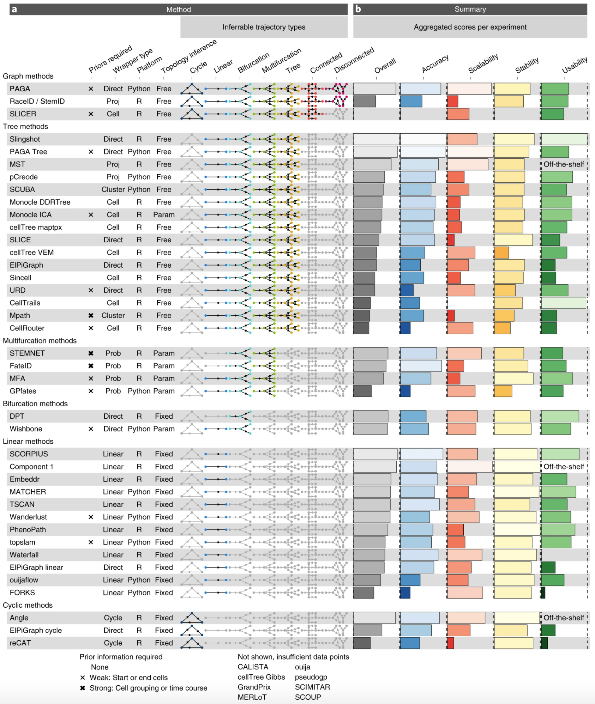

# Lab 8: Pseudotime analyses

::: {.callout-note icon="true"}
## Notes

The estimated time for this lab is around 1h30.
:::

::: {.callout-tip icon="true"}
## Aims

-   Perform pseudotime and lineage analysis
-   Model and visualize gene expression along pseudotime
-   Understand the requirements for RNA velocity computation
-   Compute RNA velocity and use it to orientate lineages
:::

## Process testis data in R

### Import testis data from GSE112013 and pre-process it

We will work on a `testis` dataset, from the "The adult human testis
transcriptional cell atlas" study ([Guo et al., Cell Research 2018](https://doi.org/10.1038/s41422-018-0099-2)).
This dataset contains single-cell RNAseq data from human testis. It is available
on the GEO database under the accession number
[GSE112013](https://www.ncbi.nlm.nih.gov/geo/query/acc.cgi?acc=GSE112013).

We have applied the different analysis steps we have learned over the past three
days to the count matrix `GSE112013_Combined_UMI_table.txt.gz`. See the code
below for the details of pre-processing steps, and run it in your session (this
takes a few minutes, and requires ~8 GB of memory).

::: {.callout-question}
::: {.callout-note title="👀 Data pre-processing 👇" collapse="true"}

Check the GEO page for supplementary processed data, and download the
`GSE112013_Combined_UMI_table.txt.gz` table.

With this data, we will:

-   Import the dataset in R as a `SingleCellExperiment` object,
-   Remove doublets,
-   Filter genes and cells,
-   Normalize `counts`,
-   Correct for batch effect,
-   Cluster cells.

```{r filename = "R", warning = FALSE}
library(SingleCellExperiment)
library(tidyverse)

# Download raw file
library(BiocFileCache)
bfc <- BiocFileCache(ask = FALSE)
umi_file <- bfcrpath(bfc, 'https://ftp.ncbi.nlm.nih.gov/geo/series/GSE112nnn/GSE112013/suppl/GSE112013_Combined_UMI_table.txt.gz')

# Create SingleCellExperiment object
x <- data.table::fread(umi_file, data.table = FALSE)
counts <- as(as.matrix(x[, -1]), 'dgCMatrix')
rownames(counts) <- x[, 1]
rm(x); invisible(gc())
testis <- SingleCellExperiment(
    assays = list(counts = counts),
    colData = DataFrame(cellid = colnames(counts))
)
testis$Barcode <- str_replace(testis$cellid, 'Donor.-', '') |> str_replace('-.', '')
testis$donor <- str_replace(testis$cellid, '-.*', '')
testis$replicate <- str_replace(testis$cellid, '.*-', '')
testis$sample <- paste0(testis$donor, '_rep', testis$replicate)
table(testis$donor, testis$replicate)

# Remove doublets
set.seed(1000)
testis <- scDblFinder::scDblFinder(testis, samples = testis$sample)
table(testis$scDblFinder.class)
testis <- testis[, testis$scDblFinder.class == 'singlet']

# Recover Ensembl IDs and biotypes for genes, and keep protein-coding genes
gene_info <- AnnotationDbi::select(
    org.Hs.eg.db::org.Hs.eg.db,
    keys = rownames(testis), keytype = 'SYMBOL',
    columns = c('ENSEMBL', 'GENETYPE')
) |>
    filter(GENETYPE == 'protein-coding') |>
    distinct(SYMBOL, .keep_all = TRUE)
testis <- testis[gene_info$SYMBOL, ]
rowData(testis)$gene_name <- gene_info$SYMBOL
rowData(testis)$gene_id <- gene_info$ENSEMBL

# Get QCs per cell, flag low-quality cells and filter them out
mito <- grep('^MT-', rownames(testis), value = TRUE)
testis <- scrapper::quickRnaQc.se(testis, subsets = list(mito = mito), block = testis$sample)
table(testis$keep)
testis <- testis[, testis$keep]

# Filter out genes not expressed in at least 10 cells
testis <- testis[Matrix::rowSums(counts(testis) > 0) >= 10, ]

# Normalize counts
clusters <- scran::quickCluster(testis, block = testis$sample)
testis <- scran::computeSumFactors(testis, clusters = clusters)
testis <- scrapper::normalizeRnaCounts.se(
    testis, size.factors = sizeFactors(testis), block = testis$sample,
    more.norm.args = list(delayed = FALSE)
)

# Computing biological variance of each gene
testis <- scrapper::chooseRnaHvgs.se(testis, block = testis$donor, top = 2000)
rowData(testis)$isHVG <- rowData(testis)$hvg
HVGs <- rownames(testis)[rowData(testis)$isHVG]

# Embedding dataset in PCA space, correcting for batch effect
mergedBatches <- batchelor::fastMNN(
    testis,
    batch = testis$donor,
    subset.row = HVGs
)
reducedDim(testis, 'corrected') <- reducedDim(mergedBatches, 'corrected')

# Cluster cells using shared nearest-neighbors graph and Louvain community finding algorithm
testis <- scrapper::clusterGraph.se(testis, reddim.type = 'corrected', output.name = 'cluster')
testis$cluster <- factor(testis$cluster)
table(testis$cluster)

# Embedding dataset in TSNE space for visualization
set.seed(10)
testis <- scater::runTSNE(testis, dimred = 'corrected')

# Visualize embeddings
p <- cowplot::plot_grid(
    scater::plotReducedDim(testis, 'corrected', colour_by = 'donor'),
    scater::plotReducedDim(testis, 'corrected', colour_by = 'cluster'),
    scater::plotReducedDim(testis, 'TSNE', colour_by = 'donor'),
    scater::plotReducedDim(testis, 'TSNE', colour_by = 'cluster')
)
p
```
:::
:::

### Annotate cells using HPA resources

The [Human Protein Atlas (HPA)](https://www.proteinatlas.org) is a valuable
resource for cell type annotations. It provides single-cell RNAseq data for a
large number of cell types.

::: {.callout-question}
::: {.callout-note title="Question"}
Download `HPA` scRNAseq atlas (combined per cell type) [from here](https://www.proteinatlas.org/download/tsv/rna_single_cell_type.tsv.zip),
and import it in R as a `SummarizedExperiment` object.

::: {.callout-answer}
::: {.callout-note title="Answer" collapse="true"}
```{r filename = "R"}
hpa_file <- bfcrpath(bfc, 'https://www.proteinatlas.org/download/tsv/rna_single_cell_type.tsv.zip')
HPA <- read_tsv(hpa_file) |>
    dplyr::select(-Gene) |>
    pivot_wider(names_from = `Cell type`, values_from = 'nCPM', values_fn = mean) |>
    distinct(`Gene name`, .keep_all = TRUE) |>
    column_to_rownames('Gene name') |>
    as.matrix()
HPA[is.na(HPA)] <- 0
HPA_se <- SummarizedExperiment::SummarizedExperiment(
    assays = list('logcounts' = log2(HPA + 1)),
    colData = DataFrame(cell_type = colnames(HPA))
)
HPA_se
```
:::
:::

How many and what cell types are profiled?

::: {.callout-answer}
::: {.callout-note title="Answer" collapse="true"}
```{r filename = "R"}
length(HPA_se$cell_type)
HPA_se$cell_type
```
:::
:::

:::
:::

We can use the HPA reference to annotate cell types in the testis dataset.

::: {.callout-question}
::: {.callout-note title="Question"}
Use `SingleR` to annotate cell types in the testis dataset using HPA reference.

::: {.callout-answer}
::: {.callout-note title="Answer" collapse="true"}
```{r filename = "R", fig.width = 12, fig.height = 10}
predictions <- SingleR::SingleR(
    test = testis,
    ref = HPA_se,
    labels = colData(HPA_se)$cell_type,
    clusters = testis$cluster
)
testis$annotation <- predictions$labels[testis$cluster]
table(testis$annotation)
cowplot::plot_grid(
    scater::plotReducedDim(testis, dimred = 'corrected', colour_by = 'cluster', text_by = 'cluster') + ggtitle('Testis data, PCA, graph-based clusters'),
    scater::plotReducedDim(testis, dimred = 'corrected', colour_by = 'annotation', text_by = 'annotation') + ggtitle('PCA, Annotations transferred from HPA'),
    scater::plotReducedDim(testis, dimred = 'TSNE', colour_by = 'cluster', text_by = 'cluster') + ggtitle('Testis data, tSNE, graph-based clusters'),
    scater::plotReducedDim(testis, dimred = 'TSNE', colour_by = 'annotation', text_by = 'annotation') + ggtitle('tSNE, Annotations transferred from HPA')
)
```
:::
:::

:::
:::

### Filter the testis dataset to only germinal cells.

In this notebook, we will focus on germinal cells only.

::: {.callout-question}
::: {.callout-note title="Question"}
Filter the `testis` dataset to only retain germinal cells.

::: {.callout-answer}
::: {.callout-note title="Answer" collapse="true"}
```{r filename = "R"}
germcell_types <- c(
    "undifferentiated spermatogonia", "differentiating spermatogonia",
    "early primary spermatocytes", "late primary spermatocytes",
    "early spermatids", "late spermatids"
)
germcells <- testis[, testis$annotation %in% germcell_types]
germcells$annotation <- factor(germcells$annotation, levels = intersect(germcell_types, germcells$annotation))
table(germcells$annotation)
```
:::
:::

:::
:::

## Trajectory inference (TI) in scRNAseq

An important question in scRNAseq field of research is: how to identify a cell
trajectory from high-dimensional expression data and map individual cells onto
it? A large number of methods have currently emerged, each one with their own
specificities, assumptions, and strengths. A nice breakdown (from 2019, so
already very outdated!) is available from `Saelens et al., Nat. Biotech. 2019`
(doi: 10.1038/s41587-019-0071-9):



### Trajectory

`Slingshot` is perhaps one of the most widely used algorithms for users who
want to focus on `R`-based approaches.

::: {.callout-question}
::: {.callout-note title="Question"}
Read Slingshot documentation to understand how to identify lineages in a
scRNAseq dataset in R.

Why is it recommended to infer lineages from PCA space rather than t-SNE or
UMAP space, even though these spaces do "reveal" an obvious trajectory in 2D?

Infer lineages, using cluster annotations as information to build the MST.
Note that you will first need to remove the 50th dimension of the `corrected`
embedding for `slingshot` to work ([bug reported](https://github.com/kstreet13/slingshot/issues/87)).

::: {.callout-answer}
::: {.callout-note title="Answer" collapse="true"}
```{r filename = "R"}
reducedDim(germcells, 'corrected_2') <- reducedDim(germcells, 'corrected')[, 1:49]
germcells_slingshot <- slingshot::slingshot(
    germcells,
    reducedDim = 'corrected_2',
    clusterLabels = germcells$annotation
)
slingshot::slingLineages(germcells_slingshot)
```
:::
:::

:::
:::

### Pseudotime

`slingshot` automatically deduces a pseudotime for each cell, based on the
inferred lineage. It can be useful to visualize the trajectory of cells in a 2D
space, and to order cells along the trajectory.

::: {.callout-question}
::: {.callout-note title="Question"}
Recover pseudotime values and principal curves from `slingshot` output.

::: {.callout-answer}
::: {.callout-note title="Answer" collapse="true"}
```{r filename = "R"}
# Fetching pseudotime
germcells$pseudotime <- slingshot::slingPseudotime(germcells_slingshot)[, 'Lineage1']

# Fetching principal curve in PCA space
pca_curve <- slingshot::slingCurves(germcells_slingshot, as.df = TRUE)
colnames(pca_curve)
## Rename the coordinates columns (all but the last two, `Order` and `Lineage`)
ndims <- ncol(pca_curve) - 2
colnames(pca_curve)[seq_len(ndims)] <- paste0('PC', seq_len(ndims))
head(pca_curve[, c('PC1', 'PC2', 'Order', 'Lineage')])
```
:::
:::

We would like to visualize the trajectory of cells in our TSNE space, but the
principal curve is only available in PCA space. We can use `slingshot` to embed
it in the TSNE space!

::: {.callout-answer}
::: {.callout-note title="Answer" collapse="true"}
```{r filename = "R"}
tsne_curve <- slingshot::embedCurves(germcells_slingshot, 'TSNE', smoother = 'loess', span = 0.1) |>
    slingshot::slingCurves(as.df = TRUE)
tsne_curve <- tsne_curve[order(tsne_curve$Order), ]
head(tsne_curve)
```
:::
:::

Plot PCA and tSNE embeddings, coloring cells by either their annotation or
their pseudotime value. Overlay the principal curves to each embedding.

::: {.callout-answer}
::: {.callout-note title="Answer" collapse="true"}
```{r filename = "R", fig.width = 12, fig.height = 10}
df <- tibble(
    PC1 = reducedDim(germcells, 'corrected')[,1],
    PC2 = reducedDim(germcells, 'corrected')[,2],
    TSNE1 = reducedDim(germcells, 'TSNE')[,1],
    TSNE2 = reducedDim(germcells, 'TSNE')[,2],
    annotation = germcells$annotation,
    pseudotime = germcells$pseudotime
)
cowplot::plot_grid(
    df |>
        ggplot() +
        geom_point(aes(PC1, PC2, col = annotation)) +
        geom_path(data = pca_curve |> filter(Lineage == 1), aes(x = PC1, y = PC2)) +
        theme_bw() +
        coord_fixed(),
    df |>
        ggplot() +
        geom_point(aes(TSNE1, TSNE2, col = annotation)) +
        geom_path(data = tsne_curve |> filter(Lineage == 1), aes(x = TSNE1, y = TSNE2)) +
        theme_bw() +
        coord_fixed(),
    df |>
        ggplot() +
        geom_point(aes(PC1, PC2, col = pseudotime)) +
        geom_path(data = pca_curve |> filter(Lineage == 1), aes(x = PC1, y = PC2)) +
        theme_bw() +
        coord_fixed(),
    df |>
        ggplot() +
        geom_point(aes(TSNE1, TSNE2, col = pseudotime)) +
        geom_path(data = tsne_curve |> filter(Lineage == 1), aes(x = TSNE1, y = TSNE2)) +
        theme_bw() +
        coord_fixed()
)
```
:::
:::

:::
:::

::: {.callout-question}
::: {.callout-note title="Question"}
Check the distribution of pseudotime values across the different cell clusters.

What do you observe? Where you expecting this?

::: {.callout-answer}
::: {.callout-note title="Answer" collapse="true"}
```{r filename = "R"}
tibble(
    annotation = germcells$annotation,
    pseudotime = germcells$pseudotime
) |>
    ggplot(aes(x = annotation, y = pseudotime, fill = annotation)) +
    geom_violin(scale = 'width') +
    geom_boxplot(outlier.shape = NULL, width = 0.1, fill = 'white') +
    theme_bw() +
    theme(axis.text.x = element_text(angle = 45, hjust = 1, vjust = 1))
```
:::
:::

`slingshot` does not know in which direction cells differentiate: the
pseudotime may well increase from late spermatids to spermatogonia! Correct
pseudotime values, so that they increase along the differentiation. Note that
the `start.clus` argument of `slingshot()` can also be used to specify the
starting point of a trajectory.

```{r filename = "R"}
pt <- slingshot::slingPseudotime(germcells_slingshot)[, 'Lineage1']
first_type <- levels(germcells$annotation)[1]
last_type <- rev(levels(germcells$annotation))[1]
if (median(pt[germcells$annotation == first_type], na.rm = TRUE) > median(pt[germcells$annotation == last_type], na.rm = TRUE)) {
    pt <- -1 * pt
}
germcells$pseudotime <- scales::rescale(pt, c(0, 1))
```

:::
:::

### BONUS: Daunting snippet but that makes a cool figure for a paper: modeling pseudotime-dependent gene expression

Using pseudotime / cell, one can model gene expression along the
differentiation process. This alleviates the need to study gene expression
**per cell**, and allows one to focus on process-related effects (e.g. gene
expression during a developmental trajectory).

::: {.callout-question}
::: {.callout-note title="Question"}
Try to do so for few markers of spermatogonia, spermatocytes and spermatids.

::: {.callout-answer}
::: {.callout-note title="Answer" collapse="true"}
```{r filename = "R", fig.height = 10}
genes <- c('ID4', 'SYCP3', 'DMC1', 'ACR', 'PRM1', 'PGK2')
fitExprs <- logcounts(germcells[genes, ]) |> # ----------------------------------- Get norm. counts for genes of interest
    as.matrix() |>
    t() |>
    as_tibble() |>
    mutate(  # ----------------------------------------------------------------- Add information for each cell
        cellID = colnames(germcells),
        annotation = germcells$annotation,
        pseudotime = germcells$pseudotime
    ) |>
    filter(!is.na(pseudotime)) |>
    pivot_longer(all_of(genes), names_to = 'gene', values_to = 'obs_expr') |> # - Pivot in "long" tidy format
    mutate(gene = factor(gene, genes)) |>
    group_by(gene) |> # ------------------------------------------------------- Group rows by genes
    nest() |> # --------------------------------------------------------------- For each gene, extract the subtable into a column named data
    mutate(
        gamModel = map(data, ~mgcv::gam(obs_expr ~ s(pseudotime, bs = "cs"), data = .)),
        gamFitted_expr = map(gamModel, predict) # ------------------------------ For each gene, fit the expression values ~ pseudotime with a GAM
    ) |>
    dplyr::select(-ends_with('Model')) |>
    unnest(c(data, ends_with('_expr'))) # -------------------------------------- Unnest all the modelled expressions
ggplot(fitExprs) +
    geom_point(aes(x = pseudotime, y = obs_expr, col = annotation), alpha = 0.5) +
    geom_line(aes(x = pseudotime, y = gamFitted_expr), col = 'white', linewidth = 2, alpha = 0.5) +
    geom_line(aes(x = pseudotime, y = gamFitted_expr), col = '#af2d0c', linewidth = 1) +
    theme_bw() +
    facet_grid(gene~., scales = 'free') +
    labs(y = 'logcounts') +
    ggtitle('Fitted models of pseudotime-dependent gene expression')
```
:::
:::

:::
:::

## Ordering trajectory with RNA velocity

As we saw earlier, TI does not necessarily know which direction is right for a
given trajectory. This orientation can be sometimes refined using RNA velocity.
Let's see whether RNA velocity helps orientating our spermatocyte
differentiation lineage trajectory here.

::: {.callout-warning icon='true'}
## Spliced and unspliced counts

RNA velocity requires the counts of spliced and unspliced reads, for each gene
in each cell. These counts are not provided in GEO: they were computed from the
raw reads of the study with [`velocyto`](https://velocyto.org/). The
resulting `loom` file (`Guo_testis_full-counts.loom`, 38 MB) is shipped with
this book, and installed in your workshop session: its path is given by
`system.file("extdata", "Guo_testis_full-counts.loom", package = "scRNAseqPhysalia2026")`.
The code below is not run when the book is built.
:::

::: {.callout-question}
::: {.callout-note title="Question"}
-   Read `velociraptor` documentation. What do you need to compute RNA velocity scores in R?
-   Import `spliced` and `unspliced` counts computed with `velocyto` in R.
-   Try and compute RNA velocity.

::: {.callout-answer}
::: {.callout-note title="Answer" collapse="true"}
```{r eval = FALSE, filename = "R"}
## - Import entire GSE112013 dataset with spliced/unspliced counts
loom_file <- system.file("extdata", "Guo_testis_full-counts.loom", package = "scRNAseqPhysalia2026")
full_GSE112013_counts <- LoomExperiment::import(loom_file)
full_GSE112013_counts

## - Filter `germcells` genes and cells to only retain those present in `full_GSE112013_counts`
germcells <- germcells[
    rowData(germcells)$gene_id %in% rowData(full_GSE112013_counts)$Accession,
    germcells$Barcode %in% full_GSE112013_counts$Barcode
]

## - Reorder rows of `full_GSE112013_counts_germcells` to match those of `germcells`
full_GSE112013_counts_germcells <- full_GSE112013_counts[match(rowData(germcells)$gene_id, rowData(full_GSE112013_counts)$Accession), match(germcells$Barcode, full_GSE112013_counts$Barcode)]
dim(germcells)
dim(full_GSE112013_counts_germcells)

## - Add spliced/unspliced counts to germcells
assay(germcells, 'spliced', withDimnames=FALSE) <- as(assay(full_GSE112013_counts_germcells, 'spliced'), 'dgCMatrix')
assay(germcells, 'unspliced', withDimnames=FALSE) <- as(assay(full_GSE112013_counts_germcells, 'unspliced'), 'dgCMatrix')
germcells

## - Run velociraptor
velo_out <- velociraptor::scvelo(
    germcells,
    assay.X = "counts",
    subset.row = rowData(germcells)$isHVG,
    use.dimred = "corrected"
)
velo_out
```
:::
:::

:::
:::

-   **Embed the velocity field in tSNE scRNAseq embedding and plot the RNA velocity field on top of tSNE projection. Conclude.**

```{r eval = FALSE, filename = "R"}
embedded_velo <- velociraptor::embedVelocity(reducedDim(germcells, "TSNE"), velo_out)
head(embedded_velo)
grid_df <- velociraptor::gridVectors(reducedDim(germcells, "TSNE"), embedded_velo, resolution = 30, scale = TRUE)
head(grid_df)
scater::plotReducedDim(germcells, 'TSNE', colour_by = "annotation", point_alpha = 0.5) +
    geom_segment(
        data = grid_df,
        mapping = aes(x = start.1, y = start.2, xend = end.1, yend = end.2),
        arrow = arrow(length = unit(0.05, "inches"), type = "closed")
    )
```

## Session info

::: {.callout-note collapse="true"}

## Click to expand 👇

```{r echo = FALSE}
sessioninfo::session_info()
```

:::
